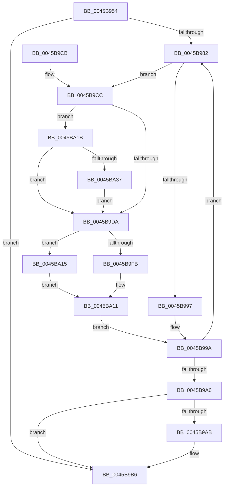

# MiProcessWsInSwapSupport

- RVA: `0x0045B954`–`0x0045BA46` (길이 `242` bytes)
- VA: `0x000000014045B954`
- 실행 섹션: `.text`
- PDB 이름 있음: `예`; PDB Function 태그: `아니요`
- unwind 정보 RVA: `0x000A9430`
- 디코드: `72`개 명령, `242/242` bytes 표시
- 미해석 바이트: `0` (있으면 어셈블리에 `.byte`로 보존)

> 이 문서는 커널 이미지의 기계어와 PDB 기호를 분석해 생성했습니다. 4번과 5번은 함수 원형과 자료형을 바이너리 사용 방식에서 추정한 C 해석이며 원본 소스 복구 결과는 아닙니다.

## 1. Dependencies

- 직접 호출 지점: **2**; 고유 호출 대상: **1**
- 직접 호출자로 확인된 함수: **3**
- RIP 상대 이미지 참조: **0**

### Outgoing calls
- `0x0045B9B1` → [MiProcessWsInSwapRanges](MiProcessWsInSwapRanges_function_0045BA4C.md) (function, `0x0045BA4C`)
- `0x0045B9F1` → [MiProcessWsInSwapRanges](MiProcessWsInSwapRanges_function_0045BA4C.md) (function, `0x0045BA4C`)

### Direct callers
- [MmInSwapWorkingSet](MmInSwapWorkingSet_function_0045B6C4.md) at `0x0045B7B1`
- [MmInSwapWorkingSet](MmInSwapWorkingSet_function_0045B6C4.md) at `0x0045B7CD`
- [MiInSwapSharedWorkingSetWorker](../../page/80/MiInSwapSharedWorkingSetWorker_function_0080C510.md) at `0x0080C592`
- [MmInSwapVirtualAddresses](../../page/A1/MmInSwapVirtualAddresses_function_00A17CCC.md) at `0x00A17D2B`

### Static image references
- 디코드된 RIP-relative 메모리 참조가 없습니다.

## 2. Other-region calls and transfers

- 다른 실행 섹션으로 향하는 call: **0**
- 별도 외부 분기/꼬리 이동을 확인하지 못했습니다.

## 3. Assembly (complete function range)

```asm
0045B954  48 89 5C 24 08                  mov qword ptr [rsp + 8], rbx
0045B959  48 89 6C 24 10                  mov qword ptr [rsp + 0x10], rbp
0045B95E  48 89 74 24 18                  mov qword ptr [rsp + 0x18], rsi
0045B963  57                              push rdi
0045B964  48 83 EC 20                     sub rsp, 0x20
0045B968  48 8B 39                        mov rdi, qword ptr [rcx]
0045B96B  33 C0                           xor eax, eax
0045B96D  48 8B 69 10                     mov rbp, qword ptr [rcx + 0x10]
0045B971  8B DA                           mov ebx, edx
0045B973  48 C1 E5 04                     shl rbp, 4
0045B977  4C 8B CF                        mov r9, rdi
0045B97A  48 03 EF                        add rbp, rdi
0045B97D  48 3B FD                        cmp rdi, rbp
0045B980  73 34                           jae 0x14045b9b6
0045B982  48 8B 77 08                     mov rsi, qword ptr [rdi + 8]
0045B986  48 C1 EE 0C                     shr rsi, 0xc
0045B98A  48 8D 0C 06                     lea rcx, [rsi + rax]
0045B98E  48 81 F9 00 10 00 00            cmp rcx, 0x1000
0045B995  73 35                           jae 0x14045b9cc
0045B997  48 8B C1                        mov rax, rcx
0045B99A  48 8B D7                        mov rdx, rdi
0045B99D  48 83 C7 10                     add rdi, 0x10
0045B9A1  48 3B FD                        cmp rdi, rbp
0045B9A4  72 DC                           jb 0x14045b982
0045B9A6  48 85 C0                        test rax, rax
0045B9A9  74 0B                           je 0x14045b9b6
0045B9AB  44 8B C3                        mov r8d, ebx
0045B9AE  49 8B C9                        mov rcx, r9
0045B9B1  E8 96 00 00 00                  call 0x14045ba4c
0045B9B6  48 8B 5C 24 30                  mov rbx, qword ptr [rsp + 0x30]
0045B9BB  48 8B 6C 24 38                  mov rbp, qword ptr [rsp + 0x38]
0045B9C0  48 8B 74 24 40                  mov rsi, qword ptr [rsp + 0x40]
0045B9C5  48 83 C4 20                     add rsp, 0x20
0045B9C9  5F                              pop rdi
0045B9CA  C3                              ret
0045B9CB  CC                              int3
0045B9CC  41 B8 00 10 00 00               mov r8d, 0x1000
0045B9D2  4C 2B C0                        sub r8, rax
0045B9D5  F6 C3 04                        test bl, 4
0045B9D8  75 41                           jne 0x14045ba1b
0045B9DA  49 8B C0                        mov rax, r8
0045B9DD  49 2B F0                        sub rsi, r8
0045B9E0  48 C1 E0 0C                     shl rax, 0xc
0045B9E4  44 8B C3                        mov r8d, ebx
0045B9E7  48 8B D7                        mov rdx, rdi
0045B9EA  48 89 47 08                     mov qword ptr [rdi + 8], rax
0045B9EE  49 8B C9                        mov rcx, r9
0045B9F1  E8 56 00 00 00                  call 0x14045ba4c
0045B9F6  48 85 F6                        test rsi, rsi
0045B9F9  74 1A                           je 0x14045ba15
0045B9FB  48 8B 47 08                     mov rax, qword ptr [rdi + 8]
0045B9FF  4C 8B CF                        mov r9, rdi
0045BA02  48 01 07                        add qword ptr [rdi], rax
0045BA05  48 C1 E6 0C                     shl rsi, 0xc
0045BA09  48 89 77 08                     mov qword ptr [rdi + 8], rsi
0045BA0D  48 83 EF 10                     sub rdi, 0x10
0045BA11  33 C0                           xor eax, eax
0045BA13  EB 85                           jmp 0x14045b99a
0045BA15  4C 8D 4F 10                     lea r9, [rdi + 0x10]
0045BA19  EB F6                           jmp 0x14045ba11
0045BA1B  48 8B 0F                        mov rcx, qword ptr [rdi]
0045BA1E  49 8B D0                        mov rdx, r8
0045BA21  48 C1 E2 0C                     shl rdx, 0xc
0045BA25  48 03 D1                        add rdx, rcx
0045BA28  48 8D 42 FF                     lea rax, [rdx - 1]
0045BA2C  48 33 C1                        xor rax, rcx
0045BA2F  48 A9 00 00 E0 FF               test rax, -0x200000
0045BA35  74 A3                           je 0x14045b9da
0045BA37  48 C1 EA 0C                     shr rdx, 0xc
0045BA3B  81 E2 FF 01 00 00               and edx, 0x1ff
0045BA41  4C 2B C2                        sub r8, rdx
0045BA44  EB 94                           jmp 0x14045b9da
```

## 4. C-style interpretation (structured pseudocode)

```c
__int64 __fastcall MiProcessWsInSwapSupport(__int64 a1, int a2)
{
    __int64 result;
    __int64 v_rbp;
    __int64 v_rdi;
    __int64 v_rsi;
    __int64 v_rsp;
    unsigned __int64 v_stack_p10;
    unsigned __int64 v_stack_p18;
    unsigned __int64 v_stack_p8;

    v_stack_p8 = v_rbx;
    v_stack_p10 = v_rbp;
    v_stack_p18 = v_rsi;
    v_rsp = (v_rsp) - (32);
    result = 0;
    v_rbp = (*(unsigned __int64 *)(a1 + 16)) << (4);
    v_rbp = (v_rbp) + (*(unsigned __int64 *)(a1));
    if ((*(unsigned __int64 *)(a1)) >= v_rbp) goto loc_0045B9B6;
loc_0045B982:
    v_rsi = (*(unsigned __int64 *)(*(unsigned __int64 *)(a1) + 8)) >> (12);
    if ((v_rsi + result * 1) >= 0x1000ULL) goto loc_0045B9CC;
loc_0045B99A:
    v_rdi = (*(unsigned __int64 *)(a1)) + (16);
    if (v_rdi < v_rbp) goto loc_0045B982;
    result = v_rsi + result * 1;
    if (v_rsi + result * 1 != 0) {
        a3 = (unsigned int)((unsigned int)(a2));
        a1 = *(unsigned __int64 *)(a1);
        result = MiProcessWsInSwapRanges(a1, *(unsigned __int64 *)(a1), a3, *(unsigned __int64 *)(a1));
    }
    v_rsp = (v_rsp) + (32);
    return result;
loc_0045B9CC:
    a3 = ((unsigned int)(0x1000ULL)) - (result);
    if ((((unsigned __int8)(v_stack_p8)) & (4)) != 0) goto loc_0045BA1B;
loc_0045B9DA:
    v_rsi = (v_stack_p18) - (a3);
    result = (a3) << (12);
    *(unsigned __int64 *)(v_rdi + 8) = result;
    result = MiProcessWsInSwapRanges(*(unsigned __int64 *)(a1), v_rdi, (unsigned int)((unsigned int)(v_stack_p8)), *(unsigned __int64 *)(a1));
    if (v_rsi == 0) goto loc_0045BA15;
    v_rsi = (v_rsi) << (12);
    *(unsigned __int64 *)(v_rdi + 8) = v_rsi;
    v_rdi = (v_rdi) - (16);
loc_0045BA11:
    result = 0;
    goto loc_0045B99A;
loc_0045BA15:
    goto loc_0045BA11;
loc_0045BA1B:
    a2 = ((unsigned int)((unsigned int)(v_stack_p8))) << (12);
    a2 = (a2) + (*(unsigned __int64 *)(v_rdi));
    result = (a2 - 1) ^ (*(unsigned __int64 *)(v_rdi));
    if (((result) & (0xFFFFFFFFFFE00000ULL)) == 0) goto loc_0045B9DA;
    a2 = (a2) >> (12);
    a2 = (unsigned int)((a2) & (511));
    a3 = ((unsigned int)((unsigned int)(v_stack_p8))) - (a2);
    goto loc_0045B9DA;
}
```

## 5. (Beta) C Style

```c
int64_t MiProcessWsInSwapSupport(void *Arg1, int32_t Arg2)
{
    uint8_t *arg1 = (uint8_t *)Arg1;

    int64_t result;
    int64_t local_rbp;
    int64_t local_rdi;
    int64_t local_rsi;
    int64_t local_rsp;
    uint64_t v_stack_p10;
    uint64_t v_stack_p18;
    uint64_t v_stack_p8;

    v_stack_p8 = local_rbx;
    v_stack_p10 = local_rbp;
    v_stack_p18 = local_rsi;
    local_rsp = (local_rsp) - (32);
    result = 0;
    local_rbp = (*(uint64_t *)(arg1 + 0x10)) << (4);
    local_rbp = (local_rbp) + (*(uint64_t *)(arg1));
    if ((*(uint64_t *)(arg1)) >= local_rbp) goto loc_0045B9B6;
loc_0045B982:
    local_rsi = (*(uint64_t *)(*(uint64_t *)(arg1) + 0x8)) >> (12);
    if ((local_rsi + result * 1) >= 0x1000ULL) goto loc_0045B9CC;
loc_0045B99A:
    local_rdi = (*(uint64_t *)(arg1)) + (16);
    if (local_rdi < local_rbp) goto loc_0045B982;
    result = local_rsi + result * 1;
    if (local_rsi + result * 1 != 0) {
        a3 = (uint32_t)((uint32_t)(Arg2));
        Arg1 = *(uint64_t *)(arg1);
        result = MiProcessWsInSwapRanges(Arg1, *(uint64_t *)(arg1), a3, *(uint64_t *)(arg1));
    }
    local_rsp = (local_rsp) + (32);
    return result;
loc_0045B9CC:
    a3 = ((uint32_t)(0x1000ULL)) - (result);
    if ((((uint8_t)(v_stack_p8)) & (4)) != 0) goto loc_0045BA1B;
loc_0045B9DA:
    local_rsi = (v_stack_p18) - (a3);
    result = (a3) << (12);
    *(uint64_t *)(local_rdi + 0x8) = result;
    result = MiProcessWsInSwapRanges(*(uint64_t *)(arg1), local_rdi, (uint32_t)((uint32_t)(v_stack_p8)), *(uint64_t *)(arg1));
    if (local_rsi == 0) goto loc_0045BA15;
    local_rsi = (local_rsi) << (12);
    *(uint64_t *)(local_rdi + 0x8) = local_rsi;
    local_rdi = (local_rdi) - (16);
loc_0045BA11:
    result = 0;
    goto loc_0045B99A;
loc_0045BA15:
    goto loc_0045BA11;
loc_0045BA1B:
    Arg2 = ((uint32_t)((uint32_t)(v_stack_p8))) << (12);
    Arg2 = (Arg2) + (*(uint64_t *)(local_rdi));
    result = (Arg2 - 1) ^ (*(uint64_t *)(local_rdi));
    if (((result) & (0xFFFFFFFFFFE00000ULL)) == 0) goto loc_0045B9DA;
    Arg2 = (Arg2) >> (12);
    Arg2 = (uint32_t)((Arg2) & (511));
    a3 = ((uint32_t)((uint32_t)(v_stack_p8))) - (Arg2);
    goto loc_0045B9DA;
}
```

### 관측된 메모리 오프셋

구조체 형식이 확인되지 않은 접근은 인자 기준의 오프셋으로만 기록했습니다.

| 기준 인자 | 오프셋 표현 | 폭 (bit) | 접근 |
|---|---:|---:|---|
| `Arg1` | `+ 0x0` | `64` | `R` |
| `Arg1` | `+ 0x10` | `64` | `R` |

## 6. Execution-region graph

[열기: 2D/3D 그래프와 함수 탐색 컨트롤 패널](../../../control-panel.html?section=text&rva=0x0045B954&view=graph)

- 2D 그래프는 위에서 아래로 흐르고, 3D 그래프는 빈 공간을 드래그해 회전합니다. Shift+드래그는 이동, 휠은 확대·축소, 함수 노드 선택은 대상 보고서 이동입니다.

### Static fallback


