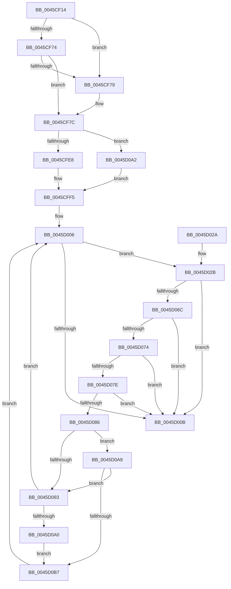

# MiQueryAddressSpan

- RVA: `0x0045CF14`–`0x0045D0CF` (길이 `443` bytes)
- VA: `0x000000014045CF14`
- 실행 섹션: `.text`
- PDB 이름 있음: `예`; PDB Function 태그: `아니요`
- unwind 정보 RVA: `0x000A9588`
- 디코드: `129`개 명령, `443/443` bytes 표시
- 미해석 바이트: `0` (있으면 어셈블리에 `.byte`로 보존)

> 이 문서는 커널 이미지의 기계어와 PDB 기호를 분석해 생성했습니다. 4번과 5번은 함수 원형과 자료형을 바이너리 사용 방식에서 추정한 C 해석이며 원본 소스 복구 결과는 아닙니다.

## 1. Dependencies

- 직접 호출 지점: **8**; 고유 호출 대상: **5**
- 직접 호출자로 확인된 함수: **1**
- RIP 상대 이미지 참조: **1**

### Outgoing calls
- `0x0045CF96` → [MiLockWorkingSetShared](../27/MiLockWorkingSetShared_function_0027CBF0.md) (function, `0x0027CBF0`)
- `0x0045CFD4` → [MiQueryAddressState](../32/MiQueryAddressState_function_0032C380.md) (function, `0x0032C380`)
- `0x0045D011` → [MiUnlockWorkingSetShared](../27/MiUnlockWorkingSetShared_function_0027D690.md) (function, `0x0027D690`)
- `0x0045D061` → [MiQueryAddressState](../32/MiQueryAddressState_function_0032C380.md) (function, `0x0032C380`)
- `0x0045D093` → [KeShouldYieldProcessor](../27/KeShouldYieldProcessor_function_002773E0.md) (function, `0x002773E0`)
- `0x0045D0AE` → [MiWorkingSetIsContended](../2A/MiWorkingSetIsContended_function_002AE520.md) (function, `0x002AE520`)
- `0x0045D0BD` → [MiUnlockWorkingSetShared](../27/MiUnlockWorkingSetShared_function_0027D690.md) (function, `0x0027D690`)
- `0x0045D0C5` → [MiLockWorkingSetShared](../27/MiLockWorkingSetShared_function_0027CBF0.md) (function, `0x0027CBF0`)

### Direct callers
- [MmQueryVirtualMemory](../../page/9D/MmQueryVirtualMemory_function_009D9280.md) at `0x009D9DD0`

### Static image references
- `0x0045CFEB` → RVA `0x00014630` (`.rdata`; read)

## 2. Other-region calls and transfers

- 다른 실행 섹션으로 향하는 call: **0**
- 별도 외부 분기/꼬리 이동을 확인하지 못했습니다.

## 3. Assembly (complete function range)

```asm
0045CF14  40 55                           push rbp
0045CF16  53                              push rbx
0045CF17  56                              push rsi
0045CF18  57                              push rdi
0045CF19  41 54                           push r12
0045CF1B  41 55                           push r13
0045CF1D  41 56                           push r14
0045CF1F  41 57                           push r15
0045CF21  48 8B EC                        mov rbp, rsp
0045CF24  48 83 EC 68                     sub rsp, 0x68
0045CF28  41 8B 41 1C                     mov eax, dword ptr [r9 + 0x1c]
0045CF2C  48 8B DA                        mov rbx, rdx
0045CF2F  41 0F B6 51 21                  movzx edx, byte ptr [r9 + 0x21]
0045CF34  4C 8B F1                        mov r14, rcx
0045CF37  33 C9                           xor ecx, ecx
0045CF39  48 C1 E2 20                     shl rdx, 0x20
0045CF3D  48 0B D0                        or rdx, rax
0045CF40  89 4D 58                        mov dword ptr [rbp + 0x58], ecx
0045CF43  48 C1 E2 0C                     shl rdx, 0xc
0045CF47  4D 8B E9                        mov r13, r9
0045CF4A  48 81 CA FF 0F 00 00            or rdx, 0xfff
0045CF51  89 4D E8                        mov dword ptr [rbp - 0x18], ecx
0045CF54  48 FF C2                        inc rdx
0045CF57  48 89 4D F0                     mov qword ptr [rbp - 0x10], rcx
0045CF5B  89 4D 60                        mov dword ptr [rbp + 0x60], ecx
0045CF5E  49 8B F8                        mov rdi, r8
0045CF61  89 4D EC                        mov dword ptr [rbp - 0x14], ecx
0045CF64  44 8B F9                        mov r15d, ecx
0045CF67  66 89 4D 48                     mov word ptr [rbp + 0x48], cx
0045CF6B  66 89 4D 50                     mov word ptr [rbp + 0x50], cx
0045CF6F  4C 3B C2                        cmp r8, rdx
0045CF72  77 05                           ja 0x14045cf79
0045CF74  4D 85 C0                        test r8, r8
0045CF77  75 03                           jne 0x14045cf7c
0045CF79  48 8B FA                        mov rdi, rdx
0045CF7C  65 48 8B 04 25 88 01 00 00      mov rax, qword ptr gs:[0x188]
0045CF85  48 8B B0 B8 00 00 00            mov rsi, qword ptr [rax + 0xb8]
0045CF8C  48 81 C6 00 04 00 00            add rsi, 0x400
0045CF93  48 8B CE                        mov rcx, rsi
0045CF96  E8 55 FC E1 FF                  call 0x14027cbf0
0045CF9B  44 8A E0                        mov r12b, al
0045CF9E  48 8D 57 FF                     lea rdx, [rdi - 1]
0045CFA2  48 8D 45 F0                     lea rax, [rbp - 0x10]
0045CFA6  4D 8B CD                        mov r9, r13
0045CFA9  48 89 44 24 40                  mov qword ptr [rsp + 0x40], rax
0045CFAE  45 8A C4                        mov r8b, r12b
0045CFB1  48 8D 45 48                     lea rax, [rbp + 0x48]
0045CFB5  48 8B CB                        mov rcx, rbx
0045CFB8  48 89 44 24 38                  mov qword ptr [rsp + 0x38], rax
0045CFBD  48 8D 45 60                     lea rax, [rbp + 0x60]
0045CFC1  48 89 44 24 30                  mov qword ptr [rsp + 0x30], rax
0045CFC6  48 8D 45 58                     lea rax, [rbp + 0x58]
0045CFCA  48 89 44 24 28                  mov qword ptr [rsp + 0x28], rax
0045CFCF  4C 21 7C 24 20                  and qword ptr [rsp + 0x20], r15
0045CFD4  E8 A7 F3 EC FF                  call 0x14032c380
0045CFD9  41 89 46 20                     mov dword ptr [r14 + 0x20], eax
0045CFDD  8B 45 58                        mov eax, dword ptr [rbp + 0x58]
0045CFE0  85 C0                           test eax, eax
0045CFE2  0F 84 BA 00 00 00               je 0x14045d0a2
0045CFE8  8B 4D 60                        mov ecx, dword ptr [rbp + 0x60]
0045CFEB  48 8D 15 3E 76 BB FF            lea rdx, [rip - 0x4489c2]
0045CFF2  0B 0C 82                        or ecx, dword ptr [rdx + rax*4]
0045CFF5  41 89 4E 24                     mov dword ptr [r14 + 0x24], ecx
0045CFF9  0F B7 45 48                     movzx eax, word ptr [rbp + 0x48]
0045CFFD  48 8B 5D F0                     mov rbx, qword ptr [rbp - 0x10]
0045D001  66 41 89 46 14                  mov word ptr [r14 + 0x14], ax
0045D006  48 3B DF                        cmp rbx, rdi
0045D009  72 20                           jb 0x14045d02b
0045D00B  41 8A D4                        mov dl, r12b
0045D00E  48 8B CE                        mov rcx, rsi
0045D011  E8 7A 06 E2 FF                  call 0x14027d690
0045D016  48 8B C3                        mov rax, rbx
0045D019  48 83 C4 68                     add rsp, 0x68
0045D01D  41 5F                           pop r15
0045D01F  41 5E                           pop r14
0045D021  41 5D                           pop r13
0045D023  41 5C                           pop r12
0045D025  5F                              pop rdi
0045D026  5E                              pop rsi
0045D027  5B                              pop rbx
0045D028  5D                              pop rbp
0045D029  C3                              ret
0045D02A  CC                              int3
0045D02B  48 8D 45 F0                     lea rax, [rbp - 0x10]
0045D02F  4D 8B CD                        mov r9, r13
0045D032  48 89 44 24 40                  mov qword ptr [rsp + 0x40], rax
0045D037  48 8D 57 FF                     lea rdx, [rdi - 1]
0045D03B  48 8D 45 50                     lea rax, [rbp + 0x50]
0045D03F  45 8A C4                        mov r8b, r12b
0045D042  48 89 44 24 38                  mov qword ptr [rsp + 0x38], rax
0045D047  48 8B CB                        mov rcx, rbx
0045D04A  48 8D 45 EC                     lea rax, [rbp - 0x14]
0045D04E  48 89 44 24 30                  mov qword ptr [rsp + 0x30], rax
0045D053  48 8D 45 E8                     lea rax, [rbp - 0x18]
0045D057  48 89 44 24 28                  mov qword ptr [rsp + 0x28], rax
0045D05C  4C 89 74 24 20                  mov qword ptr [rsp + 0x20], r14
0045D061  E8 1A F3 EC FF                  call 0x14032c380
0045D066  41 3B 46 20                     cmp eax, dword ptr [r14 + 0x20]
0045D06A  75 9F                           jne 0x14045d00b
0045D06C  8B 45 58                        mov eax, dword ptr [rbp + 0x58]
0045D06F  39 45 E8                        cmp dword ptr [rbp - 0x18], eax
0045D072  75 97                           jne 0x14045d00b
0045D074  0F B7 45 48                     movzx eax, word ptr [rbp + 0x48]
0045D078  66 39 45 50                     cmp word ptr [rbp + 0x50], ax
0045D07C  75 8D                           jne 0x14045d00b
0045D07E  8B 45 60                        mov eax, dword ptr [rbp + 0x60]
0045D081  39 45 EC                        cmp dword ptr [rbp - 0x14], eax
0045D084  75 85                           jne 0x14045d00b
0045D086  48 8B 5D F0                     mov rbx, qword ptr [rbp - 0x10]
0045D08A  41 FF C7                        inc r15d
0045D08D  41 F6 C7 1F                     test r15b, 0x1f
0045D091  74 16                           je 0x14045d0a9
0045D093  E8 48 A3 E1 FF                  call 0x1402773e0
0045D098  85 C0                           test eax, eax
0045D09A  0F 84 66 FF FF FF               je 0x14045d006
0045D0A0  EB 15                           jmp 0x14045d0b7
0045D0A2  33 C9                           xor ecx, ecx
0045D0A4  E9 4C FF FF FF                  jmp 0x14045cff5
0045D0A9  33 D2                           xor edx, edx
0045D0AB  48 8B CE                        mov rcx, rsi
0045D0AE  E8 6D 14 E5 FF                  call 0x1402ae520
0045D0B3  85 C0                           test eax, eax
0045D0B5  74 DC                           je 0x14045d093
0045D0B7  41 8A D4                        mov dl, r12b
0045D0BA  48 8B CE                        mov rcx, rsi
0045D0BD  E8 CE 05 E2 FF                  call 0x14027d690
0045D0C2  48 8B CE                        mov rcx, rsi
0045D0C5  E8 26 FB E1 FF                  call 0x14027cbf0
0045D0CA  E9 37 FF FF FF                  jmp 0x14045d006
```

## 4. C-style interpretation (structured pseudocode)

```c
__int64 __fastcall MiQueryAddressSpan(__int64 a1, __int64 a2, __int64 a3, __int64 a4)
{
    __int64 result;
    __int64 v_r15;
    __int64 v_rdi;
    __int64 v_rsi;
    __int64 v_rsp;
    unsigned __int64 v_stack_m50;
    unsigned int v_stack_m54;
    unsigned int v_stack_m58;
    unsigned __int64 v_stack_m68;
    unsigned __int64 v_stack_m70;
    unsigned __int64 v_stack_m78;
    unsigned __int64 v_stack_m80;
    unsigned __int64 v_stack_m88;
    unsigned __int16 v_stack_p10;
    unsigned int v_stack_p18;
    unsigned int v_stack_p20;
    unsigned __int64 v_stack_p28;
    unsigned __int64 v_stack_p30;
    unsigned __int64 v_stack_p38;
    unsigned __int64 v_stack_p40;
    unsigned __int16 v_stack_p8;

    v_rsp = (v_rsp) - (104);
    a1 = 0;
    a2 = (*(unsigned __int8 *)(a4 + 33)) << (32);
    a2 = (a2) | ((unsigned int)(*(unsigned int *)(a4 + 28)));
    v_stack_p18 = 0;
    a2 = (a2) << (12);
    a2 = (a2) | (0xFFFULL);
    v_stack_m58 = 0;
    a2 = (a2) + 1;
    v_stack_m50 = 0;
    v_stack_p20 = 0;
    v_stack_m54 = 0;
    v_stack_p8 = 0;
    v_stack_p10 = 0;
    if (a3 > a2) goto loc_0045CF79;
    v_rdi = a3;
    if (a3 == 0) {
        v_rdi = a2;
    }
    v_rsi = (*(unsigned __int64 *)(*(unsigned __int64 *)(gs_base + (0 + 392)) + 184)) + (0x400ULL);
    result = MiLockWorkingSetShared(v_rsi, a2, a3, a4);
    v_stack_m68 = v_stack_m50;
    v_stack_m70 = v_stack_p8;
    v_stack_m78 = v_stack_p20;
    v_stack_m80 = v_stack_p18;
    result = MiQueryAddressState(a2, v_rdi - 1, (unsigned __int8)((unsigned __int8)(result)), a4);
    *(unsigned int *)(a1 + 32) = (unsigned int)(result);
    if ((unsigned int)((unsigned int)(v_stack_p18)) == 0) goto loc_0045D0A2;
    a1 = (unsigned int)(((unsigned int)(v_stack_p20)) | (*(unsigned int *)(v_rip - 4491714 + (unsigned int)(v_stack_p18) * 4)));
loc_0045CFF5:
    *(unsigned int *)(a1 + 36) = (unsigned int)(a1);
    *(unsigned __int16 *)(a1 + 20) = (unsigned __int16)(v_stack_p8);
loc_0045D006:
    if (v_stack_m50 < v_rdi) goto loc_0045D02B;
loc_0045D00B:
    result = MiUnlockWorkingSetShared(v_rsi, (unsigned __int8)((unsigned __int8)(result)), (unsigned __int8)((unsigned __int8)(result)), a4);
    v_rsp = (v_rsp) + (104);
    return v_stack_m50;
loc_0045D02B:
    v_stack_p40 = v_stack_m50;
    v_stack_p38 = v_stack_p10;
    v_stack_p30 = v_stack_m54;
    v_stack_p28 = v_stack_m58;
    v_stack_p20 = a1;
    result = MiQueryAddressState(v_stack_m50, v_rdi - 1, (unsigned __int8)((unsigned __int8)(result)), a4);
    if (((unsigned int)(result)) != (*(unsigned int *)(a1 + 32))) goto loc_0045D00B;
    if (v_stack_m58 != ((unsigned int)((unsigned int)(v_stack_p18)))) goto loc_0045D00B;
    if (v_stack_p10 != ((unsigned __int16)(v_stack_p8))) goto loc_0045D00B;
    if (v_stack_m54 != ((unsigned int)((unsigned int)(v_stack_p20)))) goto loc_0045D00B;
    v_r15 = (unsigned int)((0) + 1);
    if ((((unsigned __int8)(v_r15)) & (31)) == 0) goto loc_0045D0A9;
loc_0045D093:
    result = KeShouldYieldProcessor(v_stack_m50, v_rdi - 1, (unsigned __int8)((unsigned __int8)(result)), a4);
    if ((unsigned int)(result) == 0) goto loc_0045D006;
    goto loc_0045D0B7;
loc_0045D0A2:
    a1 = 0;
    goto loc_0045CFF5;
loc_0045D0A9:
    a2 = 0;
    result = MiWorkingSetIsContended(v_rsi, a2, (unsigned __int8)((unsigned __int8)(result)), a4);
    if ((unsigned int)(result) == 0) goto loc_0045D093;
loc_0045D0B7:
    result = MiUnlockWorkingSetShared(v_rsi, (unsigned __int8)((unsigned __int8)(result)), (unsigned __int8)((unsigned __int8)(result)), a4);
    result = MiLockWorkingSetShared(v_rsi, (unsigned __int8)((unsigned __int8)(result)), (unsigned __int8)((unsigned __int8)(result)), a4);
    goto loc_0045D006;
}
```

## 5. (Beta) C Style

```c
int64_t MiQueryAddressSpan(void *Arg1, int64_t Arg2, int64_t Arg3, void *Arg4)
{
    uint8_t *arg1 = (uint8_t *)Arg1;
    uint8_t *arg4 = (uint8_t *)Arg4;

    int64_t result;
    int64_t local_r15;
    int64_t local_rdi;
    int64_t local_rsi;
    int64_t local_rsp;
    uint64_t v_stack_m50;
    uint32_t v_stack_m54;
    uint32_t v_stack_m58;
    uint64_t v_stack_m68;
    uint64_t v_stack_m70;
    uint64_t v_stack_m78;
    uint64_t v_stack_m80;
    uint64_t v_stack_m88;
    uint16_t v_stack_p10;
    uint32_t v_stack_p18;
    uint32_t v_stack_p20;
    uint64_t v_stack_p28;
    uint64_t v_stack_p30;
    uint64_t v_stack_p38;
    uint64_t v_stack_p40;
    uint16_t v_stack_p8;

    local_rsp = (local_rsp) - (104);
    Arg1 = 0;
    Arg2 = (*(uint8_t *)(arg4 + 0x21)) << (32);
    Arg2 = (Arg2) | ((uint32_t)(*(uint32_t *)(arg4 + 0x1C)));
    v_stack_p18 = 0;
    Arg2 = (Arg2) << (12);
    Arg2 = (Arg2) | (0xFFFULL);
    v_stack_m58 = 0;
    Arg2 = (Arg2) + 1;
    v_stack_m50 = 0;
    v_stack_p20 = 0;
    v_stack_m54 = 0;
    v_stack_p8 = 0;
    v_stack_p10 = 0;
    if (Arg3 > Arg2) goto loc_0045CF79;
    local_rdi = Arg3;
    if (Arg3 == 0) {
        local_rdi = Arg2;
    }
    local_rsi = (*(uint64_t *)(*(uint64_t *)(gs_base + (0 + 0x188)) + 0xB8)) + (0x400ULL);
    result = MiLockWorkingSetShared(local_rsi, Arg2, Arg3, Arg4);
    v_stack_m68 = v_stack_m50;
    v_stack_m70 = v_stack_p8;
    v_stack_m78 = v_stack_p20;
    v_stack_m80 = v_stack_p18;
    result = MiQueryAddressState(Arg2, local_rdi - 1, (uint8_t)((uint8_t)(result)), Arg4);
    *(uint32_t *)(arg1 + 0x20) = (uint32_t)(result);
    if ((uint32_t)((uint32_t)(v_stack_p18)) == 0) goto loc_0045D0A2;
    Arg1 = (uint32_t)(((uint32_t)(v_stack_p20)) | (*(uint32_t *)(v_rip - 0x4489C2 + (uint32_t)(v_stack_p18) * 4)));
loc_0045CFF5:
    *(uint32_t *)(arg1 + 0x24) = (uint32_t)(Arg1);
    *(uint16_t *)(arg1 + 0x14) = (uint16_t)(v_stack_p8);
loc_0045D006:
    if (v_stack_m50 < local_rdi) goto loc_0045D02B;
loc_0045D00B:
    result = MiUnlockWorkingSetShared(local_rsi, (uint8_t)((uint8_t)(result)), (uint8_t)((uint8_t)(result)), Arg4);
    local_rsp = (local_rsp) + (104);
    return v_stack_m50;
loc_0045D02B:
    v_stack_p40 = v_stack_m50;
    v_stack_p38 = v_stack_p10;
    v_stack_p30 = v_stack_m54;
    v_stack_p28 = v_stack_m58;
    v_stack_p20 = Arg1;
    result = MiQueryAddressState(v_stack_m50, local_rdi - 1, (uint8_t)((uint8_t)(result)), Arg4);
    if (((uint32_t)(result)) != (*(uint32_t *)(arg1 + 0x20))) goto loc_0045D00B;
    if (v_stack_m58 != ((uint32_t)((uint32_t)(v_stack_p18)))) goto loc_0045D00B;
    if (v_stack_p10 != ((uint16_t)(v_stack_p8))) goto loc_0045D00B;
    if (v_stack_m54 != ((uint32_t)((uint32_t)(v_stack_p20)))) goto loc_0045D00B;
    local_r15 = (uint32_t)((0) + 1);
    if ((((uint8_t)(local_r15)) & (31)) == 0) goto loc_0045D0A9;
loc_0045D093:
    result = KeShouldYieldProcessor(v_stack_m50, local_rdi - 1, (uint8_t)((uint8_t)(result)), Arg4);
    if ((uint32_t)(result) == 0) goto loc_0045D006;
    goto loc_0045D0B7;
loc_0045D0A2:
    Arg1 = 0;
    goto loc_0045CFF5;
loc_0045D0A9:
    Arg2 = 0;
    result = MiWorkingSetIsContended(local_rsi, Arg2, (uint8_t)((uint8_t)(result)), Arg4);
    if ((uint32_t)(result) == 0) goto loc_0045D093;
loc_0045D0B7:
    result = MiUnlockWorkingSetShared(local_rsi, (uint8_t)((uint8_t)(result)), (uint8_t)((uint8_t)(result)), Arg4);
    result = MiLockWorkingSetShared(local_rsi, (uint8_t)((uint8_t)(result)), (uint8_t)((uint8_t)(result)), Arg4);
    goto loc_0045D006;
}
```

### 관측된 메모리 오프셋

구조체 형식이 확인되지 않은 접근은 인자 기준의 오프셋으로만 기록했습니다.

| 기준 인자 | 오프셋 표현 | 폭 (bit) | 접근 |
|---|---:|---:|---|
| `Arg1` | `+ 0x14` | `16` | `W` |
| `Arg1` | `+ 0x20` | `32` | `R` |
| `Arg1` | `+ 0x20` | `32` | `W` |
| `Arg1` | `+ 0x24` | `32` | `W` |
| `Arg4` | `+ 0x1C` | `32` | `R` |
| `Arg4` | `+ 0x21` | `8` | `R` |

## 6. Execution-region graph

[열기: 2D/3D 그래프와 함수 탐색 컨트롤 패널](../../../control-panel.html?section=text&rva=0x0045CF14&view=graph)

- 2D 그래프는 위에서 아래로 흐르고, 3D 그래프는 빈 공간을 드래그해 회전합니다. Shift+드래그는 이동, 휠은 확대·축소, 함수 노드 선택은 대상 보고서 이동입니다.

### Static fallback


