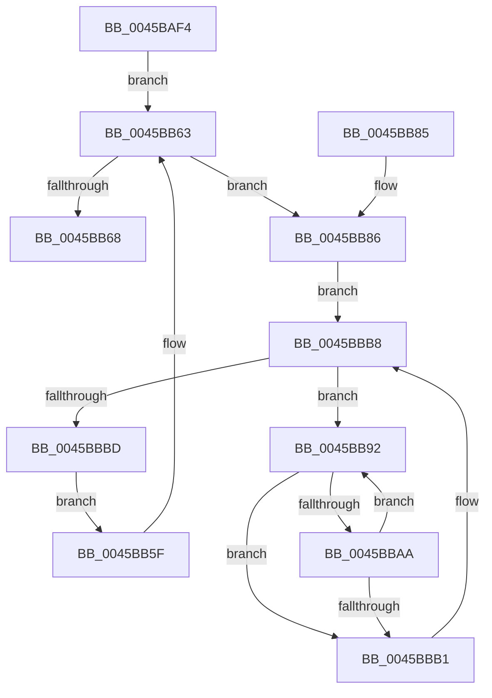

# MiReleaseOutSwapReservations

- RVA: `0x0045BAF4`–`0x0045BBBF` (길이 `203` bytes)
- VA: `0x000000014045BAF4`
- 실행 섹션: `.text`
- PDB 이름 있음: `예`; PDB Function 태그: `아니요`
- unwind 정보 RVA: `0x000A9448`
- 디코드: `57`개 명령, `203/203` bytes 표시
- 미해석 바이트: `0` (있으면 어셈블리에 `.byte`로 보존)

> 이 문서는 커널 이미지의 기계어와 PDB 기호를 분석해 생성했습니다. 4번과 5번은 함수 원형과 자료형을 바이너리 사용 방식에서 추정한 C 해석이며 원본 소스 복구 결과는 아닙니다.

## 1. Dependencies

- 직접 호출 지점: **2**; 고유 호출 대상: **2**
- 직접 호출자로 확인된 함수: **1**
- RIP 상대 이미지 참조: **0**

### Outgoing calls
- `0x0045BB23` → [memset](../6C/memset_function_006C6C40.md) (function, `0x006C6C40`)
- `0x0045BBA1` → [MmAccessFault](../27/MmAccessFault_function_0027EE80.md) (function, `0x0027EE80`)

### Direct callers
- [MiProcessWsInSwapRanges](MiProcessWsInSwapRanges_function_0045BA4C.md) at `0x0045BAD2`

### Static image references
- 디코드된 RIP-relative 메모리 참조가 없습니다.

## 2. Other-region calls and transfers

- 다른 실행 섹션으로 향하는 call: **0**
- 별도 외부 분기/꼬리 이동을 확인하지 못했습니다.

## 3. Assembly (complete function range)

```asm
0045BAF4  48 8B C4                        mov rax, rsp
0045BAF7  48 89 58 08                     mov qword ptr [rax + 8], rbx
0045BAFB  48 89 70 10                     mov qword ptr [rax + 0x10], rsi
0045BAFF  48 89 78 18                     mov qword ptr [rax + 0x18], rdi
0045BB03  55                              push rbp
0045BB04  41 56                           push r14
0045BB06  41 57                           push r15
0045BB08  48 8D 68 A1                     lea rbp, [rax - 0x5f]
0045BB0C  48 81 EC B0 00 00 00            sub rsp, 0xb0
0045BB13  4C 8B F2                        mov r14, rdx
0045BB16  48 8B F9                        mov rdi, rcx
0045BB19  33 D2                           xor edx, edx
0045BB1B  48 8D 4D C7                     lea rcx, [rbp - 0x39]
0045BB1F  44 8D 42 78                     lea r8d, [rdx + 0x78]
0045BB23  E8 18 B1 26 00                  call 0x1406c6c40
0045BB28  48 83 65 B7 00                  and qword ptr [rbp - 0x49], 0
0045BB2D  48 8D 45 B7                     lea rax, [rbp - 0x49]
0045BB31  48 83 65 DF 00                  and qword ptr [rbp - 0x21], 0
0045BB36  4C 8D 7D C7                     lea r15, [rbp - 0x39]
0045BB3A  48 83 65 E7 00                  and qword ptr [rbp - 0x19], 0
0045BB3F  48 89 45 CF                     mov qword ptr [rbp - 0x31], rax
0045BB43  49 83 CF 01                     or r15, 1
0045BB47  48 C7 45 BF 00 10 00 00         mov qword ptr [rbp - 0x41], 0x1000
0045BB4F  66 C7 45 C7 03 00               mov word ptr [rbp - 0x39], 3
0045BB55  48 C7 45 D7 01 00 00 00         mov qword ptr [rbp - 0x29], 1
0045BB5D  EB 04                           jmp 0x14045bb63
0045BB5F  48 83 C7 10                     add rdi, 0x10
0045BB63  49 3B FE                        cmp rdi, r14
0045BB66  76 1E                           jbe 0x14045bb86
0045BB68  4C 8D 9C 24 B0 00 00 00         lea r11, [rsp + 0xb0]
0045BB70  49 8B 5B 20                     mov rbx, qword ptr [r11 + 0x20]
0045BB74  49 8B 73 28                     mov rsi, qword ptr [r11 + 0x28]
0045BB78  49 8B 7B 30                     mov rdi, qword ptr [r11 + 0x30]
0045BB7C  49 8B E3                        mov rsp, r11
0045BB7F  41 5F                           pop r15
0045BB81  41 5E                           pop r14
0045BB83  5D                              pop rbp
0045BB84  C3                              ret
0045BB85  CC                              int3
0045BB86  48 8B 1F                        mov rbx, qword ptr [rdi]
0045BB89  48 8B 77 08                     mov rsi, qword ptr [rdi + 8]
0045BB8D  48 03 F3                        add rsi, rbx
0045BB90  EB 26                           jmp 0x14045bbb8
0045BB92  4D 8B CF                        mov r9, r15
0045BB95  48 89 5D B7                     mov qword ptr [rbp - 0x49], rbx
0045BB99  45 33 C0                        xor r8d, r8d
0045BB9C  48 8B D3                        mov rdx, rbx
0045BB9F  33 C9                           xor ecx, ecx
0045BBA1  E8 DA 32 E2 FF                  call 0x14027ee80
0045BBA6  85 C0                           test eax, eax
0045BBA8  78 07                           js 0x14045bbb1
0045BBAA  3D 69 03 00 00                  cmp eax, 0x369
0045BBAF  74 E1                           je 0x14045bb92
0045BBB1  48 81 C3 00 10 00 00            add rbx, 0x1000
0045BBB8  48 3B DE                        cmp rbx, rsi
0045BBBB  72 D5                           jb 0x14045bb92
0045BBBD  EB A0                           jmp 0x14045bb5f
```

## 4. C-style interpretation (structured pseudocode)

```c
__int64 __fastcall MiReleaseOutSwapReservations(__int64 a1, __int64 a2)
{
    __int64 result;
    __int64 v_r15;
    __int64 v_rbx;
    __int64 v_rdi;
    __int64 v_rsi;
    __int64 v_rsp;
    unsigned __int64 v_stack_m18;

    *(unsigned __int64 *)(v_rsp + 8) = v_rbx;
    *(unsigned __int64 *)(v_rsp + 16) = v_rsi;
    *(unsigned __int64 *)(v_rsp + 24) = v_rdi;
    v_rsp = (v_rsp) - (176);
    a2 = 0;
    result = memset(v_rsp - 95 - 57, a2, a2 + 120, a4);
    *(unsigned __int64 *)(v_rsp - 95 - 49) = v_rsp - 95 - 73;
    v_r15 = (v_rsp - 95 - 57) | (1);
    *(unsigned __int64 *)(v_rsp - 95 - 65) = 0x1000ULL;
    *(unsigned __int16 *)(v_rsp - 95 - 57) = 3;
    *(unsigned __int64 *)(v_rsp - 95 - 41) = 1;
    goto loc_0045BB63;
loc_0045BB5F:
    v_rdi = (a1) + (16);
loc_0045BB63:
    if (v_rdi <= 0) goto loc_0045BB86;
    return v_rsp - 95 - 73;
loc_0045BB86:
    v_rsi = (*(unsigned __int64 *)(*(unsigned __int64 *)(v_stack_m18 + 48) + 8)) + (*(unsigned __int64 *)(*(unsigned __int64 *)(v_stack_m18 + 48)));
    goto loc_0045BBB8;
loc_0045BB92:
    *(unsigned __int64 *)(v_rsp - 95 - 73) = *(unsigned __int64 *)(*(unsigned __int64 *)(v_stack_m18 + 48));
    a3 = 0;
    a1 = 0;
    result = MmAccessFault(a1, *(unsigned __int64 *)(*(unsigned __int64 *)(v_stack_m18 + 48)), a3, v_r15);
    if (sign_flag) goto loc_0045BBB1;
    if (((unsigned int)(result)) == 873) goto loc_0045BB92;
loc_0045BBB1:
    v_rbx = (*(unsigned __int64 *)(*(unsigned __int64 *)(v_stack_m18 + 48))) + (0x1000ULL);
loc_0045BBB8:
    if (v_rbx < v_rsi) goto loc_0045BB92;
    goto loc_0045BB5F;
}
```

## 5. (Beta) C Style

```c
int64_t MiReleaseOutSwapReservations(int64_t Arg1, int64_t Arg2)
{
    int64_t result;
    int64_t local_r15;
    int64_t local_rbx;
    int64_t local_rdi;
    int64_t local_rsi;
    int64_t local_rsp;
    uint64_t v_stack_m18;

    *(uint64_t *)(local_rsp + 0x8) = local_rbx;
    *(uint64_t *)(local_rsp + 0x10) = local_rsi;
    *(uint64_t *)(local_rsp + 0x18) = local_rdi;
    local_rsp = (local_rsp) - (176);
    Arg2 = 0;
    result = memset(local_rsp - 95 - 57, Arg2, Arg2 + 120, a4);
    *(uint64_t *)(local_rsp - 0x5F - 0x31) = local_rsp - 95 - 73;
    local_r15 = (local_rsp - 95 - 57) | (1);
    *(uint64_t *)(local_rsp - 0x5F - 0x41) = 0x1000ULL;
    *(uint16_t *)(local_rsp - 0x5F - 0x39) = 3;
    *(uint64_t *)(local_rsp - 0x5F - 0x29) = 1;
    goto loc_0045BB63;
loc_0045BB5F:
    local_rdi = (Arg1) + (16);
loc_0045BB63:
    if (local_rdi <= 0) goto loc_0045BB86;
    return local_rsp - 95 - 73;
loc_0045BB86:
    local_rsi = (*(uint64_t *)(*(uint64_t *)(v_stack_m18 + 0x30) + 0x8)) + (*(uint64_t *)(*(uint64_t *)(v_stack_m18 + 0x30)));
    goto loc_0045BBB8;
loc_0045BB92:
    *(uint64_t *)(local_rsp - 0x5F - 0x49) = *(uint64_t *)(*(uint64_t *)(v_stack_m18 + 0x30));
    a3 = 0;
    Arg1 = 0;
    result = MmAccessFault(Arg1, *(uint64_t *)(*(uint64_t *)(v_stack_m18 + 0x30)), a3, local_r15);
    if (sign_flag) goto loc_0045BBB1;
    if (((uint32_t)(result)) == 873) goto loc_0045BB92;
loc_0045BBB1:
    local_rbx = (*(uint64_t *)(*(uint64_t *)(v_stack_m18 + 0x30))) + (0x1000ULL);
loc_0045BBB8:
    if (local_rbx < local_rsi) goto loc_0045BB92;
    goto loc_0045BB5F;
}
```

## 6. Execution-region graph

[열기: 2D/3D 그래프와 함수 탐색 컨트롤 패널](../../../control-panel.html?section=text&rva=0x0045BAF4&view=graph)

- 2D 그래프는 위에서 아래로 흐르고, 3D 그래프는 빈 공간을 드래그해 회전합니다. Shift+드래그는 이동, 휠은 확대·축소, 함수 노드 선택은 대상 보고서 이동입니다.

### Static fallback


