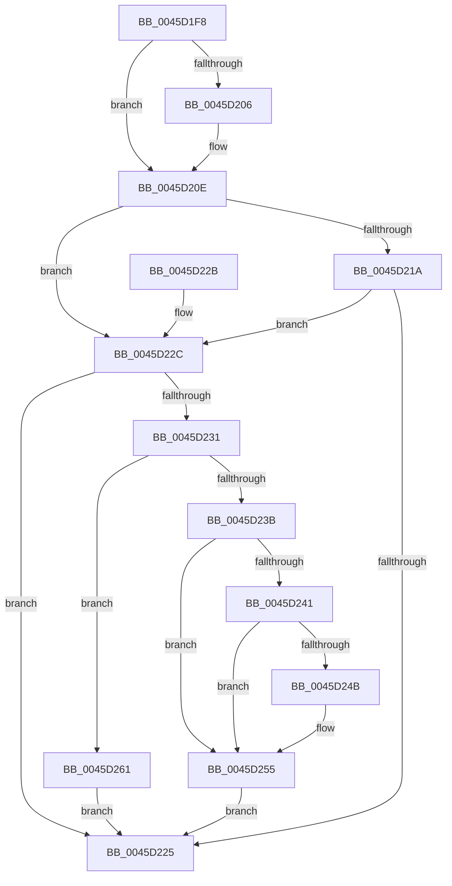

# MiReturnCcAccessLog

- RVA: `0x0045D1F8`–`0x0045D268` (길이 `112` bytes)
- VA: `0x000000014045D1F8`
- 실행 섹션: `.text`
- PDB 이름 있음: `예`; PDB Function 태그: `아니요`
- unwind 정보 RVA: `0x000A95CC`
- 디코드: `34`개 명령, `112/112` bytes 표시
- 미해석 바이트: `0` (있으면 어셈블리에 `.byte`로 보존)

> 이 문서는 커널 이미지의 기계어와 PDB 기호를 분석해 생성했습니다. 4번과 5번은 함수 원형과 자료형을 바이너리 사용 방식에서 추정한 C 해석이며 원본 소스 복구 결과는 아닙니다.

## 1. Dependencies

- 직접 호출 지점: **3**; 고유 호출 대상: **3**
- 직접 호출자로 확인된 함수: **2**
- RIP 상대 이미지 참조: **0**

### Outgoing calls
- `0x0045D250` → [ObDereferenceObjectDeferDeleteWithTag](../26/ObDereferenceObjectDeferDeleteWithTag_function_00263EA0.md) (function, `0x00263EA0`)
- `0x0045D25A` → [ExFreePoolWithTag](../../poolcode/B8/ExFreePoolWithTag_function_00B82870.md) (function, `0x00B82870`)
- `0x0045D261` → [MiQueuePageAccessLog](../34/MiQueuePageAccessLog_function_00348EB0.md) (function, `0x00348EB0`)

### Direct callers
- [MiCheckAndProcessCcAccessLog](MiCheckAndProcessCcAccessLog_function_0045D1A4.md) at `0x0045D1E1`
- [MmPrefetchForCacheManager](../../page/93/MmPrefetchForCacheManager_function_0093D714.md) at `0x0093D812`
- [MmPrefetchForCacheManager](../../page/93/MmPrefetchForCacheManager_function_0093D714.md) at `0x0093D8B6`

### Static image references
- 디코드된 RIP-relative 메모리 참조가 없습니다.

## 2. Other-region calls and transfers

- 다른 실행 섹션으로 향하는 call: **1**
  - `0x0045D25A` → [ExFreePoolWithTag](../../poolcode/B8/ExFreePoolWithTag_function_00B82870.md) (`.text` → `POOLCODE`)
- 별도 외부 분기/꼬리 이동을 확인하지 못했습니다.

## 3. Assembly (complete function range)

```asm
0045D1F8  40 53                           push rbx
0045D1FA  48 83 EC 20                     sub rsp, 0x20
0045D1FE  48 8B DA                        mov rbx, rdx
0045D201  45 85 C0                        test r8d, r8d
0045D204  74 08                           je 0x14045d20e
0045D206  48 8B 42 18                     mov rax, qword ptr [rdx + 0x18]
0045D20A  48 89 42 20                     mov qword ptr [rdx + 0x20], rax
0045D20E  48 8B 81 00 44 00 00            mov rax, qword ptr [rcx + 0x4400]
0045D215  48 85 C0                        test rax, rax
0045D218  75 12                           jne 0x14045d22c
0045D21A  F0 48 0F B1 99 00 44 00 00      lock cmpxchg qword ptr [rcx + 0x4400], rbx
0045D223  75 07                           jne 0x14045d22c
0045D225  48 83 C4 20                     add rsp, 0x20
0045D229  5B                              pop rbx
0045D22A  C3                              ret
0045D22B  CC                              int3
0045D22C  48 85 DB                        test rbx, rbx
0045D22F  74 F4                           je 0x14045d225
0045D231  48 8D 42 40                     lea rax, [rdx + 0x40]
0045D235  48 39 42 20                     cmp qword ptr [rdx + 0x20], rax
0045D239  75 26                           jne 0x14045d261
0045D23B  83 7A 08 00                     cmp dword ptr [rdx + 8], 0
0045D23F  75 14                           jne 0x14045d255
0045D241  48 8B 4A 38                     mov rcx, qword ptr [rdx + 0x38]
0045D245  48 83 F9 01                     cmp rcx, 1
0045D249  76 0A                           jbe 0x14045d255
0045D24B  BA 4D 6D 41 4C                  mov edx, 0x4c416d4d
0045D250  E8 4B 6C E0 FF                  call 0x140263ea0
0045D255  33 D2                           xor edx, edx
0045D257  48 8B CB                        mov rcx, rbx
0045D25A  E8 11 56 72 00                  call 0x140b82870
0045D25F  EB C4                           jmp 0x14045d225
0045D261  E8 4A BC EE FF                  call 0x140348eb0
0045D266  EB BD                           jmp 0x14045d225
```

## 4. C-style interpretation (structured pseudocode)

```c
__int64 __fastcall MiReturnCcAccessLog(__int64 a1, __int64 a2, int a3)
{
    __int64 result;
    __int64 v_rsp;

    v_rsp = (v_rsp) - (32);
    if (a3 != 0) {
        result = *(unsigned __int64 *)(a2 + 24);
        *(unsigned __int64 *)(a2 + 32) = result;
    }
    if (*(unsigned __int64 *)(a1 + 17408) != 0) goto loc_0045D22C;
    if (*(unsigned __int64 *)(a1 + 17408) != 0) goto loc_0045D22C;
loc_0045D225:
    v_rsp = (v_rsp) + (32);
    return *(unsigned __int64 *)(a1 + 17408);
loc_0045D22C:
    if (a2 == 0) goto loc_0045D225;
    if ((*(unsigned __int64 *)(a2 + 32)) != (a2 + 64)) goto loc_0045D261;
    if ((*(unsigned int *)(a2 + 8)) != 0) goto loc_0045D255;
    result = a2 + 64;
    if ((*(unsigned __int64 *)(a2 + 56)) >= = 1) {
        a2 = 0x4C416D4DULL;
        result = ObDereferenceObjectDeferDeleteWithTag(*(unsigned __int64 *)(a2 + 56), a2, a3, a4);
    }
    a2 = 0;
    result = ExFreePoolWithTag(0, a2, a3, a4);
    goto loc_0045D225;
loc_0045D261:
    result = MiQueuePageAccessLog(0, a2, a3, a4);
    goto loc_0045D225;
}
```

## 5. (Beta) C Style

```c
int64_t MiReturnCcAccessLog(void *Arg1, void *Arg2, int32_t Arg3)
{
    uint8_t *arg1 = (uint8_t *)Arg1;
    uint8_t *arg2 = (uint8_t *)Arg2;

    int64_t result;
    int64_t local_rsp;

    local_rsp = (local_rsp) - (32);
    if (Arg3 != 0) {
        result = *(uint64_t *)(arg2 + 0x18);
        *(uint64_t *)(arg2 + 0x20) = result;
    }
    if (*(uint64_t *)(arg1 + 0x4400) != 0) goto loc_0045D22C;
    if (*(uint64_t *)(arg1 + 0x4400) != 0) goto loc_0045D22C;
loc_0045D225:
    local_rsp = (local_rsp) + (32);
    return *(uint64_t *)(arg1 + 0x4400);
loc_0045D22C:
    if (Arg2 == NULL) goto loc_0045D225;
    if ((*(uint64_t *)(arg2 + 0x20)) != (Arg2 + 64)) goto loc_0045D261;
    if ((*(uint32_t *)(arg2 + 0x8)) != 0) goto loc_0045D255;
    result = Arg2 + 64;
    if ((*(uint64_t *)(arg2 + 0x38)) >= = 1) {
        Arg2 = 0x4C416D4DULL;
        result = ObDereferenceObjectDeferDeleteWithTag(*(uint64_t *)(arg2 + 0x38), Arg2, Arg3, a4);
    }
    Arg2 = 0;
    result = ExFreePoolWithTag(0, Arg2, Arg3, a4);
    goto loc_0045D225;
loc_0045D261:
    result = MiQueuePageAccessLog(0, Arg2, Arg3, a4);
    goto loc_0045D225;
}
```

### 관측된 메모리 오프셋

구조체 형식이 확인되지 않은 접근은 인자 기준의 오프셋으로만 기록했습니다.

| 기준 인자 | 오프셋 표현 | 폭 (bit) | 접근 |
|---|---:|---:|---|
| `Arg1` | `+ 0x4400` | `64` | `R` |
| `Arg2` | `+ 0x8` | `32` | `R` |
| `Arg2` | `+ 0x18` | `64` | `R` |
| `Arg2` | `+ 0x20` | `64` | `R` |
| `Arg2` | `+ 0x20` | `64` | `W` |
| `Arg2` | `+ 0x38` | `64` | `R` |
| `Arg2` | `+ 0x40` | `64` | `R` |

## 6. Execution-region graph

[열기: 2D/3D 그래프와 함수 탐색 컨트롤 패널](../../../control-panel.html?section=text&rva=0x0045D1F8&view=graph)

- 2D 그래프는 위에서 아래로 흐르고, 3D 그래프는 빈 공간을 드래그해 회전합니다. Shift+드래그는 이동, 휠은 확대·축소, 함수 노드 선택은 대상 보고서 이동입니다.

### Static fallback


