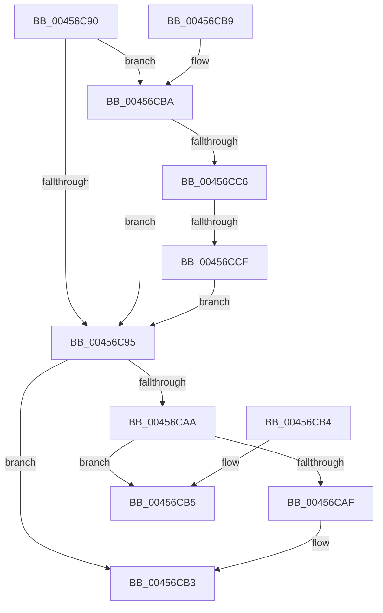

# MiSetPteTimeStamp

- RVA: `0x00456C90`–`0x00456CD7` (길이 `71` bytes)
- VA: `0x0000000140456C90`
- 실행 섹션: `.text`
- PDB 이름 있음: `예`; PDB Function 태그: `예`
- unwind 정보 RVA: `0x000DB714`
- 디코드: `24`개 명령, `71/71` bytes 표시
- 미해석 바이트: `0` (있으면 어셈블리에 `.byte`로 보존)

> 이 문서는 커널 이미지의 기계어와 PDB 기호를 분석해 생성했습니다. 4번과 5번은 함수 원형과 자료형을 바이너리 사용 방식에서 추정한 C 해석이며 원본 소스 복구 결과는 아닙니다.

## 1. Dependencies

- 직접 호출 지점: **0**; 고유 호출 대상: **0**
- 직접 호출자로 확인된 함수: **2**
- RIP 상대 이미지 참조: **1**

### Outgoing calls
- 직접 디코드된 call 명령이 없습니다.

### Direct callers
- [MiDecrementAweMapCount](../68/MiDecrementAweMapCount_function_00688158.md) at `0x006883AE`
- [MiZeroAndFlushAweLazyPtes](../68/MiZeroAndFlushAweLazyPtes_function_00689B1C.md) at `0x00689B57`

### Static image references
- `0x00456C97` → RVA `0x00E2DC80` (`.data`; read)

## 2. Other-region calls and transfers

- 다른 실행 섹션으로 향하는 call: **0**
- call이 아닌 외부 분기/꼬리 이동: **1**
  - `0x00456CC9` → `0x006F1A7C` (`tail-transfer`)

## 3. Assembly (complete function range)

```asm
00456C90  48 85 C9                        test rcx, rcx
00456C93  75 25                           jne 0x140456cba
00456C95  8B C1                           mov eax, ecx
00456C97  48 8B 0D E2 6F 9D 00            mov rcx, qword ptr [rip + 0x9d6fe2]
00456C9E  48 C1 E2 20                     shl rdx, 0x20
00456CA2  48 0B C2                        or rax, rdx
00456CA5  48 85 C9                        test rcx, rcx
00456CA8  74 09                           je 0x140456cb3
00456CAA  48 85 C8                        test rax, rcx
00456CAD  74 06                           je 0x140456cb5
00456CAF  48 83 C8 10                     or rax, 0x10
00456CB3  C3                              ret
00456CB4  CC                              int3
00456CB5  48 0B C1                        or rax, rcx
00456CB8  C3                              ret
00456CB9  CC                              int3
00456CBA  48 8B 05 BF 6F 9D 00            mov rax, qword ptr [rip + 0x9d6fbf]
00456CC1  48 85 C0                        test rax, rax
00456CC4  74 CF                           je 0x140456c95
00456CC6  F6 C1 10                        test cl, 0x10
00456CC9  0F 85 AD AD 29 00               jne 0x1406f1a7c
00456CCF  48 F7 D0                        not rax
00456CD2  48 23 C8                        and rcx, rax
00456CD5  EB BE                           jmp 0x140456c95
```

## 4. C-style interpretation (structured pseudocode)

```c
__int64 __fastcall MiSetPteTimeStamp(__int64 a1, __int64 a2)
{
    __int64 result;

    if (a1 != 0) goto loc_00456CBA;
loc_00456C95:
    a2 = (a2) << (32);
    result = ((unsigned int)((unsigned int)(a1))) | (a2);
    if (*(unsigned __int64 *)(v_rip + 10317794) == 0) goto loc_00456CB3;
    if (((result) & (*(unsigned __int64 *)(v_rip + 10317794))) == 0) goto loc_00456CB5;
    result = (result) | (16);
loc_00456CB3:
    return result;
loc_00456CB5:
    result = (result) | (*(unsigned __int64 *)(v_rip + 10317794));
    return result;
loc_00456CBA:
    if (*(unsigned __int64 *)(v_rip + 10317759) == 0) goto loc_00456C95;
    result = ~(*(unsigned __int64 *)(v_rip + 10317759));
    a1 = (*(unsigned __int64 *)(v_rip + 10317794)) & (result);
    goto loc_00456C95;
}
```

## 5. (Beta) C Style

```c
int64_t MiSetPteTimeStamp(int64_t Arg1, int64_t Arg2)
{
    int64_t result;

    if (Arg1 != 0) goto loc_00456CBA;
loc_00456C95:
    Arg2 = (Arg2) << (32);
    result = ((uint32_t)((uint32_t)(Arg1))) | (Arg2);
    if (*(uint64_t *)(v_rip + 0x9D6FE2) == 0) goto loc_00456CB3;
    if (((result) & (*(uint64_t *)(v_rip + 0x9D6FE2))) == 0) goto loc_00456CB5;
    result = (result) | (16);
loc_00456CB3:
    return result;
loc_00456CB5:
    result = (result) | (*(uint64_t *)(v_rip + 0x9D6FE2));
    return result;
loc_00456CBA:
    if (*(uint64_t *)(v_rip + 0x9D6FBF) == 0) goto loc_00456C95;
    result = ~(*(uint64_t *)(v_rip + 0x9D6FBF));
    Arg1 = (*(uint64_t *)(v_rip + 0x9D6FE2)) & (result);
    goto loc_00456C95;
}
```

## 6. Execution-region graph

[열기: 2D/3D 그래프와 함수 탐색 컨트롤 패널](../../../control-panel.html?section=text&rva=0x00456C90&view=graph)

- 2D 그래프는 위에서 아래로 흐르고, 3D 그래프는 빈 공간을 드래그해 회전합니다. Shift+드래그는 이동, 휠은 확대·축소, 함수 노드 선택은 대상 보고서 이동입니다.

### Static fallback


