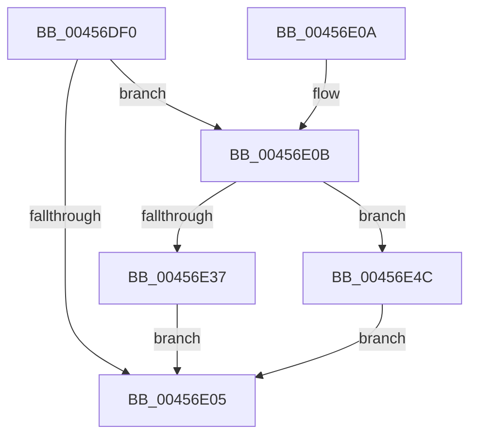

# MiStoreGetWriteSupport

- RVA: `0x00456DF0`–`0x00456E94` (길이 `164` bytes)
- VA: `0x0000000140456DF0`
- 실행 섹션: `.text`
- PDB 이름 있음: `예`; PDB Function 태그: `아니요`
- unwind 정보 RVA: `0x000A8084`
- 디코드: `36`개 명령, `164/164` bytes 표시
- 미해석 바이트: `0` (있으면 어셈블리에 `.byte`로 보존)

> 이 문서는 커널 이미지의 기계어와 PDB 기호를 분석해 생성했습니다. 4번과 5번은 함수 원형과 자료형을 바이너리 사용 방식에서 추정한 C 해석이며 원본 소스 복구 결과는 아닙니다.

## 1. Dependencies

- 직접 호출 지점: **3**; 고유 호출 대상: **3**
- 직접 호출자로 확인된 함수: **1**
- RIP 상대 이미지 참조: **1**

### Outgoing calls
- `0x00456DFB` → [ExpInterlockedPopEntrySList](../6B/ExpInterlockedPopEntrySList_function_006BA570.md) (function, `0x006BA570`)
- `0x00456E45` → [ExpAllocatePoolWithTagFromNode](../35/ExpAllocatePoolWithTagFromNode_function_0035B970.md) (function, `0x0035B970`)
- `0x00456E8A` → [VfHandlePoolAlloc](../../pagevrfy/BB/VfHandlePoolAlloc_function_00BB8A90.md) (function, `0x00BB8A90`)

### Direct callers
- [MiStoreWriteModifiedPages](../2B/MiStoreWriteModifiedPages_function_002B46C4.md) at `0x002B4A7D`

### Static image references
- `0x00456E20` → RVA `0x00FC6BD0` (`ALMOSTRO`; read)

## 2. Other-region calls and transfers

- 다른 실행 섹션으로 향하는 call: **1**
  - `0x00456E8A` → [VfHandlePoolAlloc](../../pagevrfy/BB/VfHandlePoolAlloc_function_00BB8A90.md) (`.text` → `PAGEVRFY`)
- 별도 외부 분기/꼬리 이동을 확인하지 못했습니다.

## 3. Assembly (complete function range)

```asm
00456DF0  48 83 EC 58                     sub rsp, 0x58
00456DF4  48 81 C1 60 05 00 00            add rcx, 0x560
00456DFB  E8 70 37 26 00                  call 0x1406ba570
00456E00  48 85 C0                        test rax, rax
00456E03  74 06                           je 0x140456e0b
00456E05  48 83 C4 58                     add rsp, 0x58
00456E09  C3                              ret
00456E0A  CC                              int3
00456E0B  65 48 8B 04 25 20 00 00 00      mov rax, qword ptr gs:[0x20]
00456E14  83 64 24 4C 00                  and dword ptr [rsp + 0x4c], 0
00456E19  48 8B 88 C0 00 00 00            mov rcx, qword ptr [rax + 0xc0]
00456E20  8B 05 AA FD B6 00               mov eax, dword ptr [rip + 0xb6fdaa]
00456E26  44 0F B7 89 8A 00 00 00         movzx r9d, word ptr [rcx + 0x8a]
00456E2E  41 0F BA E9 1F                  bts r9d, 0x1f
00456E33  A8 08                           test al, 8
00456E35  75 15                           jne 0x140456e4c
00456E37  BA 58 00 00 00                  mov edx, 0x58
00456E3C  41 B8 4D 6D 53 57               mov r8d, 0x57536d4d
00456E42  8D 4A E8                        lea ecx, [rdx - 0x18]
00456E45  E8 26 4B F0 FF                  call 0x14035b970
00456E4A  EB B9                           jmp 0x140456e05
00456E4C  48 8B 44 24 58                  mov rax, qword ptr [rsp + 0x58]
00456E51  B9 01 00 00 00                  mov ecx, 1
00456E56  48 89 44 24 38                  mov qword ptr [rsp + 0x38], rax
00456E5B  41 B9 4D 6D 53 57               mov r9d, 0x57536d4d
00456E61  89 4C 24 30                     mov dword ptr [rsp + 0x30], ecx
00456E65  48 8D 44 24 40                  lea rax, [rsp + 0x40]
00456E6A  48 89 4C 24 40                  mov qword ptr [rsp + 0x40], rcx
00456E6F  8D 51 3F                        lea edx, [rcx + 0x3f]
00456E72  48 89 44 24 28                  mov qword ptr [rsp + 0x28], rax
00456E77  83 64 24 20 00                  and dword ptr [rsp + 0x20], 0
00456E7C  44 8D 42 18                     lea r8d, [rdx + 0x18]
00456E80  33 C9                           xor ecx, ecx
00456E82  C7 44 24 48 20 00 00 00         mov dword ptr [rsp + 0x48], 0x20
00456E8A  E8 01 1C 76 00                  call 0x140bb8a90
00456E8F  E9 71 FF FF FF                  jmp 0x140456e05
```

## 4. C-style interpretation (structured pseudocode)

```c
__int64 __fastcall MiStoreGetWriteSupport(__int64 a1)
{
    __int64 result;
    __int64 v_rsp;
    unsigned int v_stack_p20;
    unsigned __int64 v_stack_p28;
    unsigned int v_stack_p30;
    unsigned __int64 v_stack_p38;
    unsigned __int64 v_stack_p40;
    unsigned int v_stack_p48;
    unsigned int v_stack_p4C;
    unsigned __int64 v_stack_p58;

    v_rsp = (v_rsp) - (88);
    a1 = (a1) + (0x560ULL);
    result = ExpInterlockedPopEntrySList(a1, a2, a3, a4);
    if (result == 0) goto loc_00456E0B;
loc_00456E05:
    v_rsp = (v_rsp) + (88);
    return result;
loc_00456E0B:
    if ((((unsigned __int8)((unsigned int)(*(unsigned int *)(v_rip + 11992490)))) & (8)) != 0) goto loc_00456E4C;
    result = ExpAllocatePoolWithTagFromNode(88 - 24, 88, (unsigned int)(0x57536D4DULL), *(unsigned __int16 *)(*(unsigned __int64 *)(*(unsigned __int64 *)(gs_base + (0 + 32)) + 192) + 138));
    goto loc_00456E05;
loc_00456E4C:
    v_stack_p38 = v_stack_p58;
    v_stack_p30 = 1;
    v_stack_p40 = 1;
    v_stack_p28 = v_stack_p40;
    a1 = 0;
    v_stack_p48 = 32;
    result = VfHandlePoolAlloc(a1, 1 + 63, 1 + 63 + 24, (unsigned int)(0x57536D4DULL));
    goto loc_00456E05;
}
```

## 5. (Beta) C Style

```c
int64_t MiStoreGetWriteSupport(int64_t Arg1)
{
    int64_t result;
    int64_t local_rsp;
    uint32_t v_stack_p20;
    uint64_t v_stack_p28;
    uint32_t v_stack_p30;
    uint64_t v_stack_p38;
    uint64_t v_stack_p40;
    uint32_t v_stack_p48;
    uint32_t v_stack_p4C;
    uint64_t v_stack_p58;

    local_rsp = (local_rsp) - (88);
    Arg1 = (Arg1) + (0x560ULL);
    result = ExpInterlockedPopEntrySList(Arg1, a2, a3, a4);
    if (result == 0) goto loc_00456E0B;
loc_00456E05:
    local_rsp = (local_rsp) + (88);
    return result;
loc_00456E0B:
    if ((((uint8_t)((uint32_t)(*(uint32_t *)(v_rip + 0xB6FDAA)))) & (8)) != 0) goto loc_00456E4C;
    result = ExpAllocatePoolWithTagFromNode(88 - 24, 88, (uint32_t)(0x57536D4DULL), *(uint16_t *)(*(uint64_t *)(*(uint64_t *)(gs_base + (0 + 0x20)) + 0xC0) + 0x8A));
    goto loc_00456E05;
loc_00456E4C:
    v_stack_p38 = v_stack_p58;
    v_stack_p30 = 1;
    v_stack_p40 = 1;
    v_stack_p28 = v_stack_p40;
    Arg1 = 0;
    v_stack_p48 = 32;
    result = VfHandlePoolAlloc(Arg1, 1 + 63, 1 + 63 + 24, (uint32_t)(0x57536D4DULL));
    goto loc_00456E05;
}
```

## 6. Execution-region graph

[열기: 2D/3D 그래프와 함수 탐색 컨트롤 패널](../../../control-panel.html?section=text&rva=0x00456DF0&view=graph)

- 2D 그래프는 위에서 아래로 흐르고, 3D 그래프는 빈 공간을 드래그해 회전합니다. Shift+드래그는 이동, 휠은 확대·축소, 함수 노드 선택은 대상 보고서 이동입니다.

### Static fallback


