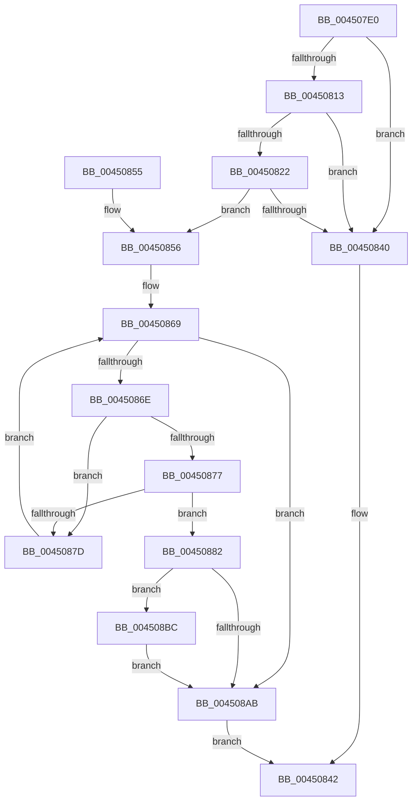

# MiSystemImageHasPrivateFixups

- RVA: `0x004507E0`–`0x004508E4` (길이 `260` bytes)
- VA: `0x00000001404507E0`
- 실행 섹션: `.text`
- PDB 이름 있음: `예`; PDB Function 태그: `아니요`
- unwind 정보 RVA: `0x000A7304`
- 디코드: `74`개 명령, `260/260` bytes 표시
- 미해석 바이트: `0` (있으면 어셈블리에 `.byte`로 보존)

> 이 문서는 커널 이미지의 기계어와 PDB 기호를 분석해 생성했습니다. 4번과 5번은 함수 원형과 자료형을 바이너리 사용 방식에서 추정한 C 해석이며 원본 소스 복구 결과는 아닙니다.

## 1. Dependencies

- 직접 호출 지점: **3**; 고유 호출 대상: **3**
- 직접 호출자로 확인된 함수: **1**
- RIP 상대 이미지 참조: **3**

### Outgoing calls
- `0x0045085D` → [ExAcquireSpinLockSharedAtDpcLevel](../24/ExAcquireSpinLockSharedAtDpcLevel_function_00248E30.md) (function, `0x00248E30`)
- `0x004508B2` → [ExReleaseSpinLockSharedFromDpcLevel](../24/ExReleaseSpinLockSharedFromDpcLevel_function_0024A590.md) (function, `0x0024A590`)
- `0x004508DA` → [MiOffsetToProtos](../24/MiOffsetToProtos_function_0024D880.md) (function, `0x0024D880`)

### Direct callers
- [MiCompleteProtoPteFault](../34/MiCompleteProtoPteFault_function_00345710.md) at `0x003463BF`

### Static image references
- `0x004507F4` → RVA `0x00E2D900` (`.data`; read)
- `0x00450825` → RVA `0x00E38AA8` (`.data`; read)
- `0x00450856` → RVA `0x00E2D91C` (`.data`; read)

## 2. Other-region calls and transfers

- 다른 실행 섹션으로 향하는 call: **0**
- 별도 외부 분기/꼬리 이동을 확인하지 못했습니다.

## 3. Assembly (complete function range)

```asm
004507E0  48 89 5C 24 08                  mov qword ptr [rsp + 8], rbx
004507E5  48 89 6C 24 18                  mov qword ptr [rsp + 0x18], rbp
004507EA  56                              push rsi
004507EB  57                              push rdi
004507EC  41 56                           push r14
004507EE  48 83 EC 20                     sub rsp, 0x20
004507F2  33 DB                           xor ebx, ebx
004507F4  48 8D 2D 05 D1 9D 00            lea rbp, [rip + 0x9dd105]
004507FB  48 39 2D FE D0 9D 00            cmp qword ptr [rip + 0x9dd0fe], rbp
00450802  49 8B F0                        mov rsi, r8
00450805  4C 8B F2                        mov r14, rdx
00450808  41 89 18                        mov dword ptr [r8], ebx
0045080B  48 8B F9                        mov rdi, rcx
0045080E  48 89 1A                        mov qword ptr [rdx], rbx
00450811  74 2D                           je 0x140450840
00450813  48 B8 00 00 00 00 00 80 FF FF   movabs rax, 0xffff800000000000
0045081D  48 3B C8                        cmp rcx, rax
00450820  72 1E                           jb 0x140450840
00450822  48 8B C1                        mov rax, rcx
00450825  48 8D 0D 7C 82 9E 00            lea rcx, [rip + 0x9e827c]
0045082C  48 C1 E8 27                     shr rax, 0x27
00450830  25 FF 01 00 00                  and eax, 0x1ff
00450835  2D 00 01 00 00                  sub eax, 0x100
0045083A  80 3C 08 0B                     cmp byte ptr [rax + rcx], 0xb
0045083E  74 16                           je 0x140450856
00450840  33 C0                           xor eax, eax
00450842  48 8B 5C 24 40                  mov rbx, qword ptr [rsp + 0x40]
00450847  48 8B 6C 24 50                  mov rbp, qword ptr [rsp + 0x50]
0045084C  48 83 C4 20                     add rsp, 0x20
00450850  41 5E                           pop r14
00450852  5F                              pop rdi
00450853  5E                              pop rsi
00450854  C3                              ret
00450855  CC                              int3
00450856  48 8D 0D BF D0 9D 00            lea rcx, [rip + 0x9dd0bf]
0045085D  E8 CE 85 DF FF                  call 0x140248e30
00450862  4C 8B 0D 97 D0 9D 00            mov r9, qword ptr [rip + 0x9dd097]
00450869  4C 3B CD                        cmp r9, rbp
0045086C  74 3D                           je 0x1404508ab
0045086E  4D 8B 51 10                     mov r10, qword ptr [r9 + 0x10]
00450872  49 3B FA                        cmp rdi, r10
00450875  72 06                           jb 0x14045087d
00450877  49 3B 79 18                     cmp rdi, qword ptr [r9 + 0x18]
0045087B  76 05                           jbe 0x140450882
0045087D  4D 8B 09                        mov r9, qword ptr [r9]
00450880  EB E7                           jmp 0x140450869
00450882  49 8B 41 28                     mov rax, qword ptr [r9 + 0x28]
00450886  49 2B FA                        sub rdi, r10
00450889  48 C1 EF 0C                     shr rdi, 0xc
0045088D  44 8B C7                        mov r8d, edi
00450890  40 8A CF                        mov cl, dil
00450893  49 C1 E8 03                     shr r8, 3
00450897  80 E1 07                        and cl, 7
0045089A  48 8B 50 08                     mov rdx, qword ptr [rax + 8]
0045089E  44 8B DF                        mov r11d, edi
004508A1  41 8A 04 10                     mov al, byte ptr [r8 + rdx]
004508A5  D2 F8                           sar al, cl
004508A7  A8 01                           test al, 1
004508A9  75 11                           jne 0x1404508bc
004508AB  48 8D 0D 6A D0 9D 00            lea rcx, [rip + 0x9dd06a]
004508B2  E8 D9 9C DF FF                  call 0x14024a590
004508B7  48 8B C3                        mov rax, rbx
004508BA  EB 86                           jmp 0x140450842
004508BC  49 8B 49 30                     mov rcx, qword ptr [r9 + 0x30]
004508C0  4C 8D 44 24 48                  lea r8, [rsp + 0x48]
004508C5  48 89 5C 24 48                  mov qword ptr [rsp + 0x48], rbx
004508CA  49 8B DA                        mov rbx, r10
004508CD  49 2B 59 20                     sub rbx, qword ptr [r9 + 0x20]
004508D1  49 C1 E3 0C                     shl r11, 0xc
004508D5  49 8B D3                        mov rdx, r11
004508D8  89 3E                           mov dword ptr [rsi], edi
004508DA  E8 A1 CF DF FF                  call 0x14024d880
004508DF  49 89 06                        mov qword ptr [r14], rax
004508E2  EB C7                           jmp 0x1404508ab
```

## 4. C-style interpretation (structured pseudocode)

```c
__int64 __fastcall MiSystemImageHasPrivateFixups(__int64 a1, __int64 a2, __int64 a3)
{
    __int64 result;
    __int64 v_r11;
    __int64 v_rbx;
    __int64 v_rdi;
    __int64 v_rsp;
    unsigned __int64 v_stack_p18;
    unsigned __int64 v_stack_p48;
    unsigned __int64 v_stack_p8;

    v_stack_p8 = v_rbx;
    v_stack_p18 = v_rbp;
    v_rsp = (v_rsp) - (32);
    v_rbx = 0;
    *(unsigned int *)(a3) = 0;
    *(unsigned __int64 *)(a2) = 0;
    if ((*(unsigned __int64 *)(v_rip + 10342654)) == (v_rip + 10342661)) goto loc_00450840;
    if (a1 < result) goto loc_00450840;
    result = (a1) >> (39);
    result = (unsigned int)((result) & (511));
    result = (unsigned int)((result) - (256));
    if ((*(unsigned __int8 *)(result + v_rip + 10388092 * 1)) == 11) goto loc_00450856;
loc_00450840:
    result = 0;
loc_00450842:
    v_rsp = (v_rsp) + (32);
    return result;
loc_00450856:
    result = ExAcquireSpinLockSharedAtDpcLevel(v_rip + 10342591, a2, a3, a4);
loc_00450869:
    if ((*(unsigned __int64 *)(v_rip + 10342551)) == v_stack_p18) goto loc_004508AB;
    if (a1 < (*(unsigned __int64 *)(*(unsigned __int64 *)(v_rip + 10342551) + 16))) goto loc_0045087D;
    if (a1 <= (*(unsigned __int64 *)(*(unsigned __int64 *)(v_rip + 10342551) + 24))) goto loc_00450882;
loc_0045087D:
    goto loc_00450869;
loc_00450882:
    v_rdi = (a1) - (*(unsigned __int64 *)(*(unsigned __int64 *)(v_rip + 10342551) + 16));
    v_rdi = (v_rdi) >> (12);
    a3 = ((unsigned int)((unsigned int)(v_rdi))) >> (3);
    a1 = (unsigned __int8)(((unsigned __int8)(v_rdi)) & (7));
    result = (unsigned __int8)((*(unsigned __int8 *)(a3 + *(unsigned __int64 *)(*(unsigned __int64 *)(*(unsigned __int64 *)(*(unsigned __int64 *)(v_rip + 10342551)) + 40) + 8) * 1)) >> ((unsigned __int8)(a1)));
    if ((((unsigned __int8)(result)) & (1)) != 0) goto loc_004508BC;
loc_004508AB:
    result = ExReleaseSpinLockSharedFromDpcLevel(v_rip + 10342506, *(unsigned __int64 *)(*(unsigned __int64 *)(*(unsigned __int64 *)(*(unsigned __int64 *)(v_rip + 10342551)) + 40) + 8), a3, *(unsigned __int64 *)(*(unsigned __int64 *)(v_rip + 10342551)));
    goto loc_00450842;
loc_004508BC:
    v_stack_p48 = v_stack_p8;
    v_rbx = (*(unsigned __int64 *)(*(unsigned __int64 *)(v_rip + 10342551) + 16)) - (*(unsigned __int64 *)(*(unsigned __int64 *)(*(unsigned __int64 *)(v_rip + 10342551)) + 32));
    v_r11 = ((unsigned int)((unsigned int)(v_rdi))) << (12);
    *(unsigned int *)(a3) = (unsigned int)(v_rdi);
    result = MiOffsetToProtos(*(unsigned __int64 *)(*(unsigned __int64 *)(*(unsigned __int64 *)(v_rip + 10342551)) + 48), v_r11, v_stack_p48, *(unsigned __int64 *)(*(unsigned __int64 *)(v_rip + 10342551)));
    *(unsigned __int64 *)(a2) = result;
    goto loc_004508AB;
}
```

## 5. (Beta) C Style

```c
int64_t MiSystemImageHasPrivateFixups(int64_t Arg1, void *Arg2, void *Arg3)
{
    uint8_t *arg2 = (uint8_t *)Arg2;
    uint8_t *arg3 = (uint8_t *)Arg3;

    int64_t result;
    int64_t local_r11;
    int64_t local_rbx;
    int64_t local_rdi;
    int64_t local_rsp;
    uint64_t v_stack_p18;
    uint64_t v_stack_p48;
    uint64_t v_stack_p8;

    v_stack_p8 = local_rbx;
    v_stack_p18 = local_rbp;
    local_rsp = (local_rsp) - (32);
    local_rbx = 0;
    *(uint32_t *)(arg3) = 0;
    *(uint64_t *)(arg2) = 0;
    if ((*(uint64_t *)(v_rip + 0x9DD0FE)) == (v_rip + 10342661)) goto loc_00450840;
    if (Arg1 < result) goto loc_00450840;
    result = (Arg1) >> (39);
    result = (uint32_t)((result) & (511));
    result = (uint32_t)((result) - (256));
    if ((*(uint8_t *)(result + v_rip + 0x9E827C * 1)) == 11) goto loc_00450856;
loc_00450840:
    result = 0;
loc_00450842:
    local_rsp = (local_rsp) + (32);
    return result;
loc_00450856:
    result = ExAcquireSpinLockSharedAtDpcLevel(v_rip + 10342591, Arg2, Arg3, a4);
loc_00450869:
    if ((*(uint64_t *)(v_rip + 0x9DD097)) == v_stack_p18) goto loc_004508AB;
    if (Arg1 < (*(uint64_t *)(*(uint64_t *)(v_rip + 0x9DD097) + 0x10))) goto loc_0045087D;
    if (Arg1 <= (*(uint64_t *)(*(uint64_t *)(v_rip + 0x9DD097) + 0x18))) goto loc_00450882;
loc_0045087D:
    goto loc_00450869;
loc_00450882:
    local_rdi = (Arg1) - (*(uint64_t *)(*(uint64_t *)(v_rip + 0x9DD097) + 0x10));
    local_rdi = (local_rdi) >> (12);
    Arg3 = ((uint32_t)((uint32_t)(local_rdi))) >> (3);
    Arg1 = (uint8_t)(((uint8_t)(local_rdi)) & (7));
    result = (uint8_t)((*(uint8_t *)(arg3 + *(uint64_t *)(*(uint64_t *)(*(uint64_t *)(*(uint64_t *)(v_rip + 0x9DD097)) + 0x28) + 0x8) * 1)) >> ((uint8_t)(Arg1)));
    if ((((uint8_t)(result)) & (1)) != 0) goto loc_004508BC;
loc_004508AB:
    result = ExReleaseSpinLockSharedFromDpcLevel(v_rip + 10342506, *(uint64_t *)(*(uint64_t *)(*(uint64_t *)(*(uint64_t *)(v_rip + 0x9DD097)) + 0x28) + 0x8), Arg3, *(uint64_t *)(*(uint64_t *)(v_rip + 0x9DD097)));
    goto loc_00450842;
loc_004508BC:
    v_stack_p48 = v_stack_p8;
    local_rbx = (*(uint64_t *)(*(uint64_t *)(v_rip + 0x9DD097) + 0x10)) - (*(uint64_t *)(*(uint64_t *)(*(uint64_t *)(v_rip + 0x9DD097)) + 0x20));
    local_r11 = ((uint32_t)((uint32_t)(local_rdi))) << (12);
    *(uint32_t *)(arg3) = (uint32_t)(local_rdi);
    result = MiOffsetToProtos(*(uint64_t *)(*(uint64_t *)(*(uint64_t *)(v_rip + 0x9DD097)) + 0x30), local_r11, v_stack_p48, *(uint64_t *)(*(uint64_t *)(v_rip + 0x9DD097)));
    *(uint64_t *)(arg2) = result;
    goto loc_004508AB;
}
```

### 관측된 메모리 오프셋

구조체 형식이 확인되지 않은 접근은 인자 기준의 오프셋으로만 기록했습니다.

| 기준 인자 | 오프셋 표현 | 폭 (bit) | 접근 |
|---|---:|---:|---|
| `Arg2` | `+ 0x0` | `64` | `W` |
| `Arg3` | `+ 0x0` | `32` | `W` |

## 6. Execution-region graph

[열기: 2D/3D 그래프와 함수 탐색 컨트롤 패널](../../../control-panel.html?section=text&rva=0x004507E0&view=graph)

- 2D 그래프는 위에서 아래로 흐르고, 3D 그래프는 빈 공간을 드래그해 회전합니다. Shift+드래그는 이동, 휠은 확대·축소, 함수 노드 선택은 대상 보고서 이동입니다.

### Static fallback


