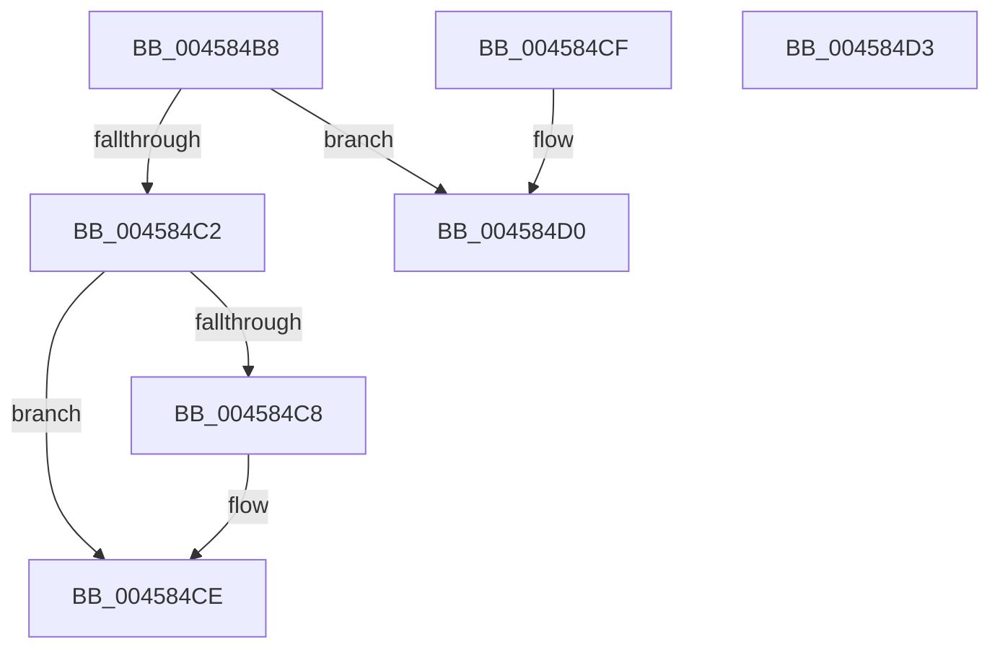

# MiTbFlushTimeStampMayNeedFlush

- RVA: `0x004584B8`–`0x004584D4` (길이 `28` bytes)
- VA: `0x00000001404584B8`
- 실행 섹션: `.text`
- PDB 이름 있음: `예`; PDB Function 태그: `아니요`
- unwind 정보 RVA: `0x000DB714`
- 디코드: `14`개 명령, `28/28` bytes 표시
- 미해석 바이트: `0` (있으면 어셈블리에 `.byte`로 보존)

> 이 문서는 커널 이미지의 기계어와 PDB 기호를 분석해 생성했습니다. 4번과 5번은 함수 원형과 자료형을 바이너리 사용 방식에서 추정한 C 해석이며 원본 소스 복구 결과는 아닙니다.

## 1. Dependencies

- 직접 호출 지점: **0**; 고유 호출 대상: **0**
- 직접 호출자로 확인된 함수: **7**
- RIP 상대 이미지 참조: **0**

### Outgoing calls
- 직접 디코드된 call 명령이 없습니다.

### Direct callers
- [sub_00237DE0](../23/Unknown_function_00237DE0.md) at `0x002384D6`
- [sub_002B79EA](../2B/Unknown_function_002B79EA.md) at `0x002B7A48`
- [MiFreeSlabEntry](../2D/MiFreeSlabEntry_function_002DC650.md) at `0x002DC940`
- [MiGetPageChain](../33/MiGetPageChain_function_00330130.md) at `0x00330736`
- [MiChangePageAttribute](../33/MiChangePageAttribute_function_00332ECC.md) at `0x003331C8`
- [MiReleaseLargePdeMappings](../49/MiReleaseLargePdeMappings_function_0049D0B0.md) at `0x0049D3D7`
- [MiDeleteStaleCacheMaps](../67/MiDeleteStaleCacheMaps_function_0067B780.md) at `0x0067B98A`

### Static image references
- 디코드된 RIP-relative 메모리 참조가 없습니다.

## 2. Other-region calls and transfers

- 다른 실행 섹션으로 향하는 call: **0**
- 별도 외부 분기/꼬리 이동을 확인하지 못했습니다.

## 3. Assembly (complete function range)

```asm
004584B8  2B D1                           sub edx, ecx
004584BA  41 23 D0                        and edx, r8d
004584BD  83 FA 02                        cmp edx, 2
004584C0  77 0E                           ja 0x1404584d0
004584C2  B0 01                           mov al, 1
004584C4  84 C8                           test al, cl
004584C6  75 06                           jne 0x1404584ce
004584C8  83 FA 02                        cmp edx, 2
004584CB  0F 92 C0                        setb al
004584CE  C3                              ret
004584CF  CC                              int3
004584D0  32 C0                           xor al, al
004584D2  C3                              ret
004584D3  CC                              int3
```

## 4. C-style interpretation (structured pseudocode)

```c
__int64 __fastcall MiTbFlushTimeStampMayNeedFlush(int a1, int a2, int a3)
{
    __int64 result;

    a2 = (unsigned int)((a2) - (a1));
    a2 = (unsigned int)((a2) & (a3));
    if (a2 > 2) goto loc_004584D0;
    result = 1;
    if (((1) & ((unsigned __int8)(a1))) == 0) {
        result = (a2 < 2) ? 1 : 0;
    }
    return result;
loc_004584D0:
    result = 0;
    return result;
}
```

## 5. (Beta) C Style

```c
int64_t MiTbFlushTimeStampMayNeedFlush(int32_t Arg1, int32_t Arg2, int32_t Arg3)
{
    int64_t result;

    Arg2 = (uint32_t)((Arg2) - (Arg1));
    Arg2 = (uint32_t)((Arg2) & (Arg3));
    if (Arg2 > 2) goto loc_004584D0;
    result = 1;
    if (((1) & ((uint8_t)(Arg1))) == 0) {
        result = (Arg2 < 2) ? 1 : 0;
    }
    return result;
loc_004584D0:
    result = 0;
    return result;
}
```

## 6. Execution-region graph

[열기: 2D/3D 그래프와 함수 탐색 컨트롤 패널](../../../control-panel.html?section=text&rva=0x004584B8&view=graph)

- 2D 그래프는 위에서 아래로 흐르고, 3D 그래프는 빈 공간을 드래그해 회전합니다. Shift+드래그는 이동, 휠은 확대·축소, 함수 노드 선택은 대상 보고서 이동입니다.

### Static fallback


