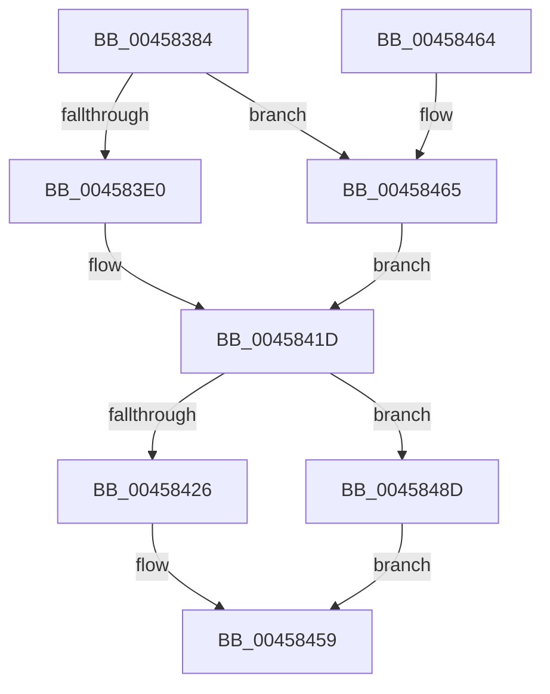

# MiUnlinkDecayClusterTimer

- RVA: `0x00458384`–`0x004584B2` (길이 `302` bytes)
- VA: `0x0000000140458384`
- 실행 섹션: `.text`
- PDB 이름 있음: `예`; PDB Function 태그: `아니요`
- unwind 정보 RVA: `0x000A8BB4`
- 디코드: `69`개 명령, `302/302` bytes 표시
- 미해석 바이트: `0` (있으면 어셈블리에 `.byte`로 보존)

> 이 문서는 커널 이미지의 기계어와 PDB 기호를 분석해 생성했습니다. 4번과 5번은 함수 원형과 자료형을 바이너리 사용 방식에서 추정한 C 해석이며 원본 소스 복구 결과는 아닙니다.

## 1. Dependencies

- 직접 호출 지점: **0**; 고유 호출 대상: **0**
- 직접 호출자로 확인된 함수: **2**
- RIP 상대 이미지 참조: **2**

### Outgoing calls
- 직접 디코드된 call 명령이 없습니다.

### Direct callers
- [MiRemoveDecayClusterTimer](../28/MiRemoveDecayClusterTimer_function_00288178.md) at `0x002881B1`
- [MiEmptyDecayClusterTimers](../2D/MiEmptyDecayClusterTimers_function_002DAB50.md) at `0x002DAE21`

### Static image references
- `0x0045839C` → RVA `0x00E30088` (`.data`; read)
- `0x004583EA` → RVA `0x00E35C00` (`.data`; read)

## 2. Other-region calls and transfers

- 다른 실행 섹션으로 향하는 call: **0**
- 별도 외부 분기/꼬리 이동을 확인하지 못했습니다.

## 3. Assembly (complete function range)

```asm
00458384  48 89 5C 24 08                  mov qword ptr [rsp + 8], rbx
00458389  48 89 74 24 10                  mov qword ptr [rsp + 0x10], rsi
0045838E  8B 41 20                        mov eax, dword ptr [rcx + 0x20]
00458391  C1 E8 10                        shr eax, 0x10
00458394  44 0F B6 C0                     movzx r8d, al
00458398  48 8B 41 28                     mov rax, qword ptr [rcx + 0x28]
0045839C  48 8B 15 E5 7C 9D 00            mov rdx, qword ptr [rip + 0x9d7ce5]
004583A3  48 C1 E8 2B                     shr rax, 0x2b
004583A7  25 FF 03 00 00                  and eax, 0x3ff
004583AC  41 C1 E8 06                     shr r8d, 6
004583B0  45 8B D0                        mov r10d, r8d
004583B3  48 BE 00 00 00 00 00 DE FF FF   movabs rsi, 0xffffde0000000000
004583BD  4C 8B 0C C2                     mov r9, qword ptr [rdx + rax*8]
004583C1  BA FE FF FF FF                  mov edx, 0xfffffffe
004583C6  48 8B 41 08                     mov rax, qword ptr [rcx + 8]
004583CA  4C 8B D8                        mov r11, rax
004583CD  48 8B C8                        mov rcx, rax
004583D0  49 C1 EB 21                     shr r11, 0x21
004583D4  48 23 CA                        and rcx, rdx
004583D7  48 3B CA                        cmp rcx, rdx
004583DA  0F 84 85 00 00 00               je 0x140458465
004583E0  48 8B C8                        mov rcx, rax
004583E3  48 D1 E9                        shr rcx, 1
004583E6  0F BA F1 1F                     btr ecx, 0x1f
004583EA  48 03 0D 0F D8 9D 00            add rcx, qword ptr [rip + 0x9dd80f]
004583F1  4C 8D 04 49                     lea r8, [rcx + rcx*2]
004583F5  49 C1 E0 04                     shl r8, 4
004583F9  48 8B CE                        mov rcx, rsi
004583FC  4C 03 C1                        add r8, rcx
004583FF  48 BB 00 00 00 00 FE FF FF FF   movabs rbx, 0xfffffffe00000000
00458409  49 8B 48 08                     mov rcx, qword ptr [r8 + 8]
0045840D  48 8B D1                        mov rdx, rcx
00458410  48 33 D0                        xor rdx, rax
00458413  48 23 D3                        and rdx, rbx
00458416  48 33 D1                        xor rdx, rcx
00458419  49 89 50 08                     mov qword ptr [r8 + 8], rdx
0045841D  49 81 FB FF FF FF 7F            cmp r11, 0x7fffffff
00458424  74 67                           je 0x14045848d
00458426  48 8B 15 D3 D7 9D 00            mov rdx, qword ptr [rip + 0x9dd7d3]
0045842D  49 03 D3                        add rdx, r11
00458430  4C 8D 04 52                     lea r8, [rdx + rdx*2]
00458434  49 C1 E0 04                     shl r8, 4
00458438  48 8B CE                        mov rcx, rsi
0045843B  4C 03 C1                        add r8, rcx
0045843E  48 BA 01 00 00 00 FF FF FF FF   movabs rdx, 0xffffffff00000001
00458448  48 8B C8                        mov rcx, rax
0045844B  49 33 48 08                     xor rcx, qword ptr [r8 + 8]
0045844F  48 23 CA                        and rcx, rdx
00458452  48 33 C8                        xor rcx, rax
00458455  49 89 48 08                     mov qword ptr [r8 + 8], rcx
00458459  48 8B 5C 24 08                  mov rbx, qword ptr [rsp + 8]
0045845E  48 8B 74 24 10                  mov rsi, qword ptr [rsp + 0x10]
00458463  C3                              ret
00458464  CC                              int3
00458465  4B 8B 8C C1 C0 3E 00 00         mov rcx, qword ptr [r9 + r8*8 + 0x3ec0]
0045846D  48 BB 00 00 00 00 FE FF FF FF   movabs rbx, 0xfffffffe00000000
00458477  48 8B D1                        mov rdx, rcx
0045847A  48 33 D0                        xor rdx, rax
0045847D  48 23 D3                        and rdx, rbx
00458480  48 33 D1                        xor rdx, rcx
00458483  4B 89 94 C1 C0 3E 00 00         mov qword ptr [r9 + r8*8 + 0x3ec0], rdx
0045848B  EB 90                           jmp 0x14045841d
0045848D  48 8B C8                        mov rcx, rax
00458490  48 BA 01 00 00 00 FF FF FF FF   movabs rdx, 0xffffffff00000001
0045849A  4B 33 8C D1 C0 3E 00 00         xor rcx, qword ptr [r9 + r10*8 + 0x3ec0]
004584A2  48 23 CA                        and rcx, rdx
004584A5  48 33 C8                        xor rcx, rax
004584A8  4B 89 8C D1 C0 3E 00 00         mov qword ptr [r9 + r10*8 + 0x3ec0], rcx
004584B0  EB A7                           jmp 0x140458459
```

## 4. C-style interpretation (structured pseudocode)

```c
__int64 __fastcall MiUnlinkDecayClusterTimer(__int64 a1)
{
    __int64 result;
    __int64 v_r11;
    unsigned __int64 v_stack_p10;
    unsigned __int64 v_stack_p8;

    v_stack_p8 = v_rbx;
    v_stack_p10 = v_rsi;
    result = (unsigned int)(((unsigned int)(*(unsigned int *)(a1 + 32))) >> (16));
    result = (*(unsigned __int64 *)(a1 + 40)) >> (43);
    result = (unsigned int)((result) & (0x3FFULL));
    a3 = (unsigned int)(((unsigned __int8)(result)) >> (6));
    v_r11 = (*(unsigned __int64 *)(a1 + 8)) >> (33);
    a1 = (*(unsigned __int64 *)(a1 + 8)) & ((unsigned int)(0xFFFFFFFEULL));
    if (a1 == ((unsigned int)(0xFFFFFFFEULL))) goto loc_00458465;
    a1 = (*(unsigned __int64 *)(a1 + 8)) >> (1);
    a1 = (a1) + (*(unsigned __int64 *)(v_rip + 10344463));
    a3 = (a1 + a1 * 2) << (4);
    a3 = (a3) + (v_rsi);
    a2 = (*(unsigned __int64 *)(a3 + 8)) ^ (*(unsigned __int64 *)(a1 + 8));
    a2 = (a2) & (v_rbx);
    a2 = (a2) ^ (*(unsigned __int64 *)(a3 + 8));
    *(unsigned __int64 *)(a3 + 8) = a2;
loc_0045841D:
    if (v_r11 == 0x7FFFFFFFULL) goto loc_0045848D;
    a2 = (*(unsigned __int64 *)(v_rip + 10344403)) + (v_r11);
    a3 = (a2 + a2 * 2) << (4);
    a3 = (a3) + (v_rsi);
    a1 = (*(unsigned __int64 *)(a1 + 8)) ^ (*(unsigned __int64 *)(a3 + 8));
    a1 = (a1) & (a2);
    a1 = (a1) ^ (*(unsigned __int64 *)(a1 + 8));
    *(unsigned __int64 *)(a3 + 8) = a1;
loc_00458459:
    return *(unsigned __int64 *)(a1 + 8);
loc_00458465:
    a2 = (*(unsigned __int64 *)(*(unsigned __int64 *)(*(unsigned __int64 *)(v_rip + 10321125) + result * 8) + a3 * 8 + 16064)) ^ (*(unsigned __int64 *)(a1 + 8));
    a2 = (a2) & (v_stack_p8);
    a2 = (a2) ^ (*(unsigned __int64 *)(*(unsigned __int64 *)(*(unsigned __int64 *)(v_rip + 10321125) + result * 8) + a3 * 8 + 16064));
    *(unsigned __int64 *)(*(unsigned __int64 *)(*(unsigned __int64 *)(v_rip + 10321125) + result * 8) + a3 * 8 + 16064) = a2;
    goto loc_0045841D;
loc_0045848D:
    a1 = (*(unsigned __int64 *)(a1 + 8)) ^ (*(unsigned __int64 *)(*(unsigned __int64 *)(*(unsigned __int64 *)(v_rip + 10321125) + result * 8) + (unsigned int)((unsigned int)(a3)) * 8 + 16064));
    a1 = (a1) & (a2);
    a1 = (a1) ^ (*(unsigned __int64 *)(a1 + 8));
    *(unsigned __int64 *)(*(unsigned __int64 *)(*(unsigned __int64 *)(v_rip + 10321125) + result * 8) + (unsigned int)((unsigned int)(a3)) * 8 + 16064) = a1;
    goto loc_00458459;
}
```

## 5. (Beta) C Style

```c
int64_t MiUnlinkDecayClusterTimer(void *Arg1)
{
    uint8_t *arg1 = (uint8_t *)Arg1;

    int64_t result;
    int64_t local_r11;
    uint64_t v_stack_p10;
    uint64_t v_stack_p8;

    v_stack_p8 = local_rbx;
    v_stack_p10 = local_rsi;
    result = (uint32_t)(((uint32_t)(*(uint32_t *)(arg1 + 0x20))) >> (16));
    result = (*(uint64_t *)(arg1 + 0x28)) >> (43);
    result = (uint32_t)((result) & (0x3FFULL));
    a3 = (uint32_t)(((uint8_t)(result)) >> (6));
    local_r11 = (*(uint64_t *)(arg1 + 0x8)) >> (33);
    Arg1 = (*(uint64_t *)(arg1 + 0x8)) & ((uint32_t)(0xFFFFFFFEULL));
    if (Arg1 == ((uint32_t)(0xFFFFFFFEULL))) goto loc_00458465;
    Arg1 = (*(uint64_t *)(arg1 + 0x8)) >> (1);
    Arg1 = (Arg1) + (*(uint64_t *)(v_rip + 0x9DD80F));
    a3 = (Arg1 + Arg1 * 2) << (4);
    a3 = (a3) + (local_rsi);
    a2 = (*(uint64_t *)(a3 + 0x8)) ^ (*(uint64_t *)(arg1 + 0x8));
    a2 = (a2) & (local_rbx);
    a2 = (a2) ^ (*(uint64_t *)(a3 + 0x8));
    *(uint64_t *)(a3 + 0x8) = a2;
loc_0045841D:
    if (local_r11 == 0x7FFFFFFFULL) goto loc_0045848D;
    a2 = (*(uint64_t *)(v_rip + 0x9DD7D3)) + (local_r11);
    a3 = (a2 + a2 * 2) << (4);
    a3 = (a3) + (local_rsi);
    Arg1 = (*(uint64_t *)(arg1 + 0x8)) ^ (*(uint64_t *)(a3 + 0x8));
    Arg1 = (Arg1) & (a2);
    Arg1 = (Arg1) ^ (*(uint64_t *)(arg1 + 0x8));
    *(void **)(a3 + 0x8) = Arg1;
loc_00458459:
    return *(uint64_t *)(arg1 + 0x8);
loc_00458465:
    a2 = (*(uint64_t *)(*(uint64_t *)(*(uint64_t *)(v_rip + 0x9D7CE5) + result * 8) + a3 * 8 + 0x3EC0)) ^ (*(uint64_t *)(arg1 + 0x8));
    a2 = (a2) & (v_stack_p8);
    a2 = (a2) ^ (*(uint64_t *)(*(uint64_t *)(*(uint64_t *)(v_rip + 0x9D7CE5) + result * 8) + a3 * 8 + 0x3EC0));
    *(uint64_t *)(*(uint64_t *)(*(uint64_t *)(v_rip + 0x9D7CE5) + result * 8) + a3 * 8 + 0x3EC0) = a2;
    goto loc_0045841D;
loc_0045848D:
    Arg1 = (*(uint64_t *)(arg1 + 0x8)) ^ (*(uint64_t *)(*(uint64_t *)(*(uint64_t *)(v_rip + 0x9D7CE5) + result * 8) + (uint32_t)((uint32_t)(a3)) * 8 + 0x3EC0));
    Arg1 = (Arg1) & (a2);
    Arg1 = (Arg1) ^ (*(uint64_t *)(arg1 + 0x8));
    *(void **)(*(uint64_t *)(*(uint64_t *)(v_rip + 0x9D7CE5) + result * 8) + (uint32_t)((uint32_t)(a3)) * 8 + 0x3EC0) = Arg1;
    goto loc_00458459;
}
```

### 관측된 메모리 오프셋

구조체 형식이 확인되지 않은 접근은 인자 기준의 오프셋으로만 기록했습니다.

| 기준 인자 | 오프셋 표현 | 폭 (bit) | 접근 |
|---|---:|---:|---|
| `Arg1` | `+ 0x8` | `64` | `R` |
| `Arg1` | `+ 0x20` | `32` | `R` |
| `Arg1` | `+ 0x28` | `64` | `R` |

## 6. Execution-region graph

[열기: 2D/3D 그래프와 함수 탐색 컨트롤 패널](../../../control-panel.html?section=text&rva=0x00458384&view=graph)

- 2D 그래프는 위에서 아래로 흐르고, 3D 그래프는 빈 공간을 드래그해 회전합니다. Shift+드래그는 이동, 휠은 확대·축소, 함수 노드 선택은 대상 보고서 이동입니다.

### Static fallback


