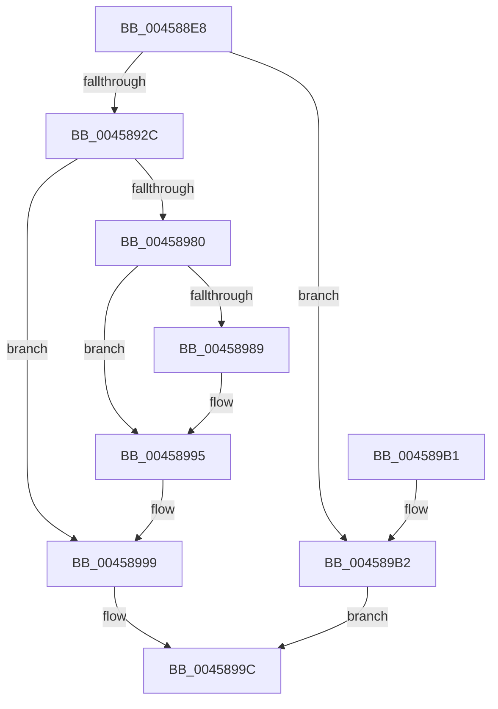

# MiUpdateControlAreaCommitCount

- RVA: `0x004588E8`–`0x004589BD` (길이 `213` bytes)
- VA: `0x00000001404588E8`
- 실행 섹션: `.text`
- PDB 이름 있음: `예`; PDB Function 태그: `아니요`
- unwind 정보 RVA: `0x000A8CB4`
- 디코드: `52`개 명령, `213/213` bytes 표시
- 미해석 바이트: `0` (있으면 어셈블리에 `.byte`로 보존)

> 이 문서는 커널 이미지의 기계어와 PDB 기호를 분석해 생성했습니다. 4번과 5번은 함수 원형과 자료형을 바이너리 사용 방식에서 추정한 C 해석이며 원본 소스 복구 결과는 아닙니다.

## 1. Dependencies

- 직접 호출 지점: **4**; 고유 호출 대상: **4**
- 직접 호출자로 확인된 함수: **4**
- RIP 상대 이미지 참조: **2**

### Outgoing calls
- `0x00458933` → [ExAcquireSpinLockExclusive](../24/ExAcquireSpinLockExclusive_function_00248690.md) (function, `0x00248690`)
- `0x00458964` → [MiGetSubsectionHoldingCrossPartitionReferences](MiGetSubsectionHoldingCrossPartitionReferences_function_004589E4.md) (function, `0x004589E4`)
- `0x00458975` → [ExReleaseSpinLockExclusiveFromDpcLevel](../24/ExReleaseSpinLockExclusiveFromDpcLevel_function_002497E0.md) (function, `0x002497E0`)
- `0x00458990` → [KiLowerIrqlProcessIrqlFlags](../4F/KiLowerIrqlProcessIrqlFlags_function_004F5698.md) (function, `0x004F5698`)

### Direct callers
- [sub_006F810A](../6F/Unknown_function_006F810A.md) at `0x006F811B`
- [MiChargeSegmentCommit](../../page/8C/MiChargeSegmentCommit_function_008CEDE4.md) at `0x008CEF7E`
- [MiCreatePagingFileMap](../../page/98/MiCreatePagingFileMap_function_009852F8.md) at `0x00985698`
- [MiCreateFileOnlyImageFixupList](../../page/98/MiCreateFileOnlyImageFixupList_function_00989AD0.md) at `0x00989CC9`

### Static image references
- `0x00458904` → RVA `0x00E30088` (`.data`; read)
- `0x00458980` → RVA `0x00FC6D20` (`ALMOSTRO`; read)

## 2. Other-region calls and transfers

- 다른 실행 섹션으로 향하는 call: **0**
- 별도 외부 분기/꼬리 이동을 확인하지 못했습니다.

## 3. Assembly (complete function range)

```asm
004588E8  48 89 5C 24 08                  mov qword ptr [rsp + 8], rbx
004588ED  48 89 6C 24 10                  mov qword ptr [rsp + 0x10], rbp
004588F2  48 89 74 24 18                  mov qword ptr [rsp + 0x18], rsi
004588F7  57                              push rdi
004588F8  48 83 EC 20                     sub rsp, 0x20
004588FC  44 0F B7 41 3C                  movzx r8d, word ptr [rcx + 0x3c]
00458901  48 8B FA                        mov rdi, rdx
00458904  48 8B 05 7D 77 9D 00            mov rax, qword ptr [rip + 0x9d777d]
0045890B  41 81 E0 FF 03 00 00            and r8d, 0x3ff
00458912  48 8B D9                        mov rbx, rcx
00458915  4E 8B 0C C0                     mov r9, qword ptr [rax + r8*8]
00458919  F0 49 01 B9 B8 4C 00 00         lock add qword ptr [r9 + 0x4cb8], rdi
00458921  48 83 79 40 00                  cmp qword ptr [rcx + 0x40], 0
00458926  0F 85 86 00 00 00               jne 0x1404589b2
0045892C  48 8D 71 48                     lea rsi, [rcx + 0x48]
00458930  48 8B CE                        mov rcx, rsi
00458933  E8 58 FD DE FF                  call 0x140248690
00458938  48 8B 4B 78                     mov rcx, qword ptr [rbx + 0x78]
0045893C  0F B6 E8                        movzx ebp, al
0045893F  48 B8 00 00 00 00 F0 FF FF FF   movabs rax, 0xfffffff000000000
00458949  48 8D 14 39                     lea rdx, [rcx + rdi]
0045894D  4C 8B C2                        mov r8, rdx
00458950  4C 33 C1                        xor r8, rcx
00458953  48 8D 8B 80 00 00 00            lea rcx, [rbx + 0x80]
0045895A  4C 23 C0                        and r8, rax
0045895D  4C 33 C2                        xor r8, rdx
00458960  4C 89 43 78                     mov qword ptr [rbx + 0x78], r8
00458964  E8 7B 00 00 00                  call 0x1404589e4
00458969  48 8B CE                        mov rcx, rsi
0045896C  8B 58 30                        mov ebx, dword ptr [rax + 0x30]
0045896F  81 E3 FF FF FF 3F               and ebx, 0x3fffffff
00458975  E8 66 0E DF FF                  call 0x1402497e0
0045897A  40 80 FD 11                     cmp bpl, 0x11
0045897E  74 19                           je 0x140458999
00458980  83 3D 99 E3 B6 00 00            cmp dword ptr [rip + 0xb6e399], 0
00458987  74 0C                           je 0x140458995
00458989  44 0F 20 C1                     mov rcx, cr8
0045898D  40 8A D5                        mov dl, bpl
00458990  E8 03 CD 09 00                  call 0x1404f5698
00458995  44 0F 22 C5                     mov cr8, rbp
00458999  48 8B C3                        mov rax, rbx
0045899C  48 8B 5C 24 30                  mov rbx, qword ptr [rsp + 0x30]
004589A1  48 8B 6C 24 38                  mov rbp, qword ptr [rsp + 0x38]
004589A6  48 8B 74 24 40                  mov rsi, qword ptr [rsp + 0x40]
004589AB  48 83 C4 20                     add rsp, 0x20
004589AF  5F                              pop rdi
004589B0  C3                              ret
004589B1  CC                              int3
004589B2  48 8B 01                        mov rax, qword ptr [rcx]
004589B5  48 01 78 10                     add qword ptr [rax + 0x10], rdi
004589B9  33 C0                           xor eax, eax
004589BB  EB DF                           jmp 0x14045899c
```

## 4. C-style interpretation (structured pseudocode)

```c
__int64 __fastcall MiUpdateControlAreaCommitCount(__int64 a1, __int64 a2)
{
    __int64 result;
    __int64 v_rbx;
    __int64 v_rsp;
    unsigned __int64 v_stack_p10;
    unsigned __int64 v_stack_p18;
    unsigned __int64 v_stack_p8;

    v_stack_p8 = v_rbx;
    v_stack_p10 = v_rbp;
    v_stack_p18 = v_rsi;
    v_rsp = (v_rsp) - (32);
    a3 = (unsigned int)((*(unsigned __int16 *)(a1 + 60)) & (0x3FFULL));
    if ((*(unsigned __int64 *)(a1 + 64)) != 0) goto loc_004589B2;
    result = ExAcquireSpinLockExclusive(a1 + 72, a2, a3, *(unsigned __int64 *)(*(unsigned __int64 *)(v_rip + 10319741) + a3 * 8));
    a3 = (*(unsigned __int64 *)(a1 + 120) + a2 * 1) ^ (*(unsigned __int64 *)(a1 + 120));
    a3 = (a3) & (result);
    a3 = (a3) ^ (*(unsigned __int64 *)(a1 + 120) + a2 * 1);
    *(unsigned __int64 *)(a1 + 120) = a3;
    result = MiGetSubsectionHoldingCrossPartitionReferences(a1 + 128, *(unsigned __int64 *)(a1 + 120) + a2 * 1, a3, *(unsigned __int64 *)(*(unsigned __int64 *)(v_rip + 10319741) + a3 * 8));
    v_rbx = (unsigned int)(((unsigned int)(*(unsigned int *)(result + 48))) & (0x3FFFFFFFULL));
    result = ExReleaseSpinLockExclusiveFromDpcLevel(a1 + 72, *(unsigned __int64 *)(a1 + 120) + a2 * 1, a3, *(unsigned __int64 *)(*(unsigned __int64 *)(v_rip + 10319741) + a3 * 8));
    if (((unsigned __int8)((unsigned __int8)(result))) == 17) goto loc_00458999;
    if ((*(unsigned int *)(v_rip + 11985817)) != 0) {
        a1 = v_cr8;
        a2 = (unsigned __int8)((unsigned __int8)(result));
        result = KiLowerIrqlProcessIrqlFlags(a1, a2, a3, *(unsigned __int64 *)(*(unsigned __int64 *)(v_rip + 10319741) + a3 * 8));
    }
loc_00458999:
loc_0045899C:
    v_rsp = (v_rsp) + (32);
    return v_rbx;
loc_004589B2:
    result = 0;
    goto loc_0045899C;
}
```

## 5. (Beta) C Style

```c
int64_t MiUpdateControlAreaCommitCount(void *Arg1, int64_t Arg2)
{
    uint8_t *arg1 = (uint8_t *)Arg1;

    int64_t result;
    int64_t local_rbx;
    int64_t local_rsp;
    uint64_t v_stack_p10;
    uint64_t v_stack_p18;
    uint64_t v_stack_p8;

    v_stack_p8 = local_rbx;
    v_stack_p10 = local_rbp;
    v_stack_p18 = local_rsi;
    local_rsp = (local_rsp) - (32);
    a3 = (uint32_t)((*(uint16_t *)(arg1 + 0x3C)) & (0x3FFULL));
    if ((*(uint64_t *)(arg1 + 0x40)) != 0) goto loc_004589B2;
    result = ExAcquireSpinLockExclusive(Arg1 + 72, Arg2, a3, *(uint64_t *)(*(uint64_t *)(v_rip + 0x9D777D) + a3 * 8));
    a3 = (*(uint64_t *)(arg1 + 0x78) + Arg2 * 1) ^ (*(uint64_t *)(arg1 + 0x78));
    a3 = (a3) & (result);
    a3 = (a3) ^ (*(uint64_t *)(arg1 + 0x78) + Arg2 * 1);
    *(uint64_t *)(arg1 + 0x78) = a3;
    result = MiGetSubsectionHoldingCrossPartitionReferences(Arg1 + 128, *(uint64_t *)(arg1 + 0x78) + Arg2 * 1, a3, *(uint64_t *)(*(uint64_t *)(v_rip + 0x9D777D) + a3 * 8));
    local_rbx = (uint32_t)(((uint32_t)(*(uint32_t *)(result + 0x30))) & (0x3FFFFFFFULL));
    result = ExReleaseSpinLockExclusiveFromDpcLevel(Arg1 + 72, *(uint64_t *)(arg1 + 0x78) + Arg2 * 1, a3, *(uint64_t *)(*(uint64_t *)(v_rip + 0x9D777D) + a3 * 8));
    if (((uint8_t)((uint8_t)(result))) == 17) goto loc_00458999;
    if ((*(uint32_t *)(v_rip + 0xB6E399)) != 0) {
        Arg1 = v_cr8;
        Arg2 = (uint8_t)((uint8_t)(result));
        result = KiLowerIrqlProcessIrqlFlags(Arg1, Arg2, a3, *(uint64_t *)(*(uint64_t *)(v_rip + 0x9D777D) + a3 * 8));
    }
loc_00458999:
loc_0045899C:
    local_rsp = (local_rsp) + (32);
    return local_rbx;
loc_004589B2:
    result = 0;
    goto loc_0045899C;
}
```

### 관측된 메모리 오프셋

구조체 형식이 확인되지 않은 접근은 인자 기준의 오프셋으로만 기록했습니다.

| 기준 인자 | 오프셋 표현 | 폭 (bit) | 접근 |
|---|---:|---:|---|
| `Arg1` | `+ 0x0` | `64` | `R` |
| `Arg1` | `+ 0x3C` | `16` | `R` |
| `Arg1` | `+ 0x40` | `64` | `R` |
| `Arg1` | `+ 0x48` | `64` | `R` |
| `Arg1` | `+ 0x78` | `64` | `R` |
| `Arg1` | `+ 0x78` | `64` | `W` |
| `Arg1` | `+ 0x80` | `64` | `R` |

## 6. Execution-region graph

[열기: 2D/3D 그래프와 함수 탐색 컨트롤 패널](../../../control-panel.html?section=text&rva=0x004588E8&view=graph)

- 2D 그래프는 위에서 아래로 흐르고, 3D 그래프는 빈 공간을 드래그해 회전합니다. Shift+드래그는 이동, 휠은 확대·축소, 함수 노드 선택은 대상 보고서 이동입니다.

### Static fallback


