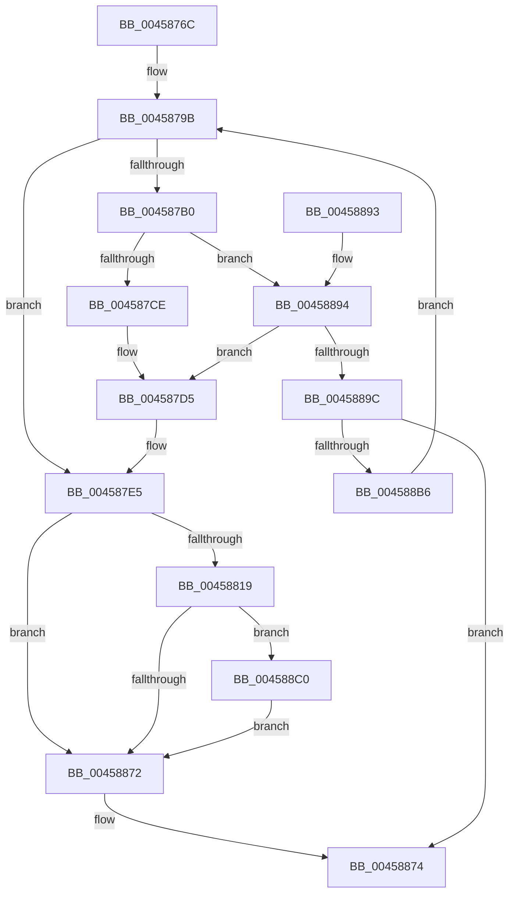

# MiUpdateLastSubsectionSize

- RVA: `0x0045876C`–`0x004588E2` (길이 `374` bytes)
- VA: `0x000000014045876C`
- 실행 섹션: `.text`
- PDB 이름 있음: `예`; PDB Function 태그: `아니요`
- unwind 정보 RVA: `0x000A8C94`
- 디코드: `108`개 명령, `374/374` bytes 표시
- 미해석 바이트: `0` (있으면 어셈블리에 `.byte`로 보존)

> 이 문서는 커널 이미지의 기계어와 PDB 기호를 분석해 생성했습니다. 4번과 5번은 함수 원형과 자료형을 바이너리 사용 방식에서 추정한 C 해석이며 원본 소스 복구 결과는 아닙니다.

## 1. Dependencies

- 직접 호출 지점: **7**; 고유 호출 대상: **5**
- 직접 호출자로 확인된 함수: **1**
- RIP 상대 이미지 참조: **1**

### Outgoing calls
- `0x0045879E` → [ExAcquireSpinLockExclusive](../24/ExAcquireSpinLockExclusive_function_00248690.md) (function, `0x00248690`)
- `0x004587B3` → [MiGetSubsectionHoldingCrossPartitionReferences](MiGetSubsectionHoldingCrossPartitionReferences_function_004589E4.md) (function, `0x004589E4`)
- `0x004587BB` → [MiGetSubsectionHoldingCrossPartitionReferences](MiGetSubsectionHoldingCrossPartitionReferences_function_004589E4.md) (function, `0x004589E4`)
- `0x00458810` → [MiReleaseSpinLockExclusive](../24/MiReleaseSpinLockExclusive_function_002482C0.md) (function, `0x002482C0`)
- `0x004588A2` → [MiReleaseSpinLockExclusive](../24/MiReleaseSpinLockExclusive_function_002482C0.md) (function, `0x002482C0`)
- `0x004588AD` → [MiGetSubsectionCharges](MiGetSubsectionCharges_function_00458A04.md) (function, `0x00458A04`)
- `0x004588DB` → [MiReturnCrossPartitionSectionCharges](../4B/MiReturnCrossPartitionSectionCharges_function_004BA61C.md) (function, `0x004BA61C`)

### Direct callers
- [MmExtendSection](../../page/98/MmExtendSection_function_00982C38.md) at `0x00982DC0`
- [MmExtendSection](../../page/98/MmExtendSection_function_00982C38.md) at `0x00982E62`

### Static image references
- `0x004588C8` → RVA `0x00E30088` (`.data`; read)

## 2. Other-region calls and transfers

- 다른 실행 섹션으로 향하는 call: **0**
- 별도 외부 분기/꼬리 이동을 확인하지 못했습니다.

## 3. Assembly (complete function range)

```asm
0045876C  48 8B C4                        mov rax, rsp
0045876F  48 89 58 08                     mov qword ptr [rax + 8], rbx
00458773  48 89 68 10                     mov qword ptr [rax + 0x10], rbp
00458777  48 89 70 18                     mov qword ptr [rax + 0x18], rsi
0045877B  48 89 78 20                     mov qword ptr [rax + 0x20], rdi
0045877F  41 54                           push r12
00458781  41 56                           push r14
00458783  41 57                           push r15
00458785  48 83 EC 20                     sub rsp, 0x20
00458789  4C 8B 39                        mov r15, qword ptr [rcx]
0045878C  4C 8B E2                        mov r12, rdx
0045878F  41 8B F0                        mov esi, r8d
00458792  48 8B F9                        mov rdi, rcx
00458795  33 DB                           xor ebx, ebx
00458797  49 8D 6F 48                     lea rbp, [r15 + 0x48]
0045879B  48 8B CD                        mov rcx, rbp
0045879E  E8 ED FE DE FF                  call 0x140248690
004587A3  44 8A C0                        mov r8b, al
004587A6  41 B9 02 00 00 00               mov r9d, 2
004587AC  85 F6                           test esi, esi
004587AE  74 35                           je 0x1404587e5
004587B0  48 8B CF                        mov rcx, rdi
004587B3  E8 2C 02 00 00                  call 0x1404589e4
004587B8  48 8B C8                        mov rcx, rax
004587BB  E8 24 02 00 00                  call 0x1404589e4
004587C0  BA FF FF FF 3F                  mov edx, 0x3fffffff
004587C5  85 50 30                        test dword ptr [rax + 0x30], edx
004587C8  0F 85 C6 00 00 00               jne 0x140458894
004587CE  83 FB 01                        cmp ebx, 1
004587D1  41 0F 44 D9                     cmove ebx, r9d
004587D5  8B 47 34                        mov eax, dword ptr [rdi + 0x34]
004587D8  8B C8                           mov ecx, eax
004587DA  2B CE                           sub ecx, esi
004587DC  33 C8                           xor ecx, eax
004587DE  23 CA                           and ecx, edx
004587E0  33 C8                           xor ecx, eax
004587E2  89 4F 34                        mov dword ptr [rdi + 0x34], ecx
004587E5  8B 47 20                        mov eax, dword ptr [rdi + 0x20]
004587E8  48 8B CD                        mov rcx, rbp
004587EB  49 8B 04 24                     mov rax, qword ptr [r12]
004587EF  48 C1 E8 0C                     shr rax, 0xc
004587F3  2B 47 24                        sub eax, dword ptr [rdi + 0x24]
004587F6  89 47 28                        mov dword ptr [rdi + 0x28], eax
004587F9  8B 47 20                        mov eax, dword ptr [rdi + 0x20]
004587FC  41 8B 14 24                     mov edx, dword ptr [r12]
00458800  25 FF FF 0F 00                  and eax, 0xfffff
00458805  C1 E2 14                        shl edx, 0x14
00458808  0B D0                           or edx, eax
0045880A  89 57 20                        mov dword ptr [rdi + 0x20], edx
0045880D  41 8A D0                        mov dl, r8b
00458810  E8 AB FA DE FF                  call 0x1402482c0
00458815  85 F6                           test esi, esi
00458817  74 59                           je 0x140458872
00458819  4D 8B 17                        mov r10, qword ptr [r15]
0045881C  48 83 C9 FF                     or rcx, 0xffffffffffffffff
00458820  48 8B C1                        mov rax, rcx
00458823  F0 49 0F B1 4A 18               lock cmpxchg qword ptr [r10 + 0x18], rcx
00458829  BA FF 03 00 00                  mov edx, 0x3ff
0045882E  48 8B CE                        mov rcx, rsi
00458831  48 C1 E1 0C                     shl rcx, 0xc
00458835  48 03 C8                        add rcx, rax
00458838  49 87 4A 18                     xchg qword ptr [r10 + 0x18], rcx
0045883C  45 0F B7 4A 0C                  movzx r9d, word ptr [r10 + 0xc]
00458841  41 8B 42 08                     mov eax, dword ptr [r10 + 8]
00458845  41 8B C9                        mov ecx, r9d
00458848  48 23 CA                        and rcx, rdx
0045884B  48 C1 E1 20                     shl rcx, 0x20
0045884F  48 0B C8                        or rcx, rax
00458852  48 03 CE                        add rcx, rsi
00458855  41 89 4A 08                     mov dword ptr [r10 + 8], ecx
00458859  48 C1 E9 20                     shr rcx, 0x20
0045885D  66 41 33 C9                     xor cx, r9w
00458861  66 23 CA                        and cx, dx
00458864  66 41 33 C9                     xor cx, r9w
00458868  66 41 89 4A 0C                  mov word ptr [r10 + 0xc], cx
0045886D  83 FB 02                        cmp ebx, 2
00458870  74 4E                           je 0x1404588c0
00458872  33 C0                           xor eax, eax
00458874  48 8B 5C 24 40                  mov rbx, qword ptr [rsp + 0x40]
00458879  48 8B 6C 24 48                  mov rbp, qword ptr [rsp + 0x48]
0045887E  48 8B 74 24 50                  mov rsi, qword ptr [rsp + 0x50]
00458883  48 8B 7C 24 58                  mov rdi, qword ptr [rsp + 0x58]
00458888  48 83 C4 20                     add rsp, 0x20
0045888C  41 5F                           pop r15
0045888E  41 5E                           pop r14
00458890  41 5C                           pop r12
00458892  C3                              ret
00458893  CC                              int3
00458894  85 DB                           test ebx, ebx
00458896  0F 85 39 FF FF FF               jne 0x1404587d5
0045889C  41 8A D0                        mov dl, r8b
0045889F  48 8B CD                        mov rcx, rbp
004588A2  E8 19 FA DE FF                  call 0x1402482c0
004588A7  48 8B D6                        mov rdx, rsi
004588AA  48 8B CF                        mov rcx, rdi
004588AD  E8 52 01 00 00                  call 0x140458a04
004588B2  85 C0                           test eax, eax
004588B4  78 BE                           js 0x140458874
004588B6  BB 01 00 00 00                  mov ebx, 1
004588BB  E9 DB FE FF FF                  jmp 0x14045879b
004588C0  41 0F B7 47 3C                  movzx eax, word ptr [r15 + 0x3c]
004588C5  4C 8B C6                        mov r8, rsi
004588C8  48 8B 0D B9 77 9D 00            mov rcx, qword ptr [rip + 0x9d77b9]
004588CF  48 23 C2                        and rax, rdx
004588D2  BA 01 00 00 00                  mov edx, 1
004588D7  48 8B 0C C1                     mov rcx, qword ptr [rcx + rax*8]
004588DB  E8 3C 1D 06 00                  call 0x1404ba61c
004588E0  EB 90                           jmp 0x140458872
```

## 4. C-style interpretation (structured pseudocode)

```c
__int64 __fastcall MiUpdateLastSubsectionSize(__int64 a1, __int64 a2, int a3)
{
    __int64 result;
    __int64 v_rbx;
    __int64 v_rsp;
    unsigned __int64 v_stack_p10;
    unsigned __int64 v_stack_p18;
    unsigned __int64 v_stack_p20;
    unsigned __int64 v_stack_p8;

    *(unsigned __int64 *)(v_rsp + 8) = v_rbx;
    *(unsigned __int64 *)(v_rsp + 16) = v_rbp;
    *(unsigned __int64 *)(v_rsp + 24) = v_rsi;
    *(unsigned __int64 *)(v_rsp + 32) = v_rdi;
    v_rsp = (v_rsp) - (32);
    v_rbx = 0;
loc_0045879B:
    result = ExAcquireSpinLockExclusive(*(unsigned __int64 *)(a1) + 72, a2, a3, a4);
    if ((unsigned int)((unsigned int)(a3)) == 0) goto loc_004587E5;
    result = MiGetSubsectionHoldingCrossPartitionReferences(a1, a2, (unsigned __int8)(result), 2);
    result = MiGetSubsectionHoldingCrossPartitionReferences(result, a2, (unsigned __int8)(result), 2);
    if (((*(unsigned int *)(result + 48)) & ((unsigned int)((unsigned int)(0x3FFFFFFFULL)))) != 0) goto loc_00458894;
    if (0 == 1) { v_rbx = 2; }
loc_004587D5:
    a1 = (unsigned int)(((unsigned int)((unsigned int)((unsigned int)(*(unsigned int *)(a1 + 52))))) - ((unsigned int)((unsigned int)(a3))));
    a1 = (unsigned int)((a1) ^ ((unsigned int)((unsigned int)(*(unsigned int *)(a1 + 52)))));
    a1 = (unsigned int)((a1) & ((unsigned int)((unsigned int)(0x3FFFFFFFULL))));
    a1 = (unsigned int)((a1) ^ ((unsigned int)((unsigned int)(*(unsigned int *)(a1 + 52)))));
    *(unsigned int *)(a1 + 52) = (unsigned int)(a1);
loc_004587E5:
    result = (*(unsigned __int64 *)(a2)) >> (12);
    result = (unsigned int)((result) - (*(unsigned int *)(a1 + 36)));
    *(unsigned int *)(a1 + 40) = (unsigned int)(result);
    result = (unsigned int)(((unsigned int)(*(unsigned int *)(a1 + 32))) & (0xFFFFFULL));
    a2 = (unsigned int)(((unsigned int)(*(unsigned int *)(a2))) << (20));
    a2 = (unsigned int)((a2) | ((unsigned int)(result)));
    *(unsigned int *)(a1 + 32) = (unsigned int)(a2);
    result = MiReleaseSpinLockExclusive(*(unsigned __int64 *)(a1) + 72, (unsigned __int8)((unsigned __int8)(result)), (unsigned __int8)(result), 2);
    if ((unsigned int)((unsigned int)(a3)) == 0) goto loc_00458872;
    a1 = (*(unsigned __int64 *)(a1) + 72) | (-1);
    a1 = ((unsigned int)(a3)) << (12);
    a1 = (a1) + (a1);
    a1 = ((unsigned int)((unsigned int)(*(unsigned __int16 *)(*(unsigned __int64 *)(*(unsigned __int64 *)(a1)) + 12)))) & ((unsigned int)(0x3FFULL));
    a1 = (a1) << (32);
    a1 = (a1) | ((unsigned int)(*(unsigned int *)(*(unsigned __int64 *)(*(unsigned __int64 *)(a1)) + 8)));
    a1 = (a1) + ((unsigned int)(a3));
    *(unsigned int *)(*(unsigned __int64 *)(*(unsigned __int64 *)(a1)) + 8) = (unsigned int)(a1);
    a1 = (a1) >> (32);
    a1 = (unsigned __int16)((a1) ^ ((unsigned __int16)(*(unsigned __int16 *)(*(unsigned __int64 *)(*(unsigned __int64 *)(a1)) + 12))));
    a1 = (unsigned __int16)((a1) & ((unsigned __int16)((unsigned int)(0x3FFULL))));
    a1 = (unsigned __int16)((a1) ^ ((unsigned __int16)(*(unsigned __int16 *)(*(unsigned __int64 *)(*(unsigned __int64 *)(a1)) + 12))));
    *(unsigned __int16 *)(*(unsigned __int64 *)(*(unsigned __int64 *)(a1)) + 12) = (unsigned __int16)(a1);
    if (((unsigned int)(v_rbx)) == 2) goto loc_004588C0;
loc_00458872:
    result = 0;
loc_00458874:
    v_rsp = (v_rsp) + (32);
    return result;
loc_00458894:
    if ((unsigned int)(v_stack_p8) != 0) goto loc_004587D5;
    result = MiReleaseSpinLockExclusive(v_stack_p10, (unsigned __int8)((unsigned __int8)(result)), (unsigned __int8)(result), *(unsigned __int16 *)(*(unsigned __int64 *)(*(unsigned __int64 *)(a1)) + 12));
    result = MiGetSubsectionCharges(v_stack_p20, v_stack_p18, (unsigned __int8)(result), *(unsigned __int16 *)(*(unsigned __int64 *)(*(unsigned __int64 *)(a1)) + 12));
    if (sign_flag) goto loc_00458874;
    goto loc_0045879B;
loc_004588C0:
    result = (*(unsigned __int16 *)(*(unsigned __int64 *)(a1) + 60)) & (v_stack_p18);
    result = MiReturnCrossPartitionSectionCharges(*(unsigned __int64 *)(*(unsigned __int64 *)(v_rip + 10319801) + result * 8), 1, v_stack_p18, *(unsigned __int16 *)(*(unsigned __int64 *)(*(unsigned __int64 *)(a1)) + 12));
    goto loc_00458872;
}
```

## 5. (Beta) C Style

```c
int64_t MiUpdateLastSubsectionSize(void *Arg1, void *Arg2, int32_t Arg3)
{
    uint8_t *arg1 = (uint8_t *)Arg1;
    uint8_t *arg2 = (uint8_t *)Arg2;

    int64_t result;
    int64_t local_rbx;
    int64_t local_rsp;
    uint64_t v_stack_p10;
    uint64_t v_stack_p18;
    uint64_t v_stack_p20;
    uint64_t v_stack_p8;

    *(uint64_t *)(local_rsp + 0x8) = local_rbx;
    *(uint64_t *)(local_rsp + 0x10) = local_rbp;
    *(uint64_t *)(local_rsp + 0x18) = local_rsi;
    *(uint64_t *)(local_rsp + 0x20) = local_rdi;
    local_rsp = (local_rsp) - (32);
    local_rbx = 0;
loc_0045879B:
    result = ExAcquireSpinLockExclusive(*(uint64_t *)(arg1) + 72, Arg2, Arg3, a4);
    if ((uint32_t)((uint32_t)(Arg3)) == 0) goto loc_004587E5;
    result = MiGetSubsectionHoldingCrossPartitionReferences(Arg1, Arg2, (uint8_t)(result), 2);
    result = MiGetSubsectionHoldingCrossPartitionReferences(result, Arg2, (uint8_t)(result), 2);
    if (((*(uint32_t *)(result + 0x30)) & ((uint32_t)((uint32_t)(0x3FFFFFFFULL)))) != 0) goto loc_00458894;
    if (0 == 1) { local_rbx = 2; }
loc_004587D5:
    Arg1 = (uint32_t)(((uint32_t)((uint32_t)((uint32_t)(*(uint32_t *)(arg1 + 0x34))))) - ((uint32_t)((uint32_t)(Arg3))));
    Arg1 = (uint32_t)((Arg1) ^ ((uint32_t)((uint32_t)(*(uint32_t *)(arg1 + 0x34)))));
    Arg1 = (uint32_t)((Arg1) & ((uint32_t)((uint32_t)(0x3FFFFFFFULL))));
    Arg1 = (uint32_t)((Arg1) ^ ((uint32_t)((uint32_t)(*(uint32_t *)(arg1 + 0x34)))));
    *(uint32_t *)(arg1 + 0x34) = (uint32_t)(Arg1);
loc_004587E5:
    result = (*(uint64_t *)(arg2)) >> (12);
    result = (uint32_t)((result) - (*(uint32_t *)(arg1 + 0x24)));
    *(uint32_t *)(arg1 + 0x28) = (uint32_t)(result);
    result = (uint32_t)(((uint32_t)(*(uint32_t *)(arg1 + 0x20))) & (0xFFFFFULL));
    Arg2 = (uint32_t)(((uint32_t)(*(uint32_t *)(arg2))) << (20));
    Arg2 = (uint32_t)((Arg2) | ((uint32_t)(result)));
    *(uint32_t *)(arg1 + 0x20) = (uint32_t)(Arg2);
    result = MiReleaseSpinLockExclusive(*(uint64_t *)(arg1) + 72, (uint8_t)((uint8_t)(result)), (uint8_t)(result), 2);
    if ((uint32_t)((uint32_t)(Arg3)) == 0) goto loc_00458872;
    Arg1 = (*(uint64_t *)(arg1) + 72) | (-1);
    Arg1 = ((uint32_t)(Arg3)) << (12);
    Arg1 = (Arg1) + (Arg1);
    Arg1 = ((uint32_t)((uint32_t)(*(uint16_t *)(*(uint64_t *)(*(uint64_t *)(arg1)) + 0xC)))) & ((uint32_t)(0x3FFULL));
    Arg1 = (Arg1) << (32);
    Arg1 = (Arg1) | ((uint32_t)(*(uint32_t *)(*(uint64_t *)(*(uint64_t *)(arg1)) + 0x8)));
    Arg1 = (Arg1) + ((uint32_t)(Arg3));
    *(uint32_t *)(*(uint64_t *)(*(uint64_t *)(arg1)) + 0x8) = (uint32_t)(Arg1);
    Arg1 = (Arg1) >> (32);
    Arg1 = (uint16_t)((Arg1) ^ ((uint16_t)(*(uint16_t *)(*(uint64_t *)(*(uint64_t *)(arg1)) + 0xC))));
    Arg1 = (uint16_t)((Arg1) & ((uint16_t)((uint32_t)(0x3FFULL))));
    Arg1 = (uint16_t)((Arg1) ^ ((uint16_t)(*(uint16_t *)(*(uint64_t *)(*(uint64_t *)(arg1)) + 0xC))));
    *(uint16_t *)(*(uint64_t *)(*(uint64_t *)(arg1)) + 0xC) = (uint16_t)(Arg1);
    if (((uint32_t)(local_rbx)) == 2) goto loc_004588C0;
loc_00458872:
    result = 0;
loc_00458874:
    local_rsp = (local_rsp) + (32);
    return result;
loc_00458894:
    if ((uint32_t)(v_stack_p8) != 0) goto loc_004587D5;
    result = MiReleaseSpinLockExclusive(v_stack_p10, (uint8_t)((uint8_t)(result)), (uint8_t)(result), *(uint16_t *)(*(uint64_t *)(*(uint64_t *)(arg1)) + 0xC));
    result = MiGetSubsectionCharges(v_stack_p20, v_stack_p18, (uint8_t)(result), *(uint16_t *)(*(uint64_t *)(*(uint64_t *)(arg1)) + 0xC));
    if (sign_flag) goto loc_00458874;
    goto loc_0045879B;
loc_004588C0:
    result = (*(uint16_t *)(*(uint64_t *)(arg1) + 0x3C)) & (v_stack_p18);
    result = MiReturnCrossPartitionSectionCharges(*(uint64_t *)(*(uint64_t *)(v_rip + 0x9D77B9) + result * 8), 1, v_stack_p18, *(uint16_t *)(*(uint64_t *)(*(uint64_t *)(arg1)) + 0xC));
    goto loc_00458872;
}
```

### 관측된 메모리 오프셋

구조체 형식이 확인되지 않은 접근은 인자 기준의 오프셋으로만 기록했습니다.

| 기준 인자 | 오프셋 표현 | 폭 (bit) | 접근 |
|---|---:|---:|---|
| `Arg1` | `+ 0x0` | `64` | `R` |
| `Arg1` | `+ 0x20` | `32` | `R` |
| `Arg1` | `+ 0x20` | `32` | `W` |
| `Arg1` | `+ 0x24` | `32` | `R` |
| `Arg1` | `+ 0x28` | `32` | `W` |
| `Arg1` | `+ 0x34` | `32` | `R` |
| `Arg1` | `+ 0x34` | `32` | `W` |
| `Arg2` | `+ 0x0` | `32` | `R` |
| `Arg2` | `+ 0x0` | `64` | `R` |

## 6. Execution-region graph

[열기: 2D/3D 그래프와 함수 탐색 컨트롤 패널](../../../control-panel.html?section=text&rva=0x0045876C&view=graph)

- 2D 그래프는 위에서 아래로 흐르고, 3D 그래프는 빈 공간을 드래그해 회전합니다. Shift+드래그는 이동, 휠은 확대·축소, 함수 노드 선택은 대상 보고서 이동입니다.

### Static fallback


