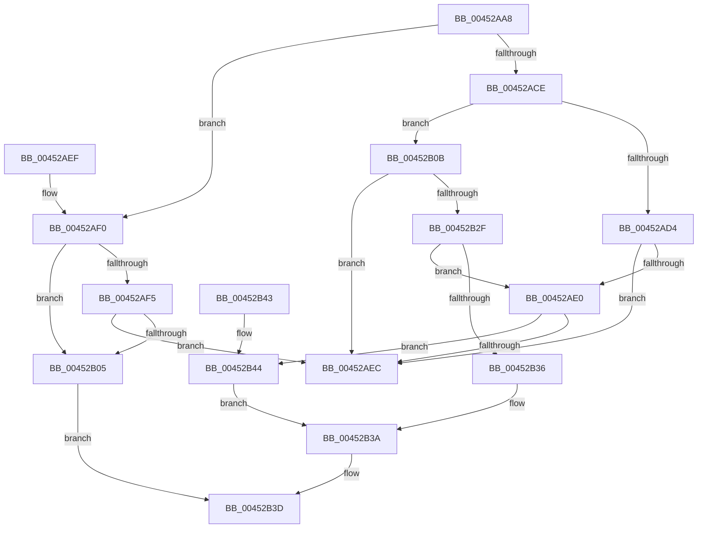

# MiValidateControlAreaPartition

- RVA: `0x00452AA8`–`0x00452B48` (길이 `160` bytes)
- VA: `0x0000000140452AA8`
- 실행 섹션: `.text`
- PDB 이름 있음: `예`; PDB Function 태그: `아니요`
- unwind 정보 RVA: `0x000DB714`
- 디코드: `46`개 명령, `160/160` bytes 표시
- 미해석 바이트: `0` (있으면 어셈블리에 `.byte`로 보존)

> 이 문서는 커널 이미지의 기계어와 PDB 기호를 분석해 생성했습니다. 4번과 5번은 함수 원형과 자료형을 바이너리 사용 방식에서 추정한 C 해석이며 원본 소스 복구 결과는 아닙니다.

## 1. Dependencies

- 직접 호출 지점: **0**; 고유 호출 대상: **0**
- 직접 호출자로 확인된 함수: **1**
- RIP 상대 이미지 참조: **2**

### Outgoing calls
- 직접 디코드된 call 명령이 없습니다.

### Direct callers
- [MiShareExistingControlArea](../../page/98/MiShareExistingControlArea_function_00984FAC.md) at `0x00984FD4`

### Static image references
- `0x00452AB0` → RVA `0x00E30088` (`.data`; read)
- `0x00452AD4` → RVA `0x00E38D00` (`.data`; read)

## 2. Other-region calls and transfers

- 다른 실행 섹션으로 향하는 call: **0**
- 별도 외부 분기/꼬리 이동을 확인하지 못했습니다.

## 3. Assembly (complete function range)

```asm
00452AA8  44 0F B7 42 3C                  movzx r8d, word ptr [rdx + 0x3c]
00452AAD  4C 8B C9                        mov r9, rcx
00452AB0  48 8B 05 D1 D5 9D 00            mov rax, qword ptr [rip + 0x9dd5d1]
00452AB7  41 81 E0 FF 03 00 00            and r8d, 0x3ff
00452ABE  4E 8B 14 C0                     mov r10, qword ptr [rax + r8*8]
00452AC2  48 8B 81 B0 00 00 00            mov rax, qword ptr [rcx + 0xb0]
00452AC9  48 85 C0                        test rax, rax
00452ACC  75 22                           jne 0x140452af0
00452ACE  F6 42 3E 01                     test byte ptr [rdx + 0x3e], 1
00452AD2  75 37                           jne 0x140452b0b
00452AD4  48 8D 05 25 62 9E 00            lea rax, [rip + 0x9e6225]
00452ADB  4C 3B D0                        cmp r10, rax
00452ADE  74 0C                           je 0x140452aec
00452AE0  41 8B 01                        mov eax, dword ptr [r9]
00452AE3  B9 00 00 00 01                  mov ecx, 0x1000000
00452AE8  85 C1                           test ecx, eax
00452AEA  74 58                           je 0x140452b44
00452AEC  33 C0                           xor eax, eax
00452AEE  C3                              ret
00452AEF  CC                              int3
00452AF0  4C 39 10                        cmp qword ptr [rax], r10
00452AF3  75 10                           jne 0x140452b05
00452AF5  8B 01                           mov eax, dword ptr [rcx]
00452AF7  0F B6 52 3E                     movzx edx, byte ptr [rdx + 0x3e]
00452AFB  C1 E8 16                        shr eax, 0x16
00452AFE  33 D0                           xor edx, eax
00452B00  F6 C2 01                        test dl, 1
00452B03  74 E7                           je 0x140452aec
00452B05  0F BA 29 17                     bts dword ptr [rcx], 0x17
00452B09  EB 32                           jmp 0x140452b3d
00452B0B  65 48 8B 04 25 88 01 00 00      mov rax, qword ptr gs:[0x188]
00452B14  48 8B 88 B8 00 00 00            mov rcx, qword ptr [rax + 0xb8]
00452B1B  48 8B 05 66 D5 9D 00            mov rax, qword ptr [rip + 0x9dd566]
00452B22  0F B7 91 AE 04 00 00            movzx edx, word ptr [rcx + 0x4ae]
00452B29  4C 3B 14 D0                     cmp r10, qword ptr [rax + rdx*8]
00452B2D  74 BD                           je 0x140452aec
00452B2F  41 8B 01                        mov eax, dword ptr [r9]
00452B32  A8 01                           test al, 1
00452B34  75 AA                           jne 0x140452ae0
00452B36  0F BA E8 17                     bts eax, 0x17
00452B3A  41 89 01                        mov dword ptr [r9], eax
00452B3D  B8 76 04 00 C0                  mov eax, 0xc0000476
00452B42  C3                              ret
00452B43  CC                              int3
00452B44  0B C1                           or eax, ecx
00452B46  EB F2                           jmp 0x140452b3a
```

## 4. C-style interpretation (structured pseudocode)

```c
__int64 __fastcall MiValidateControlAreaPartition(__int64 a1, __int64 a2)
{
    __int64 result;

    a3 = (unsigned int)((*(unsigned __int16 *)(a2 + 60)) & (0x3FFULL));
    if (*(unsigned __int64 *)(a1 + 176) != 0) goto loc_00452AF0;
    if (((*(unsigned __int8 *)(a2 + 62)) & (1)) != 0) goto loc_00452B0B;
    if ((*(unsigned __int64 *)(*(unsigned __int64 *)(v_rip + 10343889) + a3 * 8)) == (v_rip + 10379813)) goto loc_00452AEC;
loc_00452AE0:
    if ((((unsigned int)((unsigned int)(0x1000000ULL))) & ((unsigned int)((unsigned int)(*(unsigned int *)(a1))))) == 0) goto loc_00452B44;
loc_00452AEC:
    result = 0;
    return result;
loc_00452AF0:
    if ((*(unsigned __int64 *)(result)) != (*(unsigned __int64 *)(*(unsigned __int64 *)(v_rip + 10343889) + a3 * 8))) goto loc_00452B05;
    result = (unsigned int)(((unsigned int)(*(unsigned int *)((unsigned int)(0x1000000ULL)))) >> (22));
    a2 = (unsigned int)((*(unsigned __int8 *)(a2 + 62)) ^ ((unsigned int)(result)));
    if ((((unsigned __int8)(a2)) & (1)) == 0) goto loc_00452AEC;
loc_00452B05:
    goto loc_00452B3D;
loc_00452B0B:
    if ((*(unsigned __int64 *)(*(unsigned __int64 *)(v_rip + 10343889) + a3 * 8)) == (*(unsigned __int64 *)(*(unsigned __int64 *)(v_rip + 10343782) + *(unsigned __int16 *)(*(unsigned __int64 *)(*(unsigned __int64 *)(gs_base + (0 + 392)) + 184) + 1198) * 8))) goto loc_00452AEC;
    if ((((unsigned __int8)((unsigned int)(*(unsigned int *)(a1)))) & (1)) != 0) goto loc_00452AE0;
loc_00452B3A:
    *(unsigned int *)(a1) = (unsigned int)((unsigned int)(*(unsigned int *)(a1)));
loc_00452B3D:
    return (unsigned int)(0xC0000476ULL);
loc_00452B44:
    result = (unsigned int)(((unsigned int)(0xC0000476ULL)) | ((unsigned int)(*(unsigned __int64 *)(*(unsigned __int64 *)(gs_base + (0 + 392)) + 184))));
    goto loc_00452B3A;
}
```

## 5. (Beta) C Style

```c
int64_t MiValidateControlAreaPartition(void *Arg1, void *Arg2)
{
    uint8_t *arg1 = (uint8_t *)Arg1;
    uint8_t *arg2 = (uint8_t *)Arg2;

    int64_t result;

    a3 = (uint32_t)((*(uint16_t *)(arg2 + 0x3C)) & (0x3FFULL));
    if (*(uint64_t *)(arg1 + 0xB0) != 0) goto loc_00452AF0;
    if (((*(uint8_t *)(arg2 + 0x3E)) & (1)) != 0) goto loc_00452B0B;
    if ((*(uint64_t *)(*(uint64_t *)(v_rip + 0x9DD5D1) + a3 * 8)) == (v_rip + 10379813)) goto loc_00452AEC;
loc_00452AE0:
    if ((((uint32_t)((uint32_t)(0x1000000ULL))) & ((uint32_t)((uint32_t)(*(uint32_t *)(arg1))))) == 0) goto loc_00452B44;
loc_00452AEC:
    result = 0;
    return result;
loc_00452AF0:
    if ((*(uint64_t *)(result)) != (*(uint64_t *)(*(uint64_t *)(v_rip + 0x9DD5D1) + a3 * 8))) goto loc_00452B05;
    result = (uint32_t)(((uint32_t)(*(uint32_t *)((uint32_t)(0x1000000ULL)))) >> (22));
    Arg2 = (uint32_t)((*(uint8_t *)(arg2 + 0x3E)) ^ ((uint32_t)(result)));
    if ((((uint8_t)(Arg2)) & (1)) == 0) goto loc_00452AEC;
loc_00452B05:
    goto loc_00452B3D;
loc_00452B0B:
    if ((*(uint64_t *)(*(uint64_t *)(v_rip + 0x9DD5D1) + a3 * 8)) == (*(uint64_t *)(*(uint64_t *)(v_rip + 0x9DD566) + *(uint16_t *)(*(uint64_t *)(*(uint64_t *)(gs_base + (0 + 0x188)) + 0xB8) + 0x4AE) * 8))) goto loc_00452AEC;
    if ((((uint8_t)((uint32_t)(*(uint32_t *)(arg1)))) & (1)) != 0) goto loc_00452AE0;
loc_00452B3A:
    *(uint32_t *)(arg1) = (uint32_t)((uint32_t)(*(uint32_t *)(arg1)));
loc_00452B3D:
    return (uint32_t)(0xC0000476ULL);
loc_00452B44:
    result = (uint32_t)(((uint32_t)(0xC0000476ULL)) | ((uint32_t)(*(uint64_t *)(*(uint64_t *)(gs_base + (0 + 0x188)) + 0xB8))));
    goto loc_00452B3A;
}
```

### 관측된 메모리 오프셋

구조체 형식이 확인되지 않은 접근은 인자 기준의 오프셋으로만 기록했습니다.

| 기준 인자 | 오프셋 표현 | 폭 (bit) | 접근 |
|---|---:|---:|---|
| `Arg1` | `+ 0x0` | `32` | `R` |
| `Arg1` | `+ 0x0` | `32` | `R/W` |
| `Arg1` | `+ 0x0` | `32` | `W` |
| `Arg1` | `+ 0xB0` | `64` | `R` |
| `Arg2` | `+ 0x3C` | `16` | `R` |
| `Arg2` | `+ 0x3E` | `8` | `R` |

## 6. Execution-region graph

[열기: 2D/3D 그래프와 함수 탐색 컨트롤 패널](../../../control-panel.html?section=text&rva=0x00452AA8&view=graph)

- 2D 그래프는 위에서 아래로 흐르고, 3D 그래프는 빈 공간을 드래그해 회전합니다. Shift+드래그는 이동, 휠은 확대·축소, 함수 노드 선택은 대상 보고서 이동입니다.

### Static fallback


