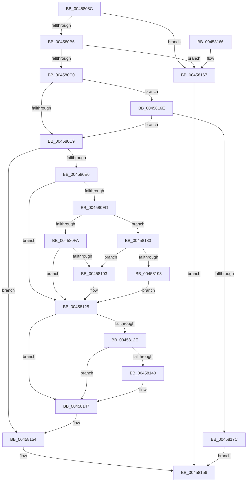

# MmChangeSectionBackingFile

- RVA: `0x0045808C`–`0x00458195` (길이 `265` bytes)
- VA: `0x000000014045808C`
- 실행 섹션: `.text`
- PDB 이름 있음: `예`; PDB Function 태그: `아니요`
- unwind 정보 RVA: `0x000A828C`
- 디코드: `69`개 명령, `265/265` bytes 표시
- 미해석 바이트: `0` (있으면 어셈블리에 `.byte`로 보존)

> 이 문서는 커널 이미지의 기계어와 PDB 기호를 분석해 생성했습니다. 4번과 5번은 함수 원형과 자료형을 바이너리 사용 방식에서 추정한 C 해석이며 원본 소스 복구 결과는 아닙니다.

## 1. Dependencies

- 직접 호출 지점: **5**; 고유 호출 대상: **5**
- 직접 호출자로 확인된 함수: **2**
- RIP 상대 이미지 참조: **0**

### Outgoing calls
- `0x004580D9` → [MiLockSectionControlArea](../2B/MiLockSectionControlArea_function_002BC930.md) (function, `0x002BC930`)
- `0x00458106` → [ObFastReplaceObject](ObFastReplaceObject_function_0045819C.md) (function, `0x0045819C`)
- `0x00458113` → [ObfReferenceObjectWithTag](../21/ObfReferenceObjectWithTag_function_00210710.md) (function, `0x00210710`)
- `0x00458120` → [ObDereferenceObjectDeferDeleteWithTag](../26/ObDereferenceObjectDeferDeleteWithTag_function_00263EA0.md) (function, `0x00263EA0`)
- `0x0045814F` → [MiReleaseSpinLockExclusive](../24/MiReleaseSpinLockExclusive_function_002482C0.md) (function, `0x002482C0`)

### Direct callers
- [FsRtlChangeBackingFileObject](FsRtlChangeBackingFileObject_function_00458040.md) at `0x00458052`
- [MiShareExistingControlArea](../../page/98/MiShareExistingControlArea_function_00984FAC.md) at `0x00985103`

### Static image references
- 디코드된 RIP-relative 메모리 참조가 없습니다.

## 2. Other-region calls and transfers

- 다른 실행 섹션으로 향하는 call: **0**
- 별도 외부 분기/꼬리 이동을 확인하지 못했습니다.

## 3. Assembly (complete function range)

```asm
0045808C  48 89 5C 24 08                  mov qword ptr [rsp + 8], rbx
00458091  48 89 74 24 10                  mov qword ptr [rsp + 0x10], rsi
00458096  57                              push rdi
00458097  48 83 EC 20                     sub rsp, 0x20
0045809B  C6 44 24 40 00                  mov byte ptr [rsp + 0x40], 0
004580A0  45 8B C8                        mov r9d, r8d
004580A3  48 8B F2                        mov rsi, rdx
004580A6  48 8B F9                        mov rdi, rcx
004580A9  41 F7 C0 FC FF FF FF            test r8d, 0xfffffffc
004580B0  0F 85 B1 00 00 00               jne 0x140458167
004580B6  41 83 F8 03                     cmp r8d, 3
004580BA  0F 84 A7 00 00 00               je 0x140458167
004580C0  48 85 C9                        test rcx, rcx
004580C3  0F 85 A5 00 00 00               jne 0x14045816e
004580C9  48 8B 4E 28                     mov rcx, qword ptr [rsi + 0x28]
004580CD  4C 8D 44 24 40                  lea r8, [rsp + 0x40]
004580D2  41 83 E1 01                     and r9d, 1
004580D6  41 8B D1                        mov edx, r9d
004580D9  E8 52 48 E6 FF                  call 0x1402bc930
004580DE  48 8B D8                        mov rbx, rax
004580E1  48 85 C0                        test rax, rax
004580E4  74 6E                           je 0x140458154
004580E6  8B 40 38                        mov eax, dword ptr [rax + 0x38]
004580E9  A8 01                           test al, 1
004580EB  75 38                           jne 0x140458125
004580ED  48 8D 4B 40                     lea rcx, [rbx + 0x40]
004580F1  48 85 FF                        test rdi, rdi
004580F4  0F 85 89 00 00 00               jne 0x140458183
004580FA  48 8B 39                        mov rdi, qword ptr [rcx]
004580FD  48 83 E7 F0                     and rdi, 0xfffffffffffffff0
00458101  74 22                           je 0x140458125
00458103  48 8B D6                        mov rdx, rsi
00458106  E8 91 00 00 00                  call 0x14045819c
0045810B  BA 4D 6D 53 43                  mov edx, 0x43536d4d
00458110  48 8B CE                        mov rcx, rsi
00458113  E8 F8 85 DB FF                  call 0x140210710
00458118  BA 4D 6D 53 43                  mov edx, 0x43536d4d
0045811D  48 8B CF                        mov rcx, rdi
00458120  E8 7B BD E0 FF                  call 0x140263ea0
00458125  8B 53 38                        mov edx, dword ptr [rbx + 0x38]
00458128  0F BA E2 09                     bt edx, 9
0045812C  73 19                           jae 0x140458147
0045812E  65 48 8B 04 25 88 01 00 00      mov rax, qword ptr gs:[0x188]
00458137  F6 80 A8 05 00 00 40            test byte ptr [rax + 0x5a8], 0x40
0045813E  75 07                           jne 0x140458147
00458140  0F BA F2 09                     btr edx, 9
00458144  89 53 38                        mov dword ptr [rbx + 0x38], edx
00458147  8A 54 24 40                     mov dl, byte ptr [rsp + 0x40]
0045814B  48 8D 4B 48                     lea rcx, [rbx + 0x48]
0045814F  E8 6C 01 DF FF                  call 0x1402482c0
00458154  33 C0                           xor eax, eax
00458156  48 8B 5C 24 30                  mov rbx, qword ptr [rsp + 0x30]
0045815B  48 8B 74 24 38                  mov rsi, qword ptr [rsp + 0x38]
00458160  48 83 C4 20                     add rsp, 0x20
00458164  5F                              pop rdi
00458165  C3                              ret
00458166  CC                              int3
00458167  B8 F1 00 00 C0                  mov eax, 0xc00000f1
0045816C  EB E8                           jmp 0x140458156
0045816E  48 8B 42 28                     mov rax, qword ptr [rdx + 0x28]
00458172  48 39 41 28                     cmp qword ptr [rcx + 0x28], rax
00458176  0F 84 4D FF FF FF               je 0x1404580c9
0045817C  B8 F0 00 00 C0                  mov eax, 0xc00000f0
00458181  EB D3                           jmp 0x140458156
00458183  48 8B 01                        mov rax, qword ptr [rcx]
00458186  48 83 E0 F0                     and rax, 0xfffffffffffffff0
0045818A  48 3B C7                        cmp rax, rdi
0045818D  0F 84 70 FF FF FF               je 0x140458103
00458193  EB 90                           jmp 0x140458125
```

## 4. C-style interpretation (structured pseudocode)

```c
__int64 __fastcall MmChangeSectionBackingFile(__int64 a1, __int64 a2, int a3)
{
    __int64 result;
    __int64 v_rdi;
    __int64 v_rsp;
    unsigned __int64 v_stack_p10;
    unsigned __int8 v_stack_p18;
    unsigned __int64 v_stack_p8;

    v_stack_p8 = v_rbx;
    v_stack_p10 = v_rsi;
    v_rsp = (v_rsp) - (32);
    v_stack_p18 = 0;
    if (((a3) & (0xFFFFFFFCULL)) != 0) goto loc_00458167;
    if (a3 == 3) goto loc_00458167;
    if (a1 != 0) goto loc_0045816E;
loc_004580C9:
    a4 = (unsigned int)(((unsigned int)(a3)) & (1));
    result = MiLockSectionControlArea(*(unsigned __int64 *)(a2 + 40), (unsigned int)((unsigned int)(a4)), v_stack_p18, a4);
    if (result == 0) goto loc_00458154;
    if ((((unsigned __int8)((unsigned int)(*(unsigned int *)(result + 56)))) & (1)) != 0) goto loc_00458125;
    if (a1 != 0) goto loc_00458183;
    v_rdi = (*(unsigned __int64 *)(result + 64)) & (-16);
    result = (unsigned int)(*(unsigned int *)(result + 56));
    if (!(condition_is_equal)) {
        a2 = a2;
        result = ObFastReplaceObject(result + 64, a2, v_stack_p18, a4);
        a2 = 0x43536D4DULL;
        a1 = a2;
        result = ObfReferenceObjectWithTag(a1, a2, v_stack_p18, a4);
        a2 = 0x43536D4DULL;
        a1 = v_rdi;
        result = ObDereferenceObjectDeferDeleteWithTag(a1, a2, v_stack_p18, a4);
    }
    if (condition_is_above_or_equal) goto loc_00458147;
    if (((*(unsigned __int8 *)(*(unsigned __int64 *)(gs_base + (0 + 392)) + 1448)) & (64)) == 0) {
        *(unsigned int *)(result + 56) = (unsigned int)((unsigned int)(*(unsigned int *)(result + 56)));
    }
    result = MiReleaseSpinLockExclusive(result + 72, v_stack_p18, v_stack_p18, a4);
loc_00458154:
    result = 0;
loc_00458156:
    v_rsp = (v_rsp) + (32);
    return result;
loc_00458167:
    goto loc_00458156;
loc_0045816E:
    if ((*(unsigned __int64 *)(result + 72 + 40)) == (*(unsigned __int64 *)(v_stack_p18 + 40))) goto loc_004580C9;
    goto loc_00458156;
loc_00458183:
    result = (*(unsigned __int64 *)(result + 72)) & (-16);
    if (result == v_rdi) goto loc_00458103;
    goto loc_00458125;
}
```

## 5. (Beta) C Style

```c
int64_t MmChangeSectionBackingFile(int64_t Arg1, void *Arg2, int32_t Arg3)
{
    uint8_t *arg2 = (uint8_t *)Arg2;

    int64_t result;
    int64_t local_rdi;
    int64_t local_rsp;
    uint64_t v_stack_p10;
    uint8_t v_stack_p18;
    uint64_t v_stack_p8;

    v_stack_p8 = local_rbx;
    v_stack_p10 = local_rsi;
    local_rsp = (local_rsp) - (32);
    v_stack_p18 = 0;
    if (((Arg3) & (0xFFFFFFFCULL)) != 0) goto loc_00458167;
    if (Arg3 == 3) goto loc_00458167;
    if (Arg1 != 0) goto loc_0045816E;
loc_004580C9:
    a4 = (uint32_t)(((uint32_t)(Arg3)) & (1));
    result = MiLockSectionControlArea(*(uint64_t *)(arg2 + 0x28), (uint32_t)((uint32_t)(a4)), v_stack_p18, a4);
    if (result == 0) goto loc_00458154;
    if ((((uint8_t)((uint32_t)(*(uint32_t *)(result + 0x38)))) & (1)) != 0) goto loc_00458125;
    if (Arg1 != 0) goto loc_00458183;
    local_rdi = (*(uint64_t *)(result + 0x40)) & (-16);
    result = (uint32_t)(*(uint32_t *)(result + 0x38));
    if (!(condition_is_equal)) {
        Arg2 = Arg2;
        result = ObFastReplaceObject(result + 64, Arg2, v_stack_p18, a4);
        Arg2 = 0x43536D4DULL;
        Arg1 = Arg2;
        result = ObfReferenceObjectWithTag(Arg1, Arg2, v_stack_p18, a4);
        Arg2 = 0x43536D4DULL;
        Arg1 = local_rdi;
        result = ObDereferenceObjectDeferDeleteWithTag(Arg1, Arg2, v_stack_p18, a4);
    }
    if (condition_is_above_or_equal) goto loc_00458147;
    if (((*(uint8_t *)(*(uint64_t *)(gs_base + (0 + 0x188)) + 0x5A8)) & (64)) == 0) {
        *(uint32_t *)(result + 0x38) = (uint32_t)((uint32_t)(*(uint32_t *)(result + 0x38)));
    }
    result = MiReleaseSpinLockExclusive(result + 72, v_stack_p18, v_stack_p18, a4);
loc_00458154:
    result = 0;
loc_00458156:
    local_rsp = (local_rsp) + (32);
    return result;
loc_00458167:
    goto loc_00458156;
loc_0045816E:
    if ((*(uint64_t *)(result + 0x48 + 0x28)) == (*(uint64_t *)(v_stack_p18 + 0x28))) goto loc_004580C9;
    goto loc_00458156;
loc_00458183:
    result = (*(uint64_t *)(result + 0x48)) & (-16);
    if (result == local_rdi) goto loc_00458103;
    goto loc_00458125;
}
```

### 관측된 메모리 오프셋

구조체 형식이 확인되지 않은 접근은 인자 기준의 오프셋으로만 기록했습니다.

| 기준 인자 | 오프셋 표현 | 폭 (bit) | 접근 |
|---|---:|---:|---|
| `Arg2` | `+ 0x28` | `64` | `R` |

## 6. Execution-region graph

[열기: 2D/3D 그래프와 함수 탐색 컨트롤 패널](../../../control-panel.html?section=text&rva=0x0045808C&view=graph)

- 2D 그래프는 위에서 아래로 흐르고, 3D 그래프는 빈 공간을 드래그해 회전합니다. Shift+드래그는 이동, 휠은 확대·축소, 함수 노드 선택은 대상 보고서 이동입니다.

### Static fallback


