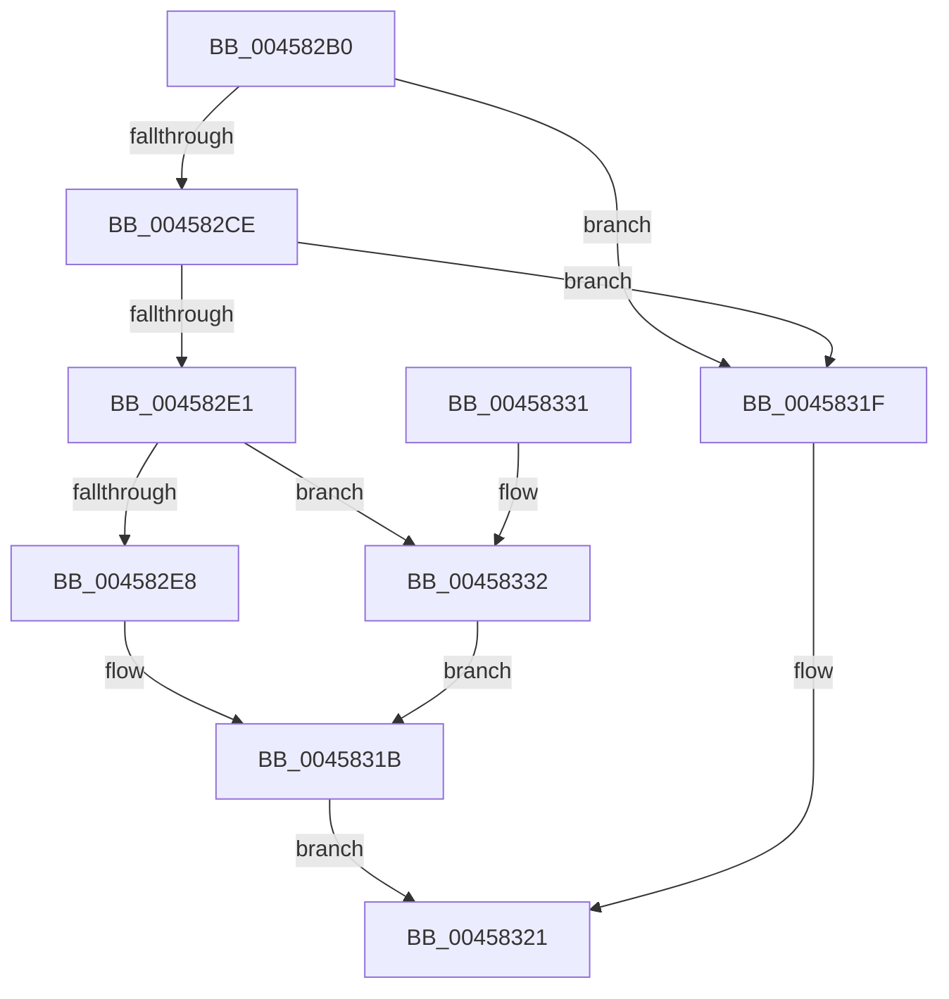

# MmGetImageFileSignatureInformation

- RVA: `0x004582B0`–`0x00458341` (길이 `145` bytes)
- VA: `0x00000001404582B0`
- 실행 섹션: `.text`
- PDB 이름 있음: `예`; PDB Function 태그: `아니요`
- unwind 정보 RVA: `0x000A8BA0`
- 디코드: `45`개 명령, `145/145` bytes 표시
- 미해석 바이트: `0` (있으면 어셈블리에 `.byte`로 보존)

> 이 문서는 커널 이미지의 기계어와 PDB 기호를 분석해 생성했습니다. 4번과 5번은 함수 원형과 자료형을 바이너리 사용 방식에서 추정한 C 해석이며 원본 소스 복구 결과는 아닙니다.

## 1. Dependencies

- 직접 호출 지점: **5**; 고유 호출 대상: **4**
- 직접 호출자로 확인된 함수: **0**
- RIP 상대 이미지 참조: **0**

### Outgoing calls
- `0x004582D4` → [MiLockSectionControlArea](../2B/MiLockSectionControlArea_function_002BC930.md) (function, `0x002BC930`)
- `0x004582EF` → [MiRemoveUnusedSegment](../2B/MiRemoveUnusedSegment_function_002BBE74.md) (function, `0x002BBE74`)
- `0x00458300` → [MiReleaseSpinLockExclusive](../24/MiReleaseSpinLockExclusive_function_002482C0.md) (function, `0x002482C0`)
- `0x00458316` → [MiDereferenceControlAreaBySection](MiDereferenceControlAreaBySection_function_00458348.md) (function, `0x00458348`)
- `0x0045833A` → [MiReleaseSpinLockExclusive](../24/MiReleaseSpinLockExclusive_function_002482C0.md) (function, `0x002482C0`)

### Direct callers
- 이 함수 시작 RVA로 연결되는 직접 call은 확인되지 않았습니다. 간접 호출은 완전히 역산할 수 없습니다.

### Static image references
- 디코드된 RIP-relative 메모리 참조가 없습니다.

## 2. Other-region calls and transfers

- 다른 실행 섹션으로 향하는 call: **0**
- 별도 외부 분기/꼬리 이동을 확인하지 못했습니다.

## 3. Assembly (complete function range)

```asm
004582B0  48 8B C4                        mov rax, rsp
004582B3  48 89 58 10                     mov qword ptr [rax + 0x10], rbx
004582B7  48 89 70 18                     mov qword ptr [rax + 0x18], rsi
004582BB  57                              push rdi
004582BC  48 83 EC 20                     sub rsp, 0x20
004582C0  48 8B 49 28                     mov rcx, qword ptr [rcx + 0x28]
004582C4  33 DB                           xor ebx, ebx
004582C6  88 58 08                        mov byte ptr [rax + 8], bl
004582C9  48 85 C9                        test rcx, rcx
004582CC  74 51                           je 0x14045831f
004582CE  4C 8D 40 08                     lea r8, [rax + 8]
004582D2  33 D2                           xor edx, edx
004582D4  E8 57 46 E6 FF                  call 0x1402bc930
004582D9  48 8B F8                        mov rdi, rax
004582DC  48 85 C0                        test rax, rax
004582DF  74 3E                           je 0x14045831f
004582E1  8B 40 38                        mov eax, dword ptr [rax + 0x38]
004582E4  A8 03                           test al, 3
004582E6  75 4A                           jne 0x140458332
004582E8  48 FF 47 18                     inc qword ptr [rdi + 0x18]
004582EC  48 8B CF                        mov rcx, rdi
004582EF  E8 80 3B E6 FF                  call 0x1402bbe74
004582F4  8A 54 24 30                     mov dl, byte ptr [rsp + 0x30]
004582F8  48 8D 4F 48                     lea rcx, [rdi + 0x48]
004582FC  48 FF 47 30                     inc qword ptr [rdi + 0x30]
00458300  E8 BB FF DE FF                  call 0x1402482c0
00458305  48 8B 07                        mov rax, qword ptr [rdi]
00458308  BA 01 00 00 00                  mov edx, 1
0045830D  48 8B CF                        mov rcx, rdi
00458310  8A 58 0F                        mov bl, byte ptr [rax + 0xf]
00458313  80 E3 0F                        and bl, 0xf
00458316  E8 2D 00 00 00                  call 0x140458348
0045831B  8A C3                           mov al, bl
0045831D  EB 02                           jmp 0x140458321
0045831F  32 C0                           xor al, al
00458321  48 8B 5C 24 38                  mov rbx, qword ptr [rsp + 0x38]
00458326  48 8B 74 24 40                  mov rsi, qword ptr [rsp + 0x40]
0045832B  48 83 C4 20                     add rsp, 0x20
0045832F  5F                              pop rdi
00458330  C3                              ret
00458331  CC                              int3
00458332  8A 54 24 30                     mov dl, byte ptr [rsp + 0x30]
00458336  48 8D 4F 48                     lea rcx, [rdi + 0x48]
0045833A  E8 81 FF DE FF                  call 0x1402482c0
0045833F  EB DA                           jmp 0x14045831b
```

## 4. C-style interpretation (structured pseudocode)

```c
__int64 __fastcall MmGetImageFileSignatureInformation(__int64 a1, int a2)
{
    __int64 result;
    __int64 v_rbx;
    __int64 v_rsp;
    unsigned __int64 v_stack_p10;
    unsigned __int64 v_stack_p18;
    unsigned __int8 v_stack_p30;
    unsigned __int8 v_stack_p8;

    *(unsigned __int64 *)(v_rsp + 16) = v_rbx;
    *(unsigned __int64 *)(v_rsp + 24) = v_rsi;
    v_rsp = (v_rsp) - (32);
    v_rbx = 0;
    *(unsigned __int8 *)(v_rsp + 8) = 0;
    if (*(unsigned __int64 *)(a1 + 40) == 0) goto loc_0045831F;
    a2 = 0;
    result = MiLockSectionControlArea(*(unsigned __int64 *)(a1 + 40), a2, v_rsp + 8, a4);
    if (result == 0) goto loc_0045831F;
    if ((((unsigned __int8)((unsigned int)(*(unsigned int *)(result + 56)))) & (3)) != 0) goto loc_00458332;
    result = MiRemoveUnusedSegment(result, a2, v_rsp + 8, a4);
    result = MiReleaseSpinLockExclusive(result + 72, v_stack_p8, v_rsp + 8, a4);
    v_rbx = (unsigned __int8)((*(unsigned __int8 *)(*(unsigned __int64 *)(result) + 15)) & (15));
    result = MiDereferenceControlAreaBySection(result, 1, v_rsp + 8, a4);
loc_0045831B:
    goto loc_00458321;
loc_0045831F:
    result = 0;
loc_00458321:
    v_rsp = (v_rsp) + (32);
    return result;
loc_00458332:
    result = MiReleaseSpinLockExclusive(result + 72, v_stack_p30, v_rsp + 8, a4);
    goto loc_0045831B;
}
```

## 5. (Beta) C Style

```c
int64_t MmGetImageFileSignatureInformation(void *Arg1, int32_t Arg2)
{
    uint8_t *arg1 = (uint8_t *)Arg1;

    int64_t result;
    int64_t local_rbx;
    int64_t local_rsp;
    uint64_t v_stack_p10;
    uint64_t v_stack_p18;
    uint8_t v_stack_p30;
    uint8_t v_stack_p8;

    *(uint64_t *)(local_rsp + 0x10) = local_rbx;
    *(uint64_t *)(local_rsp + 0x18) = local_rsi;
    local_rsp = (local_rsp) - (32);
    local_rbx = 0;
    *(uint8_t *)(local_rsp + 0x8) = 0;
    if (*(uint64_t *)(arg1 + 0x28) == 0) goto loc_0045831F;
    Arg2 = 0;
    result = MiLockSectionControlArea(*(uint64_t *)(arg1 + 0x28), Arg2, local_rsp + 8, a4);
    if (result == 0) goto loc_0045831F;
    if ((((uint8_t)((uint32_t)(*(uint32_t *)(result + 0x38)))) & (3)) != 0) goto loc_00458332;
    result = MiRemoveUnusedSegment(result, Arg2, local_rsp + 8, a4);
    result = MiReleaseSpinLockExclusive(result + 72, v_stack_p8, local_rsp + 8, a4);
    local_rbx = (uint8_t)((*(uint8_t *)(*(uint64_t *)(result) + 0xF)) & (15));
    result = MiDereferenceControlAreaBySection(result, 1, local_rsp + 8, a4);
loc_0045831B:
    goto loc_00458321;
loc_0045831F:
    result = 0;
loc_00458321:
    local_rsp = (local_rsp) + (32);
    return result;
loc_00458332:
    result = MiReleaseSpinLockExclusive(result + 72, v_stack_p30, local_rsp + 8, a4);
    goto loc_0045831B;
}
```

### 관측된 메모리 오프셋

구조체 형식이 확인되지 않은 접근은 인자 기준의 오프셋으로만 기록했습니다.

| 기준 인자 | 오프셋 표현 | 폭 (bit) | 접근 |
|---|---:|---:|---|
| `Arg1` | `+ 0x28` | `64` | `R` |

## 6. Execution-region graph

[열기: 2D/3D 그래프와 함수 탐색 컨트롤 패널](../../../control-panel.html?section=text&rva=0x004582B0&view=graph)

- 2D 그래프는 위에서 아래로 흐르고, 3D 그래프는 빈 공간을 드래그해 회전합니다. Shift+드래그는 이동, 휠은 확대·축소, 함수 노드 선택은 대상 보고서 이동입니다.

### Static fallback


