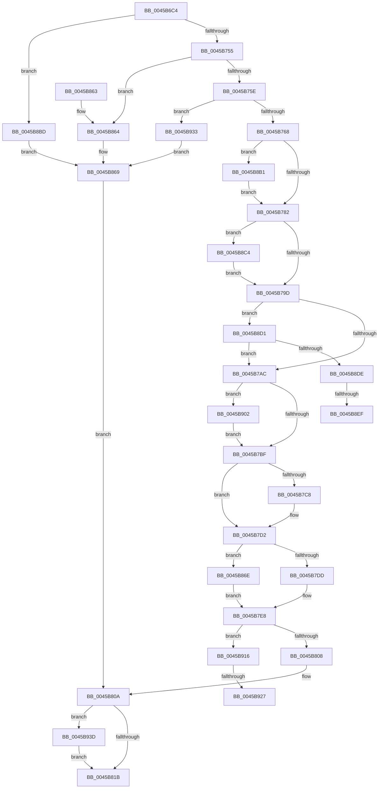

# MmInSwapWorkingSet

- RVA: `0x0045B6C4`–`0x0045B94C` (길이 `648` bytes)
- VA: `0x000000014045B6C4`
- 실행 섹션: `.text`
- PDB 이름 있음: `예`; PDB Function 태그: `예`
- unwind 정보 RVA: `0x000A93F8`
- 디코드: `160`개 명령, `648/648` bytes 표시
- 미해석 바이트: `0` (있으면 어셈블리에 `.byte`로 보존)

> 이 문서는 커널 이미지의 기계어와 PDB 기호를 분석해 생성했습니다. 4번과 5번은 함수 원형과 자료형을 바이너리 사용 방식에서 추정한 C 해석이며 원본 소스 복구 결과는 아닙니다.

## 1. Dependencies

- 직접 호출 지점: **19**; 고유 호출 대상: **14**
- 직접 호출자로 확인된 함수: **2**
- RIP 상대 이미지 참조: **4**

### Outgoing calls
- `0x0045B715` → [EtwTraceWorkingSetSwap](../../page/A1/EtwTraceWorkingSetSwap_function_00A17D80.md) (function, `0x00A17D80`)
- `0x0045B737` → [ExAcquireSpinLockExclusive](../24/ExAcquireSpinLockExclusive_function_00248690.md) (function, `0x00248690`)
- `0x0045B741` → [MiGetWorkingSetSwapSupport](../2A/MiGetWorkingSetSwapSupport_function_002A35A0.md) (function, `0x002A35A0`)
- `0x0045B788` → [MiReleaseSpinLockExclusive](../24/MiReleaseSpinLockExclusive_function_002482C0.md) (function, `0x002482C0`)
- `0x0045B7B1` → [MiProcessWsInSwapSupport](MiProcessWsInSwapSupport_function_0045B954.md) (function, `0x0045B954`)
- `0x0045B7CD` → [MiProcessWsInSwapSupport](MiProcessWsInSwapSupport_function_0045B954.md) (function, `0x0045B954`)
- `0x0045B7E3` → [MiFreeWorkingSetSwapContext](../../page/A4/MiFreeWorkingSetSwapContext_function_00A4AABC.md) (function, `0x00A4AABC`)
- `0x0045B7EB` → [ExAcquireSpinLockExclusive](../24/ExAcquireSpinLockExclusive_function_00248690.md) (function, `0x00248690`)
- `0x0045B7F5` → [MiGetWorkingSetSwapSupport](../2A/MiGetWorkingSetSwapSupport_function_002A35A0.md) (function, `0x002A35A0`)
- `0x0045B80D` → [MiReleaseSpinLockExclusive](../24/MiReleaseSpinLockExclusive_function_002482C0.md) (function, `0x002482C0`)
- `0x0045B81E` → [MiContractWsSwapPageFile](../../page/A1/MiContractWsSwapPageFile_function_00A182C4.md) (function, `0x00A182C4`)
- `0x0045B831` → [EtwTraceWorkingSetSwap](../../page/A1/EtwTraceWorkingSetSwap_function_00A17D80.md) (function, `0x00A17D80`)
- `0x0045B840` → [_security_check_cookie](../6A/_security_check_cookie_function_006AC640.md) (function, `0x006AC640`)
- `0x0045B88A` → [ObfReferenceObjectWithTag](../21/ObfReferenceObjectWithTag_function_00210710.md) (function, `0x00210710`)
- `0x0045B8A7` → [ExQueueWorkItemToPartition](../35/ExQueueWorkItemToPartition_function_00356E2C.md) (function, `0x00356E2C`)
- `0x0045B8C7` → [MiInSwapStore](../../page/A6/MiInSwapStore_function_00A61B74.md) (function, `0x00A61B74`)
- `0x0045B8DE` → [MiReAllocateWorkingSetSwapSupport](../3E/MiReAllocateWorkingSetSwapSupport_function_003E2A58.md) (function, `0x003E2A58`)
- `0x0045B90C` → [VmPrefetchVirtualAddresses](../../page/7A/VmPrefetchVirtualAddresses_function_007ACE98.md) (function, `0x007ACE98`)
- `0x0045B942` → [ExFreePoolWithTag](../../poolcode/B8/ExFreePoolWithTag_function_00B82870.md) (function, `0x00B82870`)

### Direct callers
- [PspChangeProcessExecutionStateLegacy](../5E/PspChangeProcessExecutionStateLegacy_function_005E4098.md) at `0x005E417C`
- [PspChangeProcessExecutionState](../../page/AE/PspChangeProcessExecutionState_function_00AEC594.md) at `0x00AEC680`

### Static image references
- `0x0045B6E0` → RVA `0x00E0A740` (`.data`; read)
- `0x0045B722` → RVA `0x00E30088` (`.data`; read)
- `0x0045B76E` → RVA `0x00E38858` (`.data`; read)
- `0x0045B873` → RVA `0x0080C510` (`MiInSwapSharedWorkingSetWorker`; read)

## 2. Other-region calls and transfers

- 다른 실행 섹션으로 향하는 call: **7**
  - `0x0045B715` → [EtwTraceWorkingSetSwap](../../page/A1/EtwTraceWorkingSetSwap_function_00A17D80.md) (`.text` → `PAGE`)
  - `0x0045B7E3` → [MiFreeWorkingSetSwapContext](../../page/A4/MiFreeWorkingSetSwapContext_function_00A4AABC.md) (`.text` → `PAGE`)
  - `0x0045B81E` → [MiContractWsSwapPageFile](../../page/A1/MiContractWsSwapPageFile_function_00A182C4.md) (`.text` → `PAGE`)
  - `0x0045B831` → [EtwTraceWorkingSetSwap](../../page/A1/EtwTraceWorkingSetSwap_function_00A17D80.md) (`.text` → `PAGE`)
  - `0x0045B8C7` → [MiInSwapStore](../../page/A6/MiInSwapStore_function_00A61B74.md) (`.text` → `PAGE`)
  - `0x0045B90C` → [VmPrefetchVirtualAddresses](../../page/7A/VmPrefetchVirtualAddresses_function_007ACE98.md) (`.text` → `PAGE`)
  - `0x0045B942` → [ExFreePoolWithTag](../../poolcode/B8/ExFreePoolWithTag_function_00B82870.md) (`.text` → `POOLCODE`)
- call이 아닌 외부 분기/꼬리 이동: **4**
  - `0x0045B8E9` → [sub_006F1EF0](../6F/Unknown_function_006F1EF0.md) (`tail-transfer`)
  - `0x0045B8FD` → [sub_006F1EF0](../6F/Unknown_function_006F1EF0.md) (`tail-transfer`)
  - `0x0045B921` → [sub_006F1EF0 + 0x18](../6F/Unknown_function_006F1EF0.md) (`tail-transfer`)
  - `0x0045B92E` → [sub_006F1EF0 + 0x18](../6F/Unknown_function_006F1EF0.md) (`tail-transfer`)

## 3. Assembly (complete function range)

```asm
0045B6C4  4C 8B DC                        mov r11, rsp
0045B6C7  49 89 5B 10                     mov qword ptr [r11 + 0x10], rbx
0045B6CB  49 89 6B 18                     mov qword ptr [r11 + 0x18], rbp
0045B6CF  49 89 73 20                     mov qword ptr [r11 + 0x20], rsi
0045B6D3  57                              push rdi
0045B6D4  41 54                           push r12
0045B6D6  41 55                           push r13
0045B6D8  41 56                           push r14
0045B6DA  41 57                           push r15
0045B6DC  48 83 EC 50                     sub rsp, 0x50
0045B6E0  48 8B 05 59 F0 9A 00            mov rax, qword ptr [rip + 0x9af059]
0045B6E7  48 33 C4                        xor rax, rsp
0045B6EA  48 89 44 24 48                  mov qword ptr [rsp + 0x48], rax
0045B6EF  33 C0                           xor eax, eax
0045B6F1  4D 8D 43 A8                     lea r8, [r11 - 0x58]
0045B6F5  0F 57 C0                        xorps xmm0, xmm0
0045B6F8  48 8D A9 00 04 00 00            lea rbp, [rcx + 0x400]
0045B6FF  0F 11 44 24 20                  movups xmmword ptr [rsp + 0x20], xmm0
0045B704  4C 8B F1                        mov r14, rcx
0045B707  33 F6                           xor esi, esi
0045B709  0F 11 44 24 30                  movups xmmword ptr [rsp + 0x30], xmm0
0045B70E  8D 50 03                        lea edx, [rax + 3]
0045B711  49 89 43 C8                     mov qword ptr [r11 - 0x38], rax
0045B715  E8 66 C6 5B 00                  call 0x140a17d80
0045B71A  41 0F B7 8E AE 04 00 00         movzx ecx, word ptr [r14 + 0x4ae]
0045B722  48 8B 05 5F 49 9D 00            mov rax, qword ptr [rip + 0x9d495f]
0045B729  4C 8B 2C C8                     mov r13, qword ptr [rax + rcx*8]
0045B72D  4D 8D A5 A0 04 00 00            lea r12, [r13 + 0x4a0]
0045B734  49 8B CC                        mov rcx, r12
0045B737  E8 54 CF DE FF                  call 0x140248690
0045B73C  48 8B CD                        mov rcx, rbp
0045B73F  8A D0                           mov dl, al
0045B741  E8 5A 7E E4 FF                  call 0x1402a35a0
0045B746  8D 4E 01                        lea ecx, [rsi + 1]
0045B749  48 8B F8                        mov rdi, rax
0045B74C  48 85 C0                        test rax, rax
0045B74F  0F 84 68 01 00 00               je 0x14045b8bd
0045B755  48 3B C1                        cmp rax, rcx
0045B758  0F 84 06 01 00 00               je 0x14045b864
0045B75E  48 83 F8 02                     cmp rax, 2
0045B762  0F 84 CB 01 00 00               je 0x14045b933
0045B768  8B 85 B8 00 00 00               mov eax, dword ptr [rbp + 0xb8]
0045B76E  4C 8D 3D E3 D0 9D 00            lea r15, [rip + 0x9dd0e3]
0045B775  24 0F                           and al, 0xf
0045B777  3A C1                           cmp al, cl
0045B779  49 8B C7                        mov rax, r15
0045B77C  0F 85 2F 01 00 00               jne 0x14045b8b1
0045B782  48 89 08                        mov qword ptr [rax], rcx
0045B785  49 8B CC                        mov rcx, r12
0045B788  E8 33 CB DE FF                  call 0x1402482c0
0045B78D  41 8B 85 B4 04 00 00            mov eax, dword ptr [r13 + 0x4b4]
0045B794  83 F8 FF                        cmp eax, -1
0045B797  0F 85 27 01 00 00               jne 0x14045b8c4
0045B79D  33 DB                           xor ebx, ebx
0045B79F  49 39 9E 70 06 00 00            cmp qword ptr [r14 + 0x670], rbx
0045B7A6  0F 85 25 01 00 00               jne 0x14045b8d1
0045B7AC  48 8B 0F                        mov rcx, qword ptr [rdi]
0045B7AF  8B D3                           mov edx, ebx
0045B7B1  E8 9E 01 00 00                  call 0x14045b954
0045B7B6  48 85 F6                        test rsi, rsi
0045B7B9  0F 85 43 01 00 00               jne 0x14045b902
0045B7BF  48 8B 4F 38                     mov rcx, qword ptr [rdi + 0x38]
0045B7C3  48 85 C9                        test rcx, rcx
0045B7C6  74 0A                           je 0x14045b7d2
0045B7C8  BA 01 00 00 00                  mov edx, 1
0045B7CD  E8 82 01 00 00                  call 0x14045b954
0045B7D2  48 83 7F 08 00                  cmp qword ptr [rdi + 8], 0
0045B7D7  0F 85 91 00 00 00               jne 0x14045b86e
0045B7DD  48 8B D7                        mov rdx, rdi
0045B7E0  49 8B CD                        mov rcx, r13
0045B7E3  E8 D4 F2 5E 00                  call 0x140a4aabc
0045B7E8  49 8B CC                        mov rcx, r12
0045B7EB  E8 A0 CE DE FF                  call 0x140248690
0045B7F0  48 8B CD                        mov rcx, rbp
0045B7F3  8A D0                           mov dl, al
0045B7F5  E8 A6 7D E4 FF                  call 0x1402a35a0
0045B7FA  BF 01 00 00 00                  mov edi, 1
0045B7FF  48 3B C7                        cmp rax, rdi
0045B802  0F 84 0E 01 00 00               je 0x14045b916
0045B808  33 DB                           xor ebx, ebx
0045B80A  49 8B CC                        mov rcx, r12
0045B80D  E8 AE CA DE FF                  call 0x1402482c0
0045B812  48 85 F6                        test rsi, rsi
0045B815  0F 85 22 01 00 00               jne 0x14045b93d
0045B81B  49 8B CD                        mov rcx, r13
0045B81E  E8 A1 CA 5B 00                  call 0x140a182c4
0045B823  4C 8D 44 24 20                  lea r8, [rsp + 0x20]
0045B828  89 5C 24 40                     mov dword ptr [rsp + 0x40], ebx
0045B82C  8B D7                           mov edx, edi
0045B82E  49 8B CE                        mov rcx, r14
0045B831  E8 4A C5 5B 00                  call 0x140a17d80
0045B836  8B C3                           mov eax, ebx
0045B838  48 8B 4C 24 48                  mov rcx, qword ptr [rsp + 0x48]
0045B83D  48 33 CC                        xor rcx, rsp
0045B840  E8 FB 0D 25 00                  call 0x1406ac640
0045B845  4C 8D 5C 24 50                  lea r11, [rsp + 0x50]
0045B84A  49 8B 5B 38                     mov rbx, qword ptr [r11 + 0x38]
0045B84E  49 8B 6B 40                     mov rbp, qword ptr [r11 + 0x40]
0045B852  49 8B 73 48                     mov rsi, qword ptr [r11 + 0x48]
0045B856  49 8B E3                        mov rsp, r11
0045B859  41 5F                           pop r15
0045B85B  41 5E                           pop r14
0045B85D  41 5D                           pop r13
0045B85F  41 5C                           pop r12
0045B861  5F                              pop rdi
0045B862  C3                              ret
0045B863  CC                              int3
0045B864  BB 76 04 00 C0                  mov ebx, 0xc0000476
0045B869  48 8B F9                        mov rdi, rcx
0045B86C  EB 9C                           jmp 0x14045b80a
0045B86E  48 83 67 10 00                  and qword ptr [rdi + 0x10], 0
0045B873  48 8D 05 96 0C 3B 00            lea rax, [rip + 0x3b0c96]
0045B87A  BA 4D 6D 57 73                  mov edx, 0x73576d4d
0045B87F  48 89 47 20                     mov qword ptr [rdi + 0x20], rax
0045B883  49 8B CE                        mov rcx, r14
0045B886  48 89 7F 28                     mov qword ptr [rdi + 0x28], rdi
0045B88A  E8 81 4E DB FF                  call 0x140210710
0045B88F  4C 89 77 30                     mov qword ptr [rdi + 0x30], r14
0045B893  48 8D 4F 10                     lea rcx, [rdi + 0x10]
0045B897  4D 8B 8D B8 00 00 00            mov r9, qword ptr [r13 + 0xb8]
0045B89E  41 83 C8 FF                     or r8d, 0xffffffff
0045B8A2  BA 03 00 00 00                  mov edx, 3
0045B8A7  E8 80 B5 EF FF                  call 0x140356e2c
0045B8AC  E9 37 FF FF FF                  jmp 0x14045b7e8
0045B8B1  48 8D 85 D8 00 00 00            lea rax, [rbp + 0xd8]
0045B8B8  E9 C5 FE FF FF                  jmp 0x14045b782
0045B8BD  BB 25 02 00 C0                  mov ebx, 0xc0000225
0045B8C2  EB A5                           jmp 0x14045b869
0045B8C4  49 8B CE                        mov rcx, r14
0045B8C7  E8 A8 62 60 00                  call 0x140a61b74
0045B8CC  E9 CC FE FF FF                  jmp 0x14045b79d
0045B8D1  48 8B 0F                        mov rcx, qword ptr [rdi]
0045B8D4  48 39 59 10                     cmp qword ptr [rcx + 0x10], rbx
0045B8D8  0F 84 CE FE FF FF               je 0x14045b7ac
0045B8DE  E8 75 71 F8 FF                  call 0x1403e2a58
0045B8E3  48 8B F0                        mov rsi, rax
0045B8E6  48 85 C0                        test rax, rax
0045B8E9  0F 84 01 66 29 00               je 0x1406f1ef0
0045B8EF  48 8B 0F                        mov rcx, qword ptr [rdi]
0045B8F2  B8 01 00 00 00                  mov eax, 1
0045B8F7  84 41 20                        test byte ptr [rcx + 0x20], al
0045B8FA  0F 44 D8                        cmove ebx, eax
0045B8FD  E9 EE 65 29 00                  jmp 0x1406f1ef0
0045B902  48 8B 56 10                     mov rdx, qword ptr [rsi + 0x10]
0045B906  45 33 C0                        xor r8d, r8d
0045B909  48 8B 0E                        mov rcx, qword ptr [rsi]
0045B90C  E8 87 15 35 00                  call 0x1407ace98
0045B911  E9 A9 FE FF FF                  jmp 0x14045b7bf
0045B916  8B 85 B8 00 00 00               mov eax, dword ptr [rbp + 0xb8]
0045B91C  24 0F                           and al, 0xf
0045B91E  40 3A C7                        cmp al, dil
0045B921  0F 84 E1 65 29 00               je 0x1406f1f08
0045B927  4C 8D BD D8 00 00 00            lea r15, [rbp + 0xd8]
0045B92E  E9 D5 65 29 00                  jmp 0x1406f1f08
0045B933  BB 0A 01 00 C0                  mov ebx, 0xc000010a
0045B938  E9 2C FF FF FF                  jmp 0x14045b869
0045B93D  33 D2                           xor edx, edx
0045B93F  48 8B CE                        mov rcx, rsi
0045B942  E8 29 6F 72 00                  call 0x140b82870
0045B947  E9 CF FE FF FF                  jmp 0x14045b81b
```

## 4. C-style interpretation (structured pseudocode)

```c
__int64 __fastcall MmInSwapWorkingSet(__int64 a1)
{
    __int64 result;
    __int64 v_rbx;
    __int64 v_rsi;
    __int64 v_rsp;
    unsigned __int64 v_stack_m28;
    unsigned __int64 v_stack_m30;
    unsigned int v_stack_m38;
    unsigned __int64 v_stack_m48;
    unsigned __int64 v_stack_m58;

    *(unsigned __int64 *)(v_rsp + 16) = v_rbx;
    *(unsigned __int64 *)(v_rsp + 24) = v_rbp;
    *(unsigned __int64 *)(v_rsp + 32) = v_rsi;
    v_rsp = (v_rsp) - (80);
    result = (*(unsigned __int64 *)(v_rip + 10154073)) ^ (v_rsp);
    v_stack_m30 = result;
    result = 0;
    v_stack_m58 = v_xmm0;
    v_rsi = 0;
    v_stack_m48 = v_xmm0;
    *(unsigned __int64 *)(v_rsp - 56) = 0;
    result = EtwTraceWorkingSetSwap(a1, result + 3, v_rsp - 88, a4);
    result = ExAcquireSpinLockExclusive(*(unsigned __int64 *)(*(unsigned __int64 *)(v_rip + 10307935) + *(unsigned __int16 *)(a1 + 1198) * 8) + 1184, result + 3, v_rsp - 88, a4);
    result = MiGetWorkingSetSwapSupport(a1 + 1024, (unsigned __int8)(result), v_rsp - 88, a4);
    if (result == 0) goto loc_0045B8BD;
    if (result == (v_rsi + 1)) goto loc_0045B864;
    if (result == 2) goto loc_0045B933;
    result = (unsigned __int8)(((unsigned int)(*(unsigned int *)(a1 + 1024 + 184))) & (15));
    if (((unsigned __int8)(result)) != ((unsigned __int8)(v_rsi + 1))) goto loc_0045B8B1;
loc_0045B782:
    *(unsigned __int64 *)(v_rip + 10342627) = v_rsi + 1;
    result = MiReleaseSpinLockExclusive(*(unsigned __int64 *)(*(unsigned __int64 *)(v_rip + 10307935) + *(unsigned __int16 *)(a1 + 1198) * 8) + 1184, (unsigned __int8)(result), v_rsp - 88, a4);
    if (((unsigned int)((unsigned int)(*(unsigned int *)(*(unsigned __int64 *)(*(unsigned __int64 *)(v_rip + 10307935) + *(unsigned __int16 *)(a1 + 1198) * 8) + 1204)))) != -1) goto loc_0045B8C4;
loc_0045B79D:
    v_rbx = 0;
    if ((*(unsigned __int64 *)(a1 + 1648)) != 0) goto loc_0045B8D1;
loc_0045B7AC:
    result = MiProcessWsInSwapSupport(*(unsigned __int64 *)(result), 0, v_rsp - 88, a4);
    if (0 != 0) goto loc_0045B902;
loc_0045B7BF:
    if (*(unsigned __int64 *)(result + 56) != 0) {
        a2 = 1;
        result = MiProcessWsInSwapSupport(*(unsigned __int64 *)(result + 56), a2, v_rsp - 88, a4);
    }
    if ((*(unsigned __int64 *)(result + 8)) != 0) goto loc_0045B86E;
    result = MiFreeWorkingSetSwapContext(*(unsigned __int64 *)(*(unsigned __int64 *)(v_rip + 10307935) + *(unsigned __int16 *)(a1 + 1198) * 8), result, v_rsp - 88, a4);
loc_0045B7E8:
    result = ExAcquireSpinLockExclusive(*(unsigned __int64 *)(*(unsigned __int64 *)(v_rip + 10307935) + *(unsigned __int16 *)(a1 + 1198) * 8) + 1184, result, v_rsp - 88, a4);
    result = MiGetWorkingSetSwapSupport(a1 + 1024, (unsigned __int8)(result), v_rsp - 88, a4);
    if (result == 1) goto loc_0045B916;
    v_rbx = 0;
loc_0045B80A:
    result = MiReleaseSpinLockExclusive(*(unsigned __int64 *)(*(unsigned __int64 *)(v_rip + 10307935) + *(unsigned __int16 *)(a1 + 1198) * 8) + 1184, (unsigned __int8)(result), v_rsp - 88, a4);
    if (0 != 0) goto loc_0045B93D;
loc_0045B81B:
    result = MiContractWsSwapPageFile(*(unsigned __int64 *)(*(unsigned __int64 *)(v_rip + 10307935) + *(unsigned __int16 *)(a1 + 1198) * 8), (unsigned __int8)(result), v_rsp - 88, a4);
    v_stack_m38 = 0;
    result = EtwTraceWorkingSetSwap(a1, 1, v_stack_m58, a4);
    a1 = (v_stack_m30) ^ (v_rsp);
    result = _security_check_cookie(a1, 1, v_stack_m58, a4);
    return result;
loc_0045B864:
loc_0045B869:
    goto loc_0045B80A;
loc_0045B86E:
    *(unsigned __int64 *)(a1 + 32) = v_rip + 3869846;
    *(unsigned __int64 *)(a1 + 40) = a1;
    result = ObfReferenceObjectWithTag(a1, (unsigned int)(0x73576D4DULL), v_stack_m58, a4);
    *(unsigned __int64 *)(a1 + 48) = a1;
    a3 = (unsigned int)((v_stack_m58) | (0xFFFFFFFFULL));
    result = ExQueueWorkItemToPartition(a1 + 16, 3, a3, *(unsigned __int64 *)(*(unsigned __int64 *)(*(unsigned __int64 *)(v_rip + 10307935) + *(unsigned __int16 *)(a1 + 1198) * 8) + 184));
    goto loc_0045B7E8;
loc_0045B8B1:
    goto loc_0045B782;
loc_0045B8BD:
    goto loc_0045B869;
loc_0045B8C4:
    result = MiInSwapStore(a1, 3, a3, *(unsigned __int64 *)(*(unsigned __int64 *)(*(unsigned __int64 *)(v_rip + 10307935) + *(unsigned __int16 *)(a1 + 1198) * 8) + 184));
    goto loc_0045B79D;
loc_0045B8D1:
    if ((*(unsigned __int64 *)(*(unsigned __int64 *)(a1) + 16)) == ((unsigned int)(0xC0000225ULL))) goto loc_0045B7AC;
    result = MiReAllocateWorkingSetSwapSupport(*(unsigned __int64 *)(a1), 3, a3, *(unsigned __int64 *)(*(unsigned __int64 *)(*(unsigned __int64 *)(v_rip + 10307935) + *(unsigned __int16 *)(a1 + 1198) * 8) + 184));
    v_rbx = (unsigned int)(0xC0000225ULL);
    if (((*(unsigned __int8 *)(*(unsigned __int64 *)(a1) + 32)) & (1)) == 0) { v_rbx = 1; }
loc_0045B902:
    a3 = 0;
    result = VmPrefetchVirtualAddresses(*(unsigned __int64 *)(result), *(unsigned __int64 *)(result + 16), a3, *(unsigned __int64 *)(*(unsigned __int64 *)(*(unsigned __int64 *)(v_rip + 10307935) + *(unsigned __int16 *)(a1 + 1198) * 8) + 184));
    goto loc_0045B7BF;
loc_0045B916:
    result = (unsigned __int8)(((unsigned int)(*(unsigned int *)(*(unsigned __int64 *)(v_stack_m28 + 64) + 184))) & (15));
loc_0045B933:
    goto loc_0045B869;
loc_0045B93D:
    a2 = 0;
    result = ExFreePoolWithTag(result, a2, a3, *(unsigned __int64 *)(*(unsigned __int64 *)(*(unsigned __int64 *)(v_rip + 10307935) + *(unsigned __int16 *)(a1 + 1198) * 8) + 184));
    goto loc_0045B81B;
}
```

## 5. (Beta) C Style

```c
int64_t MmInSwapWorkingSet(void *Arg1)
{
    uint8_t *arg1 = (uint8_t *)Arg1;

    int64_t result;
    int64_t local_rbx;
    int64_t local_rsi;
    int64_t local_rsp;
    uint64_t v_stack_m28;
    uint64_t v_stack_m30;
    uint32_t v_stack_m38;
    uint64_t v_stack_m48;
    uint64_t v_stack_m58;

    *(uint64_t *)(local_rsp + 0x10) = local_rbx;
    *(uint64_t *)(local_rsp + 0x18) = local_rbp;
    *(uint64_t *)(local_rsp + 0x20) = local_rsi;
    local_rsp = (local_rsp) - (80);
    result = (*(uint64_t *)(v_rip + 0x9AF059)) ^ (local_rsp);
    v_stack_m30 = result;
    result = 0;
    v_stack_m58 = v_xmm0;
    local_rsi = 0;
    v_stack_m48 = v_xmm0;
    *(uint64_t *)(local_rsp - 0x38) = 0;
    result = EtwTraceWorkingSetSwap(Arg1, result + 3, local_rsp - 88, a4);
    result = ExAcquireSpinLockExclusive(*(uint64_t *)(*(uint64_t *)(v_rip + 0x9D495F) + *(uint16_t *)(arg1 + 0x4AE) * 8) + 1184, result + 3, local_rsp - 88, a4);
    result = MiGetWorkingSetSwapSupport(Arg1 + 1024, (uint8_t)(result), local_rsp - 88, a4);
    if (result == 0) goto loc_0045B8BD;
    if (result == (local_rsi + 1)) goto loc_0045B864;
    if (result == 2) goto loc_0045B933;
    result = (uint8_t)(((uint32_t)(*(uint32_t *)(arg1 + 0x400 + 0xB8))) & (15));
    if (((uint8_t)(result)) != ((uint8_t)(local_rsi + 1))) goto loc_0045B8B1;
loc_0045B782:
    *(uint64_t *)(v_rip + 0x9DD0E3) = local_rsi + 1;
    result = MiReleaseSpinLockExclusive(*(uint64_t *)(*(uint64_t *)(v_rip + 0x9D495F) + *(uint16_t *)(arg1 + 0x4AE) * 8) + 1184, (uint8_t)(result), local_rsp - 88, a4);
    if (((uint32_t)((uint32_t)(*(uint32_t *)(*(uint64_t *)(*(uint64_t *)(v_rip + 0x9D495F) + *(uint16_t *)(arg1 + 0x4AE) * 8) + 0x4B4)))) != -1) goto loc_0045B8C4;
loc_0045B79D:
    local_rbx = 0;
    if ((*(uint64_t *)(arg1 + 0x670)) != 0) goto loc_0045B8D1;
loc_0045B7AC:
    result = MiProcessWsInSwapSupport(*(uint64_t *)(result), 0, local_rsp - 88, a4);
    if (0 != 0) goto loc_0045B902;
loc_0045B7BF:
    if (*(uint64_t *)(result + 0x38) != 0) {
        a2 = 1;
        result = MiProcessWsInSwapSupport(*(uint64_t *)(result + 0x38), a2, local_rsp - 88, a4);
    }
    if ((*(uint64_t *)(result + 0x8)) != 0) goto loc_0045B86E;
    result = MiFreeWorkingSetSwapContext(*(uint64_t *)(*(uint64_t *)(v_rip + 0x9D495F) + *(uint16_t *)(arg1 + 0x4AE) * 8), result, local_rsp - 88, a4);
loc_0045B7E8:
    result = ExAcquireSpinLockExclusive(*(uint64_t *)(*(uint64_t *)(v_rip + 0x9D495F) + *(uint16_t *)(arg1 + 0x4AE) * 8) + 1184, result, local_rsp - 88, a4);
    result = MiGetWorkingSetSwapSupport(Arg1 + 1024, (uint8_t)(result), local_rsp - 88, a4);
    if (result == 1) goto loc_0045B916;
    local_rbx = 0;
loc_0045B80A:
    result = MiReleaseSpinLockExclusive(*(uint64_t *)(*(uint64_t *)(v_rip + 0x9D495F) + *(uint16_t *)(arg1 + 0x4AE) * 8) + 1184, (uint8_t)(result), local_rsp - 88, a4);
    if (0 != 0) goto loc_0045B93D;
loc_0045B81B:
    result = MiContractWsSwapPageFile(*(uint64_t *)(*(uint64_t *)(v_rip + 0x9D495F) + *(uint16_t *)(arg1 + 0x4AE) * 8), (uint8_t)(result), local_rsp - 88, a4);
    v_stack_m38 = 0;
    result = EtwTraceWorkingSetSwap(Arg1, 1, v_stack_m58, a4);
    Arg1 = (v_stack_m30) ^ (local_rsp);
    result = _security_check_cookie(Arg1, 1, v_stack_m58, a4);
    return result;
loc_0045B864:
loc_0045B869:
    goto loc_0045B80A;
loc_0045B86E:
    *(uint64_t *)(arg1 + 0x20) = v_rip + 3869846;
    *(void **)(arg1 + 0x28) = Arg1;
    result = ObfReferenceObjectWithTag(Arg1, (uint32_t)(0x73576D4DULL), v_stack_m58, a4);
    *(void **)(arg1 + 0x30) = Arg1;
    a3 = (uint32_t)((v_stack_m58) | (0xFFFFFFFFULL));
    result = ExQueueWorkItemToPartition(Arg1 + 16, 3, a3, *(uint64_t *)(*(uint64_t *)(*(uint64_t *)(v_rip + 0x9D495F) + *(uint16_t *)(arg1 + 0x4AE) * 8) + 0xB8));
    goto loc_0045B7E8;
loc_0045B8B1:
    goto loc_0045B782;
loc_0045B8BD:
    goto loc_0045B869;
loc_0045B8C4:
    result = MiInSwapStore(Arg1, 3, a3, *(uint64_t *)(*(uint64_t *)(*(uint64_t *)(v_rip + 0x9D495F) + *(uint16_t *)(arg1 + 0x4AE) * 8) + 0xB8));
    goto loc_0045B79D;
loc_0045B8D1:
    if ((*(uint64_t *)(*(uint64_t *)(arg1) + 0x10)) == ((uint32_t)(0xC0000225ULL))) goto loc_0045B7AC;
    result = MiReAllocateWorkingSetSwapSupport(*(uint64_t *)(arg1), 3, a3, *(uint64_t *)(*(uint64_t *)(*(uint64_t *)(v_rip + 0x9D495F) + *(uint16_t *)(arg1 + 0x4AE) * 8) + 0xB8));
    local_rbx = (uint32_t)(0xC0000225ULL);
    if (((*(uint8_t *)(*(uint64_t *)(arg1) + 0x20)) & (1)) == 0) { local_rbx = 1; }
loc_0045B902:
    a3 = 0;
    result = VmPrefetchVirtualAddresses(*(uint64_t *)(result), *(uint64_t *)(result + 0x10), a3, *(uint64_t *)(*(uint64_t *)(*(uint64_t *)(v_rip + 0x9D495F) + *(uint16_t *)(arg1 + 0x4AE) * 8) + 0xB8));
    goto loc_0045B7BF;
loc_0045B916:
    result = (uint8_t)(((uint32_t)(*(uint32_t *)(*(uint64_t *)(v_stack_m28 + 0x40) + 0xB8))) & (15));
loc_0045B933:
    goto loc_0045B869;
loc_0045B93D:
    a2 = 0;
    result = ExFreePoolWithTag(result, a2, a3, *(uint64_t *)(*(uint64_t *)(*(uint64_t *)(v_rip + 0x9D495F) + *(uint16_t *)(arg1 + 0x4AE) * 8) + 0xB8));
    goto loc_0045B81B;
}
```

### 관측된 메모리 오프셋

구조체 형식이 확인되지 않은 접근은 인자 기준의 오프셋으로만 기록했습니다.

| 기준 인자 | 오프셋 표현 | 폭 (bit) | 접근 |
|---|---:|---:|---|
| `Arg1` | `+ 0xB8` | `32` | `R` |
| `Arg1` | `+ 0xD8` | `64` | `R` |
| `Arg1` | `+ 0x400` | `64` | `R` |
| `Arg1` | `+ 0x4AE` | `16` | `R` |
| `Arg1` | `+ 0x670` | `64` | `R` |

## 6. Execution-region graph

[열기: 2D/3D 그래프와 함수 탐색 컨트롤 패널](../../../control-panel.html?section=text&rva=0x0045B6C4&view=graph)

- 2D 그래프는 위에서 아래로 흐르고, 3D 그래프는 빈 공간을 드래그해 회전합니다. Shift+드래그는 이동, 휠은 확대·축소, 함수 노드 선택은 대상 보고서 이동입니다.

### Static fallback


