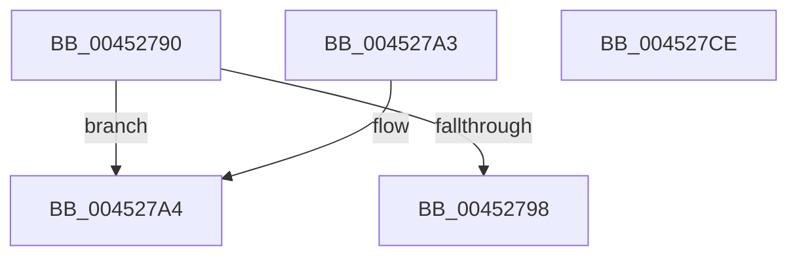

# MmMdlPageContentsState

- RVA: `0x00452790`–`0x004527CF` (길이 `63` bytes)
- VA: `0x0000000140452790`
- 실행 섹션: `.text`
- PDB 이름 있음: `예`; PDB Function 태그: `아니요`
- unwind 정보 RVA: `0x000DB714`
- 디코드: `20`개 명령, `63/63` bytes 표시
- 미해석 바이트: `0` (있으면 어셈블리에 `.byte`로 보존)

> 이 문서는 커널 이미지의 기계어와 PDB 기호를 분석해 생성했습니다. 4번과 5번은 함수 원형과 자료형을 바이너리 사용 방식에서 추정한 C 해석이며 원본 소스 복구 결과는 아닙니다.

## 1. Dependencies

- 직접 호출 지점: **0**; 고유 호출 대상: **0**
- 직접 호출자로 확인된 함수: **4**
- RIP 상대 이미지 참조: **0**

### Outgoing calls
- 직접 디코드된 call 명령이 없습니다.

### Direct callers
- [SmKmIssueVolumeIo](../60/SmKmIssueVolumeIo_function_0060F9BC.md) at `0x0060FA75`
- [MdlInvariantPostProcessing1](../61/MdlInvariantPostProcessing1_function_00613AE0.md) at `0x00613B44`
- [MdlInvariantPreProcessing1](../61/MdlInvariantPreProcessing1_function_00613CEC.md) at `0x00613D49`
- [SmKmStoreFileWriteHeader](../../page/7A/SmKmStoreFileWriteHeader_function_007A9DB4.md) at `0x007A9E6A`

### Static image references
- 디코드된 RIP-relative 메모리 참조가 없습니다.

## 2. Other-region calls and transfers

- 다른 실행 섹션으로 향하는 call: **0**
- 별도 외부 분기/꼬리 이동을 확인하지 못했습니다.

## 3. Assembly (complete function range)

```asm
00452790  4C 8B C1                        mov r8, rcx
00452793  83 FA 02                        cmp edx, 2
00452796  75 0C                           jne 0x1404527a4
00452798  0F B7 41 0A                     movzx eax, word ptr [rcx + 0xa]
0045279C  C1 E8 0E                        shr eax, 0xe
0045279F  83 E0 01                        and eax, 1
004527A2  C3                              ret
004527A3  CC                              int3
004527A4  0F B7 49 0A                     movzx ecx, word ptr [rcx + 0xa]
004527A8  41 B9 FF BF FF FF               mov r9d, 0xffffbfff
004527AE  0F B7 C1                        movzx eax, cx
004527B1  66 41 23 C1                     and ax, r9w
004527B5  41 B9 00 40 00 00               mov r9d, 0x4000
004527BB  66 41 0B C9                     or cx, r9w
004527BF  83 FA 01                        cmp edx, 1
004527C2  66 0F 45 C8                     cmovne cx, ax
004527C6  8B C2                           mov eax, edx
004527C8  66 41 89 48 0A                  mov word ptr [r8 + 0xa], cx
004527CD  C3                              ret
004527CE  CC                              int3
```

## 4. C-style interpretation (structured pseudocode)

```c
__int64 __fastcall MmMdlPageContentsState(__int64 a1, int a2)
{
    __int64 result;

    if (a2 != 2) goto loc_004527A4;
    result = (unsigned int)((*(unsigned __int16 *)(a1 + 10)) >> (14));
    result = (unsigned int)((result) & (1));
    return result;
loc_004527A4:
    result = (unsigned __int16)(((unsigned __int16)(*(unsigned __int16 *)(a1 + 10))) & ((unsigned __int16)((unsigned int)(0xFFFFBFFFULL))));
    a1 = (unsigned __int16)((*(unsigned __int16 *)(a1 + 10)) | ((unsigned __int16)((unsigned int)(0x4000ULL))));
    if (a2 != 1) { a1 = (unsigned __int16)(result); }
    *(unsigned __int16 *)(a1 + 10) = (unsigned __int16)(a1);
    return (unsigned int)(a2);
}
```

## 5. (Beta) C Style

```c
int64_t MmMdlPageContentsState(void *Arg1, int32_t Arg2)
{
    uint8_t *arg1 = (uint8_t *)Arg1;

    int64_t result;

    if (Arg2 != 2) goto loc_004527A4;
    result = (uint32_t)((*(uint16_t *)(arg1 + 0xA)) >> (14));
    result = (uint32_t)((result) & (1));
    return result;
loc_004527A4:
    result = (uint16_t)(((uint16_t)(*(uint16_t *)(arg1 + 0xA))) & ((uint16_t)((uint32_t)(0xFFFFBFFFULL))));
    Arg1 = (uint16_t)((*(uint16_t *)(arg1 + 0xA)) | ((uint16_t)((uint32_t)(0x4000ULL))));
    if (Arg2 != 1) { Arg1 = (uint16_t)(result); }
    *(uint16_t *)(arg1 + 0xA) = (uint16_t)(Arg1);
    return (uint32_t)(Arg2);
}
```

### 관측된 메모리 오프셋

구조체 형식이 확인되지 않은 접근은 인자 기준의 오프셋으로만 기록했습니다.

| 기준 인자 | 오프셋 표현 | 폭 (bit) | 접근 |
|---|---:|---:|---|
| `Arg1` | `+ 0xA` | `16` | `R` |
| `Arg1` | `+ 0xA` | `16` | `W` |

## 6. Execution-region graph

[열기: 2D/3D 그래프와 함수 탐색 컨트롤 패널](../../../control-panel.html?section=text&rva=0x00452790&view=graph)

- 2D 그래프는 위에서 아래로 흐르고, 3D 그래프는 빈 공간을 드래그해 회전합니다. Shift+드래그는 이동, 휠은 확대·축소, 함수 노드 선택은 대상 보고서 이동입니다.

### Static fallback


