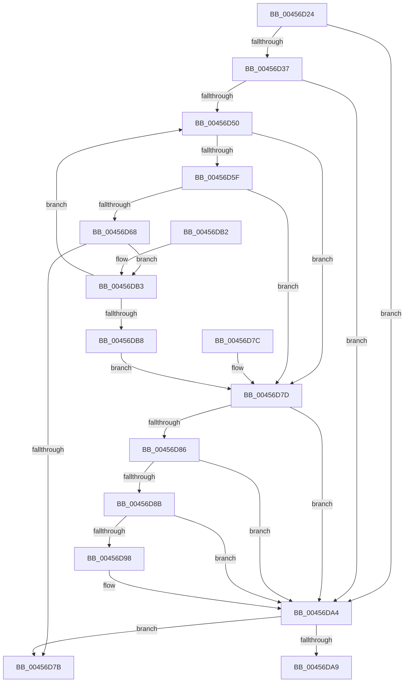

# MmStoreReleaseResidentAvailableForRead

- RVA: `0x00456D24`–`0x00456DBA` (길이 `150` bytes)
- VA: `0x0000000140456D24`
- 실행 섹션: `.text`
- PDB 이름 있음: `예`; PDB Function 태그: `아니요`
- unwind 정보 RVA: `0x000DB714`
- 디코드: `42`개 명령, `150/150` bytes 표시
- 미해석 바이트: `0` (있으면 어셈블리에 `.byte`로 보존)

> 이 문서는 커널 이미지의 기계어와 PDB 기호를 분석해 생성했습니다. 4번과 5번은 함수 원형과 자료형을 바이너리 사용 방식에서 추정한 C 해석이며 원본 소스 복구 결과는 아닙니다.

## 1. Dependencies

- 직접 호출 지점: **0**; 고유 호출 대상: **0**
- 직접 호출자로 확인된 함수: **1**
- RIP 상대 이미지 참조: **1**

### Outgoing calls
- 직접 디코드된 call 명령이 없습니다.

### Direct callers
- [SmPartitionCleanup](../../page/7A/SmPartitionCleanup_function_007A5C14.md) at `0x007A5CED`

### Static image references
- `0x00456D27` → RVA `0x00E38D00` (`.data`; read)

## 2. Other-region calls and transfers

- 다른 실행 섹션으로 향하는 call: **0**
- 별도 외부 분기/꼬리 이동을 확인하지 못했습니다.

## 3. Assembly (complete function range)

```asm
00456D24  4C 8B 09                        mov r9, qword ptr [rcx]
00456D27  48 8D 05 D2 1F 9E 00            lea rax, [rip + 0x9e1fd2]
00456D2E  4C 8D 42 30                     lea r8, [rdx + 0x30]
00456D32  4C 3B C8                        cmp r9, rax
00456D35  75 6D                           jne 0x140456da4
00456D37  65 4C 8B 14 25 20 00 00 00      mov r10, qword ptr gs:[0x20]
00456D40  41 83 CB FF                     or r11d, 0xffffffff
00456D44  41 8B 92 9C 8B 00 00            mov edx, dword ptr [r10 + 0x8b9c]
00456D4B  41 3B D3                        cmp edx, r11d
00456D4E  74 54                           je 0x140456da4
00456D50  48 63 CA                        movsxd rcx, edx
00456D53  49 03 C8                        add rcx, r8
00456D56  48 81 F9 00 01 00 00            cmp rcx, 0x100
00456D5D  77 1E                           ja 0x140456d7d
00456D5F  49 81 F8 00 00 08 00            cmp r8, 0x80000
00456D66  73 15                           jae 0x140456d7d
00456D68  41 8D 0C 10                     lea ecx, [r8 + rdx]
00456D6C  8B C2                           mov eax, edx
00456D6E  F0 41 0F B1 8A 9C 8B 00 00      lock cmpxchg dword ptr [r10 + 0x8b9c], ecx
00456D77  8B D0                           mov edx, eax
00456D79  75 38                           jne 0x140456db3
00456D7B  C3                              ret
00456D7C  CC                              int3
00456D7D  B9 C0 00 00 00                  mov ecx, 0xc0
00456D82  3B D1                           cmp edx, ecx
00456D84  7E 1E                           jle 0x140456da4
00456D86  41 3B D3                        cmp edx, r11d
00456D89  74 19                           je 0x140456da4
00456D8B  8B C2                           mov eax, edx
00456D8D  F0 41 0F B1 8A 9C 8B 00 00      lock cmpxchg dword ptr [r10 + 0x8b9c], ecx
00456D96  75 0C                           jne 0x140456da4
00456D98  8D 82 40 FF FF FF               lea eax, [rdx - 0xc0]
00456D9E  48 63 C8                        movsxd rcx, eax
00456DA1  4C 03 C1                        add r8, rcx
00456DA4  4D 85 C0                        test r8, r8
00456DA7  74 D2                           je 0x140456d7b
00456DA9  F0 4D 01 81 40 49 00 00         lock add qword ptr [r9 + 0x4940], r8
00456DB1  C3                              ret
00456DB2  CC                              int3
00456DB3  41 3B C3                        cmp eax, r11d
00456DB6  75 98                           jne 0x140456d50
00456DB8  EB C3                           jmp 0x140456d7d
```

## 4. C-style interpretation (structured pseudocode)

```c
__int64 __fastcall MmStoreReleaseResidentAvailableForRead(__int64 a1, __int64 a2)
{
    __int64 result;
    __int64 v_r11;

    if ((*(unsigned __int64 *)(a1)) != (v_rip + 10362834)) goto loc_00456DA4;
    v_r11 = (unsigned int)((v_r11) | (0xFFFFFFFFULL));
    if (((unsigned int)((unsigned int)(*(unsigned int *)(*(unsigned __int64 *)(gs_base + (0 + 32)) + 35740)))) == ((unsigned int)(v_r11))) goto loc_00456DA4;
loc_00456D50:
    a1 = ((int)((unsigned int)((unsigned int)(*(unsigned int *)(*(unsigned __int64 *)(gs_base + (0 + 32)) + 35740))))) + (a2 + 48);
    if (a1 > 256) goto loc_00456D7D;
    if ((a2 + 48) >= 0x80000ULL) goto loc_00456D7D;
    if ((a2 + 48) != 0x80000ULL) goto loc_00456DB3;
loc_00456D7B:
    return (unsigned int)((unsigned int)((unsigned int)(*(unsigned int *)(*(unsigned __int64 *)(gs_base + (0 + 32)) + 35740))));
loc_00456D7D:
    if (((unsigned int)((unsigned int)((unsigned int)((unsigned int)((unsigned int)((unsigned int)(*(unsigned int *)(*(unsigned __int64 *)(gs_base + (0 + 32)) + 35740)))))))) <= 192) goto loc_00456DA4;
    if (((unsigned int)((unsigned int)((unsigned int)((unsigned int)((unsigned int)((unsigned int)(*(unsigned int *)(*(unsigned __int64 *)(gs_base + (0 + 32)) + 35740)))))))) == ((unsigned int)(v_r11))) goto loc_00456DA4;
    result = (unsigned int)((unsigned int)((unsigned int)((unsigned int)((unsigned int)((unsigned int)((unsigned int)(*(unsigned int *)(*(unsigned __int64 *)(gs_base + (0 + 32)) + 35740))))))));
    if (((unsigned int)((unsigned int)((unsigned int)((unsigned int)((unsigned int)((unsigned int)(*(unsigned int *)(*(unsigned __int64 *)(gs_base + (0 + 32)) + 35740)))))))) == ((unsigned int)(v_r11))) {
        result = (unsigned int)((unsigned int)((unsigned int)((unsigned int)((unsigned int)(*(unsigned int *)(*(unsigned __int64 *)(gs_base + (0 + 32)) + 35740)))))) - 192;
        a1 = (int)((unsigned int)(result));
        a3 = (a2 + 48) + (a1);
    }
    if (a3 == 0) goto loc_00456D7B;
    return result;
loc_00456DB3:
    if (((unsigned int)(result)) != ((unsigned int)(v_r11))) goto loc_00456D50;
    goto loc_00456D7D;
}
```

## 5. (Beta) C Style

```c
int64_t MmStoreReleaseResidentAvailableForRead(void *Arg1, void *Arg2)
{
    uint8_t *arg1 = (uint8_t *)Arg1;
    uint8_t *arg2 = (uint8_t *)Arg2;

    int64_t result;
    int64_t local_r11;

    if ((*(uint64_t *)(arg1)) != (v_rip + 10362834)) goto loc_00456DA4;
    local_r11 = (uint32_t)((local_r11) | (0xFFFFFFFFULL));
    if (((uint32_t)((uint32_t)(*(uint32_t *)(*(uint64_t *)(gs_base + (0 + 0x20)) + 0x8B9C)))) == ((uint32_t)(local_r11))) goto loc_00456DA4;
loc_00456D50:
    Arg1 = ((int32_t)((uint32_t)((uint32_t)(*(uint32_t *)(*(uint64_t *)(gs_base + (0 + 0x20)) + 0x8B9C))))) + (Arg2 + 48);
    if (Arg1 > 256) goto loc_00456D7D;
    if ((Arg2 + 48) >= 0x80000ULL) goto loc_00456D7D;
    if ((Arg2 + 48) != 0x80000ULL) goto loc_00456DB3;
loc_00456D7B:
    return (uint32_t)((uint32_t)((uint32_t)(*(uint32_t *)(*(uint64_t *)(gs_base + (0 + 0x20)) + 0x8B9C))));
loc_00456D7D:
    if (((uint32_t)((uint32_t)((uint32_t)((uint32_t)((uint32_t)((uint32_t)(*(uint32_t *)(*(uint64_t *)(gs_base + (0 + 0x20)) + 0x8B9C)))))))) <= 192) goto loc_00456DA4;
    if (((uint32_t)((uint32_t)((uint32_t)((uint32_t)((uint32_t)((uint32_t)(*(uint32_t *)(*(uint64_t *)(gs_base + (0 + 0x20)) + 0x8B9C)))))))) == ((uint32_t)(local_r11))) goto loc_00456DA4;
    result = (uint32_t)((uint32_t)((uint32_t)((uint32_t)((uint32_t)((uint32_t)((uint32_t)(*(uint32_t *)(*(uint64_t *)(gs_base + (0 + 0x20)) + 0x8B9C))))))));
    if (((uint32_t)((uint32_t)((uint32_t)((uint32_t)((uint32_t)((uint32_t)(*(uint32_t *)(*(uint64_t *)(gs_base + (0 + 0x20)) + 0x8B9C)))))))) == ((uint32_t)(local_r11))) {
        result = (uint32_t)((uint32_t)((uint32_t)((uint32_t)((uint32_t)(*(uint32_t *)(*(uint64_t *)(gs_base + (0 + 0x20)) + 0x8B9C)))))) - 192;
        Arg1 = (int32_t)((uint32_t)(result));
        a3 = (Arg2 + 48) + (Arg1);
    }
    if (a3 == 0) goto loc_00456D7B;
    return result;
loc_00456DB3:
    if (((uint32_t)(result)) != ((uint32_t)(local_r11))) goto loc_00456D50;
    goto loc_00456D7D;
}
```

### 관측된 메모리 오프셋

구조체 형식이 확인되지 않은 접근은 인자 기준의 오프셋으로만 기록했습니다.

| 기준 인자 | 오프셋 표현 | 폭 (bit) | 접근 |
|---|---:|---:|---|
| `Arg1` | `+ 0x0` | `64` | `R` |
| `Arg2` | `+ 0x30` | `64` | `R` |

## 6. Execution-region graph

[열기: 2D/3D 그래프와 함수 탐색 컨트롤 패널](../../../control-panel.html?section=text&rva=0x00456D24&view=graph)

- 2D 그래프는 위에서 아래로 흐르고, 3D 그래프는 빈 공간을 드래그해 회전합니다. Shift+드래그는 이동, 휠은 확대·축소, 함수 노드 선택은 대상 보고서 이동입니다.

### Static fallback


