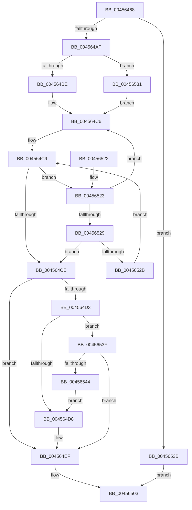

# MmUpdateMdlTracker

- RVA: `0x00456468`–`0x00456546` (길이 `222` bytes)
- VA: `0x0000000140456468`
- 실행 섹션: `.text`
- PDB 이름 있음: `예`; PDB Function 태그: `아니요`
- unwind 정보 RVA: `0x000A7C50`
- 디코드: `68`개 명령, `222/222` bytes 표시
- 미해석 바이트: `0` (있으면 어셈블리에 `.byte`로 보존)

> 이 문서는 커널 이미지의 기계어와 PDB 기호를 분석해 생성했습니다. 4번과 5번은 함수 원형과 자료형을 바이너리 사용 방식에서 추정한 C 해석이며 원본 소스 복구 결과는 아닙니다.

## 1. Dependencies

- 직접 호출 지점: **4**; 고유 호출 대상: **4**
- 직접 호출자로 확인된 함수: **7**
- RIP 상대 이미지 참조: **1**

### Outgoing calls
- `0x004564C1` → [ExAcquireSpinLockExclusiveAtDpcLevel](../24/ExAcquireSpinLockExclusiveAtDpcLevel_function_00248E80.md) (function, `0x00248E80`)
- `0x004564EA` → [memset](../6C/memset_function_006C6C40.md) (function, `0x006C6C40`)
- `0x004564F5` → [MiReleaseSpinLockExclusive](../24/MiReleaseSpinLockExclusive_function_002482C0.md) (function, `0x002482C0`)
- `0x00456531` → [ExAcquireSpinLockExclusive](../24/ExAcquireSpinLockExclusive_function_00248690.md) (function, `0x00248690`)

### Direct callers
- [IopProbeAndLockPages](../29/IopProbeAndLockPages_function_0029F1B0.md) at `0x0029F1F0`
- [IopProbeAndLockPages](IopProbeAndLockPages_function_0045641C.md) at `0x0045644E`
- [IopProbeAndLockPages](../47/IopProbeAndLockPages_function_00479708.md) at `0x00479749`
- [IopProbeAndLockPages](../4B/IopProbeAndLockPages_function_004B1188.md) at `0x004B11CC`
- [NtQueryQuotaInformationFile](../../page/72/NtQueryQuotaInformationFile_function_00720FE0.md) at `0x0072161A`
- [IopXxxControlFile](../../page/8E/IopXxxControlFile_function_008E9AD0.md) at `0x008EAA59`
- [IopWriteFileGather](../../page/AA/IopWriteFileGather_function_00AAA95C.md) at `0x00AAAF1A`

### Static image references
- `0x00456497` → RVA `0x00FC6AB0` (`ALMOSTRO`; read)

## 2. Other-region calls and transfers

- 다른 실행 섹션으로 향하는 call: **0**
- 별도 외부 분기/꼬리 이동을 확인하지 못했습니다.

## 3. Assembly (complete function range)

```asm
00456468  48 8B C4                        mov rax, rsp
0045646B  48 89 58 08                     mov qword ptr [rax + 8], rbx
0045646F  48 89 68 10                     mov qword ptr [rax + 0x10], rbp
00456473  48 89 70 18                     mov qword ptr [rax + 0x18], rsi
00456477  48 89 78 20                     mov qword ptr [rax + 0x20], rdi
0045647B  41 54                           push r12
0045647D  41 56                           push r14
0045647F  41 57                           push r15
00456481  48 83 EC 20                     sub rsp, 0x20
00456485  4C 8B 49 10                     mov r9, qword ptr [rcx + 0x10]
00456489  33 FF                           xor edi, edi
0045648B  4D 85 C9                        test r9, r9
0045648E  4D 8B F8                        mov r15, r8
00456491  4C 8B E2                        mov r12, rdx
00456494  48 8B E9                        mov rbp, rcx
00456497  4C 0F 44 0D 11 06 B7 00         cmove r9, qword ptr [rip + 0xb70611]
0045649F  49 8B 99 98 03 00 00            mov rbx, qword ptr [r9 + 0x398]
004564A6  48 85 DB                        test rbx, rbx
004564A9  0F 84 8C 00 00 00               je 0x14045653b
004564AF  44 0F 20 C0                     mov rax, cr8
004564B3  48 8D 73 18                     lea rsi, [rbx + 0x18]
004564B7  48 8B CE                        mov rcx, rsi
004564BA  3C 02                           cmp al, 2
004564BC  75 73                           jne 0x140456531
004564BE  41 B6 11                        mov r14b, 0x11
004564C1  E8 BA 29 DF FF                  call 0x140248e80
004564C6  48 8B 1B                        mov rbx, qword ptr [rbx]
004564C9  48 85 DB                        test rbx, rbx
004564CC  75 55                           jne 0x140456523
004564CE  48 85 DB                        test rbx, rbx
004564D1  74 1C                           je 0x1404564ef
004564D3  4D 85 E4                        test r12, r12
004564D6  74 67                           je 0x14045653f
004564D8  33 D2                           xor edx, edx
004564DA  4C 89 63 48                     mov qword ptr [rbx + 0x48], r12
004564DE  48 8D 4B 58                     lea rcx, [rbx + 0x58]
004564E2  4C 89 7B 50                     mov qword ptr [rbx + 0x50], r15
004564E6  44 8D 42 60                     lea r8d, [rdx + 0x60]
004564EA  E8 51 07 27 00                  call 0x1406c6c40
004564EF  41 8A D6                        mov dl, r14b
004564F2  48 8B CE                        mov rcx, rsi
004564F5  E8 C6 1D DF FF                  call 0x1402482c0
004564FA  48 85 DB                        test rbx, rbx
004564FD  40 0F 95 C7                     setne dil
00456501  8B C7                           mov eax, edi
00456503  48 8B 5C 24 40                  mov rbx, qword ptr [rsp + 0x40]
00456508  48 8B 6C 24 48                  mov rbp, qword ptr [rsp + 0x48]
0045650D  48 8B 74 24 50                  mov rsi, qword ptr [rsp + 0x50]
00456512  48 8B 7C 24 58                  mov rdi, qword ptr [rsp + 0x58]
00456517  48 83 C4 20                     add rsp, 0x20
0045651B  41 5F                           pop r15
0045651D  41 5E                           pop r14
0045651F  41 5C                           pop r12
00456521  C3                              ret
00456522  CC                              int3
00456523  48 3B 6B 18                     cmp rbp, qword ptr [rbx + 0x18]
00456527  72 9D                           jb 0x1404564c6
00456529  76 A3                           jbe 0x1404564ce
0045652B  48 8B 5B 08                     mov rbx, qword ptr [rbx + 8]
0045652F  EB 98                           jmp 0x1404564c9
00456531  E8 5A 21 DF FF                  call 0x140248690
00456536  44 8A F0                        mov r14b, al
00456539  EB 8B                           jmp 0x1404564c6
0045653B  33 C0                           xor eax, eax
0045653D  EB C4                           jmp 0x140456503
0045653F  4D 85 FF                        test r15, r15
00456542  74 AB                           je 0x1404564ef
00456544  EB 92                           jmp 0x1404564d8
```

## 4. C-style interpretation (structured pseudocode)

```c
__int64 __fastcall MmUpdateMdlTracker(__int64 a1, __int64 a2, __int64 a3)
{
    __int64 result;
    __int64 v_rdi;
    __int64 v_rsp;
    unsigned __int64 v_stack_p10;
    unsigned __int64 v_stack_p18;
    unsigned __int64 v_stack_p20;
    unsigned __int64 v_stack_p8;

    *(unsigned __int64 *)(v_rsp + 8) = v_rbx;
    *(unsigned __int64 *)(v_rsp + 16) = v_rbp;
    *(unsigned __int64 *)(v_rsp + 24) = v_rsi;
    *(unsigned __int64 *)(v_rsp + 32) = v_rdi;
    v_rsp = (v_rsp) - (32);
    v_rdi = 0;
    a4 = *(unsigned __int64 *)(a1 + 16);
    if (*(unsigned __int64 *)(a1 + 16) == 0) { a4 = *(unsigned __int64 *)(v_rip + 11994641); }
    if (*(unsigned __int64 *)(a4 + 920) == 0) goto loc_0045653B;
    if (((unsigned __int8)(v_cr8)) != 2) goto loc_00456531;
    result = ExAcquireSpinLockExclusiveAtDpcLevel(*(unsigned __int64 *)(a4 + 920) + 24, a2, a3, a4);
loc_004564C6:
loc_004564C9:
    if (*(unsigned __int64 *)(*(unsigned __int64 *)(a4 + 920)) != 0) goto loc_00456523;
loc_004564CE:
    if (*(unsigned __int64 *)(*(unsigned __int64 *)(a4 + 920)) == 0) goto loc_004564EF;
    if (a2 == 0) goto loc_0045653F;
loc_004564D8:
    a2 = 0;
    *(unsigned __int64 *)(*(unsigned __int64 *)(*(unsigned __int64 *)(a4 + 920)) + 72) = 0;
    *(unsigned __int64 *)(*(unsigned __int64 *)(*(unsigned __int64 *)(a4 + 920)) + 80) = a3;
    result = memset(*(unsigned __int64 *)(*(unsigned __int64 *)(a4 + 920)) + 88, a2, a2 + 96, a4);
loc_004564EF:
    result = MiReleaseSpinLockExclusive(*(unsigned __int64 *)(a4 + 920) + 24, 17, a2 + 96, a4);
    v_rdi = (*(unsigned __int64 *)(*(unsigned __int64 *)(a4 + 920)) != 0) ? 1 : 0;
loc_00456503:
    v_rsp = (v_rsp) + (32);
    return (unsigned int)((unsigned int)(v_rdi));
loc_00456523:
    if (v_stack_p10 < (*(unsigned __int64 *)(v_stack_p8 + 24))) goto loc_004564C6;
    if (v_stack_p10 <= (*(unsigned __int64 *)(v_stack_p8 + 24))) goto loc_004564CE;
    goto loc_004564C9;
loc_00456531:
    result = ExAcquireSpinLockExclusive(*(unsigned __int64 *)(a4 + 920) + 24, 17, a2 + 96, a4);
    goto loc_004564C6;
loc_0045653B:
    result = 0;
    goto loc_00456503;
loc_0045653F:
    if (a3 == 0) goto loc_004564EF;
    goto loc_004564D8;
}
```

## 5. (Beta) C Style

```c
int64_t MmUpdateMdlTracker(void *Arg1, int64_t Arg2, int64_t Arg3)
{
    uint8_t *arg1 = (uint8_t *)Arg1;

    int64_t result;
    int64_t local_rdi;
    int64_t local_rsp;
    uint64_t v_stack_p10;
    uint64_t v_stack_p18;
    uint64_t v_stack_p20;
    uint64_t v_stack_p8;

    *(uint64_t *)(local_rsp + 0x8) = local_rbx;
    *(uint64_t *)(local_rsp + 0x10) = local_rbp;
    *(uint64_t *)(local_rsp + 0x18) = local_rsi;
    *(uint64_t *)(local_rsp + 0x20) = local_rdi;
    local_rsp = (local_rsp) - (32);
    local_rdi = 0;
    a4 = *(uint64_t *)(arg1 + 0x10);
    if (*(uint64_t *)(arg1 + 0x10) == 0) { a4 = *(uint64_t *)(v_rip + 0xB70611); }
    if (*(uint64_t *)(a4 + 0x398) == 0) goto loc_0045653B;
    if (((uint8_t)(v_cr8)) != 2) goto loc_00456531;
    result = ExAcquireSpinLockExclusiveAtDpcLevel(*(uint64_t *)(a4 + 0x398) + 24, Arg2, Arg3, a4);
loc_004564C6:
loc_004564C9:
    if (*(uint64_t *)(*(uint64_t *)(a4 + 0x398)) != 0) goto loc_00456523;
loc_004564CE:
    if (*(uint64_t *)(*(uint64_t *)(a4 + 0x398)) == 0) goto loc_004564EF;
    if (Arg2 == 0) goto loc_0045653F;
loc_004564D8:
    Arg2 = 0;
    *(uint64_t *)(*(uint64_t *)(*(uint64_t *)(a4 + 0x398)) + 0x48) = 0;
    *(uint64_t *)(*(uint64_t *)(*(uint64_t *)(a4 + 0x398)) + 0x50) = Arg3;
    result = memset(*(uint64_t *)(*(uint64_t *)(a4 + 0x398)) + 88, Arg2, Arg2 + 96, a4);
loc_004564EF:
    result = MiReleaseSpinLockExclusive(*(uint64_t *)(a4 + 0x398) + 24, 17, Arg2 + 96, a4);
    local_rdi = (*(uint64_t *)(*(uint64_t *)(a4 + 0x398)) != 0) ? 1 : 0;
loc_00456503:
    local_rsp = (local_rsp) + (32);
    return (uint32_t)((uint32_t)(local_rdi));
loc_00456523:
    if (v_stack_p10 < (*(uint64_t *)(v_stack_p8 + 0x18))) goto loc_004564C6;
    if (v_stack_p10 <= (*(uint64_t *)(v_stack_p8 + 0x18))) goto loc_004564CE;
    goto loc_004564C9;
loc_00456531:
    result = ExAcquireSpinLockExclusive(*(uint64_t *)(a4 + 0x398) + 24, 17, Arg2 + 96, a4);
    goto loc_004564C6;
loc_0045653B:
    result = 0;
    goto loc_00456503;
loc_0045653F:
    if (Arg3 == 0) goto loc_004564EF;
    goto loc_004564D8;
}
```

### 관측된 메모리 오프셋

구조체 형식이 확인되지 않은 접근은 인자 기준의 오프셋으로만 기록했습니다.

| 기준 인자 | 오프셋 표현 | 폭 (bit) | 접근 |
|---|---:|---:|---|
| `Arg1` | `+ 0x10` | `64` | `R` |

## 6. Execution-region graph

[열기: 2D/3D 그래프와 함수 탐색 컨트롤 패널](../../../control-panel.html?section=text&rva=0x00456468&view=graph)

- 2D 그래프는 위에서 아래로 흐르고, 3D 그래프는 빈 공간을 드래그해 회전합니다. Shift+드래그는 이동, 휠은 확대·축소, 함수 노드 선택은 대상 보고서 이동입니다.

### Static fallback


