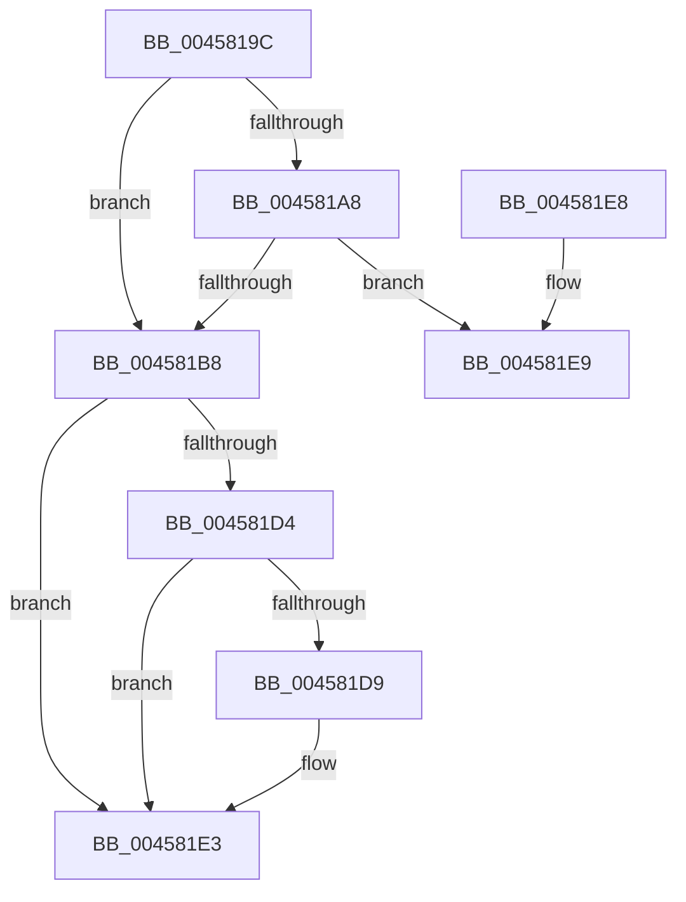

# ObFastReplaceObject

- RVA: `0x0045819C`–`0x00458206` (길이 `106` bytes)
- VA: `0x000000014045819C`
- 실행 섹션: `.text`
- PDB 이름 있음: `예`; PDB Function 태그: `아니요`
- unwind 정보 RVA: `0x000A82A0`
- 디코드: `33`개 명령, `106/106` bytes 표시
- 미해석 바이트: `0` (있으면 어셈블리에 `.byte`로 보존)

> 이 문서는 커널 이미지의 기계어와 PDB 기호를 분석해 생성했습니다. 4번과 5번은 함수 원형과 자료형을 바이너리 사용 방식에서 추정한 C 해석이며 원본 소스 복구 결과는 아닙니다.

## 1. Dependencies

- 직접 호출 지점: **1**; 고유 호출 대상: **1**
- 직접 호출자로 확인된 함수: **7**
- RIP 상대 이미지 참조: **0**

### Outgoing calls
- `0x00458200` → [KeBugCheckEx](../4F/KeBugCheckEx_function_004FD660.md) (function, `0x004FD660`)

### Direct callers
- [CcChangeBackingFileObject](CcChangeBackingFileObject_function_00457E5C.md) at `0x00457F5B`
- [MmChangeSectionBackingFile](MmChangeSectionBackingFile_function_0045808C.md) at `0x00458106`
- [MiEnableImageDirectMap](../68/MiEnableImageDirectMap_function_00680A78.md) at `0x00680B43`
- [ObpCreateSymbolicLinkName](../../page/74/ObpCreateSymbolicLinkName_function_0074EB80.md) at `0x0074EEF0`
- [ObpDeleteDeviceMap](../../page/74/ObpDeleteDeviceMap_function_0074F2F0.md) at `0x0074F343`
- [PsShutdownSystem](../../page/78/PsShutdownSystem_function_00785E94.md) at `0x007860B5`
- [SeExchangePrimaryToken](../../page/7A/SeExchangePrimaryToken_function_007A07BC.md) at `0x007A09EC`

### Static image references
- 디코드된 RIP-relative 메모리 참조가 없습니다.

## 2. Other-region calls and transfers

- 다른 실행 섹션으로 향하는 call: **0**
- 별도 외부 분기/꼬리 이동을 확인하지 못했습니다.

## 3. Assembly (complete function range)

```asm
0045819C  48 83 EC 38                     sub rsp, 0x38
004581A0  4C 8B C1                        mov r8, rcx
004581A3  48 85 D2                        test rdx, rdx
004581A6  74 10                           je 0x1404581b8
004581A8  B8 0F 00 00 00                  mov eax, 0xf
004581AD  F0 48 0F C1 42 D0               lock xadd qword ptr [rdx - 0x30], rax
004581B3  48 85 C0                        test rax, rax
004581B6  7E 31                           jle 0x1404581e9
004581B8  48 8B C2                        mov rax, rdx
004581BB  48 83 C8 0F                     or rax, 0xf
004581BF  48 F7 DA                        neg rdx
004581C2  48 1B C9                        sbb rcx, rcx
004581C5  48 23 C8                        and rcx, rax
004581C8  49 87 08                        xchg qword ptr [r8], rcx
004581CB  48 8B C1                        mov rax, rcx
004581CE  48 83 E0 F0                     and rax, 0xfffffffffffffff0
004581D2  74 0F                           je 0x1404581e3
004581D4  83 E1 0F                        and ecx, 0xf
004581D7  76 0A                           jbe 0x1404581e3
004581D9  F7 D9                           neg ecx
004581DB  48 63 D1                        movsxd rdx, ecx
004581DE  F0 48 01 50 D0                  lock add qword ptr [rax - 0x30], rdx
004581E3  48 83 C4 38                     add rsp, 0x38
004581E7  C3                              ret
004581E8  CC                              int3
004581E9  4C 8B C2                        mov r8, rdx
004581EC  48 83 C0 0F                     add rax, 0xf
004581F0  33 D2                           xor edx, edx
004581F2  48 89 44 24 20                  mov qword ptr [rsp + 0x20], rax
004581F7  41 B9 10 00 00 00               mov r9d, 0x10
004581FD  8D 4A 18                        lea ecx, [rdx + 0x18]
00458200  E8 5B 54 0A 00                  call 0x1404fd660
00458205  CC                              int3
```

## 4. C-style interpretation (structured pseudocode)

```c
__int64 __fastcall ObFastReplaceObject(__int64 a1, __int64 a2)
{
    __int64 result;
    __int64 v_rsp;
    unsigned __int64 v_stack_p20;

    v_rsp = (v_rsp) - (56);
    if (a2 == 0) goto loc_004581B8;
    if (condition_is_less_or_equal) goto loc_004581E9;
loc_004581B8:
    result = (a2) | (15);
    a2 = -(a2);
    a1 = (a1) & (result);
    result = (a1) & (-16);
    if (condition_is_equal) goto loc_004581E3;
    a1 = (unsigned int)((a1) & (15));
    if (!(condition_is_below_or_equal)) {
        a1 = (unsigned int)(-(a1));
        a2 = (int)((unsigned int)(a1));
    }
    v_rsp = (v_rsp) + (56);
    return result;
loc_004581E9:
    result = (result) + (15);
    a2 = 0;
    v_stack_p20 = result;
    result = KeBugCheckEx(a2 + 24, a2, a2, 16);
    return result;
}
```

## 5. (Beta) C Style

```c
int64_t ObFastReplaceObject(void *Arg1, int64_t Arg2)
{
    uint8_t *arg1 = (uint8_t *)Arg1;

    int64_t result;
    int64_t local_rsp;
    uint64_t v_stack_p20;

    local_rsp = (local_rsp) - (56);
    if (Arg2 == 0) goto loc_004581B8;
    if (condition_is_less_or_equal) goto loc_004581E9;
loc_004581B8:
    result = (Arg2) | (15);
    Arg2 = -(Arg2);
    Arg1 = (Arg1) & (result);
    result = (Arg1) & (-16);
    if (condition_is_equal) goto loc_004581E3;
    Arg1 = (uint32_t)((Arg1) & (15));
    if (!(condition_is_below_or_equal)) {
        Arg1 = (uint32_t)(-(Arg1));
        Arg2 = (int32_t)((uint32_t)(Arg1));
    }
    local_rsp = (local_rsp) + (56);
    return result;
loc_004581E9:
    result = (result) + (15);
    Arg2 = 0;
    v_stack_p20 = result;
    result = KeBugCheckEx(Arg2 + 24, Arg2, Arg2, 16);
    return result;
}
```

### 관측된 메모리 오프셋

구조체 형식이 확인되지 않은 접근은 인자 기준의 오프셋으로만 기록했습니다.

| 기준 인자 | 오프셋 표현 | 폭 (bit) | 접근 |
|---|---:|---:|---|
| `Arg1` | `+ 0x0` | `64` | `R/W` |

## 6. Execution-region graph

[열기: 2D/3D 그래프와 함수 탐색 컨트롤 패널](../../../control-panel.html?section=text&rva=0x0045819C&view=graph)

- 2D 그래프는 위에서 아래로 흐르고, 3D 그래프는 빈 공간을 드래그해 회전합니다. Shift+드래그는 이동, 휠은 확대·축소, 함수 노드 선택은 대상 보고서 이동입니다.

### Static fallback


