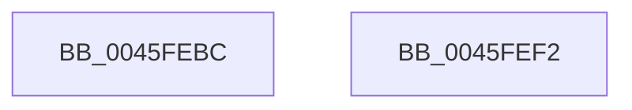

# ObpReferenceNamedObject

- RVA: `0x0045FEBC`–`0x0045FEF3` (길이 `55` bytes)
- VA: `0x000000014045FEBC`
- 실행 섹션: `.text`
- PDB 이름 있음: `예`; PDB Function 태그: `아니요`
- unwind 정보 RVA: `0x0005CF00`
- 디코드: `16`개 명령, `55/55` bytes 표시
- 미해석 바이트: `0` (있으면 어셈블리에 `.byte`로 보존)

> 이 문서는 커널 이미지의 기계어와 PDB 기호를 분석해 생성했습니다. 4번과 5번은 함수 원형과 자료형을 바이너리 사용 방식에서 추정한 C 해석이며 원본 소스 복구 결과는 아닙니다.

## 1. Dependencies

- 직접 호출 지점: **1**; 고유 호출 대상: **1**
- 직접 호출자로 확인된 함수: **1**
- RIP 상대 이미지 참조: **1**

### Outgoing calls
- `0x0045FECE` → [ObfReferenceObjectWithTag](../21/ObfReferenceObjectWithTag_function_00210710.md) (function, `0x00210710`)

### Direct callers
- [ObpInsertOrLocateNamedObject](../../page/99/ObpInsertOrLocateNamedObject_function_0099F2C0.md) at `0x0099F615`

### Static image references
- `0x0045FED7` → RVA `0x00F0FF80` (`.data`; read)

## 2. Other-region calls and transfers

- 다른 실행 섹션으로 향하는 call: **0**
- 별도 외부 분기/꼬리 이동을 확인하지 못했습니다.

## 3. Assembly (complete function range)

```asm
0045FEBC  40 53                           push rbx
0045FEBE  48 83 EC 20                     sub rsp, 0x20
0045FEC2  48 8B D9                        mov rbx, rcx
0045FEC5  BA 44 66 6C 74                  mov edx, 0x746c6644
0045FECA  48 83 C1 30                     add rcx, 0x30
0045FECE  E8 3D 08 DB FF                  call 0x140210710
0045FED3  0F B6 43 1A                     movzx eax, byte ptr [rbx + 0x1a]
0045FED7  48 8D 0D A2 00 AB 00            lea rcx, [rip + 0xab00a2]
0045FEDE  83 E0 03                        and eax, 3
0045FEE1  0F B6 04 08                     movzx eax, byte ptr [rax + rcx]
0045FEE5  48 2B D8                        sub rbx, rax
0045FEE8  F0 FF 43 18                     lock inc dword ptr [rbx + 0x18]
0045FEEC  48 83 C4 20                     add rsp, 0x20
0045FEF0  5B                              pop rbx
0045FEF1  C3                              ret
0045FEF2  CC                              int3
```

## 4. C-style interpretation (structured pseudocode)

```c
__int64 __fastcall ObpReferenceNamedObject(__int64 a1)
{
    __int64 result;
    __int64 v_rbx;
    __int64 v_rsp;

    v_rsp = (v_rsp) - (32);
    a1 = (a1) + (48);
    result = ObfReferenceObjectWithTag(a1, (unsigned int)(0x746C6644ULL), a3, a4);
    result = (unsigned int)((*(unsigned __int8 *)(a1 + 26)) & (3));
    v_rbx = (a1) - (*(unsigned __int8 *)(result + v_rip + 11206818 * 1));
    v_rsp = (v_rsp) + (32);
    return *(unsigned __int8 *)(result + v_rip + 11206818 * 1);
}
```

## 5. (Beta) C Style

```c
int64_t ObpReferenceNamedObject(void *Arg1)
{
    uint8_t *arg1 = (uint8_t *)Arg1;

    int64_t result;
    int64_t local_rbx;
    int64_t local_rsp;

    local_rsp = (local_rsp) - (32);
    Arg1 = (Arg1) + (48);
    result = ObfReferenceObjectWithTag(Arg1, (uint32_t)(0x746C6644ULL), a3, a4);
    result = (uint32_t)((*(uint8_t *)(arg1 + 0x1A)) & (3));
    local_rbx = (Arg1) - (*(uint8_t *)(result + v_rip + 0xAB00A2 * 1));
    local_rsp = (local_rsp) + (32);
    return *(uint8_t *)(result + v_rip + 0xAB00A2 * 1);
}
```

### 관측된 메모리 오프셋

구조체 형식이 확인되지 않은 접근은 인자 기준의 오프셋으로만 기록했습니다.

| 기준 인자 | 오프셋 표현 | 폭 (bit) | 접근 |
|---|---:|---:|---|
| `Arg1` | `+ 0x18` | `32` | `R/W` |
| `Arg1` | `+ 0x1A` | `8` | `R` |

## 6. Execution-region graph

[열기: 2D/3D 그래프와 함수 탐색 컨트롤 패널](../../../control-panel.html?section=text&rva=0x0045FEBC&view=graph)

- 2D 그래프는 위에서 아래로 흐르고, 3D 그래프는 빈 공간을 드래그해 회전합니다. Shift+드래그는 이동, 휠은 확대·축소, 함수 노드 선택은 대상 보고서 이동입니다.

### Static fallback


