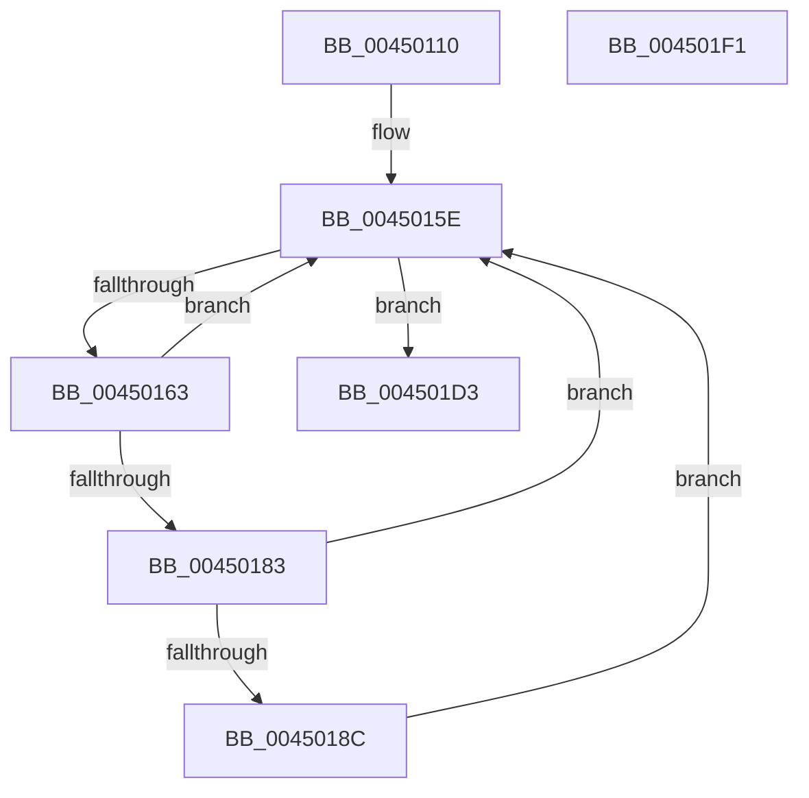

# PerfInfoLogInterruptHv

- RVA: `0x00450110`–`0x004501F2` (길이 `226` bytes)
- VA: `0x0000000140450110`
- 실행 섹션: `.text`
- PDB 이름 있음: `예`; PDB Function 태그: `아니요`
- unwind 정보 RVA: `0x000A7180`
- 디코드: `54`개 명령, `226/226` bytes 표시
- 미해석 바이트: `0` (있으면 어셈블리에 `.byte`로 보존)

> 이 문서는 커널 이미지의 기계어와 PDB 기호를 분석해 생성했습니다. 4번과 5번은 함수 원형과 자료형을 바이너리 사용 방식에서 추정한 C 해석이며 원본 소스 복구 결과는 아닙니다.

## 1. Dependencies

- 직접 호출 지점: **2**; 고유 호출 대상: **2**
- 직접 호출자로 확인된 함수: **2**
- RIP 상대 이미지 참조: **2**

### Outgoing calls
- `0x004501CC` → [EtwpLogKernelEvent](../25/EtwpLogKernelEvent_function_0025CC00.md) (function, `0x0025CC00`)
- `0x004501DA` → [_security_check_cookie](../6A/_security_check_cookie_function_006AC640.md) (function, `0x006AC640`)

### Direct callers
- [KiHvInterruptSubDispatch](../6B/KiHvInterruptSubDispatch_function_006B7F10.md) at `0x006B7FAA`
- [KiVmbusInterruptSubDispatch](../6B/KiVmbusInterruptSubDispatch_function_006B7FC0.md) at `0x006B8054`

### Static image references
- `0x00450122` → RVA `0x00E0A740` (`.data`; read)
- `0x00450143` → RVA `0x00FC6AA8` (`ALMOSTRO`; read)

## 2. Other-region calls and transfers

- 다른 실행 섹션으로 향하는 call: **0**
- 별도 외부 분기/꼬리 이동을 확인하지 못했습니다.

## 3. Assembly (complete function range)

```asm
00450110  48 89 5C 24 08                  mov qword ptr [rsp + 8], rbx
00450115  48 89 7C 24 10                  mov qword ptr [rsp + 0x10], rdi
0045011A  55                              push rbp
0045011B  48 8B EC                        mov rbp, rsp
0045011E  48 83 EC 70                     sub rsp, 0x70
00450122  48 8B 05 17 A6 9B 00            mov rax, qword ptr [rip + 0x9ba617]
00450129  48 33 C4                        xor rax, rsp
0045012C  48 89 45 F8                     mov qword ptr [rbp - 8], rax
00450130  83 65 D4 00                     and dword ptr [rbp - 0x2c], 0
00450134  48 8D 45 C8                     lea rax, [rbp - 0x38]
00450138  83 65 F4 00                     and dword ptr [rbp - 0xc], 0
0045013C  49 8B F8                        mov rdi, r8
0045013F  48 89 45 E8                     mov qword ptr [rbp - 0x18], rax
00450143  48 8B 05 5E 69 B7 00            mov rax, qword ptr [rip + 0xb7695e]
0045014A  48 89 4D C8                     mov qword ptr [rbp - 0x38], rcx
0045014E  89 55 D0                        mov dword ptr [rbp - 0x30], edx
00450151  C7 45 F0 0C 00 00 00            mov dword ptr [rbp - 0x10], 0xc
00450158  8B 98 A8 11 00 00               mov ebx, dword ptr [rax + 0x11a8]
0045015E  0F BC CB                        bsf ecx, ebx
00450161  74 70                           je 0x1404501d3
00450163  48 8B 15 3E 69 B7 00            mov rdx, qword ptr [rip + 0xb7693e]
0045016A  8D 43 FF                        lea eax, [rbx - 1]
0045016D  23 D8                           and ebx, eax
0045016F  44 8B C1                        mov r8d, ecx
00450172  8B C1                           mov eax, ecx
00450174  48 C1 E0 05                     shl rax, 5
00450178  48 05 CC 11 00 00               add rax, 0x11cc
0045017E  48 03 C2                        add rax, rdx
00450181  74 DB                           je 0x14045015e
00450183  F7 40 04 00 40 00 00            test dword ptr [rax + 4], 0x4000
0045018A  74 D2                           je 0x14045015e
0045018C  0F B6 84 4A 99 11 00 00         movzx eax, byte ptr [rdx + rcx*2 + 0x1199]
00450194  41 B9 02 00 00 00               mov r9d, 2
0045019A  83 65 E4 00                     and dword ptr [rbp - 0x1c], 0
0045019E  48 FF C8                        dec rax
004501A1  C7 45 E0 08 00 00 00            mov dword ptr [rbp - 0x20], 8
004501A8  C7 44 24 28 02 0A 50 00         mov dword ptr [rsp + 0x28], 0x500a02
004501B0  66 C7 44 24 20 43 0F            mov word ptr [rsp + 0x20], 0xf43
004501B7  48 8D 0C C7                     lea rcx, [rdi + rax*8]
004501BB  48 89 4D D8                     mov qword ptr [rbp - 0x28], rcx
004501BF  48 8D 4D D8                     lea rcx, [rbp - 0x28]
004501C3  46 0F B6 84 42 98 11 00 00      movzx r8d, byte ptr [rdx + r8*2 + 0x1198]
004501CC  E8 2F CA E0 FF                  call 0x14025cc00
004501D1  EB 8B                           jmp 0x14045015e
004501D3  48 8B 4D F8                     mov rcx, qword ptr [rbp - 8]
004501D7  48 33 CC                        xor rcx, rsp
004501DA  E8 61 C4 25 00                  call 0x1406ac640
004501DF  4C 8D 5C 24 70                  lea r11, [rsp + 0x70]
004501E4  49 8B 5B 10                     mov rbx, qword ptr [r11 + 0x10]
004501E8  49 8B 7B 18                     mov rdi, qword ptr [r11 + 0x18]
004501EC  49 8B E3                        mov rsp, r11
004501EF  5D                              pop rbp
004501F0  C3                              ret
004501F1  CC                              int3
```

## 4. C-style interpretation (structured pseudocode)

```c
__int64 __fastcall PerfInfoLogInterruptHv(__int64 a1, int a2, __int64 a3)
{
    __int64 result;
    __int64 v_rbx;
    __int64 v_rsp;
    unsigned __int64 v_stack_m10;
    unsigned int v_stack_m14;
    unsigned int v_stack_m18;
    unsigned __int64 v_stack_m20;
    unsigned int v_stack_m24;
    unsigned int v_stack_m28;
    unsigned __int64 v_stack_m30;
    unsigned int v_stack_m34;
    unsigned int v_stack_m38;
    unsigned __int64 v_stack_m40;
    unsigned int v_stack_m50;
    unsigned __int16 v_stack_m58;
    unsigned __int64 v_stack_m8;
    unsigned __int64 v_stack_p10;
    unsigned __int64 v_stack_p8;

    v_stack_p8 = v_rbx;
    v_stack_p10 = v_rdi;
    v_rsp = (v_rsp) - (112);
    result = (*(unsigned __int64 *)(v_rip + 10200599)) ^ (v_rsp);
    v_stack_m10 = result;
    v_stack_m20 = v_stack_m40;
    v_stack_m40 = a1;
    v_stack_m38 = a2;
    v_stack_m18 = 12;
loc_0045015E:
    if (condition_is_equal) goto loc_004501D3;
    v_rbx = (unsigned int)(((unsigned int)(*(unsigned int *)(*(unsigned __int64 *)(v_rip + 12020062) + 4520))) & ((unsigned int)((unsigned int)(*(unsigned int *)(*(unsigned __int64 *)(v_rip + 12020062) + 4520)) - 1)));
    result = ((unsigned int)((unsigned int)(a1))) << (5);
    result = (result) + (0x11CCULL);
    result = (result) + (*(unsigned __int64 *)(v_rip + 12020030));
    if (condition_is_equal) goto loc_0045015E;
    if (((*(unsigned int *)(result + 4)) & (0x4000ULL)) == 0) goto loc_0045015E;
    result = (*(unsigned __int8 *)(*(unsigned __int64 *)(v_rip + 12020030) + a1 * 2 + 4505)) - 1;
    v_stack_m28 = 8;
    v_stack_m50 = 0x500A02ULL;
    v_stack_m58 = 0xF43ULL;
    v_stack_m30 = a3 + result * 8;
    result = EtwpLogKernelEvent(v_stack_m30, *(unsigned __int64 *)(v_rip + 12020030), *(unsigned __int8 *)(*(unsigned __int64 *)(v_rip + 12020030) + (unsigned int)((unsigned int)(a1)) * 2 + 4504), 2);
    goto loc_0045015E;
loc_004501D3:
    a1 = (v_stack_m10) ^ (v_rsp);
    result = _security_check_cookie(a1, *(unsigned __int64 *)(v_rip + 12020030), *(unsigned __int8 *)(*(unsigned __int64 *)(v_rip + 12020030) + (unsigned int)((unsigned int)(a1)) * 2 + 4504), 2);
    return result;
}
```

## 5. (Beta) C Style

```c
int64_t PerfInfoLogInterruptHv(int64_t Arg1, int32_t Arg2, void *Arg3)
{
    uint8_t *arg3 = (uint8_t *)Arg3;

    int64_t result;
    int64_t local_rbx;
    int64_t local_rsp;
    uint64_t v_stack_m10;
    uint32_t v_stack_m14;
    uint32_t v_stack_m18;
    uint64_t v_stack_m20;
    uint32_t v_stack_m24;
    uint32_t v_stack_m28;
    uint64_t v_stack_m30;
    uint32_t v_stack_m34;
    uint32_t v_stack_m38;
    uint64_t v_stack_m40;
    uint32_t v_stack_m50;
    uint16_t v_stack_m58;
    uint64_t v_stack_m8;
    uint64_t v_stack_p10;
    uint64_t v_stack_p8;

    v_stack_p8 = local_rbx;
    v_stack_p10 = local_rdi;
    local_rsp = (local_rsp) - (112);
    result = (*(uint64_t *)(v_rip + 0x9BA617)) ^ (local_rsp);
    v_stack_m10 = result;
    v_stack_m20 = v_stack_m40;
    v_stack_m40 = Arg1;
    v_stack_m38 = Arg2;
    v_stack_m18 = 12;
loc_0045015E:
    if (condition_is_equal) goto loc_004501D3;
    local_rbx = (uint32_t)(((uint32_t)(*(uint32_t *)(*(uint64_t *)(v_rip + 0xB7695E) + 0x11A8))) & ((uint32_t)((uint32_t)(*(uint32_t *)(*(uint64_t *)(v_rip + 0xB7695E) + 0x11A8)) - 1)));
    result = ((uint32_t)((uint32_t)(Arg1))) << (5);
    result = (result) + (0x11CCULL);
    result = (result) + (*(uint64_t *)(v_rip + 0xB7693E));
    if (condition_is_equal) goto loc_0045015E;
    if (((*(uint32_t *)(result + 0x4)) & (0x4000ULL)) == 0) goto loc_0045015E;
    result = (*(uint8_t *)(*(uint64_t *)(v_rip + 0xB7693E) + Arg1 * 2 + 0x1199)) - 1;
    v_stack_m28 = 8;
    v_stack_m50 = 0x500A02ULL;
    v_stack_m58 = 0xF43ULL;
    v_stack_m30 = Arg3 + result * 8;
    result = EtwpLogKernelEvent(v_stack_m30, *(uint64_t *)(v_rip + 0xB7693E), *(uint8_t *)(*(uint64_t *)(v_rip + 0xB7693E) + (uint32_t)((uint32_t)(Arg1)) * 2 + 0x1198), 2);
    goto loc_0045015E;
loc_004501D3:
    Arg1 = (v_stack_m10) ^ (local_rsp);
    result = _security_check_cookie(Arg1, *(uint64_t *)(v_rip + 0xB7693E), *(uint8_t *)(*(uint64_t *)(v_rip + 0xB7693E) + (uint32_t)((uint32_t)(Arg1)) * 2 + 0x1198), 2);
    return result;
}
```

### 관측된 메모리 오프셋

구조체 형식이 확인되지 않은 접근은 인자 기준의 오프셋으로만 기록했습니다.

| 기준 인자 | 오프셋 표현 | 폭 (bit) | 접근 |
|---|---:|---:|---|
| `Arg3` | `+ 0x0 + rax*8` | `64` | `R` |

## 6. Execution-region graph

[열기: 2D/3D 그래프와 함수 탐색 컨트롤 패널](../../../control-panel.html?section=text&rva=0x00450110&view=graph)

- 2D 그래프는 위에서 아래로 흐르고, 3D 그래프는 빈 공간을 드래그해 회전합니다. Shift+드래그는 이동, 휠은 확대·축소, 함수 노드 선택은 대상 보고서 이동입니다.

### Static fallback


