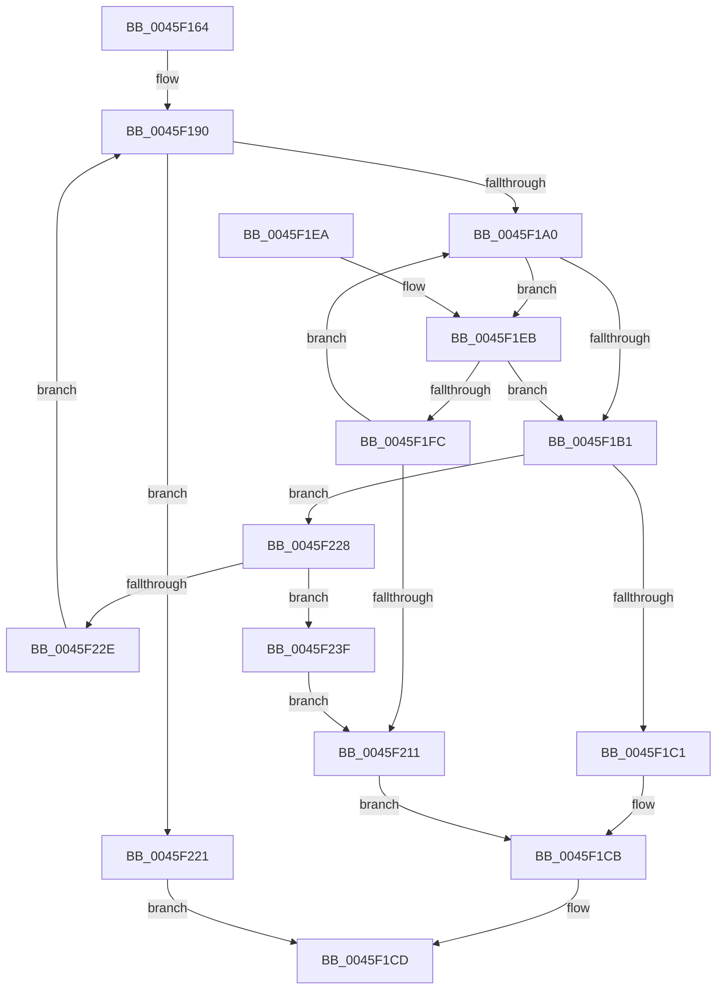

# PfFbLogEntryReserve

- RVA: `0x0045F164`–`0x0045F24F` (길이 `235` bytes)
- VA: `0x000000014045F164`
- 실행 섹션: `.text`
- PDB 이름 있음: `예`; PDB Function 태그: `아니요`
- unwind 정보 RVA: `0x000A985C`
- 디코드: `72`개 명령, `235/235` bytes 표시
- 미해석 바이트: `0` (있으면 어셈블리에 `.byte`로 보존)

> 이 문서는 커널 이미지의 기계어와 PDB 기호를 분석해 생성했습니다. 4번과 5번은 함수 원형과 자료형을 바이너리 사용 방식에서 추정한 C 해석이며 원본 소스 복구 결과는 아닙니다.

## 1. Dependencies

- 직접 호출 지점: **7**; 고유 호출 대상: **5**
- 직접 호출자로 확인된 함수: **3**
- RIP 상대 이미지 참조: **0**

### Outgoing calls
- `0x0045F193` → [ExAcquireRundownProtection](../21/ExAcquireRundownProtection_function_00216620.md) (function, `0x00216620`)
- `0x0045F1A4` → [ExpInterlockedPopEntrySList](../6B/ExpInterlockedPopEntrySList_function_006BA570.md) (function, `0x006BA570`)
- `0x0045F1EF` → [ExpInterlockedPopEntrySList](../6B/ExpInterlockedPopEntrySList_function_006BA570.md) (function, `0x006BA570`)
- `0x0045F206` → [guard_dispatch_icall](../6B/guard_dispatch_icall_function_006BAAD0.md) (function, `0x006BAAD0`)
- `0x0045F21A` → [ExReleaseRundownProtection](../34/ExReleaseRundownProtection_function_00349E80.md) (function, `0x00349E80`)
- `0x0045F235` → [guard_dispatch_icall](../6B/guard_dispatch_icall_function_006BAAD0.md) (function, `0x006BAAD0`)
- `0x0045F243` → [ExpInterlockedPushEntrySList](../6B/ExpInterlockedPushEntrySList_function_006BA5B0.md) (function, `0x006BA5B0`)

### Direct callers
- [PfTFiNotifyVolumeCreateCallback](PfTFiNotifyVolumeCreateCallback_function_0045ED30.md) at `0x0045ED7E`
- [PfTFiNotifyFileStreamCreateCallback](PfTFiNotifyFileStreamCreateCallback_function_0045EEB0.md) at `0x0045EF14`
- [PfTFiNotifyFileInfoDeleteCallback](PfTFiNotifyFileInfoDeleteCallback_function_0045F040.md) at `0x0045F076`

### Static image references
- 디코드된 RIP-relative 메모리 참조가 없습니다.

## 2. Other-region calls and transfers

- 다른 실행 섹션으로 향하는 call: **0**
- 별도 외부 분기/꼬리 이동을 확인하지 못했습니다.

## 3. Assembly (complete function range)

```asm
0045F164  48 89 5C 24 08                  mov qword ptr [rsp + 8], rbx
0045F169  48 89 6C 24 10                  mov qword ptr [rsp + 0x10], rbp
0045F16E  48 89 74 24 18                  mov qword ptr [rsp + 0x18], rsi
0045F173  57                              push rdi
0045F174  41 54                           push r12
0045F176  41 55                           push r13
0045F178  41 56                           push r14
0045F17A  41 57                           push r15
0045F17C  48 83 EC 20                     sub rsp, 0x20
0045F180  8B 74 24 70                     mov esi, dword ptr [rsp + 0x70]
0045F184  4D 8B E1                        mov r12, r9
0045F187  4D 8B E8                        mov r13, r8
0045F18A  48 8B DA                        mov rbx, rdx
0045F18D  4C 8B F9                        mov r15, rcx
0045F190  48 8B CB                        mov rcx, rbx
0045F193  E8 88 74 DB FF                  call 0x140216620
0045F198  84 C0                           test al, al
0045F19A  0F 84 81 00 00 00               je 0x14045f221
0045F1A0  48 8D 4B 20                     lea rcx, [rbx + 0x20]
0045F1A4  E8 C7 B3 25 00                  call 0x1406ba570
0045F1A9  48 8B D0                        mov rdx, rax
0045F1AC  48 85 C0                        test rax, rax
0045F1AF  74 3A                           je 0x14045f1eb
0045F1B1  4C 8B 42 18                     mov r8, qword ptr [rdx + 0x18]
0045F1B5  48 8B 4A 20                     mov rcx, qword ptr [rdx + 0x20]
0045F1B9  49 2B C8                        sub rcx, r8
0045F1BC  48 3B F1                        cmp rsi, rcx
0045F1BF  7F 67                           jg 0x14045f228
0045F1C1  4D 89 04 24                     mov qword ptr [r12], r8
0045F1C5  33 FF                           xor edi, edi
0045F1C7  49 89 55 00                     mov qword ptr [r13], rdx
0045F1CB  8B C7                           mov eax, edi
0045F1CD  48 8B 5C 24 50                  mov rbx, qword ptr [rsp + 0x50]
0045F1D2  48 8B 6C 24 58                  mov rbp, qword ptr [rsp + 0x58]
0045F1D7  48 8B 74 24 60                  mov rsi, qword ptr [rsp + 0x60]
0045F1DC  48 83 C4 20                     add rsp, 0x20
0045F1E0  41 5F                           pop r15
0045F1E2  41 5E                           pop r14
0045F1E4  41 5D                           pop r13
0045F1E6  41 5C                           pop r12
0045F1E8  5F                              pop rdi
0045F1E9  C3                              ret
0045F1EA  CC                              int3
0045F1EB  48 8D 4B 10                     lea rcx, [rbx + 0x10]
0045F1EF  E8 7C B3 25 00                  call 0x1406ba570
0045F1F4  48 8B D0                        mov rdx, rax
0045F1F7  48 85 C0                        test rax, rax
0045F1FA  75 B5                           jne 0x14045f1b1
0045F1FC  48 8B 43 60                     mov rax, qword ptr [rbx + 0x60]
0045F200  48 8B D3                        mov rdx, rbx
0045F203  49 8B CF                        mov rcx, r15
0045F206  E8 C5 B8 25 00                  call 0x1406baad0
0045F20B  8B F8                           mov edi, eax
0045F20D  85 C0                           test eax, eax
0045F20F  79 8F                           jns 0x14045f1a0
0045F211  FF 43 74                        inc dword ptr [rbx + 0x74]
0045F214  01 73 78                        add dword ptr [rbx + 0x78], esi
0045F217  48 8B CB                        mov rcx, rbx
0045F21A  E8 61 AC EE FF                  call 0x140349e80
0045F21F  EB AA                           jmp 0x14045f1cb
0045F221  B8 89 01 00 C0                  mov eax, 0xc0000189
0045F226  EB A5                           jmp 0x14045f1cd
0045F228  83 7A 28 00                     cmp dword ptr [rdx + 0x28], 0
0045F22C  74 11                           je 0x14045f23f
0045F22E  48 8B 43 68                     mov rax, qword ptr [rbx + 0x68]
0045F232  49 8B CF                        mov rcx, r15
0045F235  E8 96 B8 25 00                  call 0x1406baad0
0045F23A  E9 51 FF FF FF                  jmp 0x14045f190
0045F23F  48 8D 4B 10                     lea rcx, [rbx + 0x10]
0045F243  E8 68 B3 25 00                  call 0x1406ba5b0
0045F248  BF 23 00 00 C0                  mov edi, 0xc0000023
0045F24D  EB C2                           jmp 0x14045f211
```

## 4. C-style interpretation (structured pseudocode)

```c
__int64 __fastcall PfFbLogEntryReserve(__int64 a1, __int64 a2, __int64 a3, __int64 a4, unsigned int a5)
{
    __int64 result;
    __int64 v_rdi;
    __int64 v_rsp;
    unsigned __int64 v_stack_p10;
    unsigned __int64 v_stack_p18;
    unsigned __int64 v_stack_p8;

    v_stack_p8 = v_rbx;
    v_stack_p10 = v_rbp;
    v_stack_p18 = v_rsi;
    v_rsp = (v_rsp) - (32);
loc_0045F190:
    result = ExAcquireRundownProtection(a2, a2, a3, a4);
    if ((unsigned __int8)(result) == 0) goto loc_0045F221;
loc_0045F1A0:
    result = ExpInterlockedPopEntrySList(a2 + 32, a2, a3, a4);
    if (result == 0) goto loc_0045F1EB;
loc_0045F1B1:
    a1 = (*(unsigned __int64 *)(result + 32)) - (*(unsigned __int64 *)(result + 24));
    if (((unsigned int)(a5)) > a1) goto loc_0045F228;
    *(unsigned __int64 *)(a4) = *(unsigned __int64 *)(result + 24);
    v_rdi = 0;
    *(unsigned __int64 *)(a3) = result;
loc_0045F1CB:
loc_0045F1CD:
    v_rsp = (v_rsp) + (32);
    return 0;
loc_0045F1EB:
    result = ExpInterlockedPopEntrySList(v_stack_p8 + 16, result, *(unsigned __int64 *)(result + 24), a4);
    if (result != 0) goto loc_0045F1B1;
    result = guard_dispatch_icall(a1, v_stack_p8, *(unsigned __int64 *)(result + 24), a4);
    if (!sign_flag) goto loc_0045F1A0;
loc_0045F211:
    result = ExReleaseRundownProtection(v_stack_p8, v_stack_p8, *(unsigned __int64 *)(result + 24), a4);
    goto loc_0045F1CB;
loc_0045F221:
    goto loc_0045F1CD;
loc_0045F228:
    if ((*(unsigned int *)(v_stack_p8 + 40)) == 0) goto loc_0045F23F;
    result = guard_dispatch_icall(a1, v_stack_p8, *(unsigned __int64 *)(result + 24), a4);
    goto loc_0045F190;
loc_0045F23F:
    result = ExpInterlockedPushEntrySList(v_stack_p8 + 16, v_stack_p8, *(unsigned __int64 *)(result + 24), a4);
    goto loc_0045F211;
}
```

## 5. (Beta) C Style

```c
int64_t PfFbLogEntryReserve(int64_t Arg1, void *Arg2, void *Arg3, void *Arg4, uint32_t Arg5)
{
    uint8_t *arg2 = (uint8_t *)Arg2;
    uint8_t *arg3 = (uint8_t *)Arg3;
    uint8_t *arg4 = (uint8_t *)Arg4;

    int64_t result;
    int64_t local_rdi;
    int64_t local_rsp;
    uint64_t v_stack_p10;
    uint64_t v_stack_p18;
    uint64_t v_stack_p8;

    v_stack_p8 = local_rbx;
    v_stack_p10 = local_rbp;
    v_stack_p18 = local_rsi;
    local_rsp = (local_rsp) - (32);
loc_0045F190:
    result = ExAcquireRundownProtection(Arg2, Arg2, Arg3, Arg4);
    if ((uint8_t)(result) == 0) goto loc_0045F221;
loc_0045F1A0:
    result = ExpInterlockedPopEntrySList(Arg2 + 32, Arg2, Arg3, Arg4);
    if (result == 0) goto loc_0045F1EB;
loc_0045F1B1:
    Arg1 = (*(uint64_t *)(result + 0x20)) - (*(uint64_t *)(result + 0x18));
    if (((uint32_t)(Arg5)) > Arg1) goto loc_0045F228;
    *(uint64_t *)(arg4) = *(uint64_t *)(result + 0x18);
    local_rdi = 0;
    *(uint64_t *)(arg3) = result;
loc_0045F1CB:
loc_0045F1CD:
    local_rsp = (local_rsp) + (32);
    return 0;
loc_0045F1EB:
    result = ExpInterlockedPopEntrySList(v_stack_p8 + 16, result, *(uint64_t *)(result + 0x18), Arg4);
    if (result != 0) goto loc_0045F1B1;
    result = guard_dispatch_icall(Arg1, v_stack_p8, *(uint64_t *)(result + 0x18), Arg4);
    if (!sign_flag) goto loc_0045F1A0;
loc_0045F211:
    result = ExReleaseRundownProtection(v_stack_p8, v_stack_p8, *(uint64_t *)(result + 0x18), Arg4);
    goto loc_0045F1CB;
loc_0045F221:
    goto loc_0045F1CD;
loc_0045F228:
    if ((*(uint32_t *)(v_stack_p8 + 0x28)) == 0) goto loc_0045F23F;
    result = guard_dispatch_icall(Arg1, v_stack_p8, *(uint64_t *)(result + 0x18), Arg4);
    goto loc_0045F190;
loc_0045F23F:
    result = ExpInterlockedPushEntrySList(v_stack_p8 + 16, v_stack_p8, *(uint64_t *)(result + 0x18), Arg4);
    goto loc_0045F211;
}
```

### 관측된 메모리 오프셋

구조체 형식이 확인되지 않은 접근은 인자 기준의 오프셋으로만 기록했습니다.

| 기준 인자 | 오프셋 표현 | 폭 (bit) | 접근 |
|---|---:|---:|---|
| `Arg2` | `+ 0x10` | `64` | `R` |
| `Arg2` | `+ 0x20` | `64` | `R` |
| `Arg2` | `+ 0x60` | `64` | `R` |
| `Arg2` | `+ 0x68` | `64` | `R` |
| `Arg2` | `+ 0x74` | `32` | `R/W` |
| `Arg2` | `+ 0x78` | `32` | `R/W` |
| `Arg3` | `+ 0x0` | `64` | `W` |
| `Arg4` | `+ 0x0` | `64` | `W` |

## 6. Execution-region graph

[열기: 2D/3D 그래프와 함수 탐색 컨트롤 패널](../../../control-panel.html?section=text&rva=0x0045F164&view=graph)

- 2D 그래프는 위에서 아래로 흐르고, 3D 그래프는 빈 공간을 드래그해 회전합니다. Shift+드래그는 이동, 휠은 확대·축소, 함수 노드 선택은 대상 보고서 이동입니다.

### Static fallback


