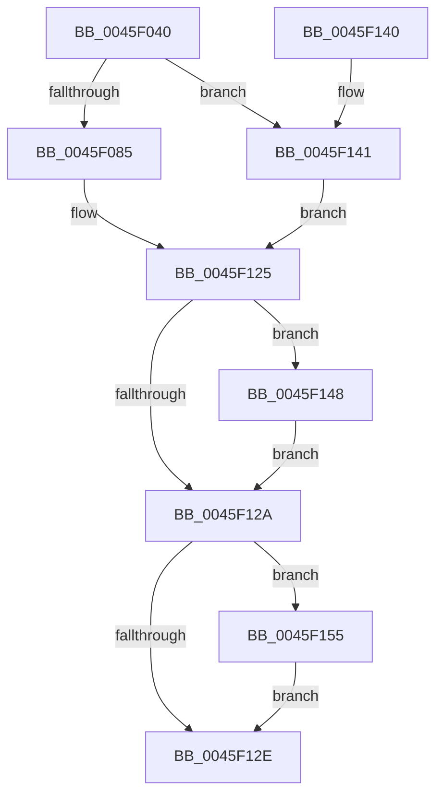

# PfTFiNotifyFileInfoDeleteCallback

- RVA: `0x0045F040`–`0x0045F15D` (길이 `285` bytes)
- VA: `0x000000014045F040`
- 실행 섹션: `.text`
- PDB 이름 있음: `예`; PDB Function 태그: `아니요`
- unwind 정보 RVA: `0x000A9848`
- 디코드: `78`개 명령, `285/285` bytes 표시
- 미해석 바이트: `0` (있으면 어셈블리에 `.byte`로 보존)

> 이 문서는 커널 이미지의 기계어와 PDB 기호를 분석해 생성했습니다. 4번과 5번은 함수 원형과 자료형을 바이너리 사용 방식에서 추정한 C 해석이며 원본 소스 복구 결과는 아닙니다.

## 1. Dependencies

- 직접 호출 지점: **3**; 고유 호출 대상: **2**
- 직접 호출자로 확인된 함수: **2**
- RIP 상대 이미지 참조: **1**

### Outgoing calls
- `0x0045F076` → [PfFbLogEntryReserve](PfFbLogEntryReserve_function_0045F164.md) (function, `0x0045F164`)
- `0x0045F11C` → [PfFbLogEntryComplete](../34/PfFbLogEntryComplete_function_00349B40.md) (function, `0x00349B40`)
- `0x0045F14E` → [PfFbLogEntryComplete](../34/PfFbLogEntryComplete_function_00349B40.md) (function, `0x00349B40`)

### Direct callers
- [sub_00341DB3](../34/Unknown_function_00341DB3.md) at `0x00341F8A`
- [sub_003425E5](../34/Unknown_function_003425E5.md) at `0x0034270B`

### Static image references
- `0x0045F105` → RVA `0x00E670CC` (`.data`; read)

## 2. Other-region calls and transfers

- 다른 실행 섹션으로 향하는 call: **0**
- 별도 외부 분기/꼬리 이동을 확인하지 못했습니다.

## 3. Assembly (complete function range)

```asm
0045F040  48 8B C4                        mov rax, rsp
0045F043  48 89 58 10                     mov qword ptr [rax + 0x10], rbx
0045F047  48 89 70 20                     mov qword ptr [rax + 0x20], rsi
0045F04B  57                              push rdi
0045F04C  48 83 EC 30                     sub rsp, 0x30
0045F050  48 83 60 18 00                  and qword ptr [rax + 0x18], 0
0045F055  4C 8D 48 08                     lea r9, [rax + 8]
0045F059  48 83 60 08 00                  and qword ptr [rax + 8], 0
0045F05E  4C 8D 40 18                     lea r8, [rax + 0x18]
0045F062  48 8B F2                        mov rsi, rdx
0045F065  C7 40 E8 20 00 00 00            mov dword ptr [rax - 0x18], 0x20
0045F06C  48 8D 91 20 01 00 00            lea rdx, [rcx + 0x120]
0045F073  48 8B D9                        mov rbx, rcx
0045F076  E8 E9 00 00 00                  call 0x14045f164
0045F07B  8B F8                           mov edi, eax
0045F07D  85 C0                           test eax, eax
0045F07F  0F 88 BC 00 00 00               js 0x14045f141
0045F085  8B 16                           mov edx, dword ptr [rsi]
0045F087  41 B9 20 00 00 00               mov r9d, 0x20
0045F08D  4C 8B 44 24 40                  mov r8, qword ptr [rsp + 0x40]
0045F092  8B C2                           mov eax, edx
0045F094  83 E2 03                        and edx, 3
0045F097  41 8B 48 10                     mov ecx, dword ptr [r8 + 0x10]
0045F09B  33 C1                           xor eax, ecx
0045F09D  83 E0 03                        and eax, 3
0045F0A0  33 C1                           xor eax, ecx
0045F0A2  48 B9 04 00 00 00 80 F7 FF FF   movabs rcx, 0xfffff78000000004
0045F0AC  41 89 40 10                     mov dword ptr [r8 + 0x10], eax
0045F0B0  8B 46 18                        mov eax, dword ptr [rsi + 0x18]
0045F0B3  C1 E0 02                        shl eax, 2
0045F0B6  0B C2                           or eax, edx
0045F0B8  41 89 40 10                     mov dword ptr [r8 + 0x10], eax
0045F0BC  48 8B 46 08                     mov rax, qword ptr [rsi + 8]
0045F0C0  49 89 40 18                     mov qword ptr [r8 + 0x18], rax
0045F0C4  41 8B 00                        mov eax, dword ptr [r8]
0045F0C7  25 03 01 00 80                  and eax, 0x80000103
0045F0CC  0D 03 01 00 00                  or eax, 0x103
0045F0D1  41 89 00                        mov dword ptr [r8], eax
0045F0D4  48 B8 20 03 00 00 80 F7 FF FF   movabs rax, 0xfffff78000000320
0045F0DE  48 8B 00                        mov rax, qword ptr [rax]
0045F0E1  8B 09                           mov ecx, dword ptr [rcx]
0045F0E3  8B D0                           mov edx, eax
0045F0E5  48 0F AF D1                     imul rdx, rcx
0045F0E9  48 C1 E8 20                     shr rax, 0x20
0045F0ED  48 0F AF C1                     imul rax, rcx
0045F0F1  48 8B 4C 24 40                  mov rcx, qword ptr [rsp + 0x40]
0045F0F6  48 C1 EA 18                     shr rdx, 0x18
0045F0FA  48 C1 E0 08                     shl rax, 8
0045F0FE  48 03 D0                        add rdx, rax
0045F101  48 C1 EA 0A                     shr rdx, 0xa
0045F105  03 15 C1 7F A0 00               add edx, dword ptr [rip + 0xa07fc1]
0045F10B  89 51 04                        mov dword ptr [rcx + 4], edx
0045F10E  8B 46 10                        mov eax, dword ptr [rsi + 0x10]
0045F111  48 8B 54 24 50                  mov rdx, qword ptr [rsp + 0x50]
0045F116  89 41 08                        mov dword ptr [rcx + 8], eax
0045F119  48 8B CB                        mov rcx, rbx
0045F11C  E8 1F AA EE FF                  call 0x140349b40
0045F121  33 D2                           xor edx, edx
0045F123  33 FF                           xor edi, edi
0045F125  48 85 D2                        test rdx, rdx
0045F128  75 1E                           jne 0x14045f148
0045F12A  85 FF                           test edi, edi
0045F12C  78 27                           js 0x14045f155
0045F12E  48 8B 5C 24 48                  mov rbx, qword ptr [rsp + 0x48]
0045F133  8B C7                           mov eax, edi
0045F135  48 8B 74 24 58                  mov rsi, qword ptr [rsp + 0x58]
0045F13A  48 83 C4 30                     add rsp, 0x30
0045F13E  5F                              pop rdi
0045F13F  C3                              ret
0045F140  CC                              int3
0045F141  48 8B 54 24 50                  mov rdx, qword ptr [rsp + 0x50]
0045F146  EB DD                           jmp 0x14045f125
0045F148  45 33 C9                        xor r9d, r9d
0045F14B  48 8B CB                        mov rcx, rbx
0045F14E  E8 ED A9 EE FF                  call 0x140349b40
0045F153  EB D5                           jmp 0x14045f12a
0045F155  FF 83 C4 02 00 00               inc dword ptr [rbx + 0x2c4]
0045F15B  EB D1                           jmp 0x14045f12e
```

## 4. C-style interpretation (structured pseudocode)

```c
__int64 __fastcall PfTFiNotifyFileInfoDeleteCallback(__int64 a1, __int64 a2)
{
    __int64 result;
    __int64 v_rdi;
    __int64 v_rsp;
    unsigned __int64 v_stack_p10;
    unsigned __int64 v_stack_p18;
    unsigned __int64 v_stack_p20;
    unsigned __int64 v_stack_p50;
    unsigned __int64 v_stack_p8;

    *(unsigned __int64 *)(v_rsp + 16) = v_rbx;
    *(unsigned __int64 *)(v_rsp + 32) = v_rsi;
    v_rsp = (v_rsp) - (48);
    *(unsigned int *)(v_rsp - 24) = 32;
    result = PfFbLogEntryReserve(a1, a1 + 288, v_rsp + 24, v_rsp + 8);
    if (sign_flag) goto loc_0045F141;
    a2 = (unsigned int)(((unsigned int)(*(unsigned int *)(a2))) & (3));
    result = (unsigned int)(((unsigned int)((unsigned int)((unsigned int)(*(unsigned int *)(a2))))) ^ ((unsigned int)((unsigned int)(*(unsigned int *)(v_stack_p8 + 16)))));
    result = (unsigned int)((result) & (3));
    result = (unsigned int)((result) ^ ((unsigned int)((unsigned int)(*(unsigned int *)(v_stack_p8 + 16)))));
    *(unsigned int *)(v_stack_p8 + 16) = (unsigned int)(result);
    result = (unsigned int)(((unsigned int)(*(unsigned int *)(a2 + 24))) << (2));
    result = (unsigned int)((result) | ((unsigned int)(a2)));
    *(unsigned int *)(v_stack_p8 + 16) = (unsigned int)(result);
    *(unsigned __int64 *)(v_stack_p8 + 24) = *(unsigned __int64 *)(a2 + 8);
    result = (unsigned int)(((unsigned int)(*(unsigned int *)(v_stack_p8))) & (0x80000103ULL));
    result = (unsigned int)((result) | (259));
    *(unsigned int *)(v_stack_p8) = (unsigned int)(result);
    a2 = ((unsigned int)((unsigned int)(*(unsigned __int64 *)(result)))) * ((unsigned int)(*(unsigned int *)((unsigned int)(*(unsigned int *)(v_stack_p8 + 16)))));
    result = (*(unsigned __int64 *)(result)) >> (32);
    result = (result) * ((unsigned int)(*(unsigned int *)((unsigned int)(*(unsigned int *)(v_stack_p8 + 16)))));
    a2 = (a2) >> (24);
    result = (result) << (8);
    a2 = (a2) + (result);
    a2 = (a2) >> (10);
    a2 = (unsigned int)((a2) + (*(unsigned int *)(v_rip + 10518465)));
    *(unsigned int *)(v_stack_p8 + 4) = (unsigned int)(a2);
    *(unsigned int *)(v_stack_p8 + 8) = (unsigned int)((unsigned int)(*(unsigned int *)(a2 + 16)));
    result = PfFbLogEntryComplete(a1, v_stack_p18, v_stack_p8, 32);
    a2 = 0;
    v_rdi = 0;
loc_0045F125:
    if (0 != 0) goto loc_0045F148;
loc_0045F12A:
    if (sign_flag) goto loc_0045F155;
loc_0045F12E:
    v_rsp = (v_rsp) + (48);
    return 0;
loc_0045F141:
    goto loc_0045F125;
loc_0045F148:
    a4 = 0;
    result = PfFbLogEntryComplete(v_stack_p10, v_stack_p50, v_stack_p8, a4);
    goto loc_0045F12A;
loc_0045F155:
    goto loc_0045F12E;
}
```

## 5. (Beta) C Style

```c
int64_t PfTFiNotifyFileInfoDeleteCallback(void *Arg1, void *Arg2)
{
    uint8_t *arg1 = (uint8_t *)Arg1;
    uint8_t *arg2 = (uint8_t *)Arg2;

    int64_t result;
    int64_t local_rdi;
    int64_t local_rsp;
    uint64_t v_stack_p10;
    uint64_t v_stack_p18;
    uint64_t v_stack_p20;
    uint64_t v_stack_p50;
    uint64_t v_stack_p8;

    *(uint64_t *)(local_rsp + 0x10) = local_rbx;
    *(uint64_t *)(local_rsp + 0x20) = local_rsi;
    local_rsp = (local_rsp) - (48);
    *(uint32_t *)(local_rsp - 0x18) = 32;
    result = PfFbLogEntryReserve(Arg1, Arg1 + 288, local_rsp + 24, local_rsp + 8);
    if (sign_flag) goto loc_0045F141;
    Arg2 = (uint32_t)(((uint32_t)(*(uint32_t *)(arg2))) & (3));
    result = (uint32_t)(((uint32_t)((uint32_t)((uint32_t)(*(uint32_t *)(arg2))))) ^ ((uint32_t)((uint32_t)(*(uint32_t *)(v_stack_p8 + 0x10)))));
    result = (uint32_t)((result) & (3));
    result = (uint32_t)((result) ^ ((uint32_t)((uint32_t)(*(uint32_t *)(v_stack_p8 + 0x10)))));
    *(uint32_t *)(v_stack_p8 + 0x10) = (uint32_t)(result);
    result = (uint32_t)(((uint32_t)(*(uint32_t *)(arg2 + 0x18))) << (2));
    result = (uint32_t)((result) | ((uint32_t)(Arg2)));
    *(uint32_t *)(v_stack_p8 + 0x10) = (uint32_t)(result);
    *(uint64_t *)(v_stack_p8 + 0x18) = *(uint64_t *)(arg2 + 0x8);
    result = (uint32_t)(((uint32_t)(*(uint32_t *)(v_stack_p8))) & (0x80000103ULL));
    result = (uint32_t)((result) | (259));
    *(uint32_t *)(v_stack_p8) = (uint32_t)(result);
    Arg2 = ((uint32_t)((uint32_t)(*(uint64_t *)(result)))) * ((uint32_t)(*(uint32_t *)((uint32_t)(*(uint32_t *)(v_stack_p8 + 0x10)))));
    result = (*(uint64_t *)(result)) >> (32);
    result = (result) * ((uint32_t)(*(uint32_t *)((uint32_t)(*(uint32_t *)(v_stack_p8 + 0x10)))));
    Arg2 = (Arg2) >> (24);
    result = (result) << (8);
    Arg2 = (Arg2) + (result);
    Arg2 = (Arg2) >> (10);
    Arg2 = (uint32_t)((Arg2) + (*(uint32_t *)(v_rip + 0xA07FC1)));
    *(uint32_t *)(v_stack_p8 + 0x4) = (uint32_t)(Arg2);
    *(uint32_t *)(v_stack_p8 + 0x8) = (uint32_t)((uint32_t)(*(uint32_t *)(arg2 + 0x10)));
    result = PfFbLogEntryComplete(Arg1, v_stack_p18, v_stack_p8, 32);
    Arg2 = 0;
    local_rdi = 0;
loc_0045F125:
    if (0 != 0) goto loc_0045F148;
loc_0045F12A:
    if (sign_flag) goto loc_0045F155;
loc_0045F12E:
    local_rsp = (local_rsp) + (48);
    return 0;
loc_0045F141:
    goto loc_0045F125;
loc_0045F148:
    a4 = 0;
    result = PfFbLogEntryComplete(v_stack_p10, v_stack_p50, v_stack_p8, a4);
    goto loc_0045F12A;
loc_0045F155:
    goto loc_0045F12E;
}
```

### 관측된 메모리 오프셋

구조체 형식이 확인되지 않은 접근은 인자 기준의 오프셋으로만 기록했습니다.

| 기준 인자 | 오프셋 표현 | 폭 (bit) | 접근 |
|---|---:|---:|---|
| `Arg1` | `+ 0x120` | `64` | `R` |
| `Arg1` | `+ 0x2C4` | `32` | `R/W` |
| `Arg2` | `+ 0x0` | `32` | `R` |
| `Arg2` | `+ 0x8` | `64` | `R` |
| `Arg2` | `+ 0x10` | `32` | `R` |
| `Arg2` | `+ 0x18` | `32` | `R` |

## 6. Execution-region graph

[열기: 2D/3D 그래프와 함수 탐색 컨트롤 패널](../../../control-panel.html?section=text&rva=0x0045F040&view=graph)

- 2D 그래프는 위에서 아래로 흐르고, 3D 그래프는 빈 공간을 드래그해 회전합니다. Shift+드래그는 이동, 휠은 확대·축소, 함수 노드 선택은 대상 보고서 이동입니다.

### Static fallback


