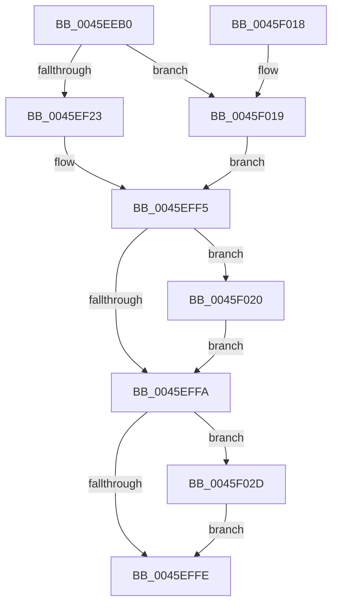

# PfTFiNotifyFileStreamCreateCallback

- RVA: `0x0045EEB0`–`0x0045F035` (길이 `389` bytes)
- VA: `0x000000014045EEB0`
- 실행 섹션: `.text`
- PDB 이름 있음: `예`; PDB Function 태그: `아니요`
- unwind 정보 RVA: `0x000A982C`
- 디코드: `118`개 명령, `389/389` bytes 표시
- 미해석 바이트: `0` (있으면 어셈블리에 `.byte`로 보존)

> 이 문서는 커널 이미지의 기계어와 PDB 기호를 분석해 생성했습니다. 4번과 5번은 함수 원형과 자료형을 바이너리 사용 방식에서 추정한 C 해석이며 원본 소스 복구 결과는 아닙니다.

## 1. Dependencies

- 직접 호출 지점: **5**; 고유 호출 대상: **4**
- 직접 호출자로 확인된 함수: **2**
- RIP 상대 이미지 참조: **0**

### Outgoing calls
- `0x0045EF14` → [PfFbLogEntryReserve](PfFbLogEntryReserve_function_0045F164.md) (function, `0x0045F164`)
- `0x0045EFC8` → [memcpy](../6C/memcpy_function_006C6840.md) (function, `0x006C6840`)
- `0x0045EFDC` → [wcsupr](../50/wcsupr_function_005003A0.md) (function, `0x005003A0`)
- `0x0045EFEC` → [PfFbLogEntryComplete](../34/PfFbLogEntryComplete_function_00349B40.md) (function, `0x00349B40`)
- `0x0045F026` → [PfFbLogEntryComplete](../34/PfFbLogEntryComplete_function_00349B40.md) (function, `0x00349B40`)

### Direct callers
- [sub_00341DB3](../34/Unknown_function_00341DB3.md) at `0x00341F57`
- [sub_003425E5](../34/Unknown_function_003425E5.md) at `0x003426E7`

### Static image references
- 디코드된 RIP-relative 메모리 참조가 없습니다.

## 2. Other-region calls and transfers

- 다른 실행 섹션으로 향하는 call: **0**
- 별도 외부 분기/꼬리 이동을 확인하지 못했습니다.

## 3. Assembly (complete function range)

```asm
0045EEB0  4C 8B DC                        mov r11, rsp
0045EEB3  49 89 5B 18                     mov qword ptr [r11 + 0x18], rbx
0045EEB7  55                              push rbp
0045EEB8  56                              push rsi
0045EEB9  57                              push rdi
0045EEBA  41 54                           push r12
0045EEBC  41 55                           push r13
0045EEBE  41 56                           push r14
0045EEC0  41 57                           push r15
0045EEC2  48 83 EC 30                     sub rsp, 0x30
0045EEC6  4C 8B 4A 10                     mov r9, qword ptr [rdx + 0x10]
0045EECA  4C 8B FA                        mov r15, rdx
0045EECD  33 FF                           xor edi, edi
0045EECF  48 8D 91 20 01 00 00            lea rdx, [rcx + 0x120]
0045EED6  48 8B F1                        mov rsi, rcx
0045EED9  49 89 7B 08                     mov qword ptr [r11 + 8], rdi
0045EEDD  49 89 7B 10                     mov qword ptr [r11 + 0x10], rdi
0045EEE1  45 8B 51 20                     mov r10d, dword ptr [r9 + 0x20]
0045EEE5  49 8B 41 18                     mov rax, qword ptr [r9 + 0x18]
0045EEE9  41 0F B7 59 22                  movzx ebx, word ptr [r9 + 0x22]
0045EEEE  4D 8D 4B 10                     lea r9, [r11 + 0x10]
0045EEF2  45 0F B7 C2                     movzx r8d, r10w
0045EEF6  4E 8D 24 40                     lea r12, [rax + r8*2]
0045EEFA  41 0F B7 C2                     movzx eax, r10w
0045EEFE  2B D8                           sub ebx, eax
0045EF00  4D 8D 43 08                     lea r8, [r11 + 8]
0045EF04  44 8D 2C 1B                     lea r13d, [rbx + rbx]
0045EF08  45 8D 75 35                     lea r14d, [r13 + 0x35]
0045EF0C  41 83 E6 F8                     and r14d, 0xfffffff8
0045EF10  45 89 73 B8                     mov dword ptr [r11 - 0x48], r14d
0045EF14  E8 4B 02 00 00                  call 0x14045f164
0045EF19  8B E8                           mov ebp, eax
0045EF1B  85 C0                           test eax, eax
0045EF1D  0F 88 F6 00 00 00               js 0x14045f019
0045EF23  48 8B 7C 24 78                  mov rdi, qword ptr [rsp + 0x78]
0045EF28  42 8D 0C F5 00 00 00 00         lea ecx, [r14*8]
0045EF30  8B 17                           mov edx, dword ptr [rdi]
0045EF32  83 E2 F8                        and edx, 0xfffffff8
0045EF35  33 CA                           xor ecx, edx
0045EF37  81 E1 F8 FF FF 7F               and ecx, 0x7ffffff8
0045EF3D  33 CA                           xor ecx, edx
0045EF3F  89 0F                           mov dword ptr [rdi], ecx
0045EF41  49 8B 47 10                     mov rax, qword ptr [r15 + 0x10]
0045EF45  8B 48 28                        mov ecx, dword ptr [rax + 0x28]
0045EF48  89 4F 04                        mov dword ptr [rdi + 4], ecx
0045EF4B  49 8B 47 10                     mov rax, qword ptr [r15 + 0x10]
0045EF4F  8B 48 2C                        mov ecx, dword ptr [rax + 0x2c]
0045EF52  89 4F 08                        mov dword ptr [rdi + 8], ecx
0045EF55  49 8B 47 10                     mov rax, qword ptr [r15 + 0x10]
0045EF59  48 8B 48 08                     mov rcx, qword ptr [rax + 8]
0045EF5D  48 89 4F 18                     mov qword ptr [rdi + 0x18], rcx
0045EF61  49 8B 47 10                     mov rax, qword ptr [r15 + 0x10]
0045EF65  8B 48 30                        mov ecx, dword ptr [rax + 0x30]
0045EF68  89 4F 20                        mov dword ptr [rdi + 0x20], ecx
0045EF6B  49 8B 47 10                     mov rax, qword ptr [r15 + 0x10]
0045EF6F  48 8B 48 10                     mov rcx, qword ptr [rax + 0x10]
0045EF73  48 89 4F 10                     mov qword ptr [rdi + 0x10], rcx
0045EF77  8B 4F 28                        mov ecx, dword ptr [rdi + 0x28]
0045EF7A  8B D1                           mov edx, ecx
0045EF7C  49 8B 47 10                     mov rax, qword ptr [r15 + 0x10]
0045EF80  33 50 24                        xor edx, dword ptr [rax + 0x24]
0045EF83  83 E2 01                        and edx, 1
0045EF86  33 D1                           xor edx, ecx
0045EF88  89 57 28                        mov dword ptr [rdi + 0x28], edx
0045EF8B  49 8B 47 10                     mov rax, qword ptr [r15 + 0x10]
0045EF8F  44 8B 40 24                     mov r8d, dword ptr [rax + 0x24]
0045EF93  41 C1 E8 03                     shr r8d, 3
0045EF97  44 33 C2                        xor r8d, edx
0045EF9A  41 83 E0 02                     and r8d, 2
0045EF9E  44 33 C2                        xor r8d, edx
0045EFA1  49 8B D4                        mov rdx, r12
0045EFA4  44 89 47 28                     mov dword ptr [rdi + 0x28], r8d
0045EFA8  49 8B 47 10                     mov rax, qword ptr [r15 + 0x10]
0045EFAC  8B 48 24                        mov ecx, dword ptr [rax + 0x24]
0045EFAF  03 C9                           add ecx, ecx
0045EFB1  41 33 C8                        xor ecx, r8d
0045EFB4  83 E1 04                        and ecx, 4
0045EFB7  41 33 C8                        xor ecx, r8d
0045EFBA  45 8B C5                        mov r8d, r13d
0045EFBD  89 4F 28                        mov dword ptr [rdi + 0x28], ecx
0045EFC0  48 8D 4F 2C                     lea rcx, [rdi + 0x2c]
0045EFC4  66 89 5F 2A                     mov word ptr [rdi + 0x2a], bx
0045EFC8  E8 73 78 26 00                  call 0x1406c6840
0045EFCD  0F B7 47 2A                     movzx eax, word ptr [rdi + 0x2a]
0045EFD1  33 C9                           xor ecx, ecx
0045EFD3  66 89 4C 47 2C                  mov word ptr [rdi + rax*2 + 0x2c], cx
0045EFD8  48 8D 4F 2C                     lea rcx, [rdi + 0x2c]
0045EFDC  E8 BF 13 0A 00                  call 0x1405003a0
0045EFE1  48 8B 54 24 70                  mov rdx, qword ptr [rsp + 0x70]
0045EFE6  45 8B CE                        mov r9d, r14d
0045EFE9  48 8B CE                        mov rcx, rsi
0045EFEC  E8 4F AB EE FF                  call 0x140349b40
0045EFF1  33 FF                           xor edi, edi
0045EFF3  8B D7                           mov edx, edi
0045EFF5  48 85 D2                        test rdx, rdx
0045EFF8  75 26                           jne 0x14045f020
0045EFFA  85 ED                           test ebp, ebp
0045EFFC  78 2F                           js 0x14045f02d
0045EFFE  48 8B 9C 24 80 00 00 00         mov rbx, qword ptr [rsp + 0x80]
0045F006  8B C5                           mov eax, ebp
0045F008  48 83 C4 30                     add rsp, 0x30
0045F00C  41 5F                           pop r15
0045F00E  41 5E                           pop r14
0045F010  41 5D                           pop r13
0045F012  41 5C                           pop r12
0045F014  5F                              pop rdi
0045F015  5E                              pop rsi
0045F016  5D                              pop rbp
0045F017  C3                              ret
0045F018  CC                              int3
0045F019  48 8B 54 24 70                  mov rdx, qword ptr [rsp + 0x70]
0045F01E  EB D5                           jmp 0x14045eff5
0045F020  45 33 C9                        xor r9d, r9d
0045F023  48 8B CE                        mov rcx, rsi
0045F026  E8 15 AB EE FF                  call 0x140349b40
0045F02B  EB CD                           jmp 0x14045effa
0045F02D  FF 86 C4 02 00 00               inc dword ptr [rsi + 0x2c4]
0045F033  EB C9                           jmp 0x14045effe
```

## 4. C-style interpretation (structured pseudocode)

```c
__int64 __fastcall PfTFiNotifyFileStreamCreateCallback(__int64 a1, __int64 a2)
{
    __int64 result;
    __int64 v_r14;
    __int64 v_rbx;
    __int64 v_rdi;
    __int64 v_rsp;
    unsigned __int64 v_stack_p10;
    unsigned __int64 v_stack_p18;
    unsigned __int64 v_stack_p70;
    unsigned __int64 v_stack_p8;

    *(unsigned __int64 *)(v_rsp + 24) = v_rbx;
    v_rsp = (v_rsp) - (48);
    v_rdi = 0;
    *(unsigned __int64 *)(v_rsp + 8) = 0;
    *(unsigned __int64 *)(v_rsp + 16) = 0;
    v_rbx = (unsigned int)((*(unsigned __int16 *)(*(unsigned __int64 *)(a2 + 16) + 34)) - ((unsigned int)((unsigned __int16)((unsigned int)(*(unsigned int *)(*(unsigned __int64 *)(a2 + 16) + 32))))));
    v_r14 = (unsigned int)((v_rbx + v_rbx * 1 + 53) & (0xFFFFFFF8ULL));
    *(unsigned int *)(v_rsp - 72) = (unsigned int)(v_r14);
    result = PfFbLogEntryReserve(a1, a1 + 288, v_rsp + 8, v_rsp + 16);
    if (sign_flag) goto loc_0045F019;
    a2 = (unsigned int)(((unsigned int)(*(unsigned int *)(v_stack_p10))) & (0xFFFFFFF8ULL));
    a1 = (unsigned int)((v_r14 * 8) ^ ((unsigned int)(a2)));
    a1 = (unsigned int)((a1) & (0x7FFFFFF8ULL));
    a1 = (unsigned int)((a1) ^ ((unsigned int)(a2)));
    *(unsigned int *)(v_stack_p10) = (unsigned int)(a1);
    *(unsigned int *)(v_stack_p10 + 4) = (unsigned int)((unsigned int)(*(unsigned int *)(*(unsigned __int64 *)(a2 + 16) + 40)));
    *(unsigned int *)(v_stack_p10 + 8) = (unsigned int)((unsigned int)(*(unsigned int *)(*(unsigned __int64 *)(a2 + 16) + 44)));
    *(unsigned __int64 *)(v_stack_p10 + 24) = *(unsigned __int64 *)(*(unsigned __int64 *)(a2 + 16) + 8);
    *(unsigned int *)(v_stack_p10 + 32) = (unsigned int)((unsigned int)(*(unsigned int *)(*(unsigned __int64 *)(a2 + 16) + 48)));
    *(unsigned __int64 *)(v_stack_p10 + 16) = *(unsigned __int64 *)(*(unsigned __int64 *)(a2 + 16) + 16);
    a2 = (unsigned int)(((unsigned int)((unsigned int)((unsigned int)(*(unsigned int *)(v_stack_p10 + 40))))) ^ (*(unsigned int *)(*(unsigned __int64 *)(a2 + 16) + 36)));
    a2 = (unsigned int)((a2) & (1));
    a2 = (unsigned int)((a2) ^ ((unsigned int)((unsigned int)(*(unsigned int *)(v_stack_p10 + 40)))));
    *(unsigned int *)(v_stack_p10 + 40) = (unsigned int)(a2);
    a3 = (unsigned int)(((unsigned int)(*(unsigned int *)(*(unsigned __int64 *)(a2 + 16) + 36))) >> (3));
    a3 = (unsigned int)((a3) ^ ((unsigned int)(a2)));
    a3 = (unsigned int)((a3) & (2));
    a3 = (unsigned int)((a3) ^ ((unsigned int)(a2)));
    *(unsigned int *)(v_stack_p10 + 40) = (unsigned int)(a3);
    a1 = (unsigned int)(((unsigned int)(*(unsigned int *)(*(unsigned __int64 *)(a2 + 16) + 36))) + ((unsigned int)((unsigned int)(*(unsigned int *)(*(unsigned __int64 *)(a2 + 16) + 36)))));
    a1 = (unsigned int)((a1) ^ ((unsigned int)(a3)));
    a1 = (unsigned int)((a1) & (4));
    a1 = (unsigned int)((a1) ^ ((unsigned int)(a3)));
    *(unsigned int *)(v_stack_p10 + 40) = (unsigned int)(a1);
    *(unsigned __int16 *)(v_stack_p10 + 42) = (unsigned __int16)(v_rbx);
    result = memcpy(v_stack_p10 + 44, *(unsigned __int64 *)(*(unsigned __int64 *)(a2 + 16) + 24) + (unsigned __int16)((unsigned int)(*(unsigned int *)(*(unsigned __int64 *)(a2 + 16) + 32))) * 2, (unsigned int)((unsigned int)(v_rbx + v_rbx * 1)), v_rsp + 16);
    a1 = 0;
    *(unsigned __int16 *)(v_stack_p10 + *(unsigned __int16 *)(v_stack_p10 + 42) * 2 + 44) = 0;
    result = wcsupr(v_stack_p10 + 44, *(unsigned __int64 *)(*(unsigned __int64 *)(a2 + 16) + 24) + (unsigned __int16)((unsigned int)(*(unsigned int *)(*(unsigned __int64 *)(a2 + 16) + 32))) * 2, (unsigned int)((unsigned int)(v_rbx + v_rbx * 1)), v_rsp + 16);
    result = PfFbLogEntryComplete(0, v_stack_p8, (unsigned int)((unsigned int)(v_rbx + v_rbx * 1)), (unsigned int)((unsigned int)(v_r14)));
    v_rdi = 0;
loc_0045EFF5:
    if (0 != 0) goto loc_0045F020;
loc_0045EFFA:
    if (sign_flag) goto loc_0045F02D;
loc_0045EFFE:
    v_rsp = (v_rsp) + (48);
    return (unsigned int)((unsigned int)((unsigned int)((unsigned int)(result))));
loc_0045F019:
    goto loc_0045EFF5;
loc_0045F020:
    a4 = 0;
    result = PfFbLogEntryComplete(0, v_stack_p70, (unsigned int)((unsigned int)(v_rbx + v_rbx * 1)), a4);
    goto loc_0045EFFA;
loc_0045F02D:
    goto loc_0045EFFE;
}
```

## 5. (Beta) C Style

```c
int64_t PfTFiNotifyFileStreamCreateCallback(void *Arg1, void *Arg2)
{
    uint8_t *arg1 = (uint8_t *)Arg1;
    uint8_t *arg2 = (uint8_t *)Arg2;

    int64_t result;
    int64_t local_r14;
    int64_t local_rbx;
    int64_t local_rdi;
    int64_t local_rsp;
    uint64_t v_stack_p10;
    uint64_t v_stack_p18;
    uint64_t v_stack_p70;
    uint64_t v_stack_p8;

    *(uint64_t *)(local_rsp + 0x18) = local_rbx;
    local_rsp = (local_rsp) - (48);
    local_rdi = 0;
    *(uint64_t *)(local_rsp + 0x8) = 0;
    *(uint64_t *)(local_rsp + 0x10) = 0;
    local_rbx = (uint32_t)((*(uint16_t *)(*(uint64_t *)(arg2 + 0x10) + 0x22)) - ((uint32_t)((uint16_t)((uint32_t)(*(uint32_t *)(*(uint64_t *)(arg2 + 0x10) + 0x20))))));
    local_r14 = (uint32_t)((local_rbx + local_rbx * 1 + 53) & (0xFFFFFFF8ULL));
    *(uint32_t *)(local_rsp - 0x48) = (uint32_t)(local_r14);
    result = PfFbLogEntryReserve(Arg1, Arg1 + 288, local_rsp + 8, local_rsp + 16);
    if (sign_flag) goto loc_0045F019;
    Arg2 = (uint32_t)(((uint32_t)(*(uint32_t *)(v_stack_p10))) & (0xFFFFFFF8ULL));
    Arg1 = (uint32_t)((local_r14 * 8) ^ ((uint32_t)(Arg2)));
    Arg1 = (uint32_t)((Arg1) & (0x7FFFFFF8ULL));
    Arg1 = (uint32_t)((Arg1) ^ ((uint32_t)(Arg2)));
    *(uint32_t *)(v_stack_p10) = (uint32_t)(Arg1);
    *(uint32_t *)(v_stack_p10 + 0x4) = (uint32_t)((uint32_t)(*(uint32_t *)(*(uint64_t *)(arg2 + 0x10) + 0x28)));
    *(uint32_t *)(v_stack_p10 + 0x8) = (uint32_t)((uint32_t)(*(uint32_t *)(*(uint64_t *)(arg2 + 0x10) + 0x2C)));
    *(uint64_t *)(v_stack_p10 + 0x18) = *(uint64_t *)(*(uint64_t *)(arg2 + 0x10) + 0x8);
    *(uint32_t *)(v_stack_p10 + 0x20) = (uint32_t)((uint32_t)(*(uint32_t *)(*(uint64_t *)(arg2 + 0x10) + 0x30)));
    *(uint64_t *)(v_stack_p10 + 0x10) = *(uint64_t *)(*(uint64_t *)(arg2 + 0x10) + 0x10);
    Arg2 = (uint32_t)(((uint32_t)((uint32_t)((uint32_t)(*(uint32_t *)(v_stack_p10 + 0x28))))) ^ (*(uint32_t *)(*(uint64_t *)(arg2 + 0x10) + 0x24)));
    Arg2 = (uint32_t)((Arg2) & (1));
    Arg2 = (uint32_t)((Arg2) ^ ((uint32_t)((uint32_t)(*(uint32_t *)(v_stack_p10 + 0x28)))));
    *(uint32_t *)(v_stack_p10 + 0x28) = (uint32_t)(Arg2);
    a3 = (uint32_t)(((uint32_t)(*(uint32_t *)(*(uint64_t *)(arg2 + 0x10) + 0x24))) >> (3));
    a3 = (uint32_t)((a3) ^ ((uint32_t)(Arg2)));
    a3 = (uint32_t)((a3) & (2));
    a3 = (uint32_t)((a3) ^ ((uint32_t)(Arg2)));
    *(uint32_t *)(v_stack_p10 + 0x28) = (uint32_t)(a3);
    Arg1 = (uint32_t)(((uint32_t)(*(uint32_t *)(*(uint64_t *)(arg2 + 0x10) + 0x24))) + ((uint32_t)((uint32_t)(*(uint32_t *)(*(uint64_t *)(arg2 + 0x10) + 0x24)))));
    Arg1 = (uint32_t)((Arg1) ^ ((uint32_t)(a3)));
    Arg1 = (uint32_t)((Arg1) & (4));
    Arg1 = (uint32_t)((Arg1) ^ ((uint32_t)(a3)));
    *(uint32_t *)(v_stack_p10 + 0x28) = (uint32_t)(Arg1);
    *(uint16_t *)(v_stack_p10 + 0x2A) = (uint16_t)(local_rbx);
    result = memcpy(v_stack_p10 + 44, *(uint64_t *)(*(uint64_t *)(arg2 + 0x10) + 0x18) + (uint16_t)((uint32_t)(*(uint32_t *)(*(uint64_t *)(arg2 + 0x10) + 0x20))) * 2, (uint32_t)((uint32_t)(local_rbx + local_rbx * 1)), local_rsp + 16);
    Arg1 = 0;
    *(uint16_t *)(v_stack_p10 + *(uint16_t *)(v_stack_p10 + 0x2A) * 2 + 0x2C) = 0;
    result = wcsupr(v_stack_p10 + 44, *(uint64_t *)(*(uint64_t *)(arg2 + 0x10) + 0x18) + (uint16_t)((uint32_t)(*(uint32_t *)(*(uint64_t *)(arg2 + 0x10) + 0x20))) * 2, (uint32_t)((uint32_t)(local_rbx + local_rbx * 1)), local_rsp + 16);
    result = PfFbLogEntryComplete(0, v_stack_p8, (uint32_t)((uint32_t)(local_rbx + local_rbx * 1)), (uint32_t)((uint32_t)(local_r14)));
    local_rdi = 0;
loc_0045EFF5:
    if (0 != 0) goto loc_0045F020;
loc_0045EFFA:
    if (sign_flag) goto loc_0045F02D;
loc_0045EFFE:
    local_rsp = (local_rsp) + (48);
    return (uint32_t)((uint32_t)((uint32_t)((uint32_t)(result))));
loc_0045F019:
    goto loc_0045EFF5;
loc_0045F020:
    a4 = 0;
    result = PfFbLogEntryComplete(0, v_stack_p70, (uint32_t)((uint32_t)(local_rbx + local_rbx * 1)), a4);
    goto loc_0045EFFA;
loc_0045F02D:
    goto loc_0045EFFE;
}
```

### 관측된 메모리 오프셋

구조체 형식이 확인되지 않은 접근은 인자 기준의 오프셋으로만 기록했습니다.

| 기준 인자 | 오프셋 표현 | 폭 (bit) | 접근 |
|---|---:|---:|---|
| `Arg1` | `+ 0x120` | `64` | `R` |
| `Arg1` | `+ 0x2C4` | `32` | `R/W` |
| `Arg2` | `+ 0x10` | `64` | `R` |

## 6. Execution-region graph

[열기: 2D/3D 그래프와 함수 탐색 컨트롤 패널](../../../control-panel.html?section=text&rva=0x0045EEB0&view=graph)

- 2D 그래프는 위에서 아래로 흐르고, 3D 그래프는 빈 공간을 드래그해 회전합니다. Shift+드래그는 이동, 휠은 확대·축소, 함수 노드 선택은 대상 보고서 이동입니다.

### Static fallback


