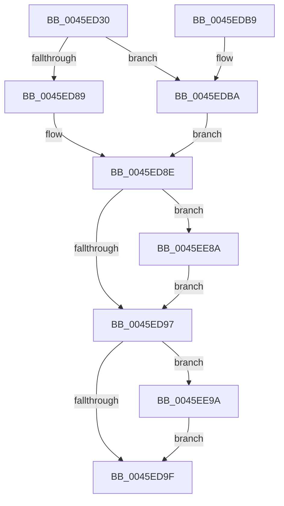

# PfTFiNotifyVolumeCreateCallback

- RVA: `0x0045ED30`–`0x0045EEA5` (길이 `373` bytes)
- VA: `0x000000014045ED30`
- 실행 섹션: `.text`
- PDB 이름 있음: `예`; PDB Function 태그: `아니요`
- unwind 정보 RVA: `0x000A9810`
- 디코드: `107`개 명령, `373/373` bytes 표시
- 미해석 바이트: `0` (있으면 어셈블리에 `.byte`로 보존)

> 이 문서는 커널 이미지의 기계어와 PDB 기호를 분석해 생성했습니다. 4번과 5번은 함수 원형과 자료형을 바이너리 사용 방식에서 추정한 C 해석이며 원본 소스 복구 결과는 아닙니다.

## 1. Dependencies

- 직접 호출 지점: **5**; 고유 호출 대상: **4**
- 직접 호출자로 확인된 함수: **0**
- RIP 상대 이미지 참조: **0**

### Outgoing calls
- `0x0045ED7E` → [PfFbLogEntryReserve](PfFbLogEntryReserve_function_0045F164.md) (function, `0x0045F164`)
- `0x0045EE56` → [memcpy](../6C/memcpy_function_006C6840.md) (function, `0x006C6840`)
- `0x0045EE6D` → [wcsupr](../50/wcsupr_function_005003A0.md) (function, `0x005003A0`)
- `0x0045EE7D` → [PfFbLogEntryComplete](../34/PfFbLogEntryComplete_function_00349B40.md) (function, `0x00349B40`)
- `0x0045EE90` → [PfFbLogEntryComplete](../34/PfFbLogEntryComplete_function_00349B40.md) (function, `0x00349B40`)

### Direct callers
- 이 함수 시작 RVA로 연결되는 직접 call은 확인되지 않았습니다. 간접 호출은 완전히 역산할 수 없습니다.

### Static image references
- 디코드된 RIP-relative 메모리 참조가 없습니다.

## 2. Other-region calls and transfers

- 다른 실행 섹션으로 향하는 call: **0**
- 별도 외부 분기/꼬리 이동을 확인하지 못했습니다.

## 3. Assembly (complete function range)

```asm
0045ED30  4C 8B DC                        mov r11, rsp
0045ED33  49 89 5B 18                     mov qword ptr [r11 + 0x18], rbx
0045ED37  55                              push rbp
0045ED38  56                              push rsi
0045ED39  57                              push rdi
0045ED3A  41 54                           push r12
0045ED3C  41 55                           push r13
0045ED3E  41 56                           push r14
0045ED40  41 57                           push r15
0045ED42  48 83 EC 30                     sub rsp, 0x30
0045ED46  48 8B 42 10                     mov rax, qword ptr [rdx + 0x10]
0045ED4A  4D 8D 4B 10                     lea r9, [r11 + 0x10]
0045ED4E  4C 8B EA                        mov r13, rdx
0045ED51  4D 8D 43 08                     lea r8, [r11 + 8]
0045ED55  45 33 E4                        xor r12d, r12d
0045ED58  48 8D 91 20 01 00 00            lea rdx, [rcx + 0x120]
0045ED5F  48 8B F1                        mov rsi, rcx
0045ED62  4D 89 63 08                     mov qword ptr [r11 + 8], r12
0045ED66  44 0F B7 78 1E                  movzx r15d, word ptr [rax + 0x1e]
0045ED6B  45 03 FF                        add r15d, r15d
0045ED6E  4D 89 63 10                     mov qword ptr [r11 + 0x10], r12
0045ED72  45 8D 77 41                     lea r14d, [r15 + 0x41]
0045ED76  41 83 E6 F8                     and r14d, 0xfffffff8
0045ED7A  45 89 73 B8                     mov dword ptr [r11 - 0x48], r14d
0045ED7E  E8 E1 03 00 00                  call 0x14045f164
0045ED83  8B E8                           mov ebp, eax
0045ED85  85 C0                           test eax, eax
0045ED87  79 31                           jns 0x14045edba
0045ED89  48 8B 54 24 70                  mov rdx, qword ptr [rsp + 0x70]
0045ED8E  48 85 D2                        test rdx, rdx
0045ED91  0F 85 F3 00 00 00               jne 0x14045ee8a
0045ED97  85 ED                           test ebp, ebp
0045ED99  0F 88 FB 00 00 00               js 0x14045ee9a
0045ED9F  48 8B 9C 24 80 00 00 00         mov rbx, qword ptr [rsp + 0x80]
0045EDA7  8B C5                           mov eax, ebp
0045EDA9  48 83 C4 30                     add rsp, 0x30
0045EDAD  41 5F                           pop r15
0045EDAF  41 5E                           pop r14
0045EDB1  41 5D                           pop r13
0045EDB3  41 5C                           pop r12
0045EDB5  5F                              pop rdi
0045EDB6  5E                              pop rsi
0045EDB7  5D                              pop rbp
0045EDB8  C3                              ret
0045EDB9  CC                              int3
0045EDBA  48 8B 7C 24 78                  mov rdi, qword ptr [rsp + 0x78]
0045EDBF  42 8D 0C F5 00 00 00 00         lea ecx, [r14*8]
0045EDC7  45 8B C7                        mov r8d, r15d
0045EDCA  8B 17                           mov edx, dword ptr [rdi]
0045EDCC  81 E2 02 00 00 80               and edx, 0x80000002
0045EDD2  0B D1                           or edx, ecx
0045EDD4  83 CA 02                        or edx, 2
0045EDD7  89 17                           mov dword ptr [rdi], edx
0045EDD9  49 8B 4D 10                     mov rcx, qword ptr [r13 + 0x10]
0045EDDD  8B 51 34                        mov edx, dword ptr [rcx + 0x34]
0045EDE0  89 57 04                        mov dword ptr [rdi + 4], edx
0045EDE3  49 8B 45 10                     mov rax, qword ptr [r13 + 0x10]
0045EDE7  8B 48 38                        mov ecx, dword ptr [rax + 0x38]
0045EDEA  89 4F 08                        mov dword ptr [rdi + 8], ecx
0045EDED  49 8B 45 10                     mov rax, qword ptr [r13 + 0x10]
0045EDF1  48 8B 48 08                     mov rcx, qword ptr [rax + 8]
0045EDF5  48 89 4F 18                     mov qword ptr [rdi + 0x18], rcx
0045EDF9  8B 4F 24                        mov ecx, dword ptr [rdi + 0x24]
0045EDFC  8B D1                           mov edx, ecx
0045EDFE  49 8B 45 10                     mov rax, qword ptr [r13 + 0x10]
0045EE02  33 50 30                        xor edx, dword ptr [rax + 0x30]
0045EE05  83 E2 0F                        and edx, 0xf
0045EE08  33 D1                           xor edx, ecx
0045EE0A  89 57 24                        mov dword ptr [rdi + 0x24], edx
0045EE0D  8B CA                           mov ecx, edx
0045EE0F  49 8B 45 10                     mov rax, qword ptr [r13 + 0x10]
0045EE13  33 48 30                        xor ecx, dword ptr [rax + 0x30]
0045EE16  81 E1 F0 00 00 00               and ecx, 0xf0
0045EE1C  33 CA                           xor ecx, edx
0045EE1E  89 4F 24                        mov dword ptr [rdi + 0x24], ecx
0045EE21  49 8B 45 10                     mov rax, qword ptr [r13 + 0x10]
0045EE25  48 8B 48 10                     mov rcx, qword ptr [rax + 0x10]
0045EE29  48 89 4F 10                     mov qword ptr [rdi + 0x10], rcx
0045EE2D  49 8B 45 10                     mov rax, qword ptr [r13 + 0x10]
0045EE31  8B 48 18                        mov ecx, dword ptr [rax + 0x18]
0045EE34  89 4F 20                        mov dword ptr [rdi + 0x20], ecx
0045EE37  49 8B 45 10                     mov rax, qword ptr [r13 + 0x10]
0045EE3B  0F B7 48 1E                     movzx ecx, word ptr [rax + 0x1e]
0045EE3F  66 03 C9                        add cx, cx
0045EE42  66 89 4F 28                     mov word ptr [rdi + 0x28], cx
0045EE46  66 89 4F 2A                     mov word ptr [rdi + 0x2a], cx
0045EE4A  48 8D 4F 38                     lea rcx, [rdi + 0x38]
0045EE4E  49 8B 55 10                     mov rdx, qword ptr [r13 + 0x10]
0045EE52  48 8B 52 28                     mov rdx, qword ptr [rdx + 0x28]
0045EE56  E8 E5 79 26 00                  call 0x1406c6840
0045EE5B  49 8B 45 10                     mov rax, qword ptr [r13 + 0x10]
0045EE5F  48 8D 4F 38                     lea rcx, [rdi + 0x38]
0045EE63  0F B7 50 1E                     movzx edx, word ptr [rax + 0x1e]
0045EE67  66 44 89 64 57 38               mov word ptr [rdi + rdx*2 + 0x38], r12w
0045EE6D  E8 2E 15 0A 00                  call 0x1405003a0
0045EE72  48 8B 54 24 70                  mov rdx, qword ptr [rsp + 0x70]
0045EE77  45 8B CE                        mov r9d, r14d
0045EE7A  48 8B CE                        mov rcx, rsi
0045EE7D  E8 BE AC EE FF                  call 0x140349b40
0045EE82  49 8B D4                        mov rdx, r12
0045EE85  E9 04 FF FF FF                  jmp 0x14045ed8e
0045EE8A  45 33 C9                        xor r9d, r9d
0045EE8D  48 8B CE                        mov rcx, rsi
0045EE90  E8 AB AC EE FF                  call 0x140349b40
0045EE95  E9 FD FE FF FF                  jmp 0x14045ed97
0045EE9A  FF 86 C4 02 00 00               inc dword ptr [rsi + 0x2c4]
0045EEA0  E9 FA FE FF FF                  jmp 0x14045ed9f
```

## 4. C-style interpretation (structured pseudocode)

```c
__int64 __fastcall PfTFiNotifyVolumeCreateCallback(__int64 a1, __int64 a2)
{
    __int64 result;
    __int64 v_r12;
    __int64 v_r14;
    __int64 v_r15;
    __int64 v_rsp;
    unsigned __int64 v_stack_p18;
    unsigned __int64 v_stack_p70;
    unsigned __int64 v_stack_p78;
    unsigned __int64 v_stack_p8;

    *(unsigned __int64 *)(v_rsp + 24) = v_rbx;
    v_rsp = (v_rsp) - (48);
    v_r12 = 0;
    *(unsigned __int64 *)(v_rsp + 8) = 0;
    v_r15 = (unsigned int)((*(unsigned __int16 *)(*(unsigned __int64 *)(a2 + 16) + 30)) + ((unsigned int)(*(unsigned __int16 *)(*(unsigned __int64 *)(a2 + 16) + 30))));
    *(unsigned __int64 *)(v_rsp + 16) = 0;
    v_r14 = (unsigned int)((v_r15 + 65) & (0xFFFFFFF8ULL));
    *(unsigned int *)(v_rsp - 72) = (unsigned int)(v_r14);
    result = PfFbLogEntryReserve(a1, a1 + 288, v_rsp + 8, v_rsp + 16);
    if (!sign_flag) goto loc_0045EDBA;
loc_0045ED8E:
    if (v_stack_p8 != 0) goto loc_0045EE8A;
loc_0045ED97:
    if (sign_flag) goto loc_0045EE9A;
loc_0045ED9F:
    v_rsp = (v_rsp) + (48);
    return (unsigned int)((unsigned int)((unsigned int)((unsigned int)(result))));
loc_0045EDBA:
    a2 = (unsigned int)(((unsigned int)(*(unsigned int *)(v_stack_p78))) & (0x80000002ULL));
    a2 = (unsigned int)((a2) | ((unsigned int)(v_r14 * 8)));
    a2 = (unsigned int)((a2) | (2));
    *(unsigned int *)(v_stack_p78) = (unsigned int)(a2);
    *(unsigned int *)(v_stack_p78 + 4) = (unsigned int)((unsigned int)(*(unsigned int *)(*(unsigned __int64 *)(a2 + 16) + 52)));
    *(unsigned int *)(v_stack_p78 + 8) = (unsigned int)((unsigned int)(*(unsigned int *)(*(unsigned __int64 *)(a2 + 16) + 56)));
    *(unsigned __int64 *)(v_stack_p78 + 24) = *(unsigned __int64 *)(*(unsigned __int64 *)(a2 + 16) + 8);
    a2 = (unsigned int)(((unsigned int)((unsigned int)((unsigned int)(*(unsigned int *)(v_stack_p78 + 36))))) ^ (*(unsigned int *)(*(unsigned __int64 *)(a2 + 16) + 48)));
    a2 = (unsigned int)((a2) & (15));
    a2 = (unsigned int)((a2) ^ ((unsigned int)((unsigned int)(*(unsigned int *)(v_stack_p78 + 36)))));
    *(unsigned int *)(v_stack_p78 + 36) = (unsigned int)(a2);
    a1 = (unsigned int)(((unsigned int)((unsigned int)(a2))) ^ (*(unsigned int *)(*(unsigned __int64 *)(a2 + 16) + 48)));
    a1 = (unsigned int)((a1) & (240));
    a1 = (unsigned int)((a1) ^ ((unsigned int)(a2)));
    *(unsigned int *)(v_stack_p78 + 36) = (unsigned int)(a1);
    *(unsigned __int64 *)(v_stack_p78 + 16) = *(unsigned __int64 *)(*(unsigned __int64 *)(a2 + 16) + 16);
    *(unsigned int *)(v_stack_p78 + 32) = (unsigned int)((unsigned int)(*(unsigned int *)(*(unsigned __int64 *)(a2 + 16) + 24)));
    a1 = (unsigned __int16)((*(unsigned __int16 *)(*(unsigned __int64 *)(a2 + 16) + 30)) + ((unsigned __int16)(*(unsigned __int16 *)(*(unsigned __int64 *)(a2 + 16) + 30))));
    *(unsigned __int16 *)(v_stack_p78 + 40) = (unsigned __int16)(a1);
    *(unsigned __int16 *)(v_stack_p78 + 42) = (unsigned __int16)(a1);
    result = memcpy(v_stack_p78 + 56, *(unsigned __int64 *)(*(unsigned __int64 *)(a2 + 16) + 40), (unsigned int)((unsigned int)(v_r15)), v_rsp + 16);
    *(unsigned __int16 *)(v_stack_p78 + *(unsigned __int16 *)(*(unsigned __int64 *)(a2 + 16) + 30) * 2 + 56) = 0;
    result = wcsupr(v_stack_p78 + 56, *(unsigned __int16 *)(*(unsigned __int64 *)(a2 + 16) + 30), (unsigned int)((unsigned int)(v_r15)), v_rsp + 16);
    result = PfFbLogEntryComplete(a1, v_stack_p70, (unsigned int)((unsigned int)(v_r15)), (unsigned int)((unsigned int)(v_r14)));
    goto loc_0045ED8E;
loc_0045EE8A:
    a4 = 0;
    result = PfFbLogEntryComplete(a1, 0, (unsigned int)((unsigned int)(v_r15)), a4);
    goto loc_0045ED97;
loc_0045EE9A:
    goto loc_0045ED9F;
}
```

## 5. (Beta) C Style

```c
int64_t PfTFiNotifyVolumeCreateCallback(void *Arg1, void *Arg2)
{
    uint8_t *arg1 = (uint8_t *)Arg1;
    uint8_t *arg2 = (uint8_t *)Arg2;

    int64_t result;
    int64_t local_r12;
    int64_t local_r14;
    int64_t local_r15;
    int64_t local_rsp;
    uint64_t v_stack_p18;
    uint64_t v_stack_p70;
    uint64_t v_stack_p78;
    uint64_t v_stack_p8;

    *(uint64_t *)(local_rsp + 0x18) = local_rbx;
    local_rsp = (local_rsp) - (48);
    local_r12 = 0;
    *(uint64_t *)(local_rsp + 0x8) = 0;
    local_r15 = (uint32_t)((*(uint16_t *)(*(uint64_t *)(arg2 + 0x10) + 0x1E)) + ((uint32_t)(*(uint16_t *)(*(uint64_t *)(arg2 + 0x10) + 0x1E))));
    *(uint64_t *)(local_rsp + 0x10) = 0;
    local_r14 = (uint32_t)((local_r15 + 65) & (0xFFFFFFF8ULL));
    *(uint32_t *)(local_rsp - 0x48) = (uint32_t)(local_r14);
    result = PfFbLogEntryReserve(Arg1, Arg1 + 288, local_rsp + 8, local_rsp + 16);
    if (!sign_flag) goto loc_0045EDBA;
loc_0045ED8E:
    if (v_stack_p8 != 0) goto loc_0045EE8A;
loc_0045ED97:
    if (sign_flag) goto loc_0045EE9A;
loc_0045ED9F:
    local_rsp = (local_rsp) + (48);
    return (uint32_t)((uint32_t)((uint32_t)((uint32_t)(result))));
loc_0045EDBA:
    Arg2 = (uint32_t)(((uint32_t)(*(uint32_t *)(v_stack_p78))) & (0x80000002ULL));
    Arg2 = (uint32_t)((Arg2) | ((uint32_t)(local_r14 * 8)));
    Arg2 = (uint32_t)((Arg2) | (2));
    *(uint32_t *)(v_stack_p78) = (uint32_t)(Arg2);
    *(uint32_t *)(v_stack_p78 + 0x4) = (uint32_t)((uint32_t)(*(uint32_t *)(*(uint64_t *)(arg2 + 0x10) + 0x34)));
    *(uint32_t *)(v_stack_p78 + 0x8) = (uint32_t)((uint32_t)(*(uint32_t *)(*(uint64_t *)(arg2 + 0x10) + 0x38)));
    *(uint64_t *)(v_stack_p78 + 0x18) = *(uint64_t *)(*(uint64_t *)(arg2 + 0x10) + 0x8);
    Arg2 = (uint32_t)(((uint32_t)((uint32_t)((uint32_t)(*(uint32_t *)(v_stack_p78 + 0x24))))) ^ (*(uint32_t *)(*(uint64_t *)(arg2 + 0x10) + 0x30)));
    Arg2 = (uint32_t)((Arg2) & (15));
    Arg2 = (uint32_t)((Arg2) ^ ((uint32_t)((uint32_t)(*(uint32_t *)(v_stack_p78 + 0x24)))));
    *(uint32_t *)(v_stack_p78 + 0x24) = (uint32_t)(Arg2);
    Arg1 = (uint32_t)(((uint32_t)((uint32_t)(Arg2))) ^ (*(uint32_t *)(*(uint64_t *)(arg2 + 0x10) + 0x30)));
    Arg1 = (uint32_t)((Arg1) & (240));
    Arg1 = (uint32_t)((Arg1) ^ ((uint32_t)(Arg2)));
    *(uint32_t *)(v_stack_p78 + 0x24) = (uint32_t)(Arg1);
    *(uint64_t *)(v_stack_p78 + 0x10) = *(uint64_t *)(*(uint64_t *)(arg2 + 0x10) + 0x10);
    *(uint32_t *)(v_stack_p78 + 0x20) = (uint32_t)((uint32_t)(*(uint32_t *)(*(uint64_t *)(arg2 + 0x10) + 0x18)));
    Arg1 = (uint16_t)((*(uint16_t *)(*(uint64_t *)(arg2 + 0x10) + 0x1E)) + ((uint16_t)(*(uint16_t *)(*(uint64_t *)(arg2 + 0x10) + 0x1E))));
    *(uint16_t *)(v_stack_p78 + 0x28) = (uint16_t)(Arg1);
    *(uint16_t *)(v_stack_p78 + 0x2A) = (uint16_t)(Arg1);
    result = memcpy(v_stack_p78 + 56, *(uint64_t *)(*(uint64_t *)(arg2 + 0x10) + 0x28), (uint32_t)((uint32_t)(local_r15)), local_rsp + 16);
    *(uint16_t *)(v_stack_p78 + *(uint16_t *)(*(uint64_t *)(arg2 + 0x10) + 0x1E) * 2 + 0x38) = 0;
    result = wcsupr(v_stack_p78 + 56, *(uint16_t *)(*(uint64_t *)(arg2 + 0x10) + 0x1E), (uint32_t)((uint32_t)(local_r15)), local_rsp + 16);
    result = PfFbLogEntryComplete(Arg1, v_stack_p70, (uint32_t)((uint32_t)(local_r15)), (uint32_t)((uint32_t)(local_r14)));
    goto loc_0045ED8E;
loc_0045EE8A:
    a4 = 0;
    result = PfFbLogEntryComplete(Arg1, 0, (uint32_t)((uint32_t)(local_r15)), a4);
    goto loc_0045ED97;
loc_0045EE9A:
    goto loc_0045ED9F;
}
```

### 관측된 메모리 오프셋

구조체 형식이 확인되지 않은 접근은 인자 기준의 오프셋으로만 기록했습니다.

| 기준 인자 | 오프셋 표현 | 폭 (bit) | 접근 |
|---|---:|---:|---|
| `Arg1` | `+ 0x120` | `64` | `R` |
| `Arg1` | `+ 0x2C4` | `32` | `R/W` |
| `Arg2` | `+ 0x10` | `64` | `R` |

## 6. Execution-region graph

[열기: 2D/3D 그래프와 함수 탐색 컨트롤 패널](../../../control-panel.html?section=text&rva=0x0045ED30&view=graph)

- 2D 그래프는 위에서 아래로 흐르고, 3D 그래프는 빈 공간을 드래그해 회전합니다. Shift+드래그는 이동, 휠은 확대·축소, 함수 노드 선택은 대상 보고서 이동입니다.

### Static fallback


