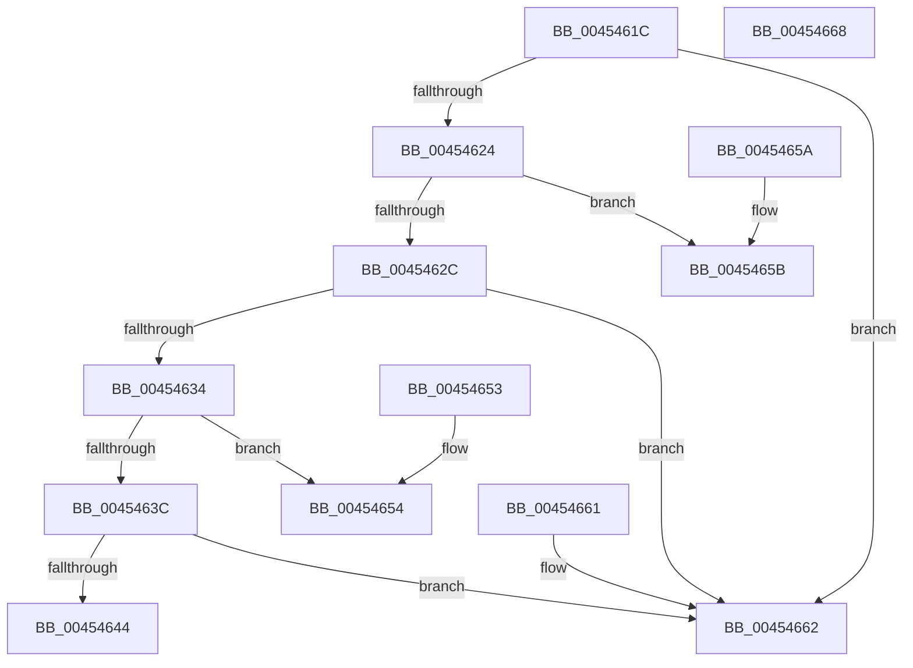

# PnpMapCmStatusToDispatchStatus

- RVA: `0x0045461C`–`0x00454669` (길이 `77` bytes)
- VA: `0x000000014045461C`
- 실행 섹션: `.text`
- PDB 이름 있음: `예`; PDB Function 태그: `아니요`
- unwind 정보 RVA: `0x000DB714`
- 디코드: `24`개 명령, `77/77` bytes 표시
- 미해석 바이트: `0` (있으면 어셈블리에 `.byte`로 보존)

> 이 문서는 커널 이미지의 기계어와 PDB 기호를 분석해 생성했습니다. 4번과 5번은 함수 원형과 자료형을 바이너리 사용 방식에서 추정한 C 해석이며 원본 소스 복구 결과는 아닙니다.

## 1. Dependencies

- 직접 호출 지점: **0**; 고유 호출 대상: **0**
- 직접 호출자로 확인된 함수: **4**
- RIP 상대 이미지 참조: **0**

### Outgoing calls
- 직접 디코드된 call 명령이 없습니다.

### Direct callers
- [_PnpDispatchDeviceInterface](../../page/8E/_PnpDispatchDeviceInterface_function_008E0DB0.md) at `0x008E0ED0`
- [sub_008E1ED1](../../page/8E/Unknown_function_008E1ED1.md) at `0x008E1ED4`
- [_PnpDispatchInterfaceClass](../../page/99/_PnpDispatchInterfaceClass_function_00993BD0.md) at `0x00993CFA`
- [_PnpDispatchInstallerClass](../../page/9D/_PnpDispatchInstallerClass_function_009D3580.md) at `0x009D3625`

### Static image references
- 디코드된 RIP-relative 메모리 참조가 없습니다.

## 2. Other-region calls and transfers

- 다른 실행 섹션으로 향하는 call: **0**
- 별도 외부 분기/꼬리 이동을 확인하지 못했습니다.

## 3. Assembly (complete function range)

```asm
0045461C  81 F9 0E 00 00 C0               cmp ecx, 0xc000000e
00454622  74 3E                           je 0x140454662
00454624  81 F9 39 00 00 C0               cmp ecx, 0xc0000039
0045462A  74 2F                           je 0x14045465b
0045462C  81 F9 3A 00 00 C0               cmp ecx, 0xc000003a
00454632  74 2E                           je 0x140454662
00454634  81 F9 BB 00 00 C0               cmp ecx, 0xc00000bb
0045463A  74 18                           je 0x140454654
0045463C  81 F9 C0 00 00 C0               cmp ecx, 0xc00000c0
00454642  74 1E                           je 0x140454662
00454644  81 F9 B9 02 00 C0               cmp ecx, 0xc00002b9
0045464A  B8 34 00 00 C0                  mov eax, 0xc0000034
0045464F  0F 45 C1                        cmovne eax, ecx
00454652  C3                              ret
00454653  CC                              int3
00454654  B8 25 02 00 C0                  mov eax, 0xc0000225
00454659  C3                              ret
0045465A  CC                              int3
0045465B  B8 33 00 00 C0                  mov eax, 0xc0000033
00454660  C3                              ret
00454661  CC                              int3
00454662  B8 34 00 00 C0                  mov eax, 0xc0000034
00454667  C3                              ret
00454668  CC                              int3
```

## 4. C-style interpretation (structured pseudocode)

```c
__int64 __fastcall PnpMapCmStatusToDispatchStatus(int a1)
{
    __int64 result;

    if (a1 == 0xC000000EULL) goto loc_00454662;
    if (a1 == 0xC0000039ULL) goto loc_0045465B;
    if (a1 == 0xC000003AULL) goto loc_00454662;
    if (a1 == 0xC00000BBULL) goto loc_00454654;
    if (a1 == 0xC00000C0ULL) goto loc_00454662;
    result = (unsigned int)(0xC0000034ULL);
    if (a1 != 0xC00002B9ULL) { result = a1; }
    return result;
loc_00454654:
    return (unsigned int)(0xC0000225ULL);
loc_0045465B:
    return (unsigned int)(0xC0000033ULL);
loc_00454662:
    return (unsigned int)(0xC0000034ULL);
}
```

## 5. (Beta) C Style

```c
int64_t PnpMapCmStatusToDispatchStatus(int32_t Arg1)
{
    int64_t result;

    if (Arg1 == 0xC000000EULL) goto loc_00454662;
    if (Arg1 == 0xC0000039ULL) goto loc_0045465B;
    if (Arg1 == 0xC000003AULL) goto loc_00454662;
    if (Arg1 == 0xC00000BBULL) goto loc_00454654;
    if (Arg1 == 0xC00000C0ULL) goto loc_00454662;
    result = (uint32_t)(0xC0000034ULL);
    if (Arg1 != 0xC00002B9ULL) { result = Arg1; }
    return result;
loc_00454654:
    return (uint32_t)(0xC0000225ULL);
loc_0045465B:
    return (uint32_t)(0xC0000033ULL);
loc_00454662:
    return (uint32_t)(0xC0000034ULL);
}
```

## 6. Execution-region graph

[열기: 2D/3D 그래프와 함수 탐색 컨트롤 패널](../../../control-panel.html?section=text&rva=0x0045461C&view=graph)

- 2D 그래프는 위에서 아래로 흐르고, 3D 그래프는 빈 공간을 드래그해 회전합니다. Shift+드래그는 이동, 휠은 확대·축소, 함수 노드 선택은 대상 보고서 이동입니다.

### Static fallback


