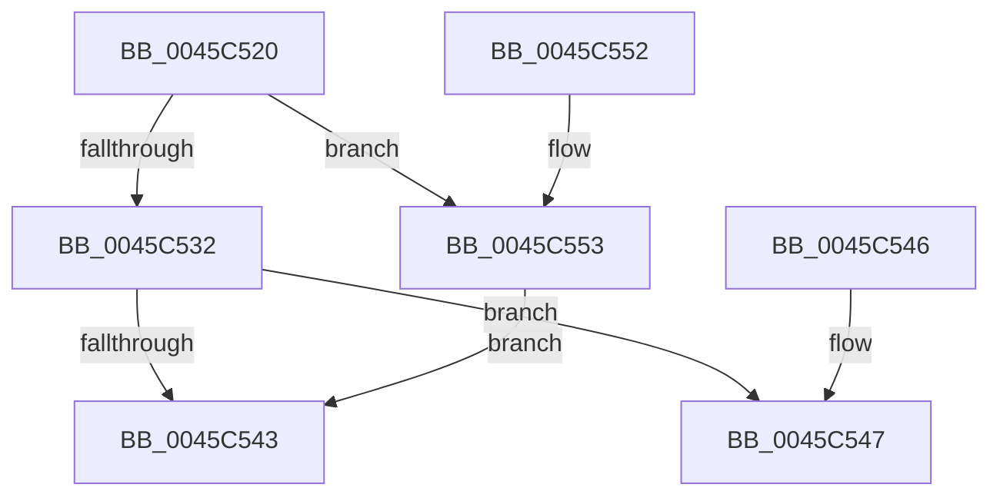

# PoCpuIdledSinceLastCallImprecise

- RVA: `0x0045C520`–`0x0045C559` (길이 `57` bytes)
- VA: `0x000000014045C520`
- 실행 섹션: `.text`
- PDB 이름 있음: `예`; PDB Function 태그: `아니요`
- unwind 정보 RVA: `0x000DB714`
- 디코드: `20`개 명령, `57/57` bytes 표시
- 미해석 바이트: `0` (있으면 어셈블리에 `.byte`로 보존)

> 이 문서는 커널 이미지의 기계어와 PDB 기호를 분석해 생성했습니다. 4번과 5번은 함수 원형과 자료형을 바이너리 사용 방식에서 추정한 C 해석이며 원본 소스 복구 결과는 아닙니다.

## 1. Dependencies

- 직접 호출 지점: **0**; 고유 호출 대상: **0**
- 직접 호출자로 확인된 함수: **0**
- RIP 상대 이미지 참조: **1**

### Outgoing calls
- 직접 디코드된 call 명령이 없습니다.

### Direct callers
- 이 함수 시작 RVA로 연결되는 직접 call은 확인되지 않았습니다. 간접 호출은 완전히 역산할 수 없습니다.

### Static image references
- `0x0045C522` → RVA `0x00FC8C40` (`ALMOSTRO`; read)

## 2. Other-region calls and transfers

- 다른 실행 섹션으로 향하는 call: **0**
- 별도 외부 분기/꼬리 이동을 확인하지 못했습니다.

## 3. Assembly (complete function range)

```asm
0045C520  8B C1                           mov eax, ecx
0045C522  48 8D 0D 17 C7 B6 00            lea rcx, [rip + 0xb6c717]
0045C529  48 8B 04 C1                     mov rax, qword ptr [rcx + rax*8]
0045C52D  48 85 C0                        test rax, rax
0045C530  74 21                           je 0x14045c553
0045C532  48 8B 80 60 88 00 00            mov rax, qword ptr [rax + 0x8860]
0045C539  48 8B 0A                        mov rcx, qword ptr [rdx]
0045C53C  48 89 02                        mov qword ptr [rdx], rax
0045C53F  A8 01                           test al, 1
0045C541  74 04                           je 0x14045c547
0045C543  B0 01                           mov al, 1
0045C545  C3                              ret
0045C546  CC                              int3
0045C547  48 2B C1                        sub rax, rcx
0045C54A  48 83 F8 02                     cmp rax, 2
0045C54E  0F 93 C0                        setae al
0045C551  C3                              ret
0045C552  CC                              int3
0045C553  48 83 22 00                     and qword ptr [rdx], 0
0045C557  EB EA                           jmp 0x14045c543
```

## 4. C-style interpretation (structured pseudocode)

```c
__int64 __fastcall PoCpuIdledSinceLastCallImprecise(int a1, __int64 a2)
{
    __int64 result;

    if (*(unsigned __int64 *)(v_rip + 11978519 + (unsigned int)(a1) * 8) == 0) goto loc_0045C553;
    *(unsigned __int64 *)(a2) = *(unsigned __int64 *)(*(unsigned __int64 *)(v_rip + 11978519 + (unsigned int)(a1) * 8) + 34912);
    if ((((unsigned __int8)(*(unsigned __int64 *)(*(unsigned __int64 *)(v_rip + 11978519 + (unsigned int)(a1) * 8) + 34912))) & (1)) == 0) goto loc_0045C547;
loc_0045C543:
    return 1;
loc_0045C547:
    result = (1) - (*(unsigned __int64 *)(a2));
    result = (result >= 2) ? 1 : 0;
    return result;
loc_0045C553:
    goto loc_0045C543;
}
```

## 5. (Beta) C Style

```c
int64_t PoCpuIdledSinceLastCallImprecise(int32_t Arg1, void *Arg2)
{
    uint8_t *arg2 = (uint8_t *)Arg2;

    int64_t result;

    if (*(uint64_t *)(v_rip + 0xB6C717 + (uint32_t)(Arg1) * 8) == 0) goto loc_0045C553;
    *(uint64_t *)(arg2) = *(uint64_t *)(*(uint64_t *)(v_rip + 0xB6C717 + (uint32_t)(Arg1) * 8) + 0x8860);
    if ((((uint8_t)(*(uint64_t *)(*(uint64_t *)(v_rip + 0xB6C717 + (uint32_t)(Arg1) * 8) + 0x8860))) & (1)) == 0) goto loc_0045C547;
loc_0045C543:
    return 1;
loc_0045C547:
    result = (1) - (*(uint64_t *)(arg2));
    result = (result >= 2) ? 1 : 0;
    return result;
loc_0045C553:
    goto loc_0045C543;
}
```

### 관측된 메모리 오프셋

구조체 형식이 확인되지 않은 접근은 인자 기준의 오프셋으로만 기록했습니다.

| 기준 인자 | 오프셋 표현 | 폭 (bit) | 접근 |
|---|---:|---:|---|
| `Arg2` | `+ 0x0` | `64` | `R` |
| `Arg2` | `+ 0x0` | `64` | `R/W` |
| `Arg2` | `+ 0x0` | `64` | `W` |

## 6. Execution-region graph

[열기: 2D/3D 그래프와 함수 탐색 컨트롤 패널](../../../control-panel.html?section=text&rva=0x0045C520&view=graph)

- 2D 그래프는 위에서 아래로 흐르고, 3D 그래프는 빈 공간을 드래그해 회전합니다. Shift+드래그는 이동, 휠은 확대·축소, 함수 노드 선택은 대상 보고서 이동입니다.

### Static fallback


