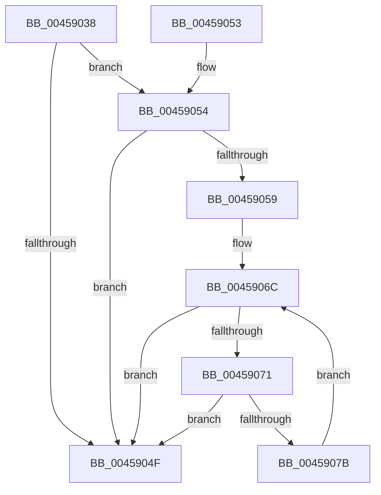

# PopPepComponentGetResidencyIdleState

- RVA: `0x00459038`–`0x0045907D` (길이 `69` bytes)
- VA: `0x0000000140459038`
- 실행 섹션: `.text`
- PDB 이름 있음: `예`; PDB Function 태그: `아니요`
- unwind 정보 RVA: `0x000DB714`
- 디코드: `21`개 명령, `69/69` bytes 표시
- 미해석 바이트: `0` (있으면 어셈블리에 `.byte`로 보존)

> 이 문서는 커널 이미지의 기계어와 PDB 기호를 분석해 생성했습니다. 4번과 5번은 함수 원형과 자료형을 바이너리 사용 방식에서 추정한 C 해석이며 원본 소스 복구 결과는 아닙니다.

## 1. Dependencies

- 직접 호출 지점: **0**; 고유 호출 대상: **0**
- 직접 호출자로 확인된 함수: **3**
- RIP 상대 이미지 참조: **1**

### Outgoing calls
- 직접 디코드된 call 명령이 없습니다.

### Direct callers
- [PopPepIdleTimeoutRoutine](PopPepIdleTimeoutRoutine_function_00458E10.md) at `0x00459005`
- [PopPepComponentSetResidency](../5D/PopPepComponentSetResidency_function_005DC9A4.md) at `0x005DC9E0`
- [PopPepRegisterDevice](../../page/AA/PopPepRegisterDevice_function_00AAEBD0.md) at `0x00AAEE8A`

### Static image references
- `0x00459042` → RVA `0x00F0774C` (`.data`; read)

## 2. Other-region calls and transfers

- 다른 실행 섹션으로 향하는 call: **0**
- 별도 외부 분기/꼬리 이동을 확인하지 못했습니다.

## 3. Assembly (complete function range)

```asm
00459038  44 8B 81 BC 00 00 00            mov r8d, dword ptr [rcx + 0xbc]
0045903F  4C 8B CA                        mov r9, rdx
00459042  8A 05 04 E7 AA 00               mov al, byte ptr [rip + 0xaae704]
00459048  41 FF C8                        dec r8d
0045904B  84 C0                           test al, al
0045904D  74 05                           je 0x140459054
0045904F  41 8B C0                        mov eax, r8d
00459052  C3                              ret
00459053  CC                              int3
00459054  45 85 C0                        test r8d, r8d
00459057  74 F6                           je 0x14045904f
00459059  48 8B 89 C8 00 00 00            mov rcx, qword ptr [rcx + 0xc8]
00459060  4B 8D 14 40                     lea rdx, [r8 + r8*2]
00459064  48 83 C1 08                     add rcx, 8
00459068  48 8D 0C D1                     lea rcx, [rcx + rdx*8]
0045906C  4C 39 09                        cmp qword ptr [rcx], r9
0045906F  76 DE                           jbe 0x14045904f
00459071  48 83 E9 18                     sub rcx, 0x18
00459075  41 83 C0 FF                     add r8d, -1
00459079  74 D4                           je 0x14045904f
0045907B  EB EF                           jmp 0x14045906c
```

## 4. C-style interpretation (structured pseudocode)

```c
__int64 __fastcall PopPepComponentGetResidencyIdleState(__int64 a1, __int64 a2)
{
    a3 = (unsigned int)(((unsigned int)(*(unsigned int *)(a1 + 188))) - 1);
    if ((unsigned __int8)(*(unsigned __int8 *)(v_rip + 11200260)) == 0) goto loc_00459054;
loc_0045904F:
    return (unsigned int)((unsigned int)(a3));
loc_00459054:
    if ((unsigned int)(a3) == 0) goto loc_0045904F;
    a1 = (*(unsigned __int64 *)(a1 + 200)) + (8);
loc_0045906C:
    if ((*(unsigned __int64 *)(a1 + a3 + a3 * 2 * 8)) <= a2) goto loc_0045904F;
    a1 = (a1 + a3 + a3 * 2 * 8) - (24);
    a3 = (unsigned int)((a3) + (-1));
    if (condition_is_equal) goto loc_0045904F;
    goto loc_0045906C;
}
```

## 5. (Beta) C Style

```c
int64_t PopPepComponentGetResidencyIdleState(void *Arg1, int64_t Arg2)
{
    uint8_t *arg1 = (uint8_t *)Arg1;

    a3 = (uint32_t)(((uint32_t)(*(uint32_t *)(arg1 + 0xBC))) - 1);
    if ((uint8_t)(*(uint8_t *)(v_rip + 0xAAE704)) == 0) goto loc_00459054;
loc_0045904F:
    return (uint32_t)((uint32_t)(a3));
loc_00459054:
    if ((uint32_t)(a3) == 0) goto loc_0045904F;
    Arg1 = (*(uint64_t *)(arg1 + 0xC8)) + (8);
loc_0045906C:
    if ((*(uint64_t *)(arg1 + a3 + a3 * 2 * 8)) <= Arg2) goto loc_0045904F;
    Arg1 = (Arg1 + a3 + a3 * 2 * 8) - (24);
    a3 = (uint32_t)((a3) + (-1));
    if (condition_is_equal) goto loc_0045904F;
    goto loc_0045906C;
}
```

### 관측된 메모리 오프셋

구조체 형식이 확인되지 않은 접근은 인자 기준의 오프셋으로만 기록했습니다.

| 기준 인자 | 오프셋 표현 | 폭 (bit) | 접근 |
|---|---:|---:|---|
| `Arg1` | `+ 0xBC` | `32` | `R` |
| `Arg1` | `+ 0xC8` | `64` | `R` |

## 6. Execution-region graph

[열기: 2D/3D 그래프와 함수 탐색 컨트롤 패널](../../../control-panel.html?section=text&rva=0x00459038&view=graph)

- 2D 그래프는 위에서 아래로 흐르고, 3D 그래프는 빈 공간을 드래그해 회전합니다. Shift+드래그는 이동, 휠은 확대·축소, 함수 노드 선택은 대상 보고서 이동입니다.

### Static fallback


