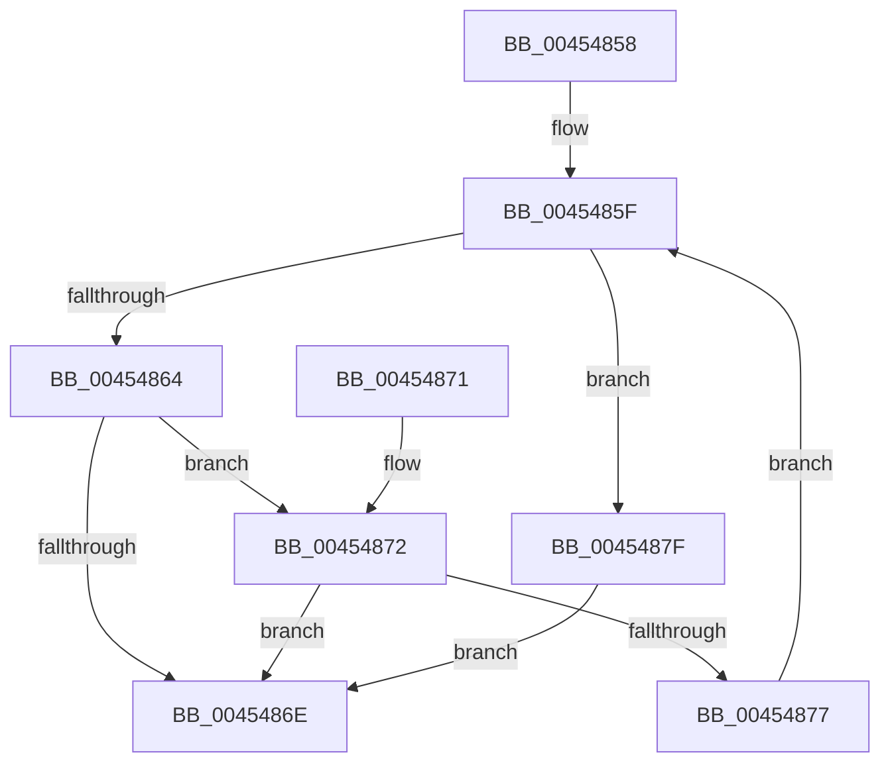

# PopPepGetReadyActivityType

- RVA: `0x00454858`–`0x00454886` (길이 `46` bytes)
- VA: `0x0000000140454858`
- 실행 섹션: `.text`
- PDB 이름 있음: `예`; PDB Function 태그: `아니요`
- unwind 정보 RVA: `0x000DB714`
- 디코드: `18`개 명령, `46/46` bytes 표시
- 미해석 바이트: `0` (있으면 어셈블리에 `.byte`로 보존)

> 이 문서는 커널 이미지의 기계어와 PDB 기호를 분석해 생성했습니다. 4번과 5번은 함수 원형과 자료형을 바이너리 사용 방식에서 추정한 C 해석이며 원본 소스 복구 결과는 아닙니다.

## 1. Dependencies

- 직접 호출 지점: **0**; 고유 호출 대상: **0**
- 직접 호출자로 확인된 함수: **1**
- RIP 상대 이미지 참조: **0**

### Outgoing calls
- 직접 디코드된 call 명령이 없습니다.

### Direct callers
- [PopPepProcessEvent](../24/PopPepProcessEvent_function_0024B930.md) at `0x0024C4C7`

### Static image references
- 디코드된 RIP-relative 메모리 참조가 없습니다.

## 2. Other-region calls and transfers

- 다른 실행 섹션으로 향하는 call: **0**
- 별도 외부 분기/꼬리 이동을 확인하지 못했습니다.

## 3. Assembly (complete function range)

```asm
00454858  48 63 C2                        movsxd rax, edx
0045485B  4C 8D 0C C1                     lea r9, [rcx + rax*8]
0045485F  41 3B D0                        cmp edx, r8d
00454862  7F 1B                           jg 0x14045487f
00454864  49 8B 01                        mov rax, qword ptr [r9]
00454867  8B 08                           mov ecx, dword ptr [rax]
00454869  F6 C1 02                        test cl, 2
0045486C  74 04                           je 0x140454872
0045486E  8B C2                           mov eax, edx
00454870  C3                              ret
00454871  CC                              int3
00454872  F6 C1 08                        test cl, 8
00454875  75 F7                           jne 0x14045486e
00454877  FF C2                           inc edx
00454879  49 83 C1 08                     add r9, 8
0045487D  EB E0                           jmp 0x14045485f
0045487F  BA 06 00 00 00                  mov edx, 6
00454884  EB E8                           jmp 0x14045486e
```

## 4. C-style interpretation (structured pseudocode)

```c
__int64 __fastcall PopPepGetReadyActivityType(__int64 a1, int a2, int a3)
{
loc_0045485F:
    if (a2 > a3) goto loc_0045487F;
    if ((((unsigned __int8)((unsigned int)(*(unsigned int *)(*(unsigned __int64 *)(a1 + (int)(a2) * 8))))) & (2)) == 0) goto loc_00454872;
loc_0045486E:
    return (unsigned int)(a2);
loc_00454872:
    if ((((unsigned __int8)((unsigned int)(*(unsigned int *)(*(unsigned __int64 *)(a1 + (int)(a2) * 8))))) & (8)) != 0) goto loc_0045486E;
    a2 = (unsigned int)((a2) + 1);
    a4 = (a1 + (int)(a2) * 8) + (8);
    goto loc_0045485F;
loc_0045487F:
    goto loc_0045486E;
}
```

## 5. (Beta) C Style

```c
int64_t PopPepGetReadyActivityType(void *Arg1, int32_t Arg2, int32_t Arg3)
{
    uint8_t *arg1 = (uint8_t *)Arg1;

loc_0045485F:
    if (Arg2 > Arg3) goto loc_0045487F;
    if ((((uint8_t)((uint32_t)(*(uint32_t *)(*(uint64_t *)(arg1 + (int32_t)(Arg2) * 8))))) & (2)) == 0) goto loc_00454872;
loc_0045486E:
    return (uint32_t)(Arg2);
loc_00454872:
    if ((((uint8_t)((uint32_t)(*(uint32_t *)(*(uint64_t *)(arg1 + (int32_t)(Arg2) * 8))))) & (8)) != 0) goto loc_0045486E;
    Arg2 = (uint32_t)((Arg2) + 1);
    a4 = (Arg1 + (int32_t)(Arg2) * 8) + (8);
    goto loc_0045485F;
loc_0045487F:
    goto loc_0045486E;
}
```

### 관측된 메모리 오프셋

구조체 형식이 확인되지 않은 접근은 인자 기준의 오프셋으로만 기록했습니다.

| 기준 인자 | 오프셋 표현 | 폭 (bit) | 접근 |
|---|---:|---:|---|
| `Arg1` | `+ 0x0` | `64` | `R` |
| `Arg1` | `+ 0x0 + rax*8` | `64` | `R` |

## 6. Execution-region graph

[열기: 2D/3D 그래프와 함수 탐색 컨트롤 패널](../../../control-panel.html?section=text&rva=0x00454858&view=graph)

- 2D 그래프는 위에서 아래로 흐르고, 3D 그래프는 빈 공간을 드래그해 회전합니다. Shift+드래그는 이동, 휠은 확대·축소, 함수 노드 선택은 대상 보고서 이동입니다.

### Static fallback


