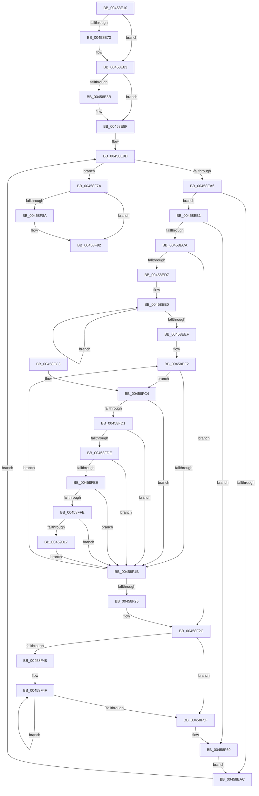

# PopPepIdleTimeoutRoutine

- RVA: `0x00458E10`–`0x00459031` (길이 `545` bytes)
- VA: `0x0000000140458E10`
- 실행 섹션: `.text`
- PDB 이름 있음: `예`; PDB Function 태그: `아니요`
- unwind 정보 RVA: `0x000A8DD0`
- 디코드: `134`개 명령, `545/545` bytes 표시
- 미해석 바이트: `0` (있으면 어셈블리에 `.byte`로 보존)

> 이 문서는 커널 이미지의 기계어와 PDB 기호를 분석해 생성했습니다. 4번과 5번은 함수 원형과 자료형을 바이너리 사용 방식에서 추정한 C 해석이며 원본 소스 복구 결과는 아닙니다.

## 1. Dependencies

- 직접 호출 지점: **12**; 고유 호출 대상: **12**
- 직접 호출자로 확인된 함수: **0**
- RIP 상대 이미지 참조: **2**

### Outgoing calls
- `0x00458E59` → [KeAbPreAcquire](../21/KeAbPreAcquire_function_00210230.md) (function, `0x00210230`)
- `0x00458E7E` → [ExfAcquirePushLockSharedEx](../21/ExfAcquirePushLockSharedEx_function_0021044C.md) (function, `0x0021044C`)
- `0x00458EB5` → [ExAcquireSpinLockExclusive](../24/ExAcquireSpinLockExclusive_function_00248690.md) (function, `0x00248690`)
- `0x00458F35` → [PopPepPromoteActivities](../24/PopPepPromoteActivities_function_0024D0D0.md) (function, `0x0024D0D0`)
- `0x00458F64` → [PopPepRequestWork](../39/PopPepRequestWork_function_003986F0.md) (function, `0x003986F0`)
- `0x00458F70` → [ExReleaseSpinLockExclusive](../2C/ExReleaseSpinLockExclusive_function_002C0EF0.md) (function, `0x002C0EF0`)
- `0x00458F8D` → [ExfReleasePushLockShared](../26/ExfReleasePushLockShared_function_00263440.md) (function, `0x00263440`)
- `0x00458F95` → [KeAbPostRelease](../2E/KeAbPostRelease_function_002E1600.md) (function, `0x002E1600`)
- `0x00458F9A` → [KeLeaveCriticalRegion](../25/KeLeaveCriticalRegion_function_0025D8B0.md) (function, `0x0025D8B0`)
- `0x00458FA1` → [PopPepArmIdleTimer](../2C/PopPepArmIdleTimer_function_002C0B9C.md) (function, `0x002C0B9C`)
- `0x00459005` → [PopPepComponentGetResidencyIdleState](PopPepComponentGetResidencyIdleState_function_00459038.md) (function, `0x00459038`)
- `0x00459027` → [PopPepUpdateIdleState](../2B/PopPepUpdateIdleState_function_002BF794.md) (function, `0x002BF794`)

### Direct callers
- 이 함수 시작 RVA로 연결되는 직접 call은 확인되지 않았습니다. 간접 호출은 완전히 역산할 수 없습니다.

### Static image references
- `0x00458E36` → RVA `0x00F07678` (`.data`; read)
- `0x00458E8F` → RVA `0x00F07680` (`.data`; read)

## 2. Other-region calls and transfers

- 다른 실행 섹션으로 향하는 call: **0**
- 별도 외부 분기/꼬리 이동을 확인하지 못했습니다.

## 3. Assembly (complete function range)

```asm
00458E10  48 89 5C 24 08                  mov qword ptr [rsp + 8], rbx
00458E15  48 89 6C 24 18                  mov qword ptr [rsp + 0x18], rbp
00458E1A  48 89 74 24 20                  mov qword ptr [rsp + 0x20], rsi
00458E1F  57                              push rdi
00458E20  41 54                           push r12
00458E22  41 55                           push r13
00458E24  41 56                           push r14
00458E26  41 57                           push r15
00458E28  48 83 EC 20                     sub rsp, 0x20
00458E2C  48 BB 08 00 00 00 80 F7 FF FF   movabs rbx, 0xfffff78000000008
00458E36  4C 8D 2D 3B E8 AA 00            lea r13, [rip + 0xaae83b]
00458E3D  45 33 C0                        xor r8d, r8d
00458E40  33 D2                           xor edx, edx
00458E42  49 8B CD                        mov rcx, r13
00458E45  48 8B 1B                        mov rbx, qword ptr [rbx]
00458E48  65 48 8B 04 25 88 01 00 00      mov rax, qword ptr gs:[0x188]
00458E51  66 FF 88 E4 01 00 00            dec word ptr [rax + 0x1e4]
00458E58  90                              nop
00458E59  E8 D2 73 DB FF                  call 0x140210230
00458E5E  48 8B F8                        mov rdi, rax
00458E61  B9 11 00 00 00                  mov ecx, 0x11
00458E66  33 C0                           xor eax, eax
00458E68  F0 48 0F B1 0D 07 E8 AA 00      lock cmpxchg qword ptr [rip + 0xaae807], rcx
00458E71  74 10                           je 0x140458e83
00458E73  4D 8B CD                        mov r9, r13
00458E76  4C 8B C7                        mov r8, rdi
00458E79  33 D2                           xor edx, edx
00458E7B  49 8B CD                        mov rcx, r13
00458E7E  E8 C9 75 DB FF                  call 0x14021044c
00458E83  45 33 E4                        xor r12d, r12d
00458E86  48 85 FF                        test rdi, rdi
00458E89  74 04                           je 0x140458e8f
00458E8B  C6 47 0A 01                     mov byte ptr [rdi + 0xa], 1
00458E8F  48 8B 3D EA E7 AA 00            mov rdi, qword ptr [rip + 0xaae7ea]
00458E96  48 8D 2D E3 E7 AA 00            lea rbp, [rip + 0xaae7e3]
00458E9D  48 3B FD                        cmp rdi, rbp
00458EA0  0F 84 D4 00 00 00               je 0x140458f7a
00458EA6  F6 47 10 01                     test byte ptr [rdi + 0x10], 1
00458EAA  74 05                           je 0x140458eb1
00458EAC  48 8B 3F                        mov rdi, qword ptr [rdi]
00458EAF  EB EC                           jmp 0x140458e9d
00458EB1  48 8D 4F 40                     lea rcx, [rdi + 0x40]
00458EB5  E8 D6 F7 DE FF                  call 0x140248690
00458EBA  44 8A F8                        mov r15b, al
00458EBD  44 38 A7 88 00 00 00            cmp byte ptr [rdi + 0x88], r12b
00458EC4  0F 84 9F 00 00 00               je 0x140458f69
00458ECA  8B 8F B4 00 00 00               mov ecx, dword ptr [rdi + 0xb4]
00458ED0  8B 77 78                        mov esi, dword ptr [rdi + 0x78]
00458ED3  85 C9                           test ecx, ecx
00458ED5  74 55                           je 0x140458f2c
00458ED7  48 8D 87 28 01 00 00            lea rax, [rdi + 0x128]
00458EDE  8B D1                           mov edx, ecx
00458EE0  03 30                           add esi, dword ptr [rax]
00458EE2  48 8D 80 D0 00 00 00            lea rax, [rax + 0xd0]
00458EE9  48 83 EA 01                     sub rdx, 1
00458EED  75 F1                           jne 0x140458ee0
00458EEF  41 8B EC                        mov ebp, r12d
00458EF2  8B C5                           mov eax, ebp
00458EF4  4C 69 D0 D0 00 00 00            imul r10, rax, 0xd0
00458EFB  49 81 C2 C0 00 00 00            add r10, 0xc0
00458F02  4C 03 D7                        add r10, rdi
00458F05  41 8B 82 BC 00 00 00            mov eax, dword ptr [r10 + 0xbc]
00458F0C  FF C8                           dec eax
00458F0E  41 39 82 B0 00 00 00            cmp dword ptr [r10 + 0xb0], eax
00458F15  0F 85 A9 00 00 00               jne 0x140458fc4
00458F1B  FF C5                           inc ebp
00458F1D  3B AF B4 00 00 00               cmp ebp, dword ptr [rdi + 0xb4]
00458F23  72 CD                           jb 0x140458ef2
00458F25  48 8D 2D 54 E7 AA 00            lea rbp, [rip + 0xaae754]
00458F2C  33 D2                           xor edx, edx
00458F2E  48 8B CF                        mov rcx, rdi
00458F31  44 8D 42 03                     lea r8d, [rdx + 3]
00458F35  E8 96 41 DF FF                  call 0x14024d0d0
00458F3A  8B 8F B4 00 00 00               mov ecx, dword ptr [rdi + 0xb4]
00458F40  44 8B 47 78                     mov r8d, dword ptr [rdi + 0x78]
00458F44  85 C9                           test ecx, ecx
00458F46  74 17                           je 0x140458f5f
00458F48  48 8D 87 28 01 00 00            lea rax, [rdi + 0x128]
00458F4F  44 03 00                        add r8d, dword ptr [rax]
00458F52  48 8D 80 D0 00 00 00            lea rax, [rax + 0xd0]
00458F59  48 83 E9 01                     sub rcx, 1
00458F5D  75 F0                           jne 0x140458f4f
00458F5F  8B D6                           mov edx, esi
00458F61  48 8B CF                        mov rcx, rdi
00458F64  E8 87 F7 F3 FF                  call 0x1403986f0
00458F69  41 8A D7                        mov dl, r15b
00458F6C  48 8D 4F 40                     lea rcx, [rdi + 0x40]
00458F70  E8 7B 7F E6 FF                  call 0x1402c0ef0
00458F75  E9 32 FF FF FF                  jmp 0x140458eac
00458F7A  B8 11 00 00 00                  mov eax, 0x11
00458F7F  F0 4C 0F B1 25 F0 E6 AA 00      lock cmpxchg qword ptr [rip + 0xaae6f0], r12
00458F88  74 08                           je 0x140458f92
00458F8A  49 8B CD                        mov rcx, r13
00458F8D  E8 AE A4 E0 FF                  call 0x140263440
00458F92  49 8B CD                        mov rcx, r13
00458F95  E8 66 86 E8 FF                  call 0x1402e1600
00458F9A  E8 11 49 E0 FF                  call 0x14025d8b0
00458F9F  B1 01                           mov cl, 1
00458FA1  E8 F6 7B E6 FF                  call 0x1402c0b9c
00458FA6  48 8B 5C 24 50                  mov rbx, qword ptr [rsp + 0x50]
00458FAB  48 8B 6C 24 60                  mov rbp, qword ptr [rsp + 0x60]
00458FB0  48 8B 74 24 68                  mov rsi, qword ptr [rsp + 0x68]
00458FB5  48 83 C4 20                     add rsp, 0x20
00458FB9  41 5F                           pop r15
00458FBB  41 5E                           pop r14
00458FBD  41 5D                           pop r13
00458FBF  41 5C                           pop r12
00458FC1  5F                              pop rdi
00458FC2  C3                              ret
00458FC3  CC                              int3
00458FC4  49 8B 42 48                     mov rax, qword ptr [r10 + 0x48]
00458FC8  44 39 20                        cmp dword ptr [rax], r12d
00458FCB  0F 85 4A FF FF FF               jne 0x140458f1b
00458FD1  49 8B 42 50                     mov rax, qword ptr [r10 + 0x50]
00458FD5  44 39 20                        cmp dword ptr [rax], r12d
00458FD8  0F 85 3D FF FF FF               jne 0x140458f1b
00458FDE  49 8B 82 88 00 00 00            mov rax, qword ptr [r10 + 0x88]
00458FE5  48 3B D8                        cmp rbx, rax
00458FE8  0F 8E 2D FF FF FF               jle 0x140458f1b
00458FEE  48 8B D3                        mov rdx, rbx
00458FF1  48 2B D0                        sub rdx, rax
00458FF4  49 3B 52 78                     cmp rdx, qword ptr [r10 + 0x78]
00458FF8  0F 86 1D FF FF FF               jbe 0x140458f1b
00458FFE  49 8B CA                        mov rcx, r10
00459001  49 89 52 78                     mov qword ptr [r10 + 0x78], rdx
00459005  E8 2E 00 00 00                  call 0x140459038
0045900A  41 39 82 A0 00 00 00            cmp dword ptr [r10 + 0xa0], eax
00459011  0F 84 04 FF FF FF               je 0x140458f1b
00459017  41 B0 01                        mov r8b, 1
0045901A  41 89 82 A0 00 00 00            mov dword ptr [r10 + 0xa0], eax
00459021  49 8B D2                        mov rdx, r10
00459024  48 8B CF                        mov rcx, rdi
00459027  E8 68 67 E6 FF                  call 0x1402bf794
0045902C  E9 EA FE FF FF                  jmp 0x140458f1b
```

## 4. C-style interpretation (structured pseudocode)

```c
__int64 __fastcall PopPepIdleTimeoutRoutine(__int64 a1, int a2, int a3)
{
    __int64 result;
    __int64 v_r10;
    __int64 v_r12;
    __int64 v_rbp;
    __int64 v_rsi;
    __int64 v_rsp;
    unsigned __int64 v_stack_p18;
    unsigned __int64 v_stack_p20;
    unsigned __int64 v_stack_p8;

    v_stack_p8 = v_rbx;
    v_stack_p18 = v_rbp;
    v_stack_p20 = v_rsi;
    v_rsp = (v_rsp) - (32);
    a3 = 0;
    a2 = 0;
    result = KeAbPreAcquire(v_rip + 11200571, a2, a3, a4);
    result = 0;
    if (!(condition_is_equal)) {
        a4 = v_rip + 11200571;
        a3 = 0;
        a2 = 0;
        a1 = v_rip + 11200571;
        result = ExfAcquirePushLockSharedEx(a1, a2, a3, a4);
    }
    v_r12 = 0;
    if (result != 0) {
        *(unsigned __int8 *)(result + 10) = 1;
    }
loc_00458E9D:
    if ((*(unsigned __int64 *)(v_rip + 11200490)) == (v_rip + 11200483)) goto loc_00458F7A;
    if (((*(unsigned __int8 *)(*(unsigned __int64 *)(v_rip + 11200490) + 16)) & (1)) == 0) goto loc_00458EB1;
loc_00458EAC:
    goto loc_00458E9D;
loc_00458EB1:
    result = ExAcquireSpinLockExclusive(*(unsigned __int64 *)(*(unsigned __int64 *)(v_rip + 11200490)) + 64, a2, a3, a4);
    if ((*(unsigned __int8 *)(*(unsigned __int64 *)(*(unsigned __int64 *)(v_rip + 11200490)) + 136)) == 0) goto loc_00458F69;
    if ((unsigned int)((unsigned int)(*(unsigned int *)(*(unsigned __int64 *)(*(unsigned __int64 *)(v_rip + 11200490)) + 180))) == 0) goto loc_00458F2C;
loc_00458EE0:
    v_rsi = (unsigned int)(((unsigned int)(*(unsigned int *)(*(unsigned __int64 *)(*(unsigned __int64 *)(v_rip + 11200490)) + 120))) + (*(unsigned int *)(*(unsigned __int64 *)(*(unsigned __int64 *)(v_rip + 11200490)) + 296)));
    a2 = ((unsigned int)((unsigned int)((unsigned int)(*(unsigned int *)(*(unsigned __int64 *)(*(unsigned __int64 *)(v_rip + 11200490)) + 180))))) - (1);
    if (condition_is_not_equal) goto loc_00458EE0;
loc_00458EF2:
    v_r10 = (v_r10) * (0);
    v_r10 = (v_r10) + (192);
    v_r10 = (v_r10) + (*(unsigned __int64 *)(*(unsigned __int64 *)(v_rip + 11200490)));
    result = (unsigned int)(((unsigned int)(*(unsigned int *)(v_r10 + 188))) - 1);
    if ((*(unsigned int *)(v_r10 + 176)) != ((unsigned int)(result))) goto loc_00458FC4;
loc_00458F1B:
    v_rbp = (unsigned int)((0) + 1);
    if (((unsigned int)(v_rbp)) < (*(unsigned int *)(*(unsigned __int64 *)(*(unsigned __int64 *)(v_rip + 11200490)) + 180))) goto loc_00458EF2;
loc_00458F2C:
    a2 = 0;
    result = PopPepPromoteActivities(*(unsigned __int64 *)(*(unsigned __int64 *)(v_rip + 11200490)), a2, a2 + 3, a4);
    if ((unsigned int)((unsigned int)(*(unsigned int *)(*(unsigned __int64 *)(*(unsigned __int64 *)(v_rip + 11200490)) + 180))) == 0) goto loc_00458F5F;
loc_00458F4F:
    a3 = (unsigned int)(((unsigned int)(*(unsigned int *)(*(unsigned __int64 *)(*(unsigned __int64 *)(v_rip + 11200490)) + 120))) + (*(unsigned int *)(*(unsigned __int64 *)(*(unsigned __int64 *)(v_rip + 11200490)) + 296)));
    a1 = ((unsigned int)(*(unsigned int *)(*(unsigned __int64 *)(*(unsigned __int64 *)(v_rip + 11200490)) + 180))) - (1);
    if (condition_is_not_equal) goto loc_00458F4F;
loc_00458F5F:
    result = PopPepRequestWork(*(unsigned __int64 *)(*(unsigned __int64 *)(v_rip + 11200490)), (unsigned int)((unsigned int)(v_rsi)), a3, a4);
loc_00458F69:
    result = ExReleaseSpinLockExclusive(*(unsigned __int64 *)(*(unsigned __int64 *)(v_rip + 11200490)) + 64, (unsigned __int8)((unsigned __int8)(result)), a3, a4);
    goto loc_00458EAC;
loc_00458F7A:
    result = 17;
    if (!(condition_is_equal)) {
        a1 = v_rip + 11200571;
        result = ExfReleasePushLockShared(a1, (unsigned __int8)((unsigned __int8)(result)), a3, a4);
    }
    result = KeAbPostRelease(v_rip + 11200571, (unsigned __int8)((unsigned __int8)(result)), a3, a4);
    result = KeLeaveCriticalRegion(v_rip + 11200571, (unsigned __int8)((unsigned __int8)(result)), a3, a4);
    result = PopPepArmIdleTimer(1, (unsigned __int8)((unsigned __int8)(result)), a3, a4);
    v_rsp = (v_rsp) + (32);
    return result;
loc_00458FC4:
    if ((*(unsigned int *)(*(unsigned __int64 *)(v_r10 + 72))) != 0) goto loc_00458F1B;
    if ((*(unsigned int *)(*(unsigned __int64 *)(v_r10 + 80))) != 0) goto loc_00458F1B;
    if (v_stack_p8 <= (*(unsigned __int64 *)(v_r10 + 136))) goto loc_00458F1B;
    a2 = (v_stack_p8) - (*(unsigned __int64 *)(v_r10 + 136));
    if (a2 <= (*(unsigned __int64 *)(v_r10 + 120))) goto loc_00458F1B;
    *(unsigned __int64 *)(v_r10 + 120) = a2;
    result = PopPepComponentGetResidencyIdleState(v_r10, a2, a3, a4);
    if ((*(unsigned int *)(v_r10 + 160)) == ((unsigned int)(result))) goto loc_00458F1B;
    *(unsigned int *)(v_r10 + 160) = (unsigned int)(result);
    result = PopPepUpdateIdleState(*(unsigned __int64 *)(*(unsigned __int64 *)(v_rip + 11200490)), v_r10, 1, a4);
    goto loc_00458F1B;
}
```

## 5. (Beta) C Style

```c
int64_t PopPepIdleTimeoutRoutine(int64_t Arg1, int32_t Arg2, int32_t Arg3)
{
    int64_t result;
    int64_t local_r10;
    int64_t local_r12;
    int64_t local_rbp;
    int64_t local_rsi;
    int64_t local_rsp;
    uint64_t v_stack_p18;
    uint64_t v_stack_p20;
    uint64_t v_stack_p8;

    v_stack_p8 = local_rbx;
    v_stack_p18 = local_rbp;
    v_stack_p20 = local_rsi;
    local_rsp = (local_rsp) - (32);
    Arg3 = 0;
    Arg2 = 0;
    result = KeAbPreAcquire(v_rip + 11200571, Arg2, Arg3, a4);
    result = 0;
    if (!(condition_is_equal)) {
        a4 = v_rip + 11200571;
        Arg3 = 0;
        Arg2 = 0;
        Arg1 = v_rip + 11200571;
        result = ExfAcquirePushLockSharedEx(Arg1, Arg2, Arg3, a4);
    }
    local_r12 = 0;
    if (result != 0) {
        *(uint8_t *)(result + 0xA) = 1;
    }
loc_00458E9D:
    if ((*(uint64_t *)(v_rip + 0xAAE7EA)) == (v_rip + 11200483)) goto loc_00458F7A;
    if (((*(uint8_t *)(*(uint64_t *)(v_rip + 0xAAE7EA) + 0x10)) & (1)) == 0) goto loc_00458EB1;
loc_00458EAC:
    goto loc_00458E9D;
loc_00458EB1:
    result = ExAcquireSpinLockExclusive(*(uint64_t *)(*(uint64_t *)(v_rip + 0xAAE7EA)) + 64, Arg2, Arg3, a4);
    if ((*(uint8_t *)(*(uint64_t *)(*(uint64_t *)(v_rip + 0xAAE7EA)) + 0x88)) == 0) goto loc_00458F69;
    if ((uint32_t)((uint32_t)(*(uint32_t *)(*(uint64_t *)(*(uint64_t *)(v_rip + 0xAAE7EA)) + 0xB4))) == 0) goto loc_00458F2C;
loc_00458EE0:
    local_rsi = (uint32_t)(((uint32_t)(*(uint32_t *)(*(uint64_t *)(*(uint64_t *)(v_rip + 0xAAE7EA)) + 0x78))) + (*(uint32_t *)(*(uint64_t *)(*(uint64_t *)(v_rip + 0xAAE7EA)) + 0x128)));
    Arg2 = ((uint32_t)((uint32_t)((uint32_t)(*(uint32_t *)(*(uint64_t *)(*(uint64_t *)(v_rip + 0xAAE7EA)) + 0xB4))))) - (1);
    if (condition_is_not_equal) goto loc_00458EE0;
loc_00458EF2:
    local_r10 = (local_r10) * (0);
    local_r10 = (local_r10) + (192);
    local_r10 = (local_r10) + (*(uint64_t *)(*(uint64_t *)(v_rip + 0xAAE7EA)));
    result = (uint32_t)(((uint32_t)(*(uint32_t *)(local_r10 + 0xBC))) - 1);
    if ((*(uint32_t *)(local_r10 + 0xB0)) != ((uint32_t)(result))) goto loc_00458FC4;
loc_00458F1B:
    local_rbp = (uint32_t)((0) + 1);
    if (((uint32_t)(local_rbp)) < (*(uint32_t *)(*(uint64_t *)(*(uint64_t *)(v_rip + 0xAAE7EA)) + 0xB4))) goto loc_00458EF2;
loc_00458F2C:
    Arg2 = 0;
    result = PopPepPromoteActivities(*(uint64_t *)(*(uint64_t *)(v_rip + 0xAAE7EA)), Arg2, Arg2 + 3, a4);
    if ((uint32_t)((uint32_t)(*(uint32_t *)(*(uint64_t *)(*(uint64_t *)(v_rip + 0xAAE7EA)) + 0xB4))) == 0) goto loc_00458F5F;
loc_00458F4F:
    Arg3 = (uint32_t)(((uint32_t)(*(uint32_t *)(*(uint64_t *)(*(uint64_t *)(v_rip + 0xAAE7EA)) + 0x78))) + (*(uint32_t *)(*(uint64_t *)(*(uint64_t *)(v_rip + 0xAAE7EA)) + 0x128)));
    Arg1 = ((uint32_t)(*(uint32_t *)(*(uint64_t *)(*(uint64_t *)(v_rip + 0xAAE7EA)) + 0xB4))) - (1);
    if (condition_is_not_equal) goto loc_00458F4F;
loc_00458F5F:
    result = PopPepRequestWork(*(uint64_t *)(*(uint64_t *)(v_rip + 0xAAE7EA)), (uint32_t)((uint32_t)(local_rsi)), Arg3, a4);
loc_00458F69:
    result = ExReleaseSpinLockExclusive(*(uint64_t *)(*(uint64_t *)(v_rip + 0xAAE7EA)) + 64, (uint8_t)((uint8_t)(result)), Arg3, a4);
    goto loc_00458EAC;
loc_00458F7A:
    result = 17;
    if (!(condition_is_equal)) {
        Arg1 = v_rip + 11200571;
        result = ExfReleasePushLockShared(Arg1, (uint8_t)((uint8_t)(result)), Arg3, a4);
    }
    result = KeAbPostRelease(v_rip + 11200571, (uint8_t)((uint8_t)(result)), Arg3, a4);
    result = KeLeaveCriticalRegion(v_rip + 11200571, (uint8_t)((uint8_t)(result)), Arg3, a4);
    result = PopPepArmIdleTimer(1, (uint8_t)((uint8_t)(result)), Arg3, a4);
    local_rsp = (local_rsp) + (32);
    return result;
loc_00458FC4:
    if ((*(uint32_t *)(*(uint64_t *)(local_r10 + 0x48))) != 0) goto loc_00458F1B;
    if ((*(uint32_t *)(*(uint64_t *)(local_r10 + 0x50))) != 0) goto loc_00458F1B;
    if (v_stack_p8 <= (*(uint64_t *)(local_r10 + 0x88))) goto loc_00458F1B;
    Arg2 = (v_stack_p8) - (*(uint64_t *)(local_r10 + 0x88));
    if (Arg2 <= (*(uint64_t *)(local_r10 + 0x78))) goto loc_00458F1B;
    *(uint64_t *)(local_r10 + 0x78) = Arg2;
    result = PopPepComponentGetResidencyIdleState(local_r10, Arg2, Arg3, a4);
    if ((*(uint32_t *)(local_r10 + 0xA0)) == ((uint32_t)(result))) goto loc_00458F1B;
    *(uint32_t *)(local_r10 + 0xA0) = (uint32_t)(result);
    result = PopPepUpdateIdleState(*(uint64_t *)(*(uint64_t *)(v_rip + 0xAAE7EA)), local_r10, 1, a4);
    goto loc_00458F1B;
}
```

## 6. Execution-region graph

[열기: 2D/3D 그래프와 함수 탐색 컨트롤 패널](../../../control-panel.html?section=text&rva=0x00458E10&view=graph)

- 2D 그래프는 위에서 아래로 흐르고, 3D 그래프는 빈 공간을 드래그해 회전합니다. Shift+드래그는 이동, 휠은 확대·축소, 함수 노드 선택은 대상 보고서 이동입니다.

### Static fallback


