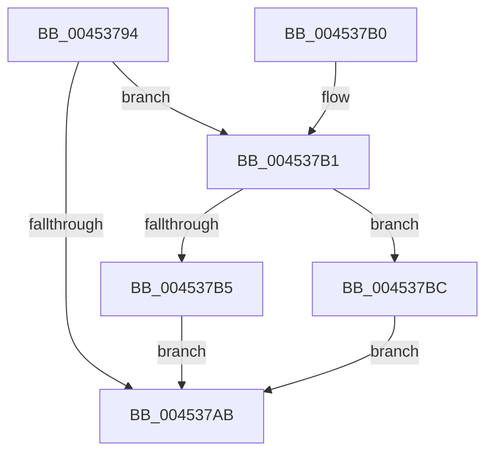

# PopPowerRequestStatsNotifyScenarioStateChange

- RVA: `0x00453794`–`0x004537C3` (길이 `47` bytes)
- VA: `0x0000000140453794`
- 실행 섹션: `.text`
- PDB 이름 있음: `예`; PDB Function 태그: `아니요`
- unwind 정보 RVA: `0x0007A1AC`
- 디코드: `15`개 명령, `47/47` bytes 표시
- 미해석 바이트: `0` (있으면 어셈블리에 `.byte`로 보존)

> 이 문서는 커널 이미지의 기계어와 PDB 기호를 분석해 생성했습니다. 4번과 5번은 함수 원형과 자료형을 바이너리 사용 방식에서 추정한 C 해석이며 원본 소스 복구 결과는 아닙니다.

## 1. Dependencies

- 직접 호출 지점: **2**; 고유 호출 대상: **2**
- 직접 호출자로 확인된 함수: **2**
- RIP 상대 이미지 참조: **1**

### Outgoing calls
- `0x004537B5` → [SleepstudyHelperBlockerActiveDereference](SleepstudyHelperBlockerActiveDereference_function_00453830.md) (function, `0x00453830`)
- `0x004537BC` → [SleepstudyHelperBlockerActiveReference](SleepstudyHelperBlockerActiveReference_function_004538D0.md) (function, `0x004538D0`)

### Direct callers
- [PopPowerRequestNotifyMobileHotspotChanged](../../page/75/PopPowerRequestNotifyMobileHotspotChanged_function_00754BBC.md) at `0x00754BE0`
- [PopWnfAudioCallback](../../page/A4/PopWnfAudioCallback_function_00A4A0E0.md) at `0x00A4A1AC`

### Static image references
- `0x0045379B` → RVA `0x00F07660` (`.data`; read)

## 2. Other-region calls and transfers

- 다른 실행 섹션으로 향하는 call: **0**
- 별도 외부 분기/꼬리 이동을 확인하지 못했습니다.

## 3. Assembly (complete function range)

```asm
00453794  48 83 EC 28                     sub rsp, 0x28
00453798  48 63 C1                        movsxd rax, ecx
0045379B  48 8D 0D BE 3E AB 00            lea rcx, [rip + 0xab3ebe]
004537A2  48 8B 0C C1                     mov rcx, qword ptr [rcx + rax*8]
004537A6  48 85 C9                        test rcx, rcx
004537A9  75 06                           jne 0x1404537b1
004537AB  48 83 C4 28                     add rsp, 0x28
004537AF  C3                              ret
004537B0  CC                              int3
004537B1  84 D2                           test dl, dl
004537B3  75 07                           jne 0x1404537bc
004537B5  E8 76 00 00 00                  call 0x140453830
004537BA  EB EF                           jmp 0x1404537ab
004537BC  E8 0F 01 00 00                  call 0x1404538d0
004537C1  EB E8                           jmp 0x1404537ab
```

## 4. C-style interpretation (structured pseudocode)

```c
__int64 __fastcall PopPowerRequestStatsNotifyScenarioStateChange(int a1, unsigned __int8 a2)
{
    __int64 result;
    __int64 v_rsp;

    v_rsp = (v_rsp) - (40);
    if (*(unsigned __int64 *)(v_rip + 11222718 + (int)(a1) * 8) != 0) goto loc_004537B1;
loc_004537AB:
    v_rsp = (v_rsp) + (40);
    return (int)(a1);
loc_004537B1:
    if (a2 != 0) goto loc_004537BC;
    result = SleepstudyHelperBlockerActiveDereference(*(unsigned __int64 *)(v_rip + 11222718 + (int)(a1) * 8), a2, a3, a4);
    goto loc_004537AB;
loc_004537BC:
    result = SleepstudyHelperBlockerActiveReference(*(unsigned __int64 *)(v_rip + 11222718 + (int)(a1) * 8), a2, a3, a4);
    goto loc_004537AB;
}
```

## 5. (Beta) C Style

```c
int64_t PopPowerRequestStatsNotifyScenarioStateChange(int32_t Arg1, uint8_t Arg2)
{
    int64_t result;
    int64_t local_rsp;

    local_rsp = (local_rsp) - (40);
    if (*(uint64_t *)(v_rip + 0xAB3EBE + (int32_t)(Arg1) * 8) != 0) goto loc_004537B1;
loc_004537AB:
    local_rsp = (local_rsp) + (40);
    return (int32_t)(Arg1);
loc_004537B1:
    if (Arg2 != 0) goto loc_004537BC;
    result = SleepstudyHelperBlockerActiveDereference(*(uint64_t *)(v_rip + 0xAB3EBE + (int32_t)(Arg1) * 8), Arg2, a3, a4);
    goto loc_004537AB;
loc_004537BC:
    result = SleepstudyHelperBlockerActiveReference(*(uint64_t *)(v_rip + 0xAB3EBE + (int32_t)(Arg1) * 8), Arg2, a3, a4);
    goto loc_004537AB;
}
```

## 6. Execution-region graph

[열기: 2D/3D 그래프와 함수 탐색 컨트롤 패널](../../../control-panel.html?section=text&rva=0x00453794&view=graph)

- 2D 그래프는 위에서 아래로 흐르고, 3D 그래프는 빈 공간을 드래그해 회전합니다. Shift+드래그는 이동, 휠은 확대·축소, 함수 노드 선택은 대상 보고서 이동입니다.

### Static fallback


