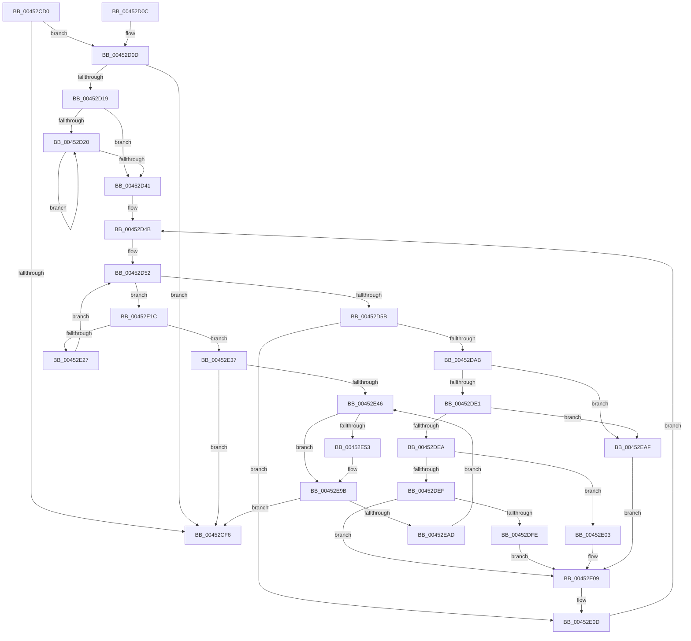

# PpmCheckComputeEnergy

- RVA: `0x00452CD0`–`0x00452EB9` (길이 `489` bytes)
- VA: `0x0000000140452CD0`
- 실행 섹션: `.text`
- PDB 이름 있음: `예`; PDB Function 태그: `아니요`
- unwind 정보 RVA: `0x000A76CC`
- 디코드: `122`개 명령, `489/489` bytes 표시
- 미해석 바이트: `0` (있으면 어셈블리에 `.byte`로 보존)

> 이 문서는 커널 이미지의 기계어와 PDB 기호를 분석해 생성했습니다. 4번과 5번은 함수 원형과 자료형을 바이너리 사용 방식에서 추정한 C 해석이며 원본 소스 복구 결과는 아닙니다.

## 1. Dependencies

- 직접 호출 지점: **4**; 고유 호출 대상: **3**
- 직접 호출자로 확인된 함수: **0**
- RIP 상대 이미지 참조: **5**

### Outgoing calls
- `0x00452D7D` → [KeGetPrcb](../2D/KeGetPrcb_function_002D85D0.md) (function, `0x002D85D0`)
- `0x00452E75` → [guard_dispatch_icall](../6B/guard_dispatch_icall_function_006BAAD0.md) (function, `0x006BAAD0`)
- `0x00452E81` → [PpmEventComputeEnergy](PpmEventComputeEnergy_function_00452EC0.md) (function, `0x00452EC0`)
- `0x00452E8A` → [KeGetPrcb](../2D/KeGetPrcb_function_002D85D0.md) (function, `0x002D85D0`)

### Direct callers
- 이 함수 시작 RVA로 연결되는 직접 call은 확인되지 않았습니다. 간접 호출은 완전히 역산할 수 없습니다.

### Static image references
- `0x00452CE4` → RVA `0x00F0EFD8` (`.data`; read)
- `0x00452D0D` → RVA `0x00F0EFE8` (`.data`; read)
- `0x00452D41` → RVA `0x00FC7128` (`ALMOSTRO`; read)
- `0x00452D4B` → RVA `0x00FC7120` (`ALMOSTRO`; read)
- `0x00452D71` → RVA `0x00F231B8` (`.data`; read)

## 2. Other-region calls and transfers

- 다른 실행 섹션으로 향하는 call: **0**
- 별도 외부 분기/꼬리 이동을 확인하지 못했습니다.

## 3. Assembly (complete function range)

```asm
00452CD0  48 89 5C 24 18                  mov qword ptr [rsp + 0x18], rbx
00452CD5  48 89 6C 24 20                  mov qword ptr [rsp + 0x20], rbp
00452CDA  56                              push rsi
00452CDB  57                              push rdi
00452CDC  41 56                           push r14
00452CDE  48 83 EC 30                     sub rsp, 0x30
00452CE2  33 DB                           xor ebx, ebx
00452CE4  48 39 1D ED C2 AB 00            cmp qword ptr [rip + 0xabc2ed], rbx
00452CEB  48 89 5C 24 58                  mov qword ptr [rsp + 0x58], rbx
00452CF0  44 8D 73 01                     lea r14d, [rbx + 1]
00452CF4  75 17                           jne 0x140452d0d
00452CF6  48 8B 5C 24 60                  mov rbx, qword ptr [rsp + 0x60]
00452CFB  41 8A C6                        mov al, r14b
00452CFE  48 8B 6C 24 68                  mov rbp, qword ptr [rsp + 0x68]
00452D03  48 83 C4 30                     add rsp, 0x30
00452D07  41 5E                           pop r14
00452D09  5F                              pop rdi
00452D0A  5E                              pop rsi
00452D0B  C3                              ret
00452D0C  CC                              int3
00452D0D  48 8B 15 D4 C2 AB 00            mov rdx, qword ptr [rip + 0xabc2d4]
00452D14  48 85 D2                        test rdx, rdx
00452D17  74 DD                           je 0x140452cf6
00452D19  44 8B C3                        mov r8d, ebx
00452D1C  39 1A                           cmp dword ptr [rdx], ebx
00452D1E  76 21                           jbe 0x140452d41
00452D20  41 8B C0                        mov eax, r8d
00452D23  45 03 C6                        add r8d, r14d
00452D26  48 6B C8 38                     imul rcx, rax, 0x38
00452D2A  C7 44 11 0C 40 00 00 00         mov dword ptr [rcx + rdx + 0xc], 0x40
00452D32  48 89 5C 11 10                  mov qword ptr [rcx + rdx + 0x10], rbx
00452D37  48 89 5C 11 18                  mov qword ptr [rcx + rdx + 0x18], rbx
00452D3C  44 3B 02                        cmp r8d, dword ptr [rdx]
00452D3F  72 DF                           jb 0x140452d20
00452D41  48 8B 35 E0 43 B7 00            mov rsi, qword ptr [rip + 0xb743e0]
00452D48  0F B7 FB                        movzx edi, bx
00452D4B  0F B7 0D CE 43 B7 00            movzx ecx, word ptr [rip + 0xb743ce]
00452D52  48 85 F6                        test rsi, rsi
00452D55  0F 84 C1 00 00 00               je 0x140452e1c
00452D5B  48 0F BC D6                     bsf rdx, rsi
00452D5F  0F B7 CF                        movzx ecx, di
00452D62  0F B6 C2                        movzx eax, dl
00452D65  C1 E1 06                        shl ecx, 6
00452D68  48 0F B3 C6                     btr rsi, rax
00452D6C  0F B6 C2                        movzx eax, dl
00452D6F  03 C8                           add ecx, eax
00452D71  48 8B 05 40 04 AD 00            mov rax, qword ptr [rip + 0xad0440]
00452D78  8B 2C 88                        mov ebp, dword ptr [rax + rcx*4]
00452D7B  8B CD                           mov ecx, ebp
00452D7D  E8 4E 58 E8 FF                  call 0x1402d85d0
00452D82  48 8B 15 5F C2 AB 00            mov rdx, qword ptr [rip + 0xabc25f]
00452D89  4C 8B C8                        mov r9, rax
00452D8C  0F B6 80 08 8A 00 00            movzx eax, byte ptr [rax + 0x8a08]
00452D93  8B 0A                           mov ecx, dword ptr [rdx]
00452D95  4D 8D 81 18 8A 00 00            lea r8, [r9 + 0x8a18]
00452D9C  3B C1                           cmp eax, ecx
00452D9E  44 8D 51 FF                     lea r10d, [rcx - 1]
00452DA2  44 0F 42 D0                     cmovb r10d, eax
00452DA6  44 3B D1                        cmp r10d, ecx
00452DA9  73 62                           jae 0x140452e0d
00452DAB  41 8B C2                        mov eax, r10d
00452DAE  48 6B C8 38                     imul rcx, rax, 0x38
00452DB2  89 6C 11 0C                     mov dword ptr [rcx + rdx + 0xc], ebp
00452DB6  49 8B 00                        mov rax, qword ptr [r8]
00452DB9  48 01 44 11 10                  add qword ptr [rcx + rdx + 0x10], rax
00452DBE  49 8B 81 20 8A 00 00            mov rax, qword ptr [r9 + 0x8a20]
00452DC5  48 01 44 11 18                  add qword ptr [rcx + rdx + 0x18], rax
00452DCA  4D 8B 91 B0 89 00 00            mov r10, qword ptr [r9 + 0x89b0]
00452DD1  49 8B 81 B8 89 00 00            mov rax, qword ptr [r9 + 0x89b8]
00452DD8  4D 85 D2                        test r10, r10
00452DDB  0F 84 CE 00 00 00               je 0x140452eaf
00452DE1  48 85 C0                        test rax, rax
00452DE4  0F 84 C5 00 00 00               je 0x140452eaf
00452DEA  38 58 70                        cmp byte ptr [rax + 0x70], bl
00452DED  75 14                           jne 0x140452e03
00452DEF  8B 40 50                        mov eax, dword ptr [rax + 0x50]
00452DF2  45 8B 92 10 02 00 00            mov r10d, dword ptr [r10 + 0x210]
00452DF9  41 3B C2                        cmp eax, r10d
00452DFC  72 0B                           jb 0x140452e09
00452DFE  41 8B C2                        mov eax, r10d
00452E01  EB 06                           jmp 0x140452e09
00452E03  8B 80 84 00 00 00               mov eax, dword ptr [rax + 0x84]
00452E09  89 44 11 08                     mov dword ptr [rcx + rdx + 8], eax
00452E0D  49 89 18                        mov qword ptr [r8], rbx
00452E10  49 89 99 20 8A 00 00            mov qword ptr [r9 + 0x8a20], rbx
00452E17  E9 2F FF FF FF                  jmp 0x140452d4b
00452E1C  66 41 03 FE                     add di, r14w
00452E20  0F B7 FF                        movzx edi, di
00452E23  3B F9                           cmp edi, ecx
00452E25  73 10                           jae 0x140452e37
00452E27  48 8D 35 FA 42 B7 00            lea rsi, [rip + 0xb742fa]
00452E2E  48 8B 34 FE                     mov rsi, qword ptr [rsi + rdi*8]
00452E32  E9 1B FF FF FF                  jmp 0x140452d52
00452E37  48 8B 3D AA C1 AB 00            mov rdi, qword ptr [rip + 0xabc1aa]
00452E3E  39 1F                           cmp dword ptr [rdi], ebx
00452E40  0F 86 B0 FE FF FF               jbe 0x140452cf6
00452E46  8B C3                           mov eax, ebx
00452E48  48 6B F0 38                     imul rsi, rax, 0x38
00452E4C  83 7C 3E 0C 40                  cmp dword ptr [rsi + rdi + 0xc], 0x40
00452E51  74 48                           je 0x140452e9b
00452E53  48 8B 05 7E C1 AB 00            mov rax, qword ptr [rip + 0xabc17e]
00452E5A  48 8D 4C 24 58                  lea rcx, [rsp + 0x58]
00452E5F  44 8B 4C 3E 08                  mov r9d, dword ptr [rsi + rdi + 8]
00452E64  4C 8B 44 3E 18                  mov r8, qword ptr [rsi + rdi + 0x18]
00452E69  48 8B 54 3E 10                  mov rdx, qword ptr [rsi + rdi + 0x10]
00452E6E  48 89 4C 24 20                  mov qword ptr [rsp + 0x20], rcx
00452E73  8B CB                           mov ecx, ebx
00452E75  E8 56 7C 26 00                  call 0x1406baad0
00452E7A  48 8B 54 24 58                  mov rdx, qword ptr [rsp + 0x58]
00452E7F  8B CB                           mov ecx, ebx
00452E81  E8 3A 00 00 00                  call 0x140452ec0
00452E86  8B 4C 3E 0C                     mov ecx, dword ptr [rsi + rdi + 0xc]
00452E8A  E8 41 57 E8 FF                  call 0x1402d85d0
00452E8F  48 8B 4C 24 58                  mov rcx, qword ptr [rsp + 0x58]
00452E94  48 01 88 10 8A 00 00            add qword ptr [rax + 0x8a10], rcx
00452E9B  48 8B 3D 46 C1 AB 00            mov rdi, qword ptr [rip + 0xabc146]
00452EA2  41 03 DE                        add ebx, r14d
00452EA5  3B 1F                           cmp ebx, dword ptr [rdi]
00452EA7  0F 83 49 FE FF FF               jae 0x140452cf6
00452EAD  EB 97                           jmp 0x140452e46
00452EAF  B8 64 00 00 00                  mov eax, 0x64
00452EB4  E9 50 FF FF FF                  jmp 0x140452e09
```

## 4. C-style interpretation (structured pseudocode)

```c
__int64 __fastcall PpmCheckComputeEnergy(void)
{
    __int64 result;
    __int64 v_r10;
    __int64 v_rbx;
    __int64 v_rdi;
    __int64 v_rsi;
    __int64 v_rsp;
    unsigned __int64 v_stack_p10;
    unsigned __int64 v_stack_p18;
    unsigned __int64 v_stack_p20;
    unsigned __int64 v_stack_p58;

    v_stack_p18 = v_rbx;
    v_stack_p20 = v_rbp;
    v_rsp = (v_rsp) - (48);
    v_rbx = 0;
    v_stack_p10 = 0;
    if ((*(unsigned __int64 *)(v_rip + 11256557)) != 0) goto loc_00452D0D;
loc_00452CF6:
    v_rsp = (v_rsp) + (48);
    return (unsigned __int8)(v_rbx + 1);
loc_00452D0D:
    if (*(unsigned __int64 *)(v_rip + 11256532) == 0) goto loc_00452CF6;
    if ((*(unsigned int *)(*(unsigned __int64 *)(v_rip + 11256532))) <= ((unsigned int)(v_stack_p18))) goto loc_00452D41;
loc_00452D20:
    a3 = (unsigned int)(((unsigned int)((unsigned int)(v_stack_p18))) + ((unsigned int)(v_rbx + 1)));
    a1 = (a1) * ((unsigned int)((unsigned int)((unsigned int)((unsigned int)(v_stack_p18)))));
    *(unsigned int *)(a1 + *(unsigned __int64 *)(v_rip + 11256532) * 1 + 12) = 64;
    *(unsigned __int64 *)(a1 + *(unsigned __int64 *)(v_rip + 11256532) * 1 + 16) = v_stack_p18;
    *(unsigned __int64 *)(a1 + *(unsigned __int64 *)(v_rip + 11256532) * 1 + 24) = v_stack_p18;
    if (((unsigned int)(a3)) < (*(unsigned int *)(*(unsigned __int64 *)(v_rip + 11256532)))) goto loc_00452D20;
loc_00452D41:
loc_00452D4B:
loc_00452D52:
    if (*(unsigned __int64 *)(v_rip + 12010464) == 0) goto loc_00452E1C;
    a1 = (unsigned int)(((unsigned __int16)((unsigned __int16)(v_stack_p18))) << (6));
    a1 = (unsigned int)((a1) + ((unsigned int)((unsigned __int8)(*(unsigned __int64 *)(v_rip + 11256532)))));
    result = KeGetPrcb((unsigned int)((unsigned int)((unsigned int)(*(unsigned int *)(*(unsigned __int64 *)(v_rip + 11338816) + a1 * 4)))), *(unsigned __int64 *)(v_rip + 11256532), a3, a4);
    v_r10 = (unsigned int)(*(unsigned int *)(*(unsigned __int64 *)(v_rip + 11256415))) - 1;
    if (((unsigned int)(*(unsigned __int8 *)(result + 35336))) < ((unsigned int)((unsigned int)(*(unsigned int *)(*(unsigned __int64 *)(v_rip + 11256415)))))) { v_r10 = (unsigned int)(*(unsigned __int8 *)(result + 35336)); }
    if (((unsigned int)(v_r10)) >= ((unsigned int)((unsigned int)(*(unsigned int *)(*(unsigned __int64 *)(v_rip + 11256415)))))) goto loc_00452E0D;
    a1 = ((unsigned int)(*(unsigned int *)(*(unsigned __int64 *)(v_rip + 11256415)))) * ((unsigned int)((unsigned int)(v_r10)));
    *(unsigned int *)(a1 + *(unsigned __int64 *)(v_rip + 11256415) * 1 + 12) = (unsigned int)((unsigned int)(*(unsigned int *)(*(unsigned __int64 *)(v_rip + 11338816) + a1 * 4)));
    if (*(unsigned __int64 *)(result + 35248) == 0) goto loc_00452EAF;
    if (*(unsigned __int64 *)(result + 35256) == 0) goto loc_00452EAF;
    if ((*(unsigned __int8 *)(*(unsigned __int64 *)(result + 35256) + 112)) != ((unsigned __int8)(v_stack_p18))) goto loc_00452E03;
    if (((unsigned int)((unsigned int)(*(unsigned int *)(*(unsigned __int64 *)(result + 35256) + 80)))) < ((unsigned int)((unsigned int)(*(unsigned int *)(*(unsigned __int64 *)(result + 35248) + 528))))) goto loc_00452E09;
    goto loc_00452E09;
loc_00452E03:
loc_00452E09:
    *(unsigned int *)(a1 + *(unsigned __int64 *)(v_rip + 11256415) * 1 + 8) = (unsigned int)((unsigned int)(*(unsigned int *)((unsigned int)((unsigned int)((unsigned int)(*(unsigned int *)(*(unsigned __int64 *)(result + 35248) + 528)))) + 132)));
loc_00452E0D:
    *(unsigned __int64 *)(result + 35352) = v_stack_p18;
    *(unsigned __int64 *)(result + 35360) = v_stack_p18;
    goto loc_00452D4B;
loc_00452E1C:
    v_rdi = (unsigned __int16)(((unsigned __int16)(v_stack_p18)) + ((unsigned __int16)(v_rbx + 1)));
    if (((unsigned int)((unsigned __int16)(v_rdi))) >= ((unsigned int)(a1))) goto loc_00452E37;
    goto loc_00452D52;
loc_00452E37:
    if ((*(unsigned int *)(*(unsigned __int64 *)(v_rip + 11256234))) <= ((unsigned int)(v_stack_p18))) goto loc_00452CF6;
loc_00452E46:
    v_rsi = (*(unsigned __int64 *)(v_rip + 12010234 + (unsigned __int16)(v_rdi) * 8)) * ((unsigned int)((unsigned int)(v_stack_p18)));
    result = (unsigned int)((unsigned int)(v_stack_p18));
    if ((*(unsigned int *)(v_rsi + *(unsigned __int64 *)(v_rip + 11256234) * 1 + 12)) != 64) {
        result = *(unsigned __int64 *)(v_rip + 11256190);
        a1 = v_stack_p58;
        a4 = *(unsigned int *)(v_rsi + *(unsigned __int64 *)(v_rip + 11256234) * 1 + 8);
        a3 = *(unsigned __int64 *)(v_rsi + *(unsigned __int64 *)(v_rip + 11256234) * 1 + 24);
        a2 = *(unsigned __int64 *)(v_rsi + *(unsigned __int64 *)(v_rip + 11256234) * 1 + 16);
        v_stack_p20 = a1;
        a1 = (unsigned int)(v_stack_p18);
        result = guard_dispatch_icall(a1, a2, a3, a4);
        a2 = v_stack_p58;
        a1 = (unsigned int)(v_stack_p18);
        result = PpmEventComputeEnergy(a1, a2, a3, a4);
        a1 = *(unsigned int *)(v_rsi + *(unsigned __int64 *)(v_rip + 11256234) * 1 + 12);
        result = KeGetPrcb(a1, a2, a3, a4);
        a1 = v_stack_p58;
    }
    v_rbx = (unsigned int)((v_stack_p18) + ((unsigned int)(v_rbx + 1)));
    if (((unsigned int)(v_rbx)) >= (*(unsigned int *)(*(unsigned __int64 *)(v_rip + 11256134)))) goto loc_00452CF6;
    goto loc_00452E46;
loc_00452EAF:
    goto loc_00452E09;
}
```

## 5. (Beta) C Style

```c
void PpmCheckComputeEnergy(void)
{
    int64_t result;
    int64_t local_r10;
    int64_t local_rbx;
    int64_t local_rdi;
    int64_t local_rsi;
    int64_t local_rsp;
    uint64_t v_stack_p10;
    uint64_t v_stack_p18;
    uint64_t v_stack_p20;
    uint64_t v_stack_p58;

    v_stack_p18 = local_rbx;
    v_stack_p20 = local_rbp;
    local_rsp = (local_rsp) - (48);
    local_rbx = 0;
    v_stack_p10 = 0;
    if ((*(uint64_t *)(v_rip + 0xABC2ED)) != 0) goto loc_00452D0D;
loc_00452CF6:
    local_rsp = (local_rsp) + (48);
    return (uint8_t)(local_rbx + 1);
loc_00452D0D:
    if (*(uint64_t *)(v_rip + 0xABC2D4) == 0) goto loc_00452CF6;
    if ((*(uint32_t *)(*(uint64_t *)(v_rip + 0xABC2D4))) <= ((uint32_t)(v_stack_p18))) goto loc_00452D41;
loc_00452D20:
    a3 = (uint32_t)(((uint32_t)((uint32_t)(v_stack_p18))) + ((uint32_t)(local_rbx + 1)));
    a1 = (a1) * ((uint32_t)((uint32_t)((uint32_t)((uint32_t)(v_stack_p18)))));
    *(uint32_t *)(a1 + *(uint64_t *)(v_rip + 0xABC2D4) * 1 + 0xC) = 64;
    *(uint64_t *)(a1 + *(uint64_t *)(v_rip + 0xABC2D4) * 1 + 0x10) = v_stack_p18;
    *(uint64_t *)(a1 + *(uint64_t *)(v_rip + 0xABC2D4) * 1 + 0x18) = v_stack_p18;
    if (((uint32_t)(a3)) < (*(uint32_t *)(*(uint64_t *)(v_rip + 0xABC2D4)))) goto loc_00452D20;
loc_00452D41:
loc_00452D4B:
loc_00452D52:
    if (*(uint64_t *)(v_rip + 0xB743E0) == 0) goto loc_00452E1C;
    a1 = (uint32_t)(((uint16_t)((uint16_t)(v_stack_p18))) << (6));
    a1 = (uint32_t)((a1) + ((uint32_t)((uint8_t)(*(uint64_t *)(v_rip + 0xABC2D4)))));
    result = KeGetPrcb((uint32_t)((uint32_t)((uint32_t)(*(uint32_t *)(*(uint64_t *)(v_rip + 0xAD0440) + a1 * 4)))), *(uint64_t *)(v_rip + 0xABC2D4), a3, a4);
    local_r10 = (uint32_t)(*(uint32_t *)(*(uint64_t *)(v_rip + 0xABC25F))) - 1;
    if (((uint32_t)(*(uint8_t *)(result + 0x8A08))) < ((uint32_t)((uint32_t)(*(uint32_t *)(*(uint64_t *)(v_rip + 0xABC25F)))))) { local_r10 = (uint32_t)(*(uint8_t *)(result + 0x8A08)); }
    if (((uint32_t)(local_r10)) >= ((uint32_t)((uint32_t)(*(uint32_t *)(*(uint64_t *)(v_rip + 0xABC25F)))))) goto loc_00452E0D;
    a1 = ((uint32_t)(*(uint32_t *)(*(uint64_t *)(v_rip + 0xABC25F)))) * ((uint32_t)((uint32_t)(local_r10)));
    *(uint32_t *)(a1 + *(uint64_t *)(v_rip + 0xABC25F) * 1 + 0xC) = (uint32_t)((uint32_t)(*(uint32_t *)(*(uint64_t *)(v_rip + 0xAD0440) + a1 * 4)));
    if (*(uint64_t *)(result + 0x89B0) == 0) goto loc_00452EAF;
    if (*(uint64_t *)(result + 0x89B8) == 0) goto loc_00452EAF;
    if ((*(uint8_t *)(*(uint64_t *)(result + 0x89B8) + 0x70)) != ((uint8_t)(v_stack_p18))) goto loc_00452E03;
    if (((uint32_t)((uint32_t)(*(uint32_t *)(*(uint64_t *)(result + 0x89B8) + 0x50)))) < ((uint32_t)((uint32_t)(*(uint32_t *)(*(uint64_t *)(result + 0x89B0) + 0x210))))) goto loc_00452E09;
    goto loc_00452E09;
loc_00452E03:
loc_00452E09:
    *(uint32_t *)(a1 + *(uint64_t *)(v_rip + 0xABC25F) * 1 + 0x8) = (uint32_t)((uint32_t)(*(uint32_t *)((uint32_t)((uint32_t)((uint32_t)(*(uint32_t *)(*(uint64_t *)(result + 0x89B0) + 0x210)))) + 0x84)));
loc_00452E0D:
    *(uint64_t *)(result + 0x8A18) = v_stack_p18;
    *(uint64_t *)(result + 0x8A20) = v_stack_p18;
    goto loc_00452D4B;
loc_00452E1C:
    local_rdi = (uint16_t)(((uint16_t)(v_stack_p18)) + ((uint16_t)(local_rbx + 1)));
    if (((uint32_t)((uint16_t)(local_rdi))) >= ((uint32_t)(a1))) goto loc_00452E37;
    goto loc_00452D52;
loc_00452E37:
    if ((*(uint32_t *)(*(uint64_t *)(v_rip + 0xABC1AA))) <= ((uint32_t)(v_stack_p18))) goto loc_00452CF6;
loc_00452E46:
    local_rsi = (*(uint64_t *)(v_rip + 0xB742FA + (uint16_t)(local_rdi) * 8)) * ((uint32_t)((uint32_t)(v_stack_p18)));
    result = (uint32_t)((uint32_t)(v_stack_p18));
    if ((*(uint32_t *)(local_rsi + *(uint64_t *)(v_rip + 0xABC1AA) * 1 + 0xC)) != 64) {
        result = *(uint64_t *)(v_rip + 0xABC17E);
        a1 = v_stack_p58;
        a4 = *(uint32_t *)(local_rsi + *(uint64_t *)(v_rip + 0xABC1AA) * 1 + 0x8);
        a3 = *(uint64_t *)(local_rsi + *(uint64_t *)(v_rip + 0xABC1AA) * 1 + 0x18);
        a2 = *(uint64_t *)(local_rsi + *(uint64_t *)(v_rip + 0xABC1AA) * 1 + 0x10);
        v_stack_p20 = a1;
        a1 = (uint32_t)(v_stack_p18);
        result = guard_dispatch_icall(a1, a2, a3, a4);
        a2 = v_stack_p58;
        a1 = (uint32_t)(v_stack_p18);
        result = PpmEventComputeEnergy(a1, a2, a3, a4);
        a1 = *(uint32_t *)(local_rsi + *(uint64_t *)(v_rip + 0xABC1AA) * 1 + 0xC);
        result = KeGetPrcb(a1, a2, a3, a4);
        a1 = v_stack_p58;
    }
    local_rbx = (uint32_t)((v_stack_p18) + ((uint32_t)(local_rbx + 1)));
    if (((uint32_t)(local_rbx)) >= (*(uint32_t *)(*(uint64_t *)(v_rip + 0xABC146)))) goto loc_00452CF6;
    goto loc_00452E46;
loc_00452EAF:
    goto loc_00452E09;
}
```

## 6. Execution-region graph

[열기: 2D/3D 그래프와 함수 탐색 컨트롤 패널](../../../control-panel.html?section=text&rva=0x00452CD0&view=graph)

- 2D 그래프는 위에서 아래로 흐르고, 3D 그래프는 빈 공간을 드래그해 회전합니다. Shift+드래그는 이동, 휠은 확대·축소, 함수 노드 선택은 대상 보고서 이동입니다.

### Static fallback


