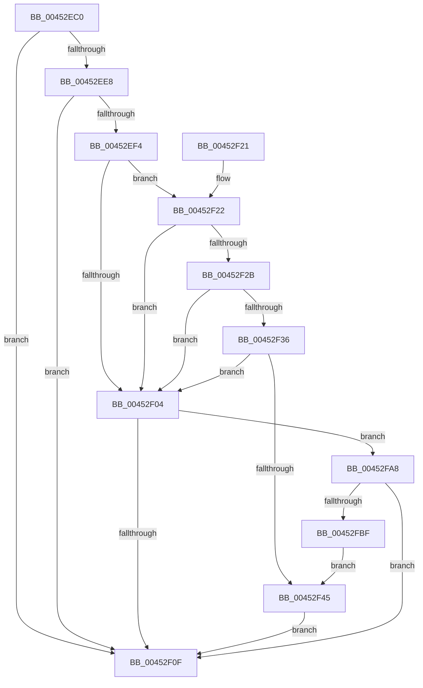

# PpmEventComputeEnergy

- RVA: `0x00452EC0`–`0x00452FC1` (길이 `257` bytes)
- VA: `0x0000000140452EC0`
- 실행 섹션: `.text`
- PDB 이름 있음: `예`; PDB Function 태그: `아니요`
- unwind 정보 RVA: `0x000A76E4`
- 디코드: `60`개 명령, `257/257` bytes 표시
- 미해석 바이트: `0` (있으면 어셈블리에 `.byte`로 보존)

> 이 문서는 커널 이미지의 기계어와 PDB 기호를 분석해 생성했습니다. 4번과 5번은 함수 원형과 자료형을 바이너리 사용 방식에서 추정한 C 해석이며 원본 소스 복구 결과는 아닙니다.

## 1. Dependencies

- 직접 호출 지점: **3**; 고유 호출 대상: **3**
- 직접 호출자로 확인된 함수: **1**
- RIP 상대 이미지 참조: **4**

### Outgoing calls
- `0x00452F17` → [_security_check_cookie](../6A/_security_check_cookie_function_006AC640.md) (function, `0x006AC640`)
- `0x00452F9E` → [EtwWriteEx](../25/EtwWriteEx_function_0025F0D0.md) (function, `0x0025F0D0`)
- `0x00452FB2` → [EtwpLevelKeywordEnabled](../2F/EtwpLevelKeywordEnabled_function_002FD110.md) (function, `0x002FD110`)

### Direct callers
- [PpmCheckComputeEnergy](PpmCheckComputeEnergy_function_00452CD0.md) at `0x00452E81`

### Static image references
- `0x00452ECD` → RVA `0x00E0A740` (`.data`; read)
- `0x00452EDF` → RVA `0x00E67A39` (`.data`; read)
- `0x00452EE8` → RVA `0x00F083E8` (`.data`; read)
- `0x00452F59` → RVA `0x00014A10` (`.rdata`; read)

## 2. Other-region calls and transfers

- 다른 실행 섹션으로 향하는 call: **0**
- 별도 외부 분기/꼬리 이동을 확인하지 못했습니다.

## 3. Assembly (complete function range)

```asm
00452EC0  48 89 54 24 10                  mov qword ptr [rsp + 0x10], rdx
00452EC5  89 4C 24 08                     mov dword ptr [rsp + 8], ecx
00452EC9  48 83 EC 78                     sub rsp, 0x78
00452ECD  48 8B 05 6C 78 9B 00            mov rax, qword ptr [rip + 0x9b786c]
00452ED4  48 33 C4                        xor rax, rsp
00452ED7  48 89 44 24 68                  mov qword ptr [rsp + 0x68], rax
00452EDC  45 33 C9                        xor r9d, r9d
00452EDF  44 38 0D 53 4B A1 00            cmp byte ptr [rip + 0xa14b53], r9b
00452EE6  74 27                           je 0x140452f0f
00452EE8  48 8B 15 F9 54 AB 00            mov rdx, qword ptr [rip + 0xab54f9]
00452EEF  48 85 D2                        test rdx, rdx
00452EF2  74 1B                           je 0x140452f0f
00452EF4  48 8B 4A 20                     mov rcx, qword ptr [rdx + 0x20]
00452EF8  41 B8 00 01 00 00               mov r8d, 0x100
00452EFE  44 39 49 60                     cmp dword ptr [rcx + 0x60], r9d
00452F02  75 1E                           jne 0x140452f22
00452F04  66 44 39 4A 66                  cmp word ptr [rdx + 0x66], r9w
00452F09  0F 85 99 00 00 00               jne 0x140452fa8
00452F0F  48 8B 4C 24 68                  mov rcx, qword ptr [rsp + 0x68]
00452F14  48 33 CC                        xor rcx, rsp
00452F17  E8 24 97 25 00                  call 0x1406ac640
00452F1C  48 83 C4 78                     add rsp, 0x78
00452F20  C3                              ret
00452F21  CC                              int3
00452F22  8A 41 64                        mov al, byte ptr [rcx + 0x64]
00452F25  FE C8                           dec al
00452F27  3C 02                           cmp al, 2
00452F29  76 D9                           jbe 0x140452f04
00452F2B  8B 41 68                        mov eax, dword ptr [rcx + 0x68]
00452F2E  8B 41 70                        mov eax, dword ptr [rcx + 0x70]
00452F31  49 85 C0                        test r8, rax
00452F34  74 CE                           je 0x140452f04
00452F36  48 8B 49 78                     mov rcx, qword ptr [rcx + 0x78]
00452F3A  48 8B C1                        mov rax, rcx
00452F3D  49 23 C0                        and rax, r8
00452F40  48 3B C1                        cmp rax, rcx
00452F43  75 BF                           jne 0x140452f04
00452F45  48 8B 0D 9C 54 AB 00            mov rcx, qword ptr [rip + 0xab549c]
00452F4C  48 8D 84 24 80 00 00 00         lea rax, [rsp + 0x80]
00452F54  48 89 44 24 48                  mov qword ptr [rsp + 0x48], rax
00452F59  48 8D 15 B0 1A BC FF            lea rdx, [rip - 0x43e550]
00452F60  48 8D 84 24 88 00 00 00         lea rax, [rsp + 0x88]
00452F68  48 C7 44 24 50 04 00 00 00      mov qword ptr [rsp + 0x50], 4
00452F71  48 89 44 24 58                  mov qword ptr [rsp + 0x58], rax
00452F76  45 33 C0                        xor r8d, r8d
00452F79  48 8D 44 24 48                  lea rax, [rsp + 0x48]
00452F7E  48 C7 44 24 60 08 00 00 00      mov qword ptr [rsp + 0x60], 8
00452F87  48 89 44 24 38                  mov qword ptr [rsp + 0x38], rax
00452F8C  C7 44 24 30 02 00 00 00         mov dword ptr [rsp + 0x30], 2
00452F94  4C 89 4C 24 28                  mov qword ptr [rsp + 0x28], r9
00452F99  4C 89 4C 24 20                  mov qword ptr [rsp + 0x20], r9
00452F9E  E8 2D C1 E0 FF                  call 0x14025f0d0
00452FA3  E9 67 FF FF FF                  jmp 0x140452f0f
00452FA8  48 8B 4A 28                     mov rcx, qword ptr [rdx + 0x28]
00452FAC  B2 04                           mov dl, 4
00452FAE  48 83 C1 60                     add rcx, 0x60
00452FB2  E8 59 A1 EA FF                  call 0x1402fd110
00452FB7  84 C0                           test al, al
00452FB9  0F 84 50 FF FF FF               je 0x140452f0f
00452FBF  EB 84                           jmp 0x140452f45
```

## 4. C-style interpretation (structured pseudocode)

```c
__int64 __fastcall PpmEventComputeEnergy(int a1, __int64 a2, __int64 a3, int a4)
{
    __int64 result;
    __int64 v_rsp;
    unsigned __int64 v_stack_m10;
    unsigned __int64 v_stack_p10;
    unsigned __int64 v_stack_p20;
    unsigned __int64 v_stack_p28;
    unsigned int v_stack_p30;
    unsigned __int64 v_stack_p38;
    unsigned __int64 v_stack_p48;
    unsigned __int64 v_stack_p50;
    unsigned __int64 v_stack_p58;
    unsigned __int64 v_stack_p60;
    unsigned int v_stack_p8;
    unsigned __int64 v_stack_p80;
    unsigned __int64 v_stack_p88;

    v_stack_p10 = a2;
    v_stack_p8 = a1;
    v_rsp = (v_rsp) - (120);
    result = (*(unsigned __int64 *)(v_rip + 10188908)) ^ (v_rsp);
    v_stack_m10 = result;
    a4 = 0;
    if ((*(unsigned __int8 *)(v_rip + 10570579)) == 0) goto loc_00452F0F;
    if (*(unsigned __int64 *)(v_rip + 11228409) == 0) goto loc_00452F0F;
    if ((*(unsigned int *)(*(unsigned __int64 *)(*(unsigned __int64 *)(v_rip + 11228409) + 32) + 96)) != 0) goto loc_00452F22;
loc_00452F04:
    if ((*(unsigned __int16 *)(*(unsigned __int64 *)(v_rip + 11228409) + 102)) != 0) goto loc_00452FA8;
loc_00452F0F:
    a1 = (v_stack_m10) ^ (v_rsp);
    result = _security_check_cookie(a1, *(unsigned __int64 *)(v_rip + 11228409), 256, a4);
    v_rsp = (v_rsp) + (120);
    return result;
loc_00452F22:
    result = (unsigned __int8)((*(unsigned __int8 *)(a1 + 100)) - 1);
    if (((unsigned __int8)(result)) <= 2) goto loc_00452F04;
    if (((256) & ((unsigned int)(*(unsigned int *)(a1 + 112)))) == 0) goto loc_00452F04;
    result = (*(unsigned __int64 *)(a1 + 120)) & (256);
    if (result != (*(unsigned __int64 *)(a1 + 120))) goto loc_00452F04;
loc_00452F45:
    v_stack_p48 = v_stack_p80;
    v_stack_p50 = 4;
    v_stack_p58 = v_stack_p88;
    a3 = 0;
    v_stack_p60 = 8;
    v_stack_p38 = v_stack_p48;
    v_stack_p30 = 2;
    v_stack_p28 = 0;
    v_stack_p20 = 0;
    result = EtwWriteEx(*(unsigned __int64 *)(v_rip + 11228316), v_rip - 4449616, a3, a4);
    goto loc_00452F0F;
loc_00452FA8:
    a1 = (*(unsigned __int64 *)(v_rip - 4449616 + 40)) + (96);
    result = EtwpLevelKeywordEnabled(a1, 4, a3, a4);
    if ((unsigned __int8)(result) == 0) goto loc_00452F0F;
    goto loc_00452F45;
}
```

## 5. (Beta) C Style

```c
int64_t PpmEventComputeEnergy(int32_t Arg1, int64_t Arg2, int64_t Arg3, int32_t Arg4)
{
    int64_t result;
    int64_t local_rsp;
    uint64_t v_stack_m10;
    uint64_t v_stack_p10;
    uint64_t v_stack_p20;
    uint64_t v_stack_p28;
    uint32_t v_stack_p30;
    uint64_t v_stack_p38;
    uint64_t v_stack_p48;
    uint64_t v_stack_p50;
    uint64_t v_stack_p58;
    uint64_t v_stack_p60;
    uint32_t v_stack_p8;
    uint64_t v_stack_p80;
    uint64_t v_stack_p88;

    v_stack_p10 = Arg2;
    v_stack_p8 = Arg1;
    local_rsp = (local_rsp) - (120);
    result = (*(uint64_t *)(v_rip + 0x9B786C)) ^ (local_rsp);
    v_stack_m10 = result;
    Arg4 = 0;
    if ((*(uint8_t *)(v_rip + 0xA14B53)) == 0) goto loc_00452F0F;
    if (*(uint64_t *)(v_rip + 0xAB54F9) == 0) goto loc_00452F0F;
    if ((*(uint32_t *)(*(uint64_t *)(*(uint64_t *)(v_rip + 0xAB54F9) + 0x20) + 0x60)) != 0) goto loc_00452F22;
loc_00452F04:
    if ((*(uint16_t *)(*(uint64_t *)(v_rip + 0xAB54F9) + 0x66)) != 0) goto loc_00452FA8;
loc_00452F0F:
    Arg1 = (v_stack_m10) ^ (local_rsp);
    result = _security_check_cookie(Arg1, *(uint64_t *)(v_rip + 0xAB54F9), 256, Arg4);
    local_rsp = (local_rsp) + (120);
    return result;
loc_00452F22:
    result = (uint8_t)((*(uint8_t *)(Arg1 + 0x64)) - 1);
    if (((uint8_t)(result)) <= 2) goto loc_00452F04;
    if (((256) & ((uint32_t)(*(uint32_t *)(Arg1 + 0x70)))) == 0) goto loc_00452F04;
    result = (*(uint64_t *)(Arg1 + 0x78)) & (256);
    if (result != (*(uint64_t *)(Arg1 + 0x78))) goto loc_00452F04;
loc_00452F45:
    v_stack_p48 = v_stack_p80;
    v_stack_p50 = 4;
    v_stack_p58 = v_stack_p88;
    Arg3 = 0;
    v_stack_p60 = 8;
    v_stack_p38 = v_stack_p48;
    v_stack_p30 = 2;
    v_stack_p28 = 0;
    v_stack_p20 = 0;
    result = EtwWriteEx(*(uint64_t *)(v_rip + 0xAB549C), v_rip - 4449616, Arg3, Arg4);
    goto loc_00452F0F;
loc_00452FA8:
    Arg1 = (*(uint64_t *)(v_rip - 0x43E550 + 0x28)) + (96);
    result = EtwpLevelKeywordEnabled(Arg1, 4, Arg3, Arg4);
    if ((uint8_t)(result) == 0) goto loc_00452F0F;
    goto loc_00452F45;
}
```

## 6. Execution-region graph

[열기: 2D/3D 그래프와 함수 탐색 컨트롤 패널](../../../control-panel.html?section=text&rva=0x00452EC0&view=graph)

- 2D 그래프는 위에서 아래로 흐르고, 3D 그래프는 빈 공간을 드래그해 회전합니다. Shift+드래그는 이동, 휠은 확대·축소, 함수 노드 선택은 대상 보고서 이동입니다.

### Static fallback


