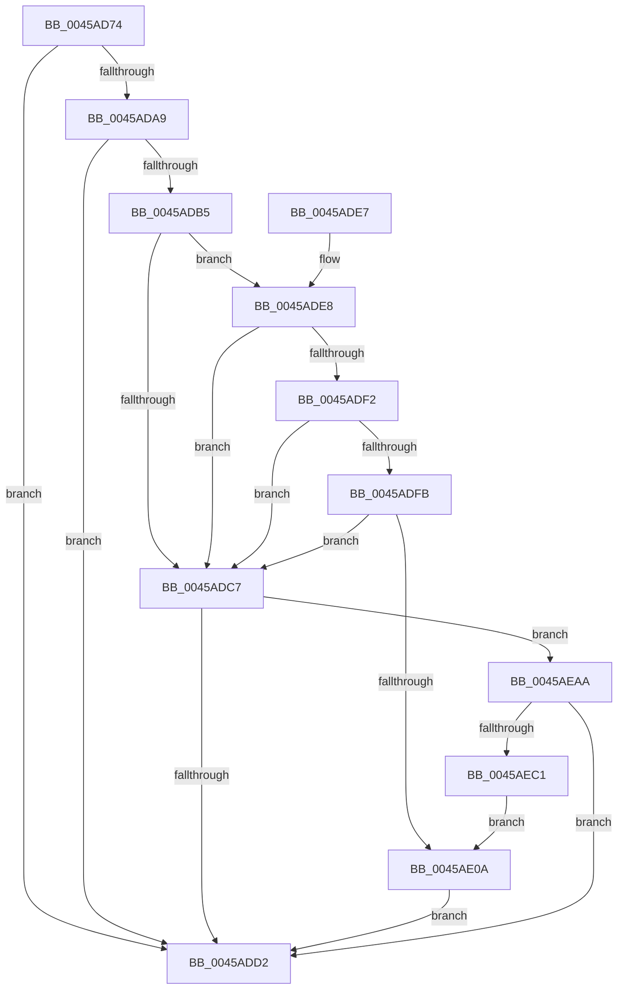

# PpmEventParkNodeRecordedStats

- RVA: `0x0045AD74`–`0x0045AEC6` (길이 `338` bytes)
- VA: `0x000000014045AD74`
- 실행 섹션: `.text`
- PDB 이름 있음: `예`; PDB Function 태그: `아니요`
- unwind 정보 RVA: `0x000A90B0`
- 디코드: `85`개 명령, `338/338` bytes 표시
- 미해석 바이트: `0` (있으면 어셈블리에 `.byte`로 보존)

> 이 문서는 커널 이미지의 기계어와 PDB 기호를 분석해 생성했습니다. 4번과 5번은 함수 원형과 자료형을 바이너리 사용 방식에서 추정한 C 해석이며 원본 소스 복구 결과는 아닙니다.

## 1. Dependencies

- 직접 호출 지점: **3**; 고유 호출 대상: **3**
- 직접 호출자로 확인된 함수: **1**
- RIP 상대 이미지 참조: **4**

### Outgoing calls
- `0x0045ADD9` → [_security_check_cookie](../6A/_security_check_cookie_function_006AC640.md) (function, `0x006AC640`)
- `0x0045AEA0` → [EtwWriteEx](../25/EtwWriteEx_function_0025F0D0.md) (function, `0x0025F0D0`)
- `0x0045AEB4` → [EtwpLevelKeywordEnabled](../2F/EtwpLevelKeywordEnabled_function_002FD110.md) (function, `0x002FD110`)

### Direct callers
- [PpmParkRecordNodeStatistics](../40/PpmParkRecordNodeStatistics_function_0040B02C.md) at `0x0040B17A`

### Static image references
- `0x0045AD8F` → RVA `0x00E0A740` (`.data`; read)
- `0x0045ADA0` → RVA `0x00E67A39` (`.data`; read)
- `0x0045ADA9` → RVA `0x00F083E8` (`.data`; read)
- `0x0045AE6F` → RVA `0x00019908` (`.rdata`; read)

## 2. Other-region calls and transfers

- 다른 실행 섹션으로 향하는 call: **0**
- 별도 외부 분기/꼬리 이동을 확인하지 못했습니다.

## 3. Assembly (complete function range)

```asm
0045AD74  48 8B C4                        mov rax, rsp
0045AD77  44 88 40 18                     mov byte ptr [rax + 0x18], r8b
0045AD7B  48 89 50 10                     mov qword ptr [rax + 0x10], rdx
0045AD7F  66 89 48 08                     mov word ptr [rax + 8], cx
0045AD83  55                              push rbp
0045AD84  48 8D 68 A9                     lea rbp, [rax - 0x57]
0045AD88  48 81 EC D0 00 00 00            sub rsp, 0xd0
0045AD8F  48 8B 05 AA F9 9A 00            mov rax, qword ptr [rip + 0x9af9aa]
0045AD96  48 33 C4                        xor rax, rsp
0045AD99  48 89 45 3F                     mov qword ptr [rbp + 0x3f], rax
0045AD9D  45 33 D2                        xor r10d, r10d
0045ADA0  44 38 15 92 CC A0 00            cmp byte ptr [rip + 0xa0cc92], r10b
0045ADA7  74 29                           je 0x14045add2
0045ADA9  48 8B 15 38 D6 AA 00            mov rdx, qword ptr [rip + 0xaad638]
0045ADB0  48 85 D2                        test rdx, rdx
0045ADB3  74 1D                           je 0x14045add2
0045ADB5  48 8B 4A 20                     mov rcx, qword ptr [rdx + 0x20]
0045ADB9  45 8D 5A 01                     lea r11d, [r10 + 1]
0045ADBD  45 8D 42 02                     lea r8d, [r10 + 2]
0045ADC1  44 39 51 60                     cmp dword ptr [rcx + 0x60], r10d
0045ADC5  75 21                           jne 0x14045ade8
0045ADC7  66 44 39 52 66                  cmp word ptr [rdx + 0x66], r10w
0045ADCC  0F 85 D8 00 00 00               jne 0x14045aeaa
0045ADD2  48 8B 4D 3F                     mov rcx, qword ptr [rbp + 0x3f]
0045ADD6  48 33 CC                        xor rcx, rsp
0045ADD9  E8 62 18 25 00                  call 0x1406ac640
0045ADDE  48 81 C4 D0 00 00 00            add rsp, 0xd0
0045ADE5  5D                              pop rbp
0045ADE6  C3                              ret
0045ADE7  CC                              int3
0045ADE8  8A 41 64                        mov al, byte ptr [rcx + 0x64]
0045ADEB  41 2A C3                        sub al, r11b
0045ADEE  3C 03                           cmp al, 3
0045ADF0  76 D5                           jbe 0x14045adc7
0045ADF2  8B 41 68                        mov eax, dword ptr [rcx + 0x68]
0045ADF5  44 84 41 70                     test byte ptr [rcx + 0x70], r8b
0045ADF9  74 CC                           je 0x14045adc7
0045ADFB  48 8B 49 78                     mov rcx, qword ptr [rcx + 0x78]
0045ADFF  48 8B C1                        mov rax, rcx
0045AE02  49 23 C0                        and rax, r8
0045AE05  48 3B C1                        cmp rax, rcx
0045AE08  75 BD                           jne 0x14045adc7
0045AE0A  49 8D 49 30                     lea rcx, [r9 + 0x30]
0045AE0E  4C 89 45 D7                     mov qword ptr [rbp - 0x29], r8
0045AE12  8B 11                           mov edx, dword ptr [rcx]
0045AE14  48 8D 45 5F                     lea rax, [rbp + 0x5f]
0045AE18  48 89 45 CF                     mov qword ptr [rbp - 0x31], rax
0045AE1C  45 33 C0                        xor r8d, r8d
0045AE1F  C1 E2 03                        shl edx, 3
0045AE22  48 8D 45 67                     lea rax, [rbp + 0x67]
0045AE26  48 89 45 DF                     mov qword ptr [rbp - 0x21], rax
0045AE2A  48 8D 45 6F                     lea rax, [rbp + 0x6f]
0045AE2E  48 89 45 EF                     mov qword ptr [rbp - 0x11], rax
0045AE32  49 8B 41 08                     mov rax, qword ptr [r9 + 8]
0045AE36  48 89 45 0F                     mov qword ptr [rbp + 0xf], rax
0045AE3A  48 8D 45 7F                     lea rax, [rbp + 0x7f]
0045AE3E  48 89 45 1F                     mov qword ptr [rbp + 0x1f], rax
0045AE42  49 8B 41 10                     mov rax, qword ptr [r9 + 0x10]
0045AE46  45 33 C9                        xor r9d, r9d
0045AE49  48 89 45 2F                     mov qword ptr [rbp + 0x2f], rax
0045AE4D  48 8D 45 CF                     lea rax, [rbp - 0x31]
0045AE51  48 89 44 24 38                  mov qword ptr [rsp + 0x38], rax
0045AE56  C7 44 24 30 07 00 00 00         mov dword ptr [rsp + 0x30], 7
0045AE5E  48 89 4D FF                     mov qword ptr [rbp - 1], rcx
0045AE62  48 8B 0D 7F D5 AA 00            mov rcx, qword ptr [rip + 0xaad57f]
0045AE69  89 55 17                        mov dword ptr [rbp + 0x17], edx
0045AE6C  89 55 37                        mov dword ptr [rbp + 0x37], edx
0045AE6F  48 8D 15 92 EA BB FF            lea rdx, [rip - 0x44156e]
0045AE76  4C 89 54 24 28                  mov qword ptr [rsp + 0x28], r10
0045AE7B  4C 89 54 24 20                  mov qword ptr [rsp + 0x20], r10
0045AE80  48 C7 45 E7 08 00 00 00         mov qword ptr [rbp - 0x19], 8
0045AE88  4C 89 5D F7                     mov qword ptr [rbp - 9], r11
0045AE8C  48 C7 45 07 04 00 00 00         mov qword ptr [rbp + 7], 4
0045AE94  44 89 55 1B                     mov dword ptr [rbp + 0x1b], r10d
0045AE98  4C 89 5D 27                     mov qword ptr [rbp + 0x27], r11
0045AE9C  44 89 55 3B                     mov dword ptr [rbp + 0x3b], r10d
0045AEA0  E8 2B 42 E0 FF                  call 0x14025f0d0
0045AEA5  E9 28 FF FF FF                  jmp 0x14045add2
0045AEAA  48 8B 4A 28                     mov rcx, qword ptr [rdx + 0x28]
0045AEAE  B2 05                           mov dl, 5
0045AEB0  48 83 C1 60                     add rcx, 0x60
0045AEB4  E8 57 22 EA FF                  call 0x1402fd110
0045AEB9  84 C0                           test al, al
0045AEBB  0F 84 11 FF FF FF               je 0x14045add2
0045AEC1  E9 44 FF FF FF                  jmp 0x14045ae0a
```

## 4. C-style interpretation (structured pseudocode)

```c
__int64 __fastcall PpmEventParkNodeRecordedStats(unsigned __int16 a1, __int64 a2, unsigned __int8 a3, __int64 a4)
{
    __int64 result;
    __int64 v_r10;
    __int64 v_rsp;
    unsigned __int64 v_stack_p20;
    unsigned __int64 v_stack_p28;
    unsigned int v_stack_p30;
    unsigned __int64 v_stack_p38;

    *(unsigned __int8 *)(v_rsp + 24) = a3;
    *(unsigned __int64 *)(v_rsp + 16) = a2;
    *(unsigned __int16 *)(v_rsp + 8) = a1;
    v_rsp = (v_rsp) - (208);
    result = (*(unsigned __int64 *)(v_rip + 10156458)) ^ (v_rsp);
    *(unsigned __int64 *)(v_rsp - 87 + 63) = result;
    v_r10 = 0;
    if ((*(unsigned __int8 *)(v_rip + 10538130)) == 0) goto loc_0045ADD2;
    if (*(unsigned __int64 *)(v_rip + 11195960) == 0) goto loc_0045ADD2;
    if ((*(unsigned int *)(*(unsigned __int64 *)(*(unsigned __int64 *)(v_rip + 11195960) + 32) + 96)) != 0) goto loc_0045ADE8;
loc_0045ADC7:
    if ((*(unsigned __int16 *)(*(unsigned __int64 *)(v_rip + 11195960) + 102)) != 0) goto loc_0045AEAA;
loc_0045ADD2:
    a1 = (*(unsigned __int64 *)(v_rsp - 87 + 63)) ^ (v_rsp);
    result = _security_check_cookie(a1, *(unsigned __int64 *)(v_rip + 11195960), v_r10 + 2, a4);
    v_rsp = (v_rsp) + (208);
    return result;
loc_0045ADE8:
    result = (unsigned __int8)((*(unsigned __int8 *)(a1 + 100)) - ((unsigned __int8)(v_r10 + 1)));
    if (((unsigned __int8)(result)) <= 3) goto loc_0045ADC7;
    if (((*(unsigned __int8 *)(a1 + 112)) & ((unsigned __int8)(v_r10 + 2))) == 0) goto loc_0045ADC7;
    result = (*(unsigned __int64 *)(a1 + 120)) & (v_r10 + 2);
    if (result != (*(unsigned __int64 *)(a1 + 120))) goto loc_0045ADC7;
loc_0045AE0A:
    *(unsigned __int64 *)(v_rsp - 87 - 41) = v_r10 + 2;
    *(unsigned __int64 *)(v_rsp - 87 - 49) = v_rsp - 87 + 95;
    a3 = 0;
    a2 = (unsigned int)(((unsigned int)(*(unsigned int *)(a4 + 48))) << (3));
    *(unsigned __int64 *)(v_rsp - 87 - 33) = v_rsp - 87 + 103;
    *(unsigned __int64 *)(v_rsp - 87 - 17) = v_rsp - 87 + 111;
    *(unsigned __int64 *)(v_rsp - 87 + 15) = *(unsigned __int64 *)(a4 + 8);
    *(unsigned __int64 *)(v_rsp - 87 + 31) = v_rsp - 87 + 127;
    a4 = 0;
    *(unsigned __int64 *)(v_rsp - 87 + 47) = *(unsigned __int64 *)(a4 + 16);
    v_stack_p38 = v_rsp - 87 - 49;
    v_stack_p30 = 7;
    *(unsigned __int64 *)(v_rsp - 87 - 1) = a4 + 48;
    *(unsigned int *)(v_rsp - 87 + 23) = (unsigned int)(a2);
    *(unsigned int *)(v_rsp - 87 + 55) = (unsigned int)(a2);
    v_stack_p28 = 0;
    v_stack_p20 = 0;
    *(unsigned __int64 *)(v_rsp - 87 - 25) = 8;
    *(unsigned __int64 *)(v_rsp - 87 - 9) = v_r10 + 1;
    *(unsigned __int64 *)(v_rsp - 87 + 7) = 4;
    *(unsigned int *)(v_rsp - 87 + 27) = 0;
    *(unsigned __int64 *)(v_rsp - 87 + 39) = v_r10 + 1;
    *(unsigned int *)(v_rsp - 87 + 59) = 0;
    result = EtwWriteEx(*(unsigned __int64 *)(v_rip + 11195775), v_rip - 4461934, a3, a4);
    goto loc_0045ADD2;
loc_0045AEAA:
    a1 = (*(unsigned __int64 *)(v_rip - 4461934 + 40)) + (96);
    result = EtwpLevelKeywordEnabled(a1, 5, a3, a4);
    if ((unsigned __int8)(result) == 0) goto loc_0045ADD2;
    goto loc_0045AE0A;
}
```

## 5. (Beta) C Style

```c
int64_t PpmEventParkNodeRecordedStats(uint16_t Arg1, int64_t Arg2, uint8_t Arg3, int64_t Arg4)
{
    int64_t result;
    int64_t local_r10;
    int64_t local_rsp;
    uint64_t v_stack_p20;
    uint64_t v_stack_p28;
    uint32_t v_stack_p30;
    uint64_t v_stack_p38;

    *(uint8_t *)(local_rsp + 0x18) = Arg3;
    *(uint64_t *)(local_rsp + 0x10) = Arg2;
    *(uint16_t *)(local_rsp + 0x8) = Arg1;
    local_rsp = (local_rsp) - (208);
    result = (*(uint64_t *)(v_rip + 0x9AF9AA)) ^ (local_rsp);
    *(uint64_t *)(local_rsp - 0x57 + 0x3F) = result;
    local_r10 = 0;
    if ((*(uint8_t *)(v_rip + 0xA0CC92)) == 0) goto loc_0045ADD2;
    if (*(uint64_t *)(v_rip + 0xAAD638) == 0) goto loc_0045ADD2;
    if ((*(uint32_t *)(*(uint64_t *)(*(uint64_t *)(v_rip + 0xAAD638) + 0x20) + 0x60)) != 0) goto loc_0045ADE8;
loc_0045ADC7:
    if ((*(uint16_t *)(*(uint64_t *)(v_rip + 0xAAD638) + 0x66)) != 0) goto loc_0045AEAA;
loc_0045ADD2:
    Arg1 = (*(uint64_t *)(local_rsp - 0x57 + 0x3F)) ^ (local_rsp);
    result = _security_check_cookie(Arg1, *(uint64_t *)(v_rip + 0xAAD638), local_r10 + 2, Arg4);
    local_rsp = (local_rsp) + (208);
    return result;
loc_0045ADE8:
    result = (uint8_t)((*(uint8_t *)(Arg1 + 0x64)) - ((uint8_t)(local_r10 + 1)));
    if (((uint8_t)(result)) <= 3) goto loc_0045ADC7;
    if (((*(uint8_t *)(Arg1 + 0x70)) & ((uint8_t)(local_r10 + 2))) == 0) goto loc_0045ADC7;
    result = (*(uint64_t *)(Arg1 + 0x78)) & (local_r10 + 2);
    if (result != (*(uint64_t *)(Arg1 + 0x78))) goto loc_0045ADC7;
loc_0045AE0A:
    *(uint64_t *)(local_rsp - 0x57 - 0x29) = local_r10 + 2;
    *(uint64_t *)(local_rsp - 0x57 - 0x31) = local_rsp - 87 + 95;
    Arg3 = 0;
    Arg2 = (uint32_t)(((uint32_t)(*(uint32_t *)(Arg4 + 0x30))) << (3));
    *(uint64_t *)(local_rsp - 0x57 - 0x21) = local_rsp - 87 + 103;
    *(uint64_t *)(local_rsp - 0x57 - 0x11) = local_rsp - 87 + 111;
    *(uint64_t *)(local_rsp - 0x57 + 0xF) = *(uint64_t *)(Arg4 + 0x8);
    *(uint64_t *)(local_rsp - 0x57 + 0x1F) = local_rsp - 87 + 127;
    Arg4 = 0;
    *(uint64_t *)(local_rsp - 0x57 + 0x2F) = *(uint64_t *)(Arg4 + 0x10);
    v_stack_p38 = local_rsp - 87 - 49;
    v_stack_p30 = 7;
    *(uint64_t *)(local_rsp - 0x57 - 0x1) = Arg4 + 48;
    *(uint32_t *)(local_rsp - 0x57 + 0x17) = (uint32_t)(Arg2);
    *(uint32_t *)(local_rsp - 0x57 + 0x37) = (uint32_t)(Arg2);
    v_stack_p28 = 0;
    v_stack_p20 = 0;
    *(uint64_t *)(local_rsp - 0x57 - 0x19) = 8;
    *(uint64_t *)(local_rsp - 0x57 - 0x9) = local_r10 + 1;
    *(uint64_t *)(local_rsp - 0x57 + 0x7) = 4;
    *(uint32_t *)(local_rsp - 0x57 + 0x1B) = 0;
    *(uint64_t *)(local_rsp - 0x57 + 0x27) = local_r10 + 1;
    *(uint32_t *)(local_rsp - 0x57 + 0x3B) = 0;
    result = EtwWriteEx(*(uint64_t *)(v_rip + 0xAAD57F), v_rip - 4461934, Arg3, Arg4);
    goto loc_0045ADD2;
loc_0045AEAA:
    Arg1 = (*(uint64_t *)(v_rip - 0x44156E + 0x28)) + (96);
    result = EtwpLevelKeywordEnabled(Arg1, 5, Arg3, Arg4);
    if ((uint8_t)(result) == 0) goto loc_0045ADD2;
    goto loc_0045AE0A;
}
```

## 6. Execution-region graph

[열기: 2D/3D 그래프와 함수 탐색 컨트롤 패널](../../../control-panel.html?section=text&rva=0x0045AD74&view=graph)

- 2D 그래프는 위에서 아래로 흐르고, 3D 그래프는 빈 공간을 드래그해 회전합니다. Shift+드래그는 이동, 휠은 확대·축소, 함수 노드 선택은 대상 보고서 이동입니다.

### Static fallback


