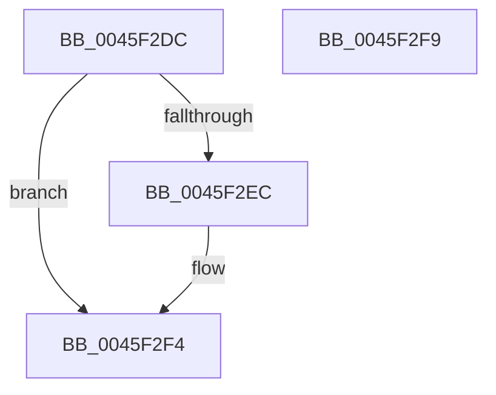

# PpmGetPmcCounters

- RVA: `0x0045F2DC`–`0x0045F2FA` (길이 `30` bytes)
- VA: `0x000000014045F2DC`
- 실행 섹션: `.text`
- PDB 이름 있음: `예`; PDB Function 태그: `아니요`
- unwind 정보 RVA: `0x0005C788`
- 디코드: `9`개 명령, `30/30` bytes 표시
- 미해석 바이트: `0` (있으면 어셈블리에 `.byte`로 보존)

> 이 문서는 커널 이미지의 기계어와 PDB 기호를 분석해 생성했습니다. 4번과 5번은 함수 원형과 자료형을 바이너리 사용 방식에서 추정한 C 해석이며 원본 소스 복구 결과는 아닙니다.

## 1. Dependencies

- 직접 호출 지점: **1**; 고유 호출 대상: **1**
- 직접 호출자로 확인된 함수: **1**
- RIP 상대 이미지 참조: **1**

### Outgoing calls
- `0x0045F2EF` → [guard_dispatch_icall](../6B/guard_dispatch_icall_function_006BAAD0.md) (function, `0x006BAAD0`)

### Direct callers
- [PpmEndActiveTimeAccumulation](../2D/PpmEndActiveTimeAccumulation_function_002D17F0.md) at `0x002D1826`

### Static image references
- `0x0045F2E0` → RVA `0x00F0EFE0` (`.data`; read)

## 2. Other-region calls and transfers

- 다른 실행 섹션으로 향하는 call: **0**
- 별도 외부 분기/꼬리 이동을 확인하지 못했습니다.

## 3. Assembly (complete function range)

```asm
0045F2DC  48 83 EC 28                     sub rsp, 0x28
0045F2E0  48 8B 05 F9 FC AA 00            mov rax, qword ptr [rip + 0xaafcf9]
0045F2E7  48 85 C0                        test rax, rax
0045F2EA  74 08                           je 0x14045f2f4
0045F2EC  8B 49 24                        mov ecx, dword ptr [rcx + 0x24]
0045F2EF  E8 DC B7 25 00                  call 0x1406baad0
0045F2F4  48 83 C4 28                     add rsp, 0x28
0045F2F8  C3                              ret
0045F2F9  CC                              int3
```

## 4. C-style interpretation (structured pseudocode)

```c
__int64 __fastcall PpmGetPmcCounters(__int64 a1)
{
    __int64 result;
    __int64 v_rsp;

    v_rsp = (v_rsp) - (40);
    result = *(unsigned __int64 *)(v_rip + 11205881);
    if (*(unsigned __int64 *)(v_rip + 11205881) != 0) {
        a1 = *(unsigned int *)(a1 + 36);
        result = guard_dispatch_icall(a1, a2, a3, a4);
    }
    v_rsp = (v_rsp) + (40);
    return result;
}
```

## 5. (Beta) C Style

```c
int64_t PpmGetPmcCounters(void *Arg1)
{
    uint8_t *arg1 = (uint8_t *)Arg1;

    int64_t result;
    int64_t local_rsp;

    local_rsp = (local_rsp) - (40);
    result = *(uint64_t *)(v_rip + 0xAAFCF9);
    if (*(uint64_t *)(v_rip + 0xAAFCF9) != 0) {
        Arg1 = *(uint32_t *)(arg1 + 0x24);
        result = guard_dispatch_icall(Arg1, a2, a3, a4);
    }
    local_rsp = (local_rsp) + (40);
    return result;
}
```

### 관측된 메모리 오프셋

구조체 형식이 확인되지 않은 접근은 인자 기준의 오프셋으로만 기록했습니다.

| 기준 인자 | 오프셋 표현 | 폭 (bit) | 접근 |
|---|---:|---:|---|
| `Arg1` | `+ 0x24` | `32` | `R` |

## 6. Execution-region graph

[열기: 2D/3D 그래프와 함수 탐색 컨트롤 패널](../../../control-panel.html?section=text&rva=0x0045F2DC&view=graph)

- 2D 그래프는 위에서 아래로 흐르고, 3D 그래프는 빈 공간을 드래그해 회전합니다. Shift+드래그는 이동, 휠은 확대·축소, 함수 노드 선택은 대상 보고서 이동입니다.

### Static fallback


