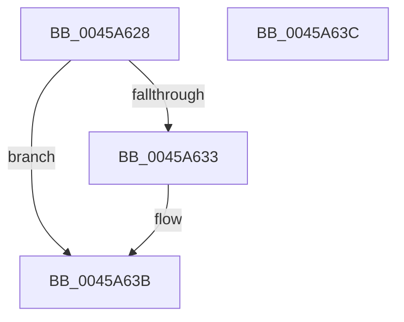

# PpmHeteroNormalizedUtilityToUtility

- RVA: `0x0045A628`–`0x0045A63D` (길이 `21` bytes)
- VA: `0x000000014045A628`
- 실행 섹션: `.text`
- PDB 이름 있음: `예`; PDB Function 태그: `아니요`
- unwind 정보 RVA: `0x000DB714`
- 디코드: `9`개 명령, `21/21` bytes 표시
- 미해석 바이트: `0` (있으면 어셈블리에 `.byte`로 보존)

> 이 문서는 커널 이미지의 기계어와 PDB 기호를 분석해 생성했습니다. 4번과 5번은 함수 원형과 자료형을 바이너리 사용 방식에서 추정한 C 해석이며 원본 소스 복구 결과는 아닙니다.

## 1. Dependencies

- 직접 호출 지점: **0**; 고유 호출 대상: **0**
- 직접 호출자로 확인된 함수: **1**
- RIP 상대 이미지 참조: **0**

### Outgoing calls
- 직접 디코드된 call 명령이 없습니다.

### Direct callers
- [PpmParkDistributeUtilityEx](../4F/PpmParkDistributeUtilityEx_function_004F020C.md) at `0x004F05A0`
- [PpmParkDistributeUtilityEx](../4F/PpmParkDistributeUtilityEx_function_004F020C.md) at `0x004F06B7`
- [PpmParkDistributeUtilityEx](../4F/PpmParkDistributeUtilityEx_function_004F020C.md) at `0x004F074D`

### Static image references
- 디코드된 RIP-relative 메모리 참조가 없습니다.

## 2. Other-region calls and transfers

- 다른 실행 섹션으로 향하는 call: **0**
- 별도 외부 분기/꼬리 이동을 확인하지 못했습니다.

## 3. Assembly (complete function range)

```asm
0045A628  44 8B 41 40                     mov r8d, dword ptr [rcx + 0x40]
0045A62C  8B C2                           mov eax, edx
0045A62E  45 85 C0                        test r8d, r8d
0045A631  74 08                           je 0x14045a63b
0045A633  C1 E0 10                        shl eax, 0x10
0045A636  33 D2                           xor edx, edx
0045A638  41 F7 F0                        div r8d
0045A63B  C3                              ret
0045A63C  CC                              int3
```

## 4. C-style interpretation (structured pseudocode)

```c
__int64 __fastcall PpmHeteroNormalizedUtilityToUtility(__int64 a1, int a2)
{
    __int64 result;

    result = (unsigned int)(a2);
    if ((unsigned int)((unsigned int)(*(unsigned int *)(a1 + 64))) != 0) {
        result = (unsigned int)(((unsigned int)(a2)) << (16));
        a2 = 0;
    }
    return result;
}
```

## 5. (Beta) C Style

```c
int64_t PpmHeteroNormalizedUtilityToUtility(void *Arg1, int32_t Arg2)
{
    uint8_t *arg1 = (uint8_t *)Arg1;

    int64_t result;

    result = (uint32_t)(Arg2);
    if ((uint32_t)((uint32_t)(*(uint32_t *)(arg1 + 0x40))) != 0) {
        result = (uint32_t)(((uint32_t)(Arg2)) << (16));
        Arg2 = 0;
    }
    return result;
}
```

### 관측된 메모리 오프셋

구조체 형식이 확인되지 않은 접근은 인자 기준의 오프셋으로만 기록했습니다.

| 기준 인자 | 오프셋 표현 | 폭 (bit) | 접근 |
|---|---:|---:|---|
| `Arg1` | `+ 0x40` | `32` | `R` |

## 6. Execution-region graph

[열기: 2D/3D 그래프와 함수 탐색 컨트롤 패널](../../../control-panel.html?section=text&rva=0x0045A628&view=graph)

- 2D 그래프는 위에서 아래로 흐르고, 3D 그래프는 빈 공간을 드래그해 회전합니다. Shift+드래그는 이동, 휠은 확대·축소, 함수 노드 선택은 대상 보고서 이동입니다.

### Static fallback


