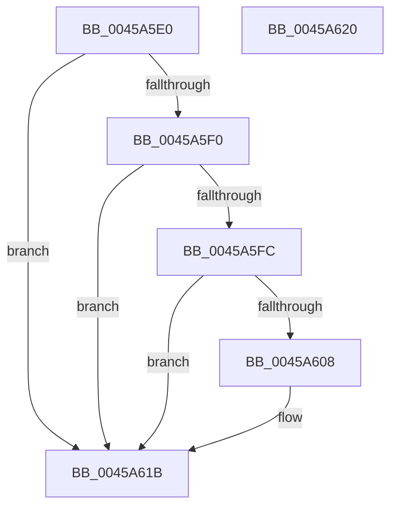

# PpmPerfUpdateHwDebugData

- RVA: `0x0045A5E0`–`0x0045A621` (길이 `65` bytes)
- VA: `0x000000014045A5E0`
- 실행 섹션: `.text`
- PDB 이름 있음: `예`; PDB Function 태그: `아니요`
- unwind 정보 RVA: `0x0005C788`
- 디코드: `17`개 명령, `65/65` bytes 표시
- 미해석 바이트: `0` (있으면 어셈블리에 `.byte`로 보존)

> 이 문서는 커널 이미지의 기계어와 PDB 기호를 분석해 생성했습니다. 4번과 5번은 함수 원형과 자료형을 바이너리 사용 방식에서 추정한 C 해석이며 원본 소스 복구 결과는 아닙니다.

## 1. Dependencies

- 직접 호출 지점: **1**; 고유 호출 대상: **1**
- 직접 호출자로 확인된 함수: **1**
- RIP 상대 이미지 참조: **1**

### Outgoing calls
- `0x0045A616` → [guard_dispatch_icall](../6B/guard_dispatch_icall_function_006BAAD0.md) (function, `0x006BAAD0`)

### Direct callers
- [PpmPerfSnapDeliveredPerformance](../2D/PpmPerfSnapDeliveredPerformance_function_002D7F30.md) at `0x002D822E`

### Static image references
- `0x0045A608` → RVA `0x00F0B260` (`.data`; read)

## 2. Other-region calls and transfers

- 다른 실행 섹션으로 향하는 call: **0**
- 별도 외부 분기/꼬리 이동을 확인하지 못했습니다.

## 3. Assembly (complete function range)

```asm
0045A5E0  48 83 EC 28                     sub rsp, 0x28
0045A5E4  48 8B 81 B0 89 00 00            mov rax, qword ptr [rcx + 0x89b0]
0045A5EB  48 85 C0                        test rax, rax
0045A5EE  74 2B                           je 0x14045a61b
0045A5F0  48 8B 89 B8 89 00 00            mov rcx, qword ptr [rcx + 0x89b8]
0045A5F7  48 85 C9                        test rcx, rcx
0045A5FA  74 1F                           je 0x14045a61b
0045A5FC  48 8B 80 A0 01 00 00            mov rax, qword ptr [rax + 0x1a0]
0045A603  48 85 C0                        test rax, rax
0045A606  74 13                           je 0x14045a61b
0045A608  48 8B 15 51 0C AB 00            mov rdx, qword ptr [rip + 0xab0c51]
0045A60F  45 33 C0                        xor r8d, r8d
0045A612  48 8B 49 08                     mov rcx, qword ptr [rcx + 8]
0045A616  E8 B5 04 26 00                  call 0x1406baad0
0045A61B  48 83 C4 28                     add rsp, 0x28
0045A61F  C3                              ret
0045A620  CC                              int3
```

## 4. C-style interpretation (structured pseudocode)

```c
__int64 __fastcall PpmPerfUpdateHwDebugData(__int64 a1, __int64 a2, int a3)
{
    __int64 result;
    __int64 v_rsp;

    v_rsp = (v_rsp) - (40);
    if (*(unsigned __int64 *)(a1 + 35248) == 0) goto loc_0045A61B;
    if (*(unsigned __int64 *)(a1 + 35256) == 0) goto loc_0045A61B;
    result = *(unsigned __int64 *)(*(unsigned __int64 *)(a1 + 35248) + 416);
    if (*(unsigned __int64 *)(*(unsigned __int64 *)(a1 + 35248) + 416) != 0) {
        a2 = *(unsigned __int64 *)(v_rip + 11209809);
        a3 = 0;
        a1 = *(unsigned __int64 *)(*(unsigned __int64 *)(a1 + 35256) + 8);
        result = guard_dispatch_icall(a1, a2, a3, a4);
    }
    v_rsp = (v_rsp) + (40);
    return result;
}
```

## 5. (Beta) C Style

```c
int64_t PpmPerfUpdateHwDebugData(void *Arg1, int64_t Arg2, int32_t Arg3)
{
    uint8_t *arg1 = (uint8_t *)Arg1;

    int64_t result;
    int64_t local_rsp;

    local_rsp = (local_rsp) - (40);
    if (*(uint64_t *)(arg1 + 0x89B0) == 0) goto loc_0045A61B;
    if (*(uint64_t *)(arg1 + 0x89B8) == 0) goto loc_0045A61B;
    result = *(uint64_t *)(*(uint64_t *)(arg1 + 0x89B0) + 0x1A0);
    if (*(uint64_t *)(*(uint64_t *)(arg1 + 0x89B0) + 0x1A0) != 0) {
        Arg2 = *(uint64_t *)(v_rip + 0xAB0C51);
        Arg3 = 0;
        Arg1 = *(uint64_t *)(*(uint64_t *)(arg1 + 0x89B8) + 0x8);
        result = guard_dispatch_icall(Arg1, Arg2, Arg3, a4);
    }
    local_rsp = (local_rsp) + (40);
    return result;
}
```

### 관측된 메모리 오프셋

구조체 형식이 확인되지 않은 접근은 인자 기준의 오프셋으로만 기록했습니다.

| 기준 인자 | 오프셋 표현 | 폭 (bit) | 접근 |
|---|---:|---:|---|
| `Arg1` | `+ 0x89B0` | `64` | `R` |
| `Arg1` | `+ 0x89B8` | `64` | `R` |

## 6. Execution-region graph

[열기: 2D/3D 그래프와 함수 탐색 컨트롤 패널](../../../control-panel.html?section=text&rva=0x0045A5E0&view=graph)

- 2D 그래프는 위에서 아래로 흐르고, 3D 그래프는 빈 공간을 드래그해 회전합니다. Shift+드래그는 이동, 휠은 확대·축소, 함수 노드 선택은 대상 보고서 이동입니다.

### Static fallback


