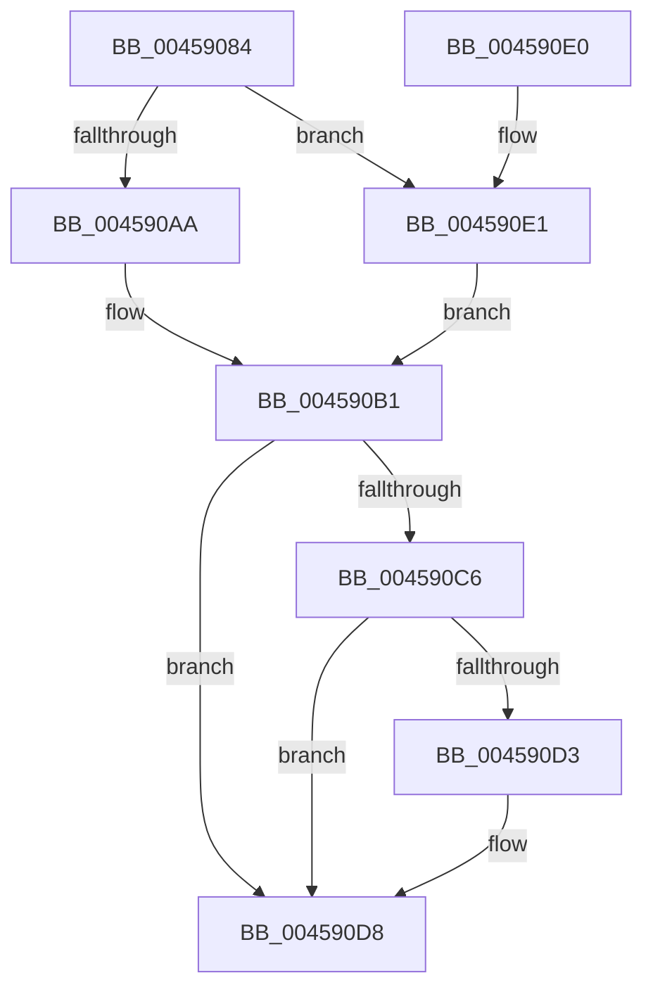

# PsSetSystemPagePriorityThread

- RVA: `0x00459084`–`0x004590EF` (길이 `107` bytes)
- VA: `0x0000000140459084`
- 실행 섹션: `.text`
- PDB 이름 있음: `예`; PDB Function 태그: `아니요`
- unwind 정보 RVA: `0x000704F4`
- 디코드: `32`개 명령, `107/107` bytes 표시
- 미해석 바이트: `0` (있으면 어셈블리에 `.byte`로 보존)

> 이 문서는 커널 이미지의 기계어와 PDB 기호를 분석해 생성했습니다. 4번과 5번은 함수 원형과 자료형을 바이너리 사용 방식에서 추정한 C 해석이며 원본 소스 복구 결과는 아닙니다.

## 1. Dependencies

- 직접 호출 지점: **1**; 고유 호출 대상: **1**
- 직접 호출자로 확인된 함수: **2**
- RIP 상대 이미지 참조: **0**

### Outgoing calls
- `0x004590D3` → [KiCheckForKernelApcDelivery](../2E/KiCheckForKernelApcDelivery_function_002E2C80.md) (function, `0x002E2C80`)

### Direct callers
- [MiValidateSectionCreate](../../page/94/MiValidateSectionCreate_function_00940190.md) at `0x009404E2`
- [MiRelocateImage](../../page/98/MiRelocateImage_function_00988E14.md) at `0x00989034`

### Static image references
- 디코드된 RIP-relative 메모리 참조가 없습니다.

## 2. Other-region calls and transfers

- 다른 실행 섹션으로 향하는 call: **0**
- 별도 외부 분기/꼬리 이동을 확인하지 못했습니다.

## 3. Assembly (complete function range)

```asm
00459084  40 53                           push rbx
00459086  48 83 EC 20                     sub rsp, 0x20
0045908A  66 FF 89 E6 01 00 00            dec word ptr [rcx + 0x1e6]
00459091  4C 8B C1                        mov r8, rcx
00459094  90                              nop
00459095  C1 E2 09                        shl edx, 9
00459098  8B 81 A8 05 00 00               mov eax, dword ptr [rcx + 0x5a8]
0045909E  0F B6 89 A9 05 00 00            movzx ecx, byte ptr [rcx + 0x5a9]
004590A5  F6 C1 01                        test cl, 1
004590A8  75 37                           jne 0x1404590e1
004590AA  83 CB FF                        or ebx, 0xffffffff
004590AD  0F BA E8 08                     bts eax, 8
004590B1  0B C2                           or eax, edx
004590B3  41 89 80 A8 05 00 00            mov dword ptr [r8 + 0x5a8], eax
004590BA  90                              nop
004590BB  66 41 83 80 E6 01 00 00 01      add word ptr [r8 + 0x1e6], 1
004590C4  75 12                           jne 0x1404590d8
004590C6  49 8D 88 98 00 00 00            lea rcx, [r8 + 0x98]
004590CD  90                              nop
004590CE  48 39 09                        cmp qword ptr [rcx], rcx
004590D1  74 05                           je 0x1404590d8
004590D3  E8 A8 9B E8 FF                  call 0x1402e2c80
004590D8  8B C3                           mov eax, ebx
004590DA  48 83 C4 20                     add rsp, 0x20
004590DE  5B                              pop rbx
004590DF  C3                              ret
004590E0  CC                              int3
004590E1  8B D9                           mov ebx, ecx
004590E3  D1 EB                           shr ebx, 1
004590E5  83 E3 07                        and ebx, 7
004590E8  25 FF F1 FF FF                  and eax, 0xfffff1ff
004590ED  EB C2                           jmp 0x1404590b1
```

## 4. C-style interpretation (structured pseudocode)

```c
__int64 __fastcall PsSetSystemPagePriorityThread(__int64 a1, int a2)
{
    __int64 result;
    __int64 v_rbx;
    __int64 v_rsp;

    v_rsp = (v_rsp) - (32);
    a2 = (unsigned int)((a2) << (9));
    if ((((unsigned __int8)(*(unsigned __int8 *)(a1 + 1449))) & (1)) != 0) goto loc_004590E1;
    v_rbx = (unsigned int)((v_rbx) | (0xFFFFFFFFULL));
loc_004590B1:
    result = (unsigned int)(((unsigned int)(*(unsigned int *)(a1 + 1448))) | (a2));
    *(unsigned int *)(a1 + 1448) = (unsigned int)(result);
    if (condition_is_not_equal) goto loc_004590D8;
    if ((*(unsigned __int64 *)(a1 + 152)) != (a1 + 152)) {
        result = KiCheckForKernelApcDelivery(a1 + 152, a2, a1, a4);
    }
    v_rsp = (v_rsp) + (32);
    return (unsigned int)((unsigned int)(v_rbx));
loc_004590E1:
    v_rbx = (unsigned int)(((unsigned int)((unsigned int)(a1 + 152))) >> (1));
    v_rbx = (unsigned int)((v_rbx) & (7));
    result = (unsigned int)(((unsigned int)((unsigned int)(v_rbx))) & (0xFFFFF1FFULL));
    goto loc_004590B1;
}
```

## 5. (Beta) C Style

```c
int64_t PsSetSystemPagePriorityThread(void *Arg1, int32_t Arg2)
{
    uint8_t *arg1 = (uint8_t *)Arg1;

    int64_t result;
    int64_t local_rbx;
    int64_t local_rsp;

    local_rsp = (local_rsp) - (32);
    Arg2 = (uint32_t)((Arg2) << (9));
    if ((((uint8_t)(*(uint8_t *)(arg1 + 0x5A9))) & (1)) != 0) goto loc_004590E1;
    local_rbx = (uint32_t)((local_rbx) | (0xFFFFFFFFULL));
loc_004590B1:
    result = (uint32_t)(((uint32_t)(*(uint32_t *)(arg1 + 0x5A8))) | (Arg2));
    *(uint32_t *)(arg1 + 0x5A8) = (uint32_t)(result);
    if (condition_is_not_equal) goto loc_004590D8;
    if ((*(uint64_t *)(arg1 + 0x98)) != (Arg1 + 152)) {
        result = KiCheckForKernelApcDelivery(Arg1 + 152, Arg2, Arg1, a4);
    }
    local_rsp = (local_rsp) + (32);
    return (uint32_t)((uint32_t)(local_rbx));
loc_004590E1:
    local_rbx = (uint32_t)(((uint32_t)((uint32_t)(Arg1 + 152))) >> (1));
    local_rbx = (uint32_t)((local_rbx) & (7));
    result = (uint32_t)(((uint32_t)((uint32_t)(local_rbx))) & (0xFFFFF1FFULL));
    goto loc_004590B1;
}
```

### 관측된 메모리 오프셋

구조체 형식이 확인되지 않은 접근은 인자 기준의 오프셋으로만 기록했습니다.

| 기준 인자 | 오프셋 표현 | 폭 (bit) | 접근 |
|---|---:|---:|---|
| `Arg1` | `+ 0x0` | `64` | `R` |
| `Arg1` | `+ 0x98` | `64` | `R` |
| `Arg1` | `+ 0x1E6` | `16` | `R/W` |
| `Arg1` | `+ 0x5A8` | `32` | `R` |
| `Arg1` | `+ 0x5A8` | `32` | `W` |
| `Arg1` | `+ 0x5A9` | `8` | `R` |

## 6. Execution-region graph

[열기: 2D/3D 그래프와 함수 탐색 컨트롤 패널](../../../control-panel.html?section=text&rva=0x00459084&view=graph)

- 2D 그래프는 위에서 아래로 흐르고, 3D 그래프는 빈 공간을 드래그해 회전합니다. Shift+드래그는 이동, 휠은 확대·축소, 함수 노드 선택은 대상 보고서 이동입니다.

### Static fallback


