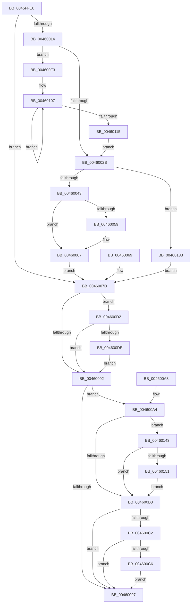

# PsThawMultiProcess

- RVA: `0x0045FFE0`–`0x0046015E` (길이 `382` bytes)
- VA: `0x000000014045FFE0`
- 실행 섹션: `.text`
- PDB 이름 있음: `예`; PDB Function 태그: `아니요`
- unwind 정보 RVA: `0x000A9BB4`
- 디코드: `101`개 명령, `382/382` bytes 표시
- 미해석 바이트: `0` (있으면 어셈블리에 `.byte`로 보존)

> 이 문서는 커널 이미지의 기계어와 PDB 기호를 분석해 생성했습니다. 4번과 5번은 함수 원형과 자료형을 바이너리 사용 방식에서 추정한 C 해석이며 원본 소스 복구 결과는 아닙니다.

## 1. Dependencies

- 직접 호출 지점: **10**; 고유 호출 대상: **10**
- 직접 호출자로 확인된 함수: **6**
- RIP 상대 이미지 참조: **3**

### Outgoing calls
- `0x00460019` → [PspLockProcessExclusive](../46/PspLockProcessExclusive_function_00460164.md) (function, `0x00460164`)
- `0x00460031` → [PspUnlockProcessExclusive](../46/PspUnlockProcessExclusive_function_004601C0.md) (function, `0x004601C0`)
- `0x00460050` → [PsWow64GetProcessNtdllType](../../page/8C/PsWow64GetProcessNtdllType_function_008CE464.md) (function, `0x008CE464`)
- `0x0046005B` → [PspWow64GetSharedInformation](../../page/8C/PspWow64GetSharedInformation_function_008CE480.md) (function, `0x008CE480`)
- `0x00460086` → [KeThawMultiProcess](../20/KeThawMultiProcess_function_00202A04.md) (function, `0x00202A04`)
- `0x004600A4` → `ext-ms-win-ntos-win32k-l1-1-0.dll!Win32kAsyncProcessFreezeThawSupportIsActive` (import, 간접 대상; import `ext-ms-win-ntos-win32k-l1-1-0.dll!Win32kAsyncProcessFreezeThawSupportIsActive`)
- `0x004600CB` → [EtwTraceFreezeThawProcess](../../page/A8/EtwTraceFreezeThawProcess_function_00A862A4.md) (function, `0x00A862A4`)
- `0x004600EC` → [EtwTiLogSuspendResumeProcess](../../page/A7/EtwTiLogSuspendResumeProcess_function_00A7956C.md) (function, `0x00A7956C`)
- `0x00460139` → [VslUpdateFreezeTimeBias](../../page/AA/VslUpdateFreezeTimeBias_function_00AA7CF0.md) (function, `0x00AA7CF0`)
- `0x00460154` → [PspPostFreezeOperationWorkEnqueue](../../page/AA/PspPostFreezeOperationWorkEnqueue_function_00AA6DFC.md) (function, `0x00AA6DFC`)

### Direct callers
- [NtChangeProcessState](../../page/78/NtChangeProcessState_function_00782C00.md) at `0x00782D80`
- [PspDeleteProcessStateChange](../../page/78/PspDeleteProcessStateChange_function_00784400.md) at `0x0078442D`
- [DbgkForwardException](../../page/8A/DbgkForwardException_function_008A2D60.md) at `0x008A2F62`
- [DbgkpResumeProcess](../../page/A7/DbgkpResumeProcess_function_00A7954C.md) at `0x00A79556`
- [PsThawProcess](../../page/A8/PsThawProcess_function_00A878FC.md) at `0x00A87906`
- [PspChangeProcessExecutionState](../../page/AE/PspChangeProcessExecutionState_function_00AEC594.md) at `0x00AEC6BD`

### Static image references
- `0x00460043` → RVA `0x00FC74D0` (`ALMOSTRO`; read)
- `0x004600A4` → RVA `0x00151678` (`ext-ms-win-ntos-win32k-l1-1-0.dll!Win32kAsyncProcessFreezeThawSupportIsActive (IAT)`; read)
- `0x004600B8` → RVA `0x00FC6B08` (`ALMOSTRO`; read)

## 2. Other-region calls and transfers

- 다른 실행 섹션으로 향하는 call: **6**
  - `0x00460050` → [PsWow64GetProcessNtdllType](../../page/8C/PsWow64GetProcessNtdllType_function_008CE464.md) (`.text` → `PAGE`)
  - `0x0046005B` → [PspWow64GetSharedInformation](../../page/8C/PspWow64GetSharedInformation_function_008CE480.md) (`.text` → `PAGE`)
  - `0x004600CB` → [EtwTraceFreezeThawProcess](../../page/A8/EtwTraceFreezeThawProcess_function_00A862A4.md) (`.text` → `PAGE`)
  - `0x004600EC` → [EtwTiLogSuspendResumeProcess](../../page/A7/EtwTiLogSuspendResumeProcess_function_00A7956C.md) (`.text` → `PAGE`)
  - `0x00460139` → [VslUpdateFreezeTimeBias](../../page/AA/VslUpdateFreezeTimeBias_function_00AA7CF0.md) (`.text` → `PAGE`)
  - `0x00460154` → [PspPostFreezeOperationWorkEnqueue](../../page/AA/PspPostFreezeOperationWorkEnqueue_function_00AA6DFC.md) (`.text` → `PAGE`)
- 별도 외부 분기/꼬리 이동을 확인하지 못했습니다.

## 3. Assembly (complete function range)

```asm
0045FFE0  44 89 44 24 18                  mov dword ptr [rsp + 0x18], r8d
0045FFE5  88 54 24 10                     mov byte ptr [rsp + 0x10], dl
0045FFE9  48 89 4C 24 08                  mov qword ptr [rsp + 8], rcx
0045FFEE  53                              push rbx
0045FFEF  56                              push rsi
0045FFF0  57                              push rdi
0045FFF1  41 56                           push r14
0045FFF3  41 57                           push r15
0045FFF5  48 83 EC 20                     sub rsp, 0x20
0045FFF9  45 8B F8                        mov r15d, r8d
0045FFFC  40 8A F2                        mov sil, dl
0045FFFF  48 8B D9                        mov rbx, rcx
00460002  65 4C 8B 34 25 88 01 00 00      mov r14, qword ptr gs:[0x188]
0046000B  4C 89 74 24 68                  mov qword ptr [rsp + 0x68], r14
00460010  84 D2                           test dl, dl
00460012  74 69                           je 0x14046007d
00460014  33 FF                           xor edi, edi
00460016  49 8B D6                        mov rdx, r14
00460019  E8 46 01 00 00                  call 0x140460164
0046001E  48 39 BB 30 06 00 00            cmp qword ptr [rbx + 0x630], rdi
00460025  0F 85 C8 00 00 00               jne 0x1404600f3
0046002B  49 8B D6                        mov rdx, r14
0046002E  48 8B CB                        mov rcx, rbx
00460031  E8 8A 01 00 00                  call 0x1404601c0
00460036  F6 83 70 01 00 00 01            test byte ptr [rbx + 0x170], 1
0046003D  0F 85 F0 00 00 00               jne 0x140460133
00460043  48 8B 05 86 74 B6 00            mov rax, qword ptr [rip + 0xb67486]
0046004A  48 01 38                        add qword ptr [rax], rdi
0046004D  48 8B CB                        mov rcx, rbx
00460050  E8 0F E4 46 00                  call 0x1408ce464
00460055  85 C0                           test eax, eax
00460057  74 0E                           je 0x140460067
00460059  8B C8                           mov ecx, eax
0046005B  E8 20 E4 46 00                  call 0x1408ce480
00460060  48 8B 48 40                     mov rcx, qword ptr [rax + 0x40]
00460064  48 01 39                        add qword ptr [rcx], rdi
00460067  EB 14                           jmp 0x14046007d
00460069  44 8B 7C 24 60                  mov r15d, dword ptr [rsp + 0x60]
0046006E  40 8A 74 24 58                  mov sil, byte ptr [rsp + 0x58]
00460073  48 8B 5C 24 50                  mov rbx, qword ptr [rsp + 0x50]
00460078  4C 8B 74 24 68                  mov r14, qword ptr [rsp + 0x68]
0046007D  45 8B C7                        mov r8d, r15d
00460080  40 8A D6                        mov dl, sil
00460083  48 8B CB                        mov rcx, rbx
00460086  E8 79 29 DA FF                  call 0x140202a04
0046008B  8B F8                           mov edi, eax
0046008D  41 3B C7                        cmp eax, r15d
00460090  74 40                           je 0x1404600d2
00460092  40 84 F6                        test sil, sil
00460095  75 0D                           jne 0x1404600a4
00460097  48 83 C4 20                     add rsp, 0x20
0046009B  41 5F                           pop r15
0046009D  41 5E                           pop r14
0046009F  5F                              pop rdi
004600A0  5E                              pop rsi
004600A1  5B                              pop rbx
004600A2  C3                              ret
004600A3  CC                              int3
004600A4  48 FF 15 CD 15 CF FF            call qword ptr [rip - 0x30ea33]
004600AB  0F 1F 44 00 00                  nop dword ptr [rax + rax]
004600B0  84 C0                           test al, al
004600B2  0F 85 8B 00 00 00               jne 0x140460143
004600B8  8B 05 4A 6A B6 00               mov eax, dword ptr [rip + 0xb66a4a]
004600BE  A8 02                           test al, 2
004600C0  74 D5                           je 0x140460097
004600C2  85 FF                           test edi, edi
004600C4  74 D1                           je 0x140460097
004600C6  33 D2                           xor edx, edx
004600C8  48 8B CB                        mov rcx, rbx
004600CB  E8 D4 61 62 00                  call 0x140a862a4
004600D0  EB C5                           jmp 0x140460097
004600D2  F7 83 FC 05 00 00 00 00 08 00   test dword ptr [rbx + 0x5fc], 0x80000
004600DC  74 B4                           je 0x140460092
004600DE  41 B9 03 00 00 00               mov r9d, 3
004600E4  4C 8B C3                        mov r8, rbx
004600E7  49 8B D6                        mov rdx, r14
004600EA  33 C9                           xor ecx, ecx
004600EC  E8 7B 94 61 00                  call 0x140a7956c
004600F1  EB 9F                           jmp 0x140460092
004600F3  48 BA B0 03 00 00 80 F7 FF FF   movabs rdx, 0xfffff780000003b0
004600FD  49 B8 08 00 00 00 80 F7 FF FF   movabs r8, 0xfffff78000000008
00460107  48 8B 0A                        mov rcx, qword ptr [rdx]
0046010A  49 8B 38                        mov rdi, qword ptr [r8]
0046010D  48 8B 02                        mov rax, qword ptr [rdx]
00460110  48 3B C8                        cmp rcx, rax
00460113  75 F2                           jne 0x140460107
00460115  48 2B F9                        sub rdi, rcx
00460118  48 2B BB 30 06 00 00            sub rdi, qword ptr [rbx + 0x630]
0046011F  48 83 A3 30 06 00 00 00         and qword ptr [rbx + 0x630], 0
00460127  48 01 BB 90 06 00 00            add qword ptr [rbx + 0x690], rdi
0046012E  E9 F8 FE FF FF                  jmp 0x14046002b
00460133  48 8B D7                        mov rdx, rdi
00460136  48 8B CB                        mov rcx, rbx
00460139  E8 B2 7B 64 00                  call 0x140aa7cf0
0046013E  E9 3A FF FF FF                  jmp 0x14046007d
00460143  8B 83 F4 01 00 00               mov eax, dword ptr [rbx + 0x1f4]
00460149  A8 08                           test al, 8
0046014B  0F 85 67 FF FF FF               jne 0x1404600b8
00460151  48 8B CB                        mov rcx, rbx
00460154  E8 A3 6C 64 00                  call 0x140aa6dfc
00460159  E9 5A FF FF FF                  jmp 0x1404600b8
```

## 4. C-style interpretation (structured pseudocode)

```c
__int64 __fastcall PsThawMultiProcess(__int64 a1, unsigned __int8 a2, int a3)
{
    __int64 result;
    __int64 v_rdi;
    __int64 v_rsp;
    unsigned __int8 v_stack_p10;
    unsigned int v_stack_p18;
    unsigned __int64 v_stack_p20;
    unsigned __int64 v_stack_p8;

    v_stack_p18 = a3;
    v_stack_p10 = a2;
    v_stack_p8 = a1;
    v_rsp = (v_rsp) - (32);
    v_stack_p20 = *(unsigned __int64 *)(gs_base + (0 + 392));
    if (a2 == 0) goto loc_0046007D;
    v_rdi = 0;
    result = PspLockProcessExclusive(a1, *(unsigned __int64 *)(gs_base + (0 + 392)), a3, a4);
    if ((*(unsigned __int64 *)(a1 + 1584)) != 0) goto loc_004600F3;
loc_0046002B:
    result = PspUnlockProcessExclusive(a1, *(unsigned __int64 *)(gs_base + (0 + 392)), a3, a4);
    if (((*(unsigned __int8 *)(a1 + 368)) & (1)) != 0) goto loc_00460133;
    result = PsWow64GetProcessNtdllType(a1, *(unsigned __int64 *)(gs_base + (0 + 392)), a3, a4);
    if ((unsigned int)(result) != 0) {
        a1 = (unsigned int)(result);
        result = PspWow64GetSharedInformation(a1, *(unsigned __int64 *)(gs_base + (0 + 392)), a3, a4);
        a1 = *(unsigned __int64 *)(result + 64);
    }
    goto loc_0046007D;
loc_0046007D:
    result = KeThawMultiProcess(a1, a2, (unsigned int)((unsigned int)((unsigned int)(a3))), a4);
    if (((unsigned int)(result)) == ((unsigned int)((unsigned int)(a3)))) goto loc_004600D2;
loc_00460092:
    if (a2 != 0) goto loc_004600A4;
loc_00460097:
    v_rsp = (v_rsp) + (32);
    return result;
loc_004600A4:
    result = ext_ms_win_ntos_win32k_l1_1_0_dll_Win32kAsyncProcessFreezeThawSupportIsActive(a1, a2, (unsigned int)((unsigned int)((unsigned int)(a3))), a4);
    if ((unsigned __int8)(result) != 0) goto loc_00460143;
loc_004600B8:
    if ((((unsigned __int8)((unsigned int)(*(unsigned int *)(v_rip + 11954762)))) & (2)) == 0) goto loc_00460097;
    if ((unsigned int)((unsigned int)((unsigned int)(result))) == 0) goto loc_00460097;
    a2 = 0;
    result = EtwTraceFreezeThawProcess(a1, a2, (unsigned int)((unsigned int)((unsigned int)(a3))), a4);
    goto loc_00460097;
loc_004600D2:
    if (((*(unsigned int *)(a1 + 1532)) & (0x80000ULL)) == 0) goto loc_00460092;
    a1 = 0;
    result = EtwTiLogSuspendResumeProcess(a1, *(unsigned __int64 *)(gs_base + (0 + 392)), a1, 3);
    goto loc_00460092;
loc_004600F3:
loc_00460107:
    if ((*(unsigned __int64 *)(*(unsigned __int64 *)(gs_base + (0 + 392)))) != (*(unsigned __int64 *)(*(unsigned __int64 *)(gs_base + (0 + 392))))) goto loc_00460107;
    v_rdi = (*(unsigned __int64 *)(a1)) - (*(unsigned __int64 *)(*(unsigned __int64 *)(gs_base + (0 + 392))));
    v_rdi = (v_rdi) - (*(unsigned __int64 *)(a1 + 1584));
    goto loc_0046002B;
loc_00460133:
    result = VslUpdateFreezeTimeBias(0, v_rdi, a1, 3);
    goto loc_0046007D;
loc_00460143:
    if ((((unsigned __int8)((unsigned int)(*(unsigned int *)(a1 + 500)))) & (8)) != 0) goto loc_004600B8;
    result = PspPostFreezeOperationWorkEnqueue(0, v_rdi, a1, 3);
    goto loc_004600B8;
}
```

## 5. (Beta) C Style

```c
int64_t PsThawMultiProcess(void *Arg1, uint8_t Arg2, int32_t Arg3)
{
    uint8_t *arg1 = (uint8_t *)Arg1;

    int64_t result;
    int64_t local_rdi;
    int64_t local_rsp;
    uint8_t v_stack_p10;
    uint32_t v_stack_p18;
    uint64_t v_stack_p20;
    uint64_t v_stack_p8;

    v_stack_p18 = Arg3;
    v_stack_p10 = Arg2;
    v_stack_p8 = Arg1;
    local_rsp = (local_rsp) - (32);
    v_stack_p20 = *(uint64_t *)(gs_base + (0 + 0x188));
    if (Arg2 == 0) goto loc_0046007D;
    local_rdi = 0;
    result = PspLockProcessExclusive(Arg1, *(uint64_t *)(gs_base + (0 + 0x188)), Arg3, a4);
    if ((*(uint64_t *)(arg1 + 0x630)) != 0) goto loc_004600F3;
loc_0046002B:
    result = PspUnlockProcessExclusive(Arg1, *(uint64_t *)(gs_base + (0 + 0x188)), Arg3, a4);
    if (((*(uint8_t *)(arg1 + 0x170)) & (1)) != 0) goto loc_00460133;
    result = PsWow64GetProcessNtdllType(Arg1, *(uint64_t *)(gs_base + (0 + 0x188)), Arg3, a4);
    if ((uint32_t)(result) != 0) {
        Arg1 = (uint32_t)(result);
        result = PspWow64GetSharedInformation(Arg1, *(uint64_t *)(gs_base + (0 + 0x188)), Arg3, a4);
        Arg1 = *(uint64_t *)(result + 0x40);
    }
    goto loc_0046007D;
loc_0046007D:
    result = KeThawMultiProcess(Arg1, Arg2, (uint32_t)((uint32_t)((uint32_t)(Arg3))), a4);
    if (((uint32_t)(result)) == ((uint32_t)((uint32_t)(Arg3)))) goto loc_004600D2;
loc_00460092:
    if (Arg2 != 0) goto loc_004600A4;
loc_00460097:
    local_rsp = (local_rsp) + (32);
    return result;
loc_004600A4:
    result = kernel_indirect_call(Arg1, Arg2, (uint32_t)((uint32_t)((uint32_t)(Arg3))), a4);
    if ((uint8_t)(result) != 0) goto loc_00460143;
loc_004600B8:
    if ((((uint8_t)((uint32_t)(*(uint32_t *)(v_rip + 0xB66A4A)))) & (2)) == 0) goto loc_00460097;
    if ((uint32_t)((uint32_t)((uint32_t)(result))) == 0) goto loc_00460097;
    Arg2 = 0;
    result = EtwTraceFreezeThawProcess(Arg1, Arg2, (uint32_t)((uint32_t)((uint32_t)(Arg3))), a4);
    goto loc_00460097;
loc_004600D2:
    if (((*(uint32_t *)(arg1 + 0x5FC)) & (0x80000ULL)) == 0) goto loc_00460092;
    Arg1 = 0;
    result = EtwTiLogSuspendResumeProcess(Arg1, *(uint64_t *)(gs_base + (0 + 0x188)), Arg1, 3);
    goto loc_00460092;
loc_004600F3:
loc_00460107:
    if ((*(uint64_t *)(*(uint64_t *)(gs_base + (0 + 0x188)))) != (*(uint64_t *)(*(uint64_t *)(gs_base + (0 + 0x188))))) goto loc_00460107;
    local_rdi = (*(uint64_t *)(arg1)) - (*(uint64_t *)(*(uint64_t *)(gs_base + (0 + 0x188))));
    local_rdi = (local_rdi) - (*(uint64_t *)(arg1 + 0x630));
    goto loc_0046002B;
loc_00460133:
    result = VslUpdateFreezeTimeBias(0, local_rdi, Arg1, 3);
    goto loc_0046007D;
loc_00460143:
    if ((((uint8_t)((uint32_t)(*(uint32_t *)(arg1 + 0x1F4)))) & (8)) != 0) goto loc_004600B8;
    result = PspPostFreezeOperationWorkEnqueue(0, local_rdi, Arg1, 3);
    goto loc_004600B8;
}
```

### 관측된 메모리 오프셋

구조체 형식이 확인되지 않은 접근은 인자 기준의 오프셋으로만 기록했습니다.

| 기준 인자 | 오프셋 표현 | 폭 (bit) | 접근 |
|---|---:|---:|---|
| `Arg1` | `+ 0x170` | `8` | `R` |
| `Arg1` | `+ 0x1F4` | `32` | `R` |
| `Arg1` | `+ 0x5FC` | `32` | `R` |
| `Arg1` | `+ 0x630` | `64` | `R` |
| `Arg1` | `+ 0x630` | `64` | `R/W` |
| `Arg1` | `+ 0x690` | `64` | `R/W` |

## 6. Execution-region graph

[열기: 2D/3D 그래프와 함수 탐색 컨트롤 패널](../../../control-panel.html?section=text&rva=0x0045FFE0&view=graph)

- 2D 그래프는 위에서 아래로 흐르고, 3D 그래프는 빈 공간을 드래그해 회전합니다. Shift+드래그는 이동, 휠은 확대·축소, 함수 노드 선택은 대상 보고서 이동입니다.

### Static fallback


