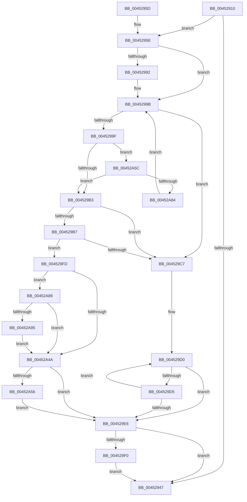

# PsWatchWorkingSet

- RVA: `0x00452910`–`0x00452AA2` (길이 `402` bytes)
- VA: `0x0000000140452910`
- 실행 섹션: `.text`
- PDB 이름 있음: `예`; PDB Function 태그: `아니요`
- unwind 정보 RVA: `0x000A7684`
- 디코드: `98`개 명령, `402/402` bytes 표시
- 미해석 바이트: `0` (있으면 어셈블리에 `.byte`로 보존)

> 이 문서는 커널 이미지의 기계어와 PDB 기호를 분석해 생성했습니다. 4번과 5번은 함수 원형과 자료형을 바이너리 사용 방식에서 추정한 C 해석이며 원본 소스 복구 결과는 아닙니다.

## 1. Dependencies

- 직접 호출 지점: **2**; 고유 호출 대상: **2**
- 직접 호출자로 확인된 함수: **1**
- RIP 상대 이미지 참조: **0**

### Outgoing calls
- `0x004529F3` → [KiLeaveCriticalRegionUnsafe](../25/KiLeaveCriticalRegionUnsafe_function_0025F010.md) (function, `0x0025F010`)
- `0x00452A9B` → [KeSignalGate](../2C/KeSignalGate_function_002C748C.md) (function, `0x002C748C`)

### Direct callers
- [KiPageFault](../6C/KiPageFault_function_006C0740.md) at `0x006C0BC4`

### Static image references
- 디코드된 RIP-relative 메모리 참조가 없습니다.

## 2. Other-region calls and transfers

- 다른 실행 섹션으로 향하는 call: **0**
- 별도 외부 분기/꼬리 이동을 확인하지 못했습니다.

## 3. Assembly (complete function range)

```asm
00452910  48 89 5C 24 08                  mov qword ptr [rsp + 8], rbx
00452915  48 89 74 24 10                  mov qword ptr [rsp + 0x10], rsi
0045291A  48 89 7C 24 18                  mov qword ptr [rsp + 0x18], rdi
0045291F  41 56                           push r14
00452921  48 83 EC 20                     sub rsp, 0x20
00452925  65 48 8B 1C 25 88 01 00 00      mov rbx, qword ptr gs:[0x188]
0045292E  4C 8B DA                        mov r11, rdx
00452931  44 8B D1                        mov r10d, ecx
00452934  48 8B 83 B8 00 00 00            mov rax, qword ptr [rbx + 0xb8]
0045293B  4C 8B 88 C0 02 00 00            mov r9, qword ptr [rax + 0x2c0]
00452942  4D 85 C9                        test r9, r9
00452945  75 17                           jne 0x14045295e
00452947  48 8B 5C 24 30                  mov rbx, qword ptr [rsp + 0x30]
0045294C  48 8B 74 24 38                  mov rsi, qword ptr [rsp + 0x38]
00452951  48 8B 7C 24 40                  mov rdi, qword ptr [rsp + 0x40]
00452956  48 83 C4 20                     add rsp, 0x20
0045295A  41 5E                           pop r14
0045295C  C3                              ret
0045295D  CC                              int3
0045295E  41 81 FA 14 01 00 00            cmp r10d, 0x114
00452965  48 BF 00 00 00 00 00 00 00 40   movabs rdi, 0x4000000000000000
0045296F  48 B8 00 00 00 00 00 00 00 80   movabs rax, 0x8000000000000000
00452979  48 0F 4D F8                     cmovge rdi, rax
0045297D  41 0F 0D 09                     prefetchw byte ptr [r9]
00452981  41 8B 01                        mov eax, dword ptr [r9]
00452984  44 0F 20 C6                     mov rsi, cr8
00452988  49 83 CE FF                     or r14, 0xffffffffffffffff
0045298C  40 80 FE 01                     cmp sil, 1
00452990  73 09                           jae 0x14045299b
00452992  66 44 01 B3 E4 01 00 00         add word ptr [rbx + 0x1e4], r14w
0045299A  90                              nop
0045299B  A8 01                           test al, 1
0045299D  75 28                           jne 0x1404529c7
0045299F  8B C8                           mov ecx, eax
004529A1  81 E1 FE FF 00 00               and ecx, 0xfffe
004529A7  81 F9 00 08 00 00               cmp ecx, 0x800
004529AD  0F 82 A9 00 00 00               jb 0x140452a5c
004529B3  A8 01                           test al, 1
004529B5  75 10                           jne 0x1404529c7
004529B7  8B C8                           mov ecx, eax
004529B9  81 E1 FE FF 00 00               and ecx, 0xfffe
004529BF  81 F9 00 08 00 00               cmp ecx, 0x800
004529C5  72 36                           jb 0x1404529fd
004529C7  41 0F 0D 49 08                  prefetchw byte ptr [r9 + 8]
004529CC  49 8B 51 08                     mov rdx, qword ptr [r9 + 8]
004529D0  49 3B D6                        cmp rdx, r14
004529D3  74 11                           je 0x1404529e6
004529D5  48 8B C2                        mov rax, rdx
004529D8  48 FF C2                        inc rdx
004529DB  F0 49 0F B1 51 08               lock cmpxchg qword ptr [r9 + 8], rdx
004529E1  48 8B D0                        mov rdx, rax
004529E4  75 EA                           jne 0x1404529d0
004529E6  40 80 FE 01                     cmp sil, 1
004529EA  0F 83 57 FF FF FF               jae 0x140452947
004529F0  48 8B CB                        mov rcx, rbx
004529F3  E8 18 C6 E0 FF                  call 0x14025f010
004529F8  E9 4A FF FF FF                  jmp 0x140452947
004529FD  8B D0                           mov edx, eax
004529FF  49 8B C0                        mov rax, r8
00452A02  48 83 E0 FE                     and rax, 0xfffffffffffffffe
00452A06  48 D1 EA                        shr rdx, 1
00452A09  81 E2 FF 7F 00 00               and edx, 0x7fff
00452A0F  49 83 C8 01                     or r8, 1
00452A13  41 81 FA 14 01 00 00            cmp r10d, 0x114
00452A1A  4C 0F 4D C0                     cmovge r8, rax
00452A1E  48 8D 0C 52                     lea rcx, [rdx + rdx*2]
00452A22  4D 89 5C C9 28                  mov qword ptr [r9 + rcx*8 + 0x28], r11
00452A27  48 8D 04 52                     lea rax, [rdx + rdx*2]
00452A2B  4D 89 44 C1 30                  mov qword ptr [r9 + rax*8 + 0x30], r8
00452A30  48 8B 83 10 05 00 00            mov rax, qword ptr [rbx + 0x510]
00452A37  49 89 44 C9 38                  mov qword ptr [r9 + rcx*8 + 0x38], rax
00452A3C  B8 00 00 FF FF                  mov eax, 0xffff0000
00452A41  F0 41 0F C1 01                  lock xadd dword ptr [r9], eax
00452A46  A8 01                           test al, 1
00452A48  75 3F                           jne 0x140452a89
00452A4A  48 8B 83 68 01 00 00            mov rax, qword ptr [rbx + 0x168]
00452A51  48 85 C0                        test rax, rax
00452A54  74 90                           je 0x1404529e6
00452A56  F0 48 09 38                     lock or qword ptr [rax], rdi
00452A5A  EB 8A                           jmp 0x1404529e6
00452A5C  8D 50 02                        lea edx, [rax + 2]
00452A5F  33 D0                           xor edx, eax
00452A61  81 E2 FE FF 00 00               and edx, 0xfffe
00452A67  33 D0                           xor edx, eax
00452A69  8D 8A 00 00 01 00               lea ecx, [rdx + 0x10000]
00452A6F  33 CA                           xor ecx, edx
00452A71  81 E1 00 00 FF 7F               and ecx, 0x7fff0000
00452A77  33 CA                           xor ecx, edx
00452A79  F0 41 0F B1 09                  lock cmpxchg dword ptr [r9], ecx
00452A7E  0F 84 2F FF FF FF               je 0x1404529b3
00452A84  E9 12 FF FF FF                  jmp 0x14045299b
00452A89  25 00 00 FF 7F                  and eax, 0x7fff0000
00452A8E  3D 00 00 01 00                  cmp eax, 0x10000
00452A93  75 B5                           jne 0x140452a4a
00452A95  49 8D 49 10                     lea rcx, [r9 + 0x10]
00452A99  33 D2                           xor edx, edx
00452A9B  E8 EC 49 E7 FF                  call 0x1402c748c
00452AA0  EB A8                           jmp 0x140452a4a
```

## 4. C-style interpretation (structured pseudocode)

```c
__int64 __fastcall PsWatchWorkingSet(int a1, __int64 a2, __int64 a3)
{
    __int64 result;
    __int64 v_r14;
    __int64 v_rdi;
    __int64 v_rsp;
    unsigned __int64 v_stack_p10;
    unsigned __int64 v_stack_p18;
    unsigned __int64 v_stack_p8;

    v_stack_p8 = v_rbx;
    v_stack_p10 = v_rsi;
    v_stack_p18 = v_rdi;
    v_rsp = (v_rsp) - (32);
    if (*(unsigned __int64 *)(*(unsigned __int64 *)(*(unsigned __int64 *)(gs_base + (0 + 392)) + 184) + 704) != 0) goto loc_0045295E;
loc_00452947:
    v_rsp = (v_rsp) + (32);
    return *(unsigned __int64 *)(*(unsigned __int64 *)(gs_base + (0 + 392)) + 184);
loc_0045295E:
    v_rdi = v_stack_p18;
    if (((unsigned int)((unsigned int)(a1))) >= 276) { v_rdi = *(unsigned __int64 *)(*(unsigned __int64 *)(gs_base + (0 + 392)) + 184); }
    v_r14 = (v_r14) | (-1);
    if (((unsigned __int8)(v_cr8)) < 1) {
    }
    if ((((unsigned __int8)((unsigned int)(*(unsigned int *)(*(unsigned __int64 *)(*(unsigned __int64 *)(*(unsigned __int64 *)(gs_base + (0 + 392)) + 184) + 704))))) & (1)) != 0) goto loc_004529C7;
    a1 = (unsigned int)(((unsigned int)((unsigned int)((unsigned int)(*(unsigned int *)(*(unsigned __int64 *)(*(unsigned __int64 *)(*(unsigned __int64 *)(gs_base + (0 + 392)) + 184) + 704)))))) & (0xFFFEULL));
    if (a1 < 0x800ULL) goto loc_00452A5C;
loc_004529B3:
    if ((((unsigned __int8)((unsigned int)(*(unsigned int *)(*(unsigned __int64 *)(*(unsigned __int64 *)(*(unsigned __int64 *)(gs_base + (0 + 392)) + 184) + 704))))) & (1)) != 0) goto loc_004529C7;
    a1 = (unsigned int)(((unsigned int)((unsigned int)((unsigned int)(*(unsigned int *)(*(unsigned __int64 *)(*(unsigned __int64 *)(*(unsigned __int64 *)(gs_base + (0 + 392)) + 184) + 704)))))) & (0xFFFEULL));
    if (a1 < 0x800ULL) goto loc_004529FD;
loc_004529C7:
loc_004529D0:
    if ((*(unsigned __int64 *)(*(unsigned __int64 *)(*(unsigned __int64 *)(*(unsigned __int64 *)(gs_base + (0 + 392)) + 184) + 704) + 8)) == v_r14) goto loc_004529E6;
    a2 = (*(unsigned __int64 *)(*(unsigned __int64 *)(*(unsigned __int64 *)(*(unsigned __int64 *)(gs_base + (0 + 392)) + 184) + 704) + 8)) + 1;
    if ((*(unsigned __int64 *)(*(unsigned __int64 *)(*(unsigned __int64 *)(*(unsigned __int64 *)(gs_base + (0 + 392)) + 184) + 704) + 8)) != v_r14) goto loc_004529D0;
loc_004529E6:
    if (((unsigned __int8)(v_cr8)) >= 1) goto loc_00452947;
    result = KiLeaveCriticalRegionUnsafe(v_stack_p8, *(unsigned __int64 *)(*(unsigned __int64 *)(*(unsigned __int64 *)(*(unsigned __int64 *)(gs_base + (0 + 392)) + 184) + 704) + 8), a3, *(unsigned __int64 *)(*(unsigned __int64 *)(*(unsigned __int64 *)(gs_base + (0 + 392)) + 184) + 704));
    goto loc_00452947;
loc_004529FD:
    result = (a3) & (-2);
    a2 = ((unsigned int)((unsigned int)(result))) >> (1);
    a2 = (unsigned int)((a2) & (0x7FFFULL));
    a3 = (a3) | (1);
    if (((unsigned int)((unsigned int)(a1))) >= 276) { a3 = result; }
    *(unsigned __int64 *)(*(unsigned __int64 *)(*(unsigned __int64 *)(*(unsigned __int64 *)(gs_base + (0 + 392)) + 184) + 704) + a2 + a2 * 2 * 8 + 40) = a2;
    *(unsigned __int64 *)(*(unsigned __int64 *)(*(unsigned __int64 *)(*(unsigned __int64 *)(gs_base + (0 + 392)) + 184) + 704) + a2 + a2 * 2 * 8 + 48) = a3;
    *(unsigned __int64 *)(*(unsigned __int64 *)(*(unsigned __int64 *)(*(unsigned __int64 *)(gs_base + (0 + 392)) + 184) + 704) + a2 + a2 * 2 * 8 + 56) = *(unsigned __int64 *)(v_stack_p8 + 1296);
    if ((((unsigned __int8)((unsigned int)(0xFFFF0000ULL))) & (1)) != 0) goto loc_00452A89;
loc_00452A4A:
    if (*(unsigned __int64 *)(v_stack_p8 + 360) == 0) goto loc_004529E6;
    goto loc_004529E6;
loc_00452A5C:
    a2 = (unsigned int)((*(unsigned __int64 *)(v_stack_p8 + 360) + 2) ^ ((unsigned int)(*(unsigned __int64 *)(v_stack_p8 + 360))));
    a2 = (unsigned int)((a2) & (0xFFFEULL));
    a2 = (unsigned int)((a2) ^ ((unsigned int)(*(unsigned __int64 *)(v_stack_p8 + 360))));
    a1 = (unsigned int)((a2 + 65536) ^ ((unsigned int)(a2)));
    a1 = (unsigned int)((a1) & (0x7FFF0000ULL));
    a1 = (unsigned int)((a1) ^ ((unsigned int)(a2)));
    if (condition_is_equal) goto loc_004529B3;
    goto loc_0045299B;
loc_00452A89:
    result = (unsigned int)((*(unsigned __int64 *)(v_stack_p8 + 360)) & (0x7FFF0000ULL));
    if (((unsigned int)(result)) != 0x10000ULL) goto loc_00452A4A;
    a2 = 0;
    result = KeSignalGate(*(unsigned __int64 *)(*(unsigned __int64 *)(*(unsigned __int64 *)(gs_base + (0 + 392)) + 184) + 704) + 16, a2, a3, *(unsigned __int64 *)(*(unsigned __int64 *)(*(unsigned __int64 *)(gs_base + (0 + 392)) + 184) + 704));
    goto loc_00452A4A;
}
```

## 5. (Beta) C Style

```c
int64_t PsWatchWorkingSet(int32_t Arg1, int64_t Arg2, int64_t Arg3)
{
    int64_t result;
    int64_t local_r14;
    int64_t local_rdi;
    int64_t local_rsp;
    uint64_t v_stack_p10;
    uint64_t v_stack_p18;
    uint64_t v_stack_p8;

    v_stack_p8 = local_rbx;
    v_stack_p10 = local_rsi;
    v_stack_p18 = local_rdi;
    local_rsp = (local_rsp) - (32);
    if (*(uint64_t *)(*(uint64_t *)(*(uint64_t *)(gs_base + (0 + 0x188)) + 0xB8) + 0x2C0) != 0) goto loc_0045295E;
loc_00452947:
    local_rsp = (local_rsp) + (32);
    return *(uint64_t *)(*(uint64_t *)(gs_base + (0 + 0x188)) + 0xB8);
loc_0045295E:
    local_rdi = v_stack_p18;
    if (((uint32_t)((uint32_t)(Arg1))) >= 276) { local_rdi = *(uint64_t *)(*(uint64_t *)(gs_base + (0 + 0x188)) + 0xB8); }
    local_r14 = (local_r14) | (-1);
    if (((uint8_t)(v_cr8)) < 1) {
    }
    if ((((uint8_t)((uint32_t)(*(uint32_t *)(*(uint64_t *)(*(uint64_t *)(*(uint64_t *)(gs_base + (0 + 0x188)) + 0xB8) + 0x2C0))))) & (1)) != 0) goto loc_004529C7;
    Arg1 = (uint32_t)(((uint32_t)((uint32_t)((uint32_t)(*(uint32_t *)(*(uint64_t *)(*(uint64_t *)(*(uint64_t *)(gs_base + (0 + 0x188)) + 0xB8) + 0x2C0)))))) & (0xFFFEULL));
    if (Arg1 < 0x800ULL) goto loc_00452A5C;
loc_004529B3:
    if ((((uint8_t)((uint32_t)(*(uint32_t *)(*(uint64_t *)(*(uint64_t *)(*(uint64_t *)(gs_base + (0 + 0x188)) + 0xB8) + 0x2C0))))) & (1)) != 0) goto loc_004529C7;
    Arg1 = (uint32_t)(((uint32_t)((uint32_t)((uint32_t)(*(uint32_t *)(*(uint64_t *)(*(uint64_t *)(*(uint64_t *)(gs_base + (0 + 0x188)) + 0xB8) + 0x2C0)))))) & (0xFFFEULL));
    if (Arg1 < 0x800ULL) goto loc_004529FD;
loc_004529C7:
loc_004529D0:
    if ((*(uint64_t *)(*(uint64_t *)(*(uint64_t *)(*(uint64_t *)(gs_base + (0 + 0x188)) + 0xB8) + 0x2C0) + 0x8)) == local_r14) goto loc_004529E6;
    Arg2 = (*(uint64_t *)(*(uint64_t *)(*(uint64_t *)(*(uint64_t *)(gs_base + (0 + 0x188)) + 0xB8) + 0x2C0) + 0x8)) + 1;
    if ((*(uint64_t *)(*(uint64_t *)(*(uint64_t *)(*(uint64_t *)(gs_base + (0 + 0x188)) + 0xB8) + 0x2C0) + 0x8)) != local_r14) goto loc_004529D0;
loc_004529E6:
    if (((uint8_t)(v_cr8)) >= 1) goto loc_00452947;
    result = KiLeaveCriticalRegionUnsafe(v_stack_p8, *(uint64_t *)(*(uint64_t *)(*(uint64_t *)(*(uint64_t *)(gs_base + (0 + 0x188)) + 0xB8) + 0x2C0) + 0x8), Arg3, *(uint64_t *)(*(uint64_t *)(*(uint64_t *)(gs_base + (0 + 0x188)) + 0xB8) + 0x2C0));
    goto loc_00452947;
loc_004529FD:
    result = (Arg3) & (-2);
    Arg2 = ((uint32_t)((uint32_t)(result))) >> (1);
    Arg2 = (uint32_t)((Arg2) & (0x7FFFULL));
    Arg3 = (Arg3) | (1);
    if (((uint32_t)((uint32_t)(Arg1))) >= 276) { Arg3 = result; }
    *(uint64_t *)(*(uint64_t *)(*(uint64_t *)(*(uint64_t *)(gs_base + (0 + 0x188)) + 0xB8) + 0x2C0) + Arg2 + Arg2 * 2 * 8 + 0x28) = Arg2;
    *(uint64_t *)(*(uint64_t *)(*(uint64_t *)(*(uint64_t *)(gs_base + (0 + 0x188)) + 0xB8) + 0x2C0) + Arg2 + Arg2 * 2 * 8 + 0x30) = Arg3;
    *(uint64_t *)(*(uint64_t *)(*(uint64_t *)(*(uint64_t *)(gs_base + (0 + 0x188)) + 0xB8) + 0x2C0) + Arg2 + Arg2 * 2 * 8 + 0x38) = *(uint64_t *)(v_stack_p8 + 0x510);
    if ((((uint8_t)((uint32_t)(0xFFFF0000ULL))) & (1)) != 0) goto loc_00452A89;
loc_00452A4A:
    if (*(uint64_t *)(v_stack_p8 + 0x168) == 0) goto loc_004529E6;
    goto loc_004529E6;
loc_00452A5C:
    Arg2 = (uint32_t)((*(uint64_t *)(v_stack_p8 + 0x168) + 2) ^ ((uint32_t)(*(uint64_t *)(v_stack_p8 + 0x168))));
    Arg2 = (uint32_t)((Arg2) & (0xFFFEULL));
    Arg2 = (uint32_t)((Arg2) ^ ((uint32_t)(*(uint64_t *)(v_stack_p8 + 0x168))));
    Arg1 = (uint32_t)((Arg2 + 65536) ^ ((uint32_t)(Arg2)));
    Arg1 = (uint32_t)((Arg1) & (0x7FFF0000ULL));
    Arg1 = (uint32_t)((Arg1) ^ ((uint32_t)(Arg2)));
    if (condition_is_equal) goto loc_004529B3;
    goto loc_0045299B;
loc_00452A89:
    result = (uint32_t)((*(uint64_t *)(v_stack_p8 + 0x168)) & (0x7FFF0000ULL));
    if (((uint32_t)(result)) != 0x10000ULL) goto loc_00452A4A;
    Arg2 = 0;
    result = KeSignalGate(*(uint64_t *)(*(uint64_t *)(*(uint64_t *)(gs_base + (0 + 0x188)) + 0xB8) + 0x2C0) + 16, Arg2, Arg3, *(uint64_t *)(*(uint64_t *)(*(uint64_t *)(gs_base + (0 + 0x188)) + 0xB8) + 0x2C0));
    goto loc_00452A4A;
}
```

## 6. Execution-region graph

[열기: 2D/3D 그래프와 함수 탐색 컨트롤 패널](../../../control-panel.html?section=text&rva=0x00452910&view=graph)

- 2D 그래프는 위에서 아래로 흐르고, 3D 그래프는 빈 공간을 드래그해 회전합니다. Shift+드래그는 이동, 휠은 확대·축소, 함수 노드 선택은 대상 보고서 이동입니다.

### Static fallback


