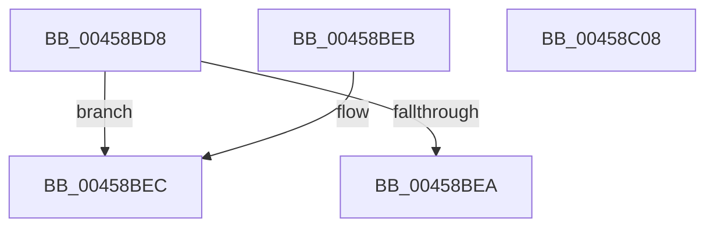

# PspIsParentProcess

- RVA: `0x00458BD8`–`0x00458C09` (길이 `49` bytes)
- VA: `0x0000000140458BD8`
- 실행 섹션: `.text`
- PDB 이름 있음: `예`; PDB Function 태그: `아니요`
- unwind 정보 RVA: `0x000DB714`
- 디코드: `13`개 명령, `49/49` bytes 표시
- 미해석 바이트: `0` (있으면 어셈블리에 `.byte`로 보존)

> 이 문서는 커널 이미지의 기계어와 PDB 기호를 분석해 생성했습니다. 4번과 5번은 함수 원형과 자료형을 바이너리 사용 방식에서 추정한 C 해석이며 원본 소스 복구 결과는 아닙니다.

## 1. Dependencies

- 직접 호출 지점: **0**; 고유 호출 대상: **0**
- 직접 호출자로 확인된 함수: **3**
- RIP 상대 이미지 참조: **0**

### Outgoing calls
- 직접 디코드된 call 명령이 없습니다.

### Direct callers
- [PspOneDirectionSecurityDomainCombine](../../page/8A/PspOneDirectionSecurityDomainCombine_function_008A23BC.md) at `0x008A2441`
- [PspThreadOpen](../../page/A0/PspThreadOpen_function_00A0FED0.md) at `0x00A0FF2D`
- [PspProcessOpen](../../page/AE/PspProcessOpen_function_00AE3620.md) at `0x00AE3666`

### Static image references
- 디코드된 RIP-relative 메모리 참조가 없습니다.

## 2. Other-region calls and transfers

- 다른 실행 섹션으로 향하는 call: **0**
- 별도 외부 분기/꼬리 이동을 확인하지 못했습니다.

## 3. Assembly (complete function range)

```asm
00458BD8  4C 8B 81 D0 01 00 00            mov r8, qword ptr [rcx + 0x1d0]
00458BDF  32 C0                           xor al, al
00458BE1  4C 39 82 D0 02 00 00            cmp qword ptr [rdx + 0x2d0], r8
00458BE8  74 02                           je 0x140458bec
00458BEA  C3                              ret
00458BEB  CC                              int3
00458BEC  48 8B 89 78 06 00 00            mov rcx, qword ptr [rcx + 0x678]
00458BF3  41 B8 01 00 00 00               mov r8d, 1
00458BF9  48 39 8A 78 06 00 00            cmp qword ptr [rdx + 0x678], rcx
00458C00  0F B6 C0                        movzx eax, al
00458C03  41 0F 47 C0                     cmova eax, r8d
00458C07  C3                              ret
00458C08  CC                              int3
```

## 4. C-style interpretation (structured pseudocode)

```c
__int64 __fastcall PspIsParentProcess(__int64 a1, __int64 a2)
{
    __int64 result;

    result = 0;
    if ((*(unsigned __int64 *)(a2 + 720)) == (*(unsigned __int64 *)(a1 + 464))) goto loc_00458BEC;
    return result;
loc_00458BEC:
    result = 0;
    if ((*(unsigned __int64 *)(a2 + 1656)) > (*(unsigned __int64 *)(a1 + 1656))) { result = 1; }
    return result;
}
```

## 5. (Beta) C Style

```c
int64_t PspIsParentProcess(void *Arg1, void *Arg2)
{
    uint8_t *arg1 = (uint8_t *)Arg1;
    uint8_t *arg2 = (uint8_t *)Arg2;

    int64_t result;

    result = 0;
    if ((*(uint64_t *)(arg2 + 0x2D0)) == (*(uint64_t *)(arg1 + 0x1D0))) goto loc_00458BEC;
    return result;
loc_00458BEC:
    result = 0;
    if ((*(uint64_t *)(arg2 + 0x678)) > (*(uint64_t *)(arg1 + 0x678))) { result = 1; }
    return result;
}
```

### 관측된 메모리 오프셋

구조체 형식이 확인되지 않은 접근은 인자 기준의 오프셋으로만 기록했습니다.

| 기준 인자 | 오프셋 표현 | 폭 (bit) | 접근 |
|---|---:|---:|---|
| `Arg1` | `+ 0x1D0` | `64` | `R` |
| `Arg1` | `+ 0x678` | `64` | `R` |
| `Arg2` | `+ 0x2D0` | `64` | `R` |
| `Arg2` | `+ 0x678` | `64` | `R` |

## 6. Execution-region graph

[열기: 2D/3D 그래프와 함수 탐색 컨트롤 패널](../../../control-panel.html?section=text&rva=0x00458BD8&view=graph)

- 2D 그래프는 위에서 아래로 흐르고, 3D 그래프는 빈 공간을 드래그해 회전합니다. Shift+드래그는 이동, 휠은 확대·축소, 함수 노드 선택은 대상 보고서 이동입니다.

### Static fallback


