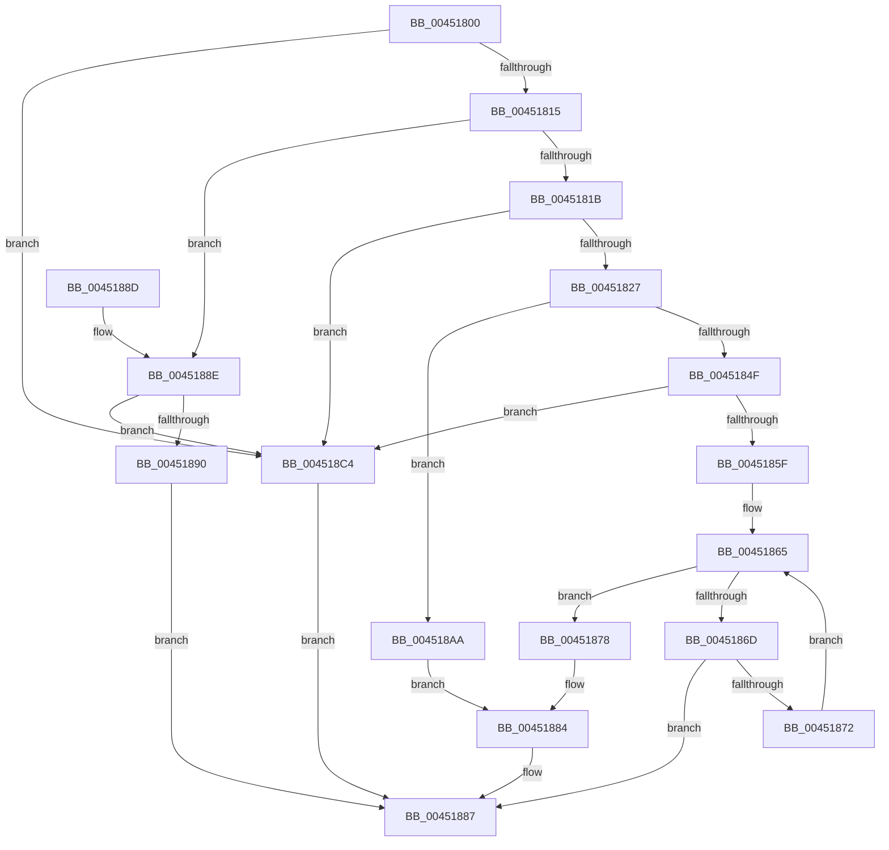

# RtlAreBitsClear

- RVA: `0x00451800`–`0x004518C8` (길이 `200` bytes)
- VA: `0x0000000140451800`
- 실행 섹션: `.text`
- PDB 이름 있음: `예`; PDB Function 태그: `아니요`
- unwind 정보 RVA: `0x000A74C8`
- 디코드: `65`개 명령, `200/200` bytes 표시
- 미해석 바이트: `0` (있으면 어셈블리에 `.byte`로 보존)

> 이 문서는 커널 이미지의 기계어와 PDB 기호를 분석해 생성했습니다. 4번과 5번은 함수 원형과 자료형을 바이너리 사용 방식에서 추정한 C 해석이며 원본 소스 복구 결과는 아닙니다.

## 1. Dependencies

- 직접 호출 지점: **0**; 고유 호출 대상: **0**
- 직접 호출자로 확인된 함수: **6**
- RIP 상대 이미지 참조: **0**

### Outgoing calls
- 직접 디코드된 call 명령이 없습니다.

### Direct callers
- [CmpLoadHiveThread](../../page/7D/CmpLoadHiveThread_function_007DB040.md) at `0x007DB859`
- [CmpMountPreloadedHives](../../page/7D/CmpMountPreloadedHives_function_007DBE18.md) at `0x007DC31B`
- [HvIsRangeDirty](../../page/7F/HvIsRangeDirty_function_007F39BC.md) at `0x007F39F2`
- [HvGetHiveLogFileStatus](../../page/9B/HvGetHiveLogFileStatus_function_009B67B8.md) at `0x009B67FF`
- [MiReleaseDriverPtes](../../page/A7/MiReleaseDriverPtes_function_00A7F1B4.md) at `0x00A7F2D7`
- [MiReleaseDriverPtes](../../page/A7/MiReleaseDriverPtes_function_00A7F1B4.md) at `0x00A7F2F4`
- [MiReleaseDriverPtes](../../page/A7/MiReleaseDriverPtes_function_00A7F1B4.md) at `0x00A7F366`
- [HalpMmAllocCtxMarkHiberPhase](../../pagelk/B5/HalpMmAllocCtxMarkHiberPhase_function_00B5C254.md) at `0x00B5C2B0`

### Static image references
- 디코드된 RIP-relative 메모리 참조가 없습니다.

## 2. Other-region calls and transfers

- 다른 실행 섹션으로 향하는 call: **0**
- 별도 외부 분기/꼬리 이동을 확인하지 못했습니다.

## 3. Assembly (complete function range)

```asm
00451800  48 89 5C 24 08                  mov qword ptr [rsp + 8], rbx
00451805  8B 01                           mov eax, dword ptr [rcx]
00451807  4C 8B D9                        mov r11, rcx
0045180A  44 8B CA                        mov r9d, edx
0045180D  3B D0                           cmp edx, eax
0045180F  0F 83 AF 00 00 00               jae 0x1404518c4
00451815  41 83 F8 01                     cmp r8d, 1
00451819  76 73                           jbe 0x14045188e
0045181B  41 2B C1                        sub eax, r9d
0045181E  41 3B C0                        cmp eax, r8d
00451821  0F 82 9D 00 00 00               jb 0x1404518c4
00451827  48 8B 49 08                     mov rcx, qword ptr [rcx + 8]
0045182B  45 8D 50 FF                     lea r10d, [r8 - 1]
0045182F  45 03 D1                        add r10d, r9d
00451832  41 8B C1                        mov eax, r9d
00451835  48 C1 E8 05                     shr rax, 5
00451839  48 8D 14 81                     lea rdx, [rcx + rax*4]
0045183D  41 8B C2                        mov eax, r10d
00451840  8B 1A                           mov ebx, dword ptr [rdx]
00451842  48 C1 E8 05                     shr rax, 5
00451846  4C 8D 1C 81                     lea r11, [rcx + rax*4]
0045184A  49 3B D3                        cmp rdx, r11
0045184D  74 5B                           je 0x1404518aa
0045184F  41 83 C8 FF                     or r8d, 0xffffffff
00451853  41 8B C9                        mov ecx, r9d
00451856  41 8B C0                        mov eax, r8d
00451859  D3 E0                           shl eax, cl
0045185B  85 D8                           test eax, ebx
0045185D  75 65                           jne 0x1404518c4
0045185F  48 83 C2 04                     add rdx, 4
00451863  33 C0                           xor eax, eax
00451865  44 8B 0A                        mov r9d, dword ptr [rdx]
00451868  49 3B D3                        cmp rdx, r11
0045186B  74 0B                           je 0x140451878
0045186D  45 85 C9                        test r9d, r9d
00451870  75 15                           jne 0x140451887
00451872  48 83 C2 04                     add rdx, 4
00451876  EB ED                           jmp 0x140451865
00451878  41 F7 D2                        not r10d
0045187B  41 8A CA                        mov cl, r10b
0045187E  41 D3 E8                        shr r8d, cl
00451881  45 85 C8                        test r8d, r9d
00451884  0F 94 C0                        sete al
00451887  48 8B 5C 24 08                  mov rbx, qword ptr [rsp + 8]
0045188C  C3                              ret
0045188D  CC                              int3
0045188E  75 34                           jne 0x1404518c4
00451890  49 8B 43 08                     mov rax, qword ptr [r11 + 8]
00451894  49 8B C9                        mov rcx, r9
00451897  48 C1 E9 05                     shr rcx, 5
0045189B  41 8B D1                        mov edx, r9d
0045189E  83 E2 1F                        and edx, 0x1f
004518A1  0F A3 14 88                     bt dword ptr [rax + rcx*4], edx
004518A5  0F 93 C0                        setae al
004518A8  EB DD                           jmp 0x140451887
004518AA  B9 20 00 00 00                  mov ecx, 0x20
004518AF  41 2B C8                        sub ecx, r8d
004518B2  41 83 C8 FF                     or r8d, 0xffffffff
004518B6  41 D3 E8                        shr r8d, cl
004518B9  41 8B C9                        mov ecx, r9d
004518BC  41 D3 E0                        shl r8d, cl
004518BF  41 85 D8                        test r8d, ebx
004518C2  EB C0                           jmp 0x140451884
004518C4  33 C0                           xor eax, eax
004518C6  EB BF                           jmp 0x140451887
```

## 4. C-style interpretation (structured pseudocode)

```c
__int64 __fastcall RtlAreBitsClear(__int64 a1, int a2, __int64 a3)
{
    __int64 result;
    __int64 v_r10;
    unsigned __int64 v_stack_p8;

    v_stack_p8 = v_rbx;
    if (a2 >= ((unsigned int)((unsigned int)(*(unsigned int *)(a1))))) goto loc_004518C4;
    if (((unsigned int)(a3)) <= 1) goto loc_0045188E;
    result = (unsigned int)(((unsigned int)(*(unsigned int *)(a1))) - ((unsigned int)((unsigned int)(a2))));
    if (((unsigned int)(result)) < ((unsigned int)(a3))) goto loc_004518C4;
    v_r10 = (unsigned int)((a3 - 1) + ((unsigned int)((unsigned int)(a2))));
    result = ((unsigned int)((unsigned int)((unsigned int)(a2)))) >> (5);
    result = ((unsigned int)((unsigned int)(v_r10))) >> (5);
    if ((*(unsigned __int64 *)(a1 + 8) + result * 4) == (*(unsigned __int64 *)(a1 + 8) + result * 4)) goto loc_004518AA;
    a3 = (unsigned int)((a3) | (0xFFFFFFFFULL));
    result = (unsigned int)(((unsigned int)((unsigned int)(a3))) << ((unsigned __int8)((unsigned int)((unsigned int)((unsigned int)(a2))))));
    if ((((unsigned int)(result)) & ((unsigned int)((unsigned int)(*(unsigned int *)(*(unsigned __int64 *)(a1 + 8) + result * 4))))) != 0) goto loc_004518C4;
    a2 = (*(unsigned __int64 *)(a1 + 8) + result * 4) + (4);
    result = 0;
loc_00451865:
    if (a2 == (*(unsigned __int64 *)(a1 + 8) + result * 4)) goto loc_00451878;
    if ((unsigned int)((unsigned int)(*(unsigned int *)(a2))) != 0) goto loc_00451887;
    a2 = (a2) + (4);
    goto loc_00451865;
loc_00451878:
    v_r10 = (unsigned int)(~(v_r10));
    a3 = (unsigned int)((a3) >> ((unsigned __int8)((unsigned __int8)(v_r10))));
loc_00451884:
    result = ((((unsigned int)(a3)) & ((unsigned int)((unsigned int)(*(unsigned int *)(a2))))) == 0) ? 1 : 0;
loc_00451887:
    return result;
loc_0045188E:
    if ((((unsigned int)(a3)) & ((unsigned int)((unsigned int)(*(unsigned int *)(a2))))) != 0) goto loc_004518C4;
    a1 = ((unsigned int)(*(unsigned int *)(a2))) >> (5);
    a2 = (unsigned int)(((unsigned int)((unsigned int)((unsigned int)(*(unsigned int *)(a2))))) & (31));
    result = (condition_is_above_or_equal) ? 1 : 0;
    goto loc_00451887;
loc_004518AA:
    a1 = (unsigned int)((32) - ((unsigned int)(a3)));
    a3 = (unsigned int)((a3) | (0xFFFFFFFFULL));
    a3 = (unsigned int)((a3) >> ((unsigned __int8)(a1)));
    a3 = (unsigned int)((a3) << ((unsigned __int8)((unsigned int)((unsigned int)((unsigned int)(*(unsigned int *)(a2)))))));
    goto loc_00451884;
loc_004518C4:
    result = 0;
    goto loc_00451887;
}
```

## 5. (Beta) C Style

```c
int64_t RtlAreBitsClear(void *Arg1, int32_t Arg2, int64_t Arg3)
{
    uint8_t *arg1 = (uint8_t *)Arg1;

    int64_t result;
    int64_t local_r10;
    uint64_t v_stack_p8;

    v_stack_p8 = local_rbx;
    if (Arg2 >= ((uint32_t)((uint32_t)(*(uint32_t *)(arg1))))) goto loc_004518C4;
    if (((uint32_t)(Arg3)) <= 1) goto loc_0045188E;
    result = (uint32_t)(((uint32_t)(*(uint32_t *)(arg1))) - ((uint32_t)((uint32_t)(Arg2))));
    if (((uint32_t)(result)) < ((uint32_t)(Arg3))) goto loc_004518C4;
    local_r10 = (uint32_t)((Arg3 - 1) + ((uint32_t)((uint32_t)(Arg2))));
    result = ((uint32_t)((uint32_t)((uint32_t)(Arg2)))) >> (5);
    result = ((uint32_t)((uint32_t)(local_r10))) >> (5);
    if ((*(uint64_t *)(arg1 + 0x8) + result * 4) == (*(uint64_t *)(arg1 + 0x8) + result * 4)) goto loc_004518AA;
    Arg3 = (uint32_t)((Arg3) | (0xFFFFFFFFULL));
    result = (uint32_t)(((uint32_t)((uint32_t)(Arg3))) << ((uint8_t)((uint32_t)((uint32_t)((uint32_t)(Arg2))))));
    if ((((uint32_t)(result)) & ((uint32_t)((uint32_t)(*(uint32_t *)(*(uint64_t *)(arg1 + 0x8) + result * 4))))) != 0) goto loc_004518C4;
    Arg2 = (*(uint64_t *)(arg1 + 0x8) + result * 4) + (4);
    result = 0;
loc_00451865:
    if (Arg2 == (*(uint64_t *)(arg1 + 0x8) + result * 4)) goto loc_00451878;
    if ((uint32_t)((uint32_t)(*(uint32_t *)(Arg2))) != 0) goto loc_00451887;
    Arg2 = (Arg2) + (4);
    goto loc_00451865;
loc_00451878:
    local_r10 = (uint32_t)(~(local_r10));
    Arg3 = (uint32_t)((Arg3) >> ((uint8_t)((uint8_t)(local_r10))));
loc_00451884:
    result = ((((uint32_t)(Arg3)) & ((uint32_t)((uint32_t)(*(uint32_t *)(Arg2))))) == 0) ? 1 : 0;
loc_00451887:
    return result;
loc_0045188E:
    if ((((uint32_t)(Arg3)) & ((uint32_t)((uint32_t)(*(uint32_t *)(Arg2))))) != 0) goto loc_004518C4;
    Arg1 = ((uint32_t)(*(uint32_t *)(Arg2))) >> (5);
    Arg2 = (uint32_t)(((uint32_t)((uint32_t)((uint32_t)(*(uint32_t *)(Arg2))))) & (31));
    result = (condition_is_above_or_equal) ? 1 : 0;
    goto loc_00451887;
loc_004518AA:
    Arg1 = (uint32_t)((32) - ((uint32_t)(Arg3)));
    Arg3 = (uint32_t)((Arg3) | (0xFFFFFFFFULL));
    Arg3 = (uint32_t)((Arg3) >> ((uint8_t)(Arg1)));
    Arg3 = (uint32_t)((Arg3) << ((uint8_t)((uint32_t)((uint32_t)((uint32_t)(*(uint32_t *)(Arg2)))))));
    goto loc_00451884;
loc_004518C4:
    result = 0;
    goto loc_00451887;
}
```

### 관측된 메모리 오프셋

구조체 형식이 확인되지 않은 접근은 인자 기준의 오프셋으로만 기록했습니다.

| 기준 인자 | 오프셋 표현 | 폭 (bit) | 접근 |
|---|---:|---:|---|
| `Arg1` | `+ 0x0` | `32` | `R` |
| `Arg1` | `+ 0x8` | `64` | `R` |

## 6. Execution-region graph

[열기: 2D/3D 그래프와 함수 탐색 컨트롤 패널](../../../control-panel.html?section=text&rva=0x00451800&view=graph)

- 2D 그래프는 위에서 아래로 흐르고, 3D 그래프는 빈 공간을 드래그해 회전합니다. Shift+드래그는 이동, 휠은 확대·축소, 함수 노드 선택은 대상 보고서 이동입니다.

### Static fallback


