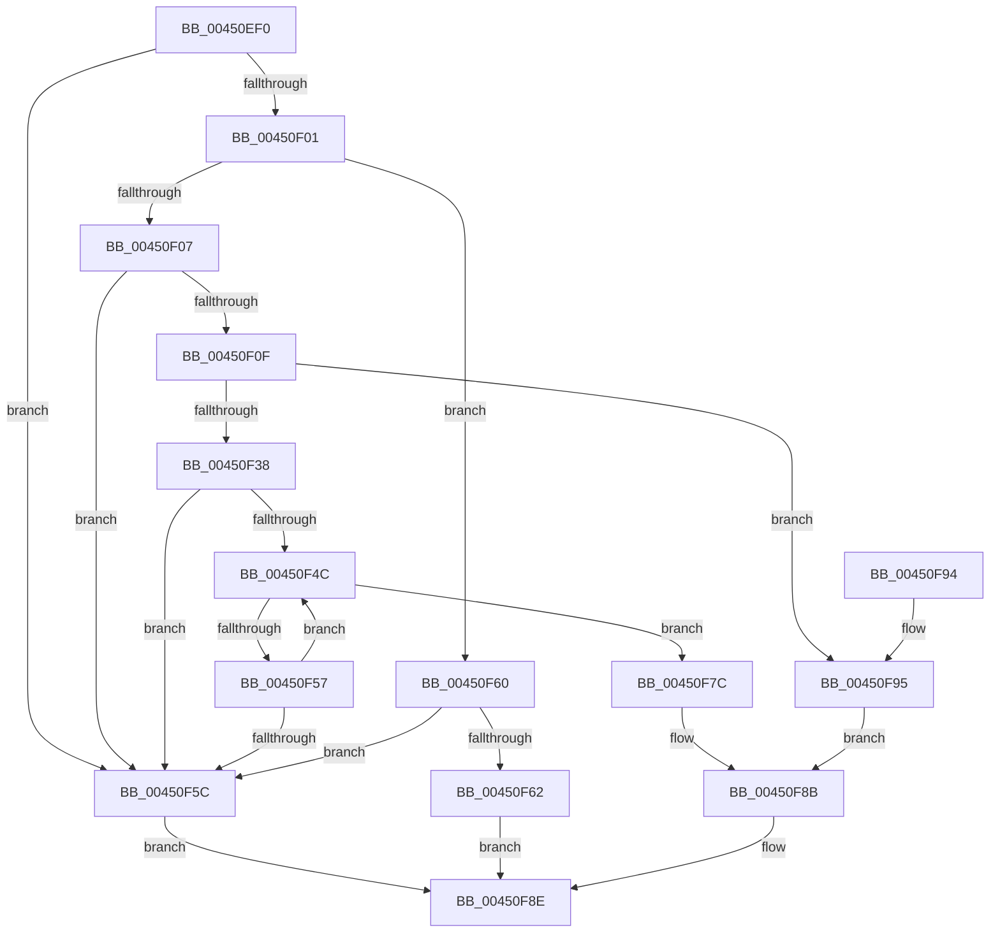

# RtlAreBitsSet

- RVA: `0x00450EF0`–`0x00450FB2` (길이 `194` bytes)
- VA: `0x0000000140450EF0`
- 실행 섹션: `.text`
- PDB 이름 있음: `예`; PDB Function 태그: `아니요`
- unwind 정보 RVA: `0x000A73FC`
- 디코드: `65`개 명령, `194/194` bytes 표시
- 미해석 바이트: `0` (있으면 어셈블리에 `.byte`로 보존)

> 이 문서는 커널 이미지의 기계어와 PDB 기호를 분석해 생성했습니다. 4번과 5번은 함수 원형과 자료형을 바이너리 사용 방식에서 추정한 C 해석이며 원본 소스 복구 결과는 아닙니다.

## 1. Dependencies

- 직접 호출 지점: **0**; 고유 호출 대상: **0**
- 직접 호출자로 확인된 함수: **3**
- RIP 상대 이미지 참조: **0**

### Outgoing calls
- 직접 디코드된 call 명령이 없습니다.

### Direct callers
- [MiPrepareToHotPatchImage](../../page/80/MiPrepareToHotPatchImage_function_00806820.md) at `0x00806C2D`
- [MiReleaseDriverPtes](../../page/A7/MiReleaseDriverPtes_function_00A7F1B4.md) at `0x00A7F25A`
- [MiReserveExistingDriverPtes](../../page/AF/MiReserveExistingDriverPtes_function_00AF84DC.md) at `0x00AF85E3`

### Static image references
- 디코드된 RIP-relative 메모리 참조가 없습니다.

## 2. Other-region calls and transfers

- 다른 실행 섹션으로 향하는 call: **0**
- 별도 외부 분기/꼬리 이동을 확인하지 못했습니다.

## 3. Assembly (complete function range)

```asm
00450EF0  48 89 5C 24 08                  mov qword ptr [rsp + 8], rbx
00450EF5  8B 01                           mov eax, dword ptr [rcx]
00450EF7  4C 8B D1                        mov r10, rcx
00450EFA  44 8B CA                        mov r9d, edx
00450EFD  3B D0                           cmp edx, eax
00450EFF  73 5B                           jae 0x140450f5c
00450F01  41 83 F8 01                     cmp r8d, 1
00450F05  76 59                           jbe 0x140450f60
00450F07  41 2B C1                        sub eax, r9d
00450F0A  41 3B C0                        cmp eax, r8d
00450F0D  72 4D                           jb 0x140450f5c
00450F0F  48 8B 49 08                     mov rcx, qword ptr [rcx + 8]
00450F13  45 8D 58 FF                     lea r11d, [r8 - 1]
00450F17  45 03 D9                        add r11d, r9d
00450F1A  41 8B C1                        mov eax, r9d
00450F1D  48 C1 E8 05                     shr rax, 5
00450F21  48 8D 14 81                     lea rdx, [rcx + rax*4]
00450F25  41 8B C3                        mov eax, r11d
00450F28  44 8B 12                        mov r10d, dword ptr [rdx]
00450F2B  48 C1 E8 05                     shr rax, 5
00450F2F  48 8D 1C 81                     lea rbx, [rcx + rax*4]
00450F33  48 3B D3                        cmp rdx, rbx
00450F36  74 5D                           je 0x140450f95
00450F38  41 83 C8 FF                     or r8d, 0xffffffff
00450F3C  41 8B C9                        mov ecx, r9d
00450F3F  41 8B C0                        mov eax, r8d
00450F42  D3 E0                           shl eax, cl
00450F44  44 23 D0                        and r10d, eax
00450F47  44 3B D0                        cmp r10d, eax
00450F4A  75 10                           jne 0x140450f5c
00450F4C  48 83 C2 04                     add rdx, 4
00450F50  8B 02                           mov eax, dword ptr [rdx]
00450F52  48 3B D3                        cmp rdx, rbx
00450F55  74 25                           je 0x140450f7c
00450F57  41 3B C0                        cmp eax, r8d
00450F5A  74 F0                           je 0x140450f4c
00450F5C  32 C0                           xor al, al
00450F5E  EB 2E                           jmp 0x140450f8e
00450F60  75 FA                           jne 0x140450f5c
00450F62  49 8B 42 08                     mov rax, qword ptr [r10 + 8]
00450F66  49 8B C9                        mov rcx, r9
00450F69  48 C1 E9 05                     shr rcx, 5
00450F6D  41 8B D1                        mov edx, r9d
00450F70  83 E2 1F                        and edx, 0x1f
00450F73  0F A3 14 88                     bt dword ptr [rax + rcx*4], edx
00450F77  0F 92 C0                        setb al
00450F7A  EB 12                           jmp 0x140450f8e
00450F7C  41 F7 D3                        not r11d
00450F7F  41 8A CB                        mov cl, r11b
00450F82  41 D3 E8                        shr r8d, cl
00450F85  41 23 C0                        and eax, r8d
00450F88  41 3B C0                        cmp eax, r8d
00450F8B  0F 94 C0                        sete al
00450F8E  48 8B 5C 24 08                  mov rbx, qword ptr [rsp + 8]
00450F93  C3                              ret
00450F94  CC                              int3
00450F95  B9 20 00 00 00                  mov ecx, 0x20
00450F9A  41 2B C8                        sub ecx, r8d
00450F9D  41 83 C8 FF                     or r8d, 0xffffffff
00450FA1  41 D3 E8                        shr r8d, cl
00450FA4  41 8B C9                        mov ecx, r9d
00450FA7  41 D3 E0                        shl r8d, cl
00450FAA  45 23 D0                        and r10d, r8d
00450FAD  45 3B D0                        cmp r10d, r8d
00450FB0  EB D9                           jmp 0x140450f8b
```

## 4. C-style interpretation (structured pseudocode)

```c
__int64 __fastcall RtlAreBitsSet(__int64 a1, int a2, __int64 a3)
{
    __int64 result;
    __int64 v_r10;
    __int64 v_r11;
    unsigned __int64 v_stack_p8;

    v_stack_p8 = v_rbx;
    if (a2 >= ((unsigned int)((unsigned int)(*(unsigned int *)(a1))))) goto loc_00450F5C;
    if (((unsigned int)(a3)) <= 1) goto loc_00450F60;
    result = (unsigned int)(((unsigned int)(*(unsigned int *)(a1))) - ((unsigned int)((unsigned int)(a2))));
    if (((unsigned int)(result)) < ((unsigned int)(a3))) goto loc_00450F5C;
    v_r11 = (unsigned int)((a3 - 1) + ((unsigned int)((unsigned int)(a2))));
    result = ((unsigned int)((unsigned int)((unsigned int)(a2)))) >> (5);
    result = ((unsigned int)((unsigned int)(v_r11))) >> (5);
    if ((*(unsigned __int64 *)(a1 + 8) + result * 4) == (*(unsigned __int64 *)(a1 + 8) + result * 4)) goto loc_00450F95;
    a3 = (unsigned int)((a3) | (0xFFFFFFFFULL));
    result = (unsigned int)(((unsigned int)((unsigned int)(a3))) << ((unsigned __int8)((unsigned int)((unsigned int)((unsigned int)(a2))))));
    v_r10 = (unsigned int)(((unsigned int)(*(unsigned int *)(*(unsigned __int64 *)(a1 + 8) + result * 4))) & ((unsigned int)(result)));
    if (((unsigned int)(v_r10)) != ((unsigned int)(result))) goto loc_00450F5C;
loc_00450F4C:
    a2 = (*(unsigned __int64 *)(a1 + 8) + result * 4) + (4);
    if (a2 == (*(unsigned __int64 *)(a1 + 8) + result * 4)) goto loc_00450F7C;
    if (((unsigned int)((unsigned int)(*(unsigned int *)(a2)))) == ((unsigned int)(a3))) goto loc_00450F4C;
loc_00450F5C:
    result = 0;
    goto loc_00450F8E;
loc_00450F60:
    if (condition_is_not_equal) goto loc_00450F5C;
    a1 = ((unsigned int)(a2)) >> (5);
    a2 = (unsigned int)(((unsigned int)((unsigned int)((unsigned int)(a2)))) & (31));
    result = (condition_is_below) ? 1 : 0;
    goto loc_00450F8E;
loc_00450F7C:
    v_r11 = (unsigned int)(~(v_r11));
    a3 = (unsigned int)((a3) >> ((unsigned __int8)((unsigned __int8)(v_r11))));
    result = (unsigned int)((result) & ((unsigned int)(a3)));
loc_00450F8B:
    result = (((unsigned int)(result)) == ((unsigned int)(a3))) ? 1 : 0;
loc_00450F8E:
    return result;
loc_00450F95:
    a1 = (unsigned int)((32) - ((unsigned int)(a3)));
    a3 = (unsigned int)((a3) | (0xFFFFFFFFULL));
    a3 = (unsigned int)((a3) >> ((unsigned __int8)(a1)));
    a3 = (unsigned int)((a3) << ((unsigned __int8)((unsigned int)((unsigned int)((unsigned int)(a2))))));
    v_r10 = (unsigned int)((v_r10) & ((unsigned int)(a3)));
    goto loc_00450F8B;
}
```

## 5. (Beta) C Style

```c
int64_t RtlAreBitsSet(void *Arg1, int32_t Arg2, int64_t Arg3)
{
    uint8_t *arg1 = (uint8_t *)Arg1;

    int64_t result;
    int64_t local_r10;
    int64_t local_r11;
    uint64_t v_stack_p8;

    v_stack_p8 = local_rbx;
    if (Arg2 >= ((uint32_t)((uint32_t)(*(uint32_t *)(arg1))))) goto loc_00450F5C;
    if (((uint32_t)(Arg3)) <= 1) goto loc_00450F60;
    result = (uint32_t)(((uint32_t)(*(uint32_t *)(arg1))) - ((uint32_t)((uint32_t)(Arg2))));
    if (((uint32_t)(result)) < ((uint32_t)(Arg3))) goto loc_00450F5C;
    local_r11 = (uint32_t)((Arg3 - 1) + ((uint32_t)((uint32_t)(Arg2))));
    result = ((uint32_t)((uint32_t)((uint32_t)(Arg2)))) >> (5);
    result = ((uint32_t)((uint32_t)(local_r11))) >> (5);
    if ((*(uint64_t *)(arg1 + 0x8) + result * 4) == (*(uint64_t *)(arg1 + 0x8) + result * 4)) goto loc_00450F95;
    Arg3 = (uint32_t)((Arg3) | (0xFFFFFFFFULL));
    result = (uint32_t)(((uint32_t)((uint32_t)(Arg3))) << ((uint8_t)((uint32_t)((uint32_t)((uint32_t)(Arg2))))));
    local_r10 = (uint32_t)(((uint32_t)(*(uint32_t *)(*(uint64_t *)(arg1 + 0x8) + result * 4))) & ((uint32_t)(result)));
    if (((uint32_t)(local_r10)) != ((uint32_t)(result))) goto loc_00450F5C;
loc_00450F4C:
    Arg2 = (*(uint64_t *)(arg1 + 0x8) + result * 4) + (4);
    if (Arg2 == (*(uint64_t *)(arg1 + 0x8) + result * 4)) goto loc_00450F7C;
    if (((uint32_t)((uint32_t)(*(uint32_t *)(Arg2)))) == ((uint32_t)(Arg3))) goto loc_00450F4C;
loc_00450F5C:
    result = 0;
    goto loc_00450F8E;
loc_00450F60:
    if (condition_is_not_equal) goto loc_00450F5C;
    Arg1 = ((uint32_t)(Arg2)) >> (5);
    Arg2 = (uint32_t)(((uint32_t)((uint32_t)((uint32_t)(Arg2)))) & (31));
    result = (condition_is_below) ? 1 : 0;
    goto loc_00450F8E;
loc_00450F7C:
    local_r11 = (uint32_t)(~(local_r11));
    Arg3 = (uint32_t)((Arg3) >> ((uint8_t)((uint8_t)(local_r11))));
    result = (uint32_t)((result) & ((uint32_t)(Arg3)));
loc_00450F8B:
    result = (((uint32_t)(result)) == ((uint32_t)(Arg3))) ? 1 : 0;
loc_00450F8E:
    return result;
loc_00450F95:
    Arg1 = (uint32_t)((32) - ((uint32_t)(Arg3)));
    Arg3 = (uint32_t)((Arg3) | (0xFFFFFFFFULL));
    Arg3 = (uint32_t)((Arg3) >> ((uint8_t)(Arg1)));
    Arg3 = (uint32_t)((Arg3) << ((uint8_t)((uint32_t)((uint32_t)((uint32_t)(Arg2))))));
    local_r10 = (uint32_t)((local_r10) & ((uint32_t)(Arg3)));
    goto loc_00450F8B;
}
```

### 관측된 메모리 오프셋

구조체 형식이 확인되지 않은 접근은 인자 기준의 오프셋으로만 기록했습니다.

| 기준 인자 | 오프셋 표현 | 폭 (bit) | 접근 |
|---|---:|---:|---|
| `Arg1` | `+ 0x0` | `32` | `R` |
| `Arg1` | `+ 0x8` | `64` | `R` |

## 6. Execution-region graph

[열기: 2D/3D 그래프와 함수 탐색 컨트롤 패널](../../../control-panel.html?section=text&rva=0x00450EF0&view=graph)

- 2D 그래프는 위에서 아래로 흐르고, 3D 그래프는 빈 공간을 드래그해 회전합니다. Shift+드래그는 이동, 휠은 확대·축소, 함수 노드 선택은 대상 보고서 이동입니다.

### Static fallback


