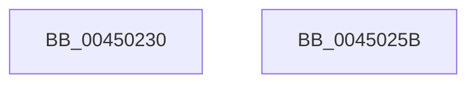

# RtlClearAllBits

- RVA: `0x00450230`–`0x0045025C` (길이 `44` bytes)
- VA: `0x0000000140450230`
- 실행 섹션: `.text`
- PDB 이름 있음: `예`; PDB Function 태그: `아니요`
- unwind 정보 RVA: `0x0005C788`
- 디코드: `14`개 명령, `44/44` bytes 표시
- 미해석 바이트: `0` (있으면 어셈블리에 `.byte`로 보존)

> 이 문서는 커널 이미지의 기계어와 PDB 기호를 분석해 생성했습니다. 4번과 5번은 함수 원형과 자료형을 바이너리 사용 방식에서 추정한 C 해석이며 원본 소스 복구 결과는 아닙니다.

## 1. Dependencies

- 직접 호출 지점: **1**; 고유 호출 대상: **1**
- 직접 호출자로 확인된 함수: **20**
- RIP 상대 이미지 참조: **0**

### Outgoing calls
- `0x00450251` → [memset](../6C/memset_function_006C6C40.md) (function, `0x006C6C40`)

### Direct callers
- [HalpIrtExtendRemappingRange](../../page/70/HalpIrtExtendRemappingRange_function_0070AD40.md) at `0x0070ADBF`
- [SepInitializeLowBoxNumberTable](../../page/7A/SepInitializeLowBoxNumberTable_function_007A31E4.md) at `0x007A323F`
- [SmcStoreResize](../../page/7A/SmcStoreResize_function_007AC500.md) at `0x007AC5CD`
- [MiPrepareToHotPatchImage](../../page/80/MiPrepareToHotPatchImage_function_00806820.md) at `0x00806963`
- [MiPrepareToHotPatchImage](../../page/80/MiPrepareToHotPatchImage_function_00806820.md) at `0x00806B7C`
- [MiPrepareToHotPatchImage](../../page/80/MiPrepareToHotPatchImage_function_00806820.md) at `0x00806CF7`
- [MiExpandPartitionIds](../../page/80/MiExpandPartitionIds_function_0080D258.md) at `0x0080D3CD`
- [MmStoreRegister](../../page/80/MmStoreRegister_function_0080E6D8.md) at `0x0080E813`
- [CmCheckRegistry](../../page/96/CmCheckRegistry_function_0096D2F4.md) at `0x0096D3C0`
- [CmCheckRegistry](../../page/96/CmCheckRegistry_function_0096D2F4.md) at `0x0096D3DE`
- [HvResetDirtyData](../../page/9B/HvResetDirtyData_function_009B3D84.md) at `0x009B3D9D`
- [HvStoreModifiedData](../../page/9B/HvStoreModifiedData_function_009B4FB4.md) at `0x009B5385`
- [HvpPerformLogFileRecovery](../../page/9B/HvpPerformLogFileRecovery_function_009B7994.md) at `0x009B7D48`
- [HvpPerformLogFileRecovery](../../page/9B/HvpPerformLogFileRecovery_function_009B7994.md) at `0x009B7DAB`
- [MiInitializePrivateFixupBitmap](../../page/9E/MiInitializePrivateFixupBitmap_function_009E55C8.md) at `0x009E5609`
- [SepAddLuidToIndexEntry](../../page/A4/SepAddLuidToIndexEntry_function_00A425C0.md) at `0x00A4278E`
- [SepGetLowBoxNumberEntry](../../page/A6/SepGetLowBoxNumberEntry_function_00A65040.md) at `0x00A6515A`
- [EtwpUpdateStackTracing](../../page/A6/EtwpUpdateStackTracing_function_00A6778C.md) at `0x00A677FD`
- [EtwpUpdateStackTracing](../../page/A6/EtwpUpdateStackTracing_function_00A6778C.md) at `0x00A67843`
- [EtwpUpdateStackTracing](../../page/A6/EtwpUpdateStackTracing_function_00A6778C.md) at `0x00A67862`
- [MiCaptureImageExceptionValues](../../page/AA/MiCaptureImageExceptionValues_function_00AAA890.md) at `0x00AAA8D9`
- [PopAllocateHiberContext](../../page/AD/PopAllocateHiberContext_function_00ADC05C.md) at `0x00ADC35F`
- [HalpCheckLowMemoryPreSleep](../../pagelk/B5/HalpCheckLowMemoryPreSleep_function_00B5EB88.md) at `0x00B5EBB3`
- [HalpIommuInitializeAll](../../pagelk/B7/HalpIommuInitializeAll_function_00B7A684.md) at `0x00B7A7A9`
- [ViAllocateContiguousMemory](../../pagevrfy/B9/ViAllocateContiguousMemory_function_00B97CE0.md) at `0x00B97D53`
- [BgpFwInitializeReservePool](../../pagebgfx/BC/BgpFwInitializeReservePool_function_00BC1634.md) at `0x00BC1665`

### Static image references
- 디코드된 RIP-relative 메모리 참조가 없습니다.

## 2. Other-region calls and transfers

- 다른 실행 섹션으로 향하는 call: **0**
- 별도 외부 분기/꼬리 이동을 확인하지 못했습니다.

## 3. Assembly (complete function range)

```asm
00450230  48 83 EC 28                     sub rsp, 0x28
00450234  8B 01                           mov eax, dword ptr [rcx]
00450236  BA 00 00 00 00                  mov edx, 0
0045023B  48 8B 49 08                     mov rcx, qword ptr [rcx + 8]
0045023F  A8 1F                           test al, 0x1f
00450241  0F 95 C2                        setne dl
00450244  C1 E8 05                        shr eax, 5
00450247  44 8D 04 10                     lea r8d, [rax + rdx]
0045024B  33 D2                           xor edx, edx
0045024D  41 C1 E0 02                     shl r8d, 2
00450251  E8 EA 69 27 00                  call 0x1406c6c40
00450256  48 83 C4 28                     add rsp, 0x28
0045025A  C3                              ret
0045025B  CC                              int3
```

## 4. C-style interpretation (structured pseudocode)

```c
__int64 __fastcall RtlClearAllBits(__int64 a1)
{
    __int64 result;
    __int64 v_rsp;

    v_rsp = (v_rsp) - (40);
    a2 = ((((unsigned __int8)((unsigned int)(*(unsigned int *)(a1)))) & (31)) != 0) ? 1 : 0;
    result = (unsigned int)(((unsigned int)(*(unsigned int *)(a1))) >> (5));
    a2 = 0;
    a3 = (unsigned int)((result + a2 * 1) << (2));
    result = memset(*(unsigned __int64 *)(a1 + 8), a2, a3, a4);
    v_rsp = (v_rsp) + (40);
    return result;
}
```

## 5. (Beta) C Style

```c
int64_t RtlClearAllBits(void *Arg1)
{
    uint8_t *arg1 = (uint8_t *)Arg1;

    int64_t result;
    int64_t local_rsp;

    local_rsp = (local_rsp) - (40);
    a2 = ((((uint8_t)((uint32_t)(*(uint32_t *)(arg1)))) & (31)) != 0) ? 1 : 0;
    result = (uint32_t)(((uint32_t)(*(uint32_t *)(arg1))) >> (5));
    a2 = 0;
    a3 = (uint32_t)((result + a2 * 1) << (2));
    result = memset(*(uint64_t *)(arg1 + 0x8), a2, a3, a4);
    local_rsp = (local_rsp) + (40);
    return result;
}
```

### 관측된 메모리 오프셋

구조체 형식이 확인되지 않은 접근은 인자 기준의 오프셋으로만 기록했습니다.

| 기준 인자 | 오프셋 표현 | 폭 (bit) | 접근 |
|---|---:|---:|---|
| `Arg1` | `+ 0x0` | `32` | `R` |
| `Arg1` | `+ 0x8` | `64` | `R` |

## 6. Execution-region graph

[열기: 2D/3D 그래프와 함수 탐색 컨트롤 패널](../../../control-panel.html?section=text&rva=0x00450230&view=graph)

- 2D 그래프는 위에서 아래로 흐르고, 3D 그래프는 빈 공간을 드래그해 회전합니다. Shift+드래그는 이동, 휠은 확대·축소, 함수 노드 선택은 대상 보고서 이동입니다.

### Static fallback


