# RtlCompareAltitudes

- RVA: `0x0045D410`–`0x0045D60A` (길이 `506` bytes)
- VA: `0x000000014045D410`
- 실행 섹션: `.text`
- PDB 이름 있음: `예`; PDB Function 태그: `예`
- unwind 정보 RVA: `0x000A9624`
- 디코드: `145`개 명령, `506/506` bytes 표시
- 미해석 바이트: `0` (있으면 어셈블리에 `.byte`로 보존)

> 이 문서는 커널 이미지의 기계어와 PDB 기호를 분석해 생성했습니다. 4번과 5번은 함수 원형과 자료형을 바이너리 사용 방식에서 추정한 C 해석이며 원본 소스 복구 결과는 아닙니다.

## 1. Dependencies

- 직접 호출 지점: **0**; 고유 호출 대상: **0**
- 직접 호출자로 확인된 함수: **2**
- RIP 상대 이미지 참조: **0**

### Outgoing calls
- 직접 디코드된 call 명령이 없습니다.

### Direct callers
- [CmpInsertCallbackInListByAltitude](../../page/97/CmpInsertCallbackInListByAltitude_function_0097D684.md) at `0x0097D6ED`
- [ObpInsertCallbackByAltitude](../../page/9D/ObpInsertCallbackByAltitude_function_009DAD34.md) at `0x009DAD78`

### Static image references
- 디코드된 RIP-relative 메모리 참조가 없습니다.

## 2. Other-region calls and transfers

- 다른 실행 섹션으로 향하는 call: **0**
- call이 아닌 외부 분기/꼬리 이동: **1**
  - `0x0045D5EF` → [sub_006F1FFA](../6F/Unknown_function_006F1FFA.md) (`tail-transfer`)

## 3. Assembly (complete function range)

```asm
0045D410  48 8B C4                        mov rax, rsp
0045D413  48 89 58 08                     mov qword ptr [rax + 8], rbx
0045D417  48 89 68 10                     mov qword ptr [rax + 0x10], rbp
0045D41B  48 89 70 18                     mov qword ptr [rax + 0x18], rsi
0045D41F  48 89 78 20                     mov qword ptr [rax + 0x20], rdi
0045D423  41 54                           push r12
0045D425  41 56                           push r14
0045D427  41 57                           push r15
0045D429  44 0F B7 19                     movzx r11d, word ptr [rcx]
0045D42D  45 33 C0                        xor r8d, r8d
0045D430  44 0F B7 0A                     movzx r9d, word ptr [rdx]
0045D434  48 8B 71 08                     mov rsi, qword ptr [rcx + 8]
0045D438  41 0F B7 C8                     movzx ecx, r8w
0045D43C  4C 8B 72 08                     mov r14, qword ptr [rdx + 8]
0045D440  66 41 D1 EB                     shr r11w, 1
0045D444  45 8D 50 01                     lea r10d, [r8 + 1]
0045D448  66 41 D1 E9                     shr r9w, 1
0045D44C  66 45 3B C3                     cmp r8w, r11w
0045D450  73 14                           jae 0x14045d466
0045D452  0F B7 C1                        movzx eax, cx
0045D455  66 83 3C 46 2E                  cmp word ptr [rsi + rax*2], 0x2e
0045D45A  74 0A                           je 0x14045d466
0045D45C  66 41 03 CA                     add cx, r10w
0045D460  66 41 3B CB                     cmp cx, r11w
0045D464  72 EC                           jb 0x14045d452
0045D466  41 0F B7 D0                     movzx edx, r8w
0045D46A  66 45 3B C1                     cmp r8w, r9w
0045D46E  73 15                           jae 0x14045d485
0045D470  0F B7 C2                        movzx eax, dx
0045D473  66 41 83 3C 46 2E               cmp word ptr [r14 + rax*2], 0x2e
0045D479  74 0A                           je 0x14045d485
0045D47B  66 41 03 D2                     add dx, r10w
0045D47F  66 41 3B D1                     cmp dx, r9w
0045D483  72 EB                           jb 0x14045d470
0045D485  0F B7 D9                        movzx ebx, cx
0045D488  41 0F B7 C0                     movzx eax, r8w
0045D48C  41 BC FF FF 00 00               mov r12d, 0xffff
0045D492  66 44 3B C1                     cmp r8w, cx
0045D496  73 0A                           jae 0x14045d4a2
0045D498  66 83 3E 30                     cmp word ptr [rsi], 0x30
0045D49C  0F 84 EB 00 00 00               je 0x14045d58d
0045D4A2  0F B7 DA                        movzx ebx, dx
0045D4A5  41 0F B7 C0                     movzx eax, r8w
0045D4A9  66 44 3B C2                     cmp r8w, dx
0045D4AD  73 07                           jae 0x14045d4b6
0045D4AF  66 41 83 3E 30                  cmp word ptr [r14], 0x30
0045D4B4  74 48                           je 0x14045d4fe
0045D4B6  66 3B D1                        cmp dx, cx
0045D4B9  75 1A                           jne 0x14045d4d5
0045D4BB  41 0F B7 D8                     movzx ebx, r8w
0045D4BF  66 3B D9                        cmp bx, cx
0045D4C2  73 51                           jae 0x14045d515
0045D4C4  0F B7 C3                        movzx eax, bx
0045D4C7  0F B7 3C 46                     movzx edi, word ptr [rsi + rax*2]
0045D4CB  41 0F B7 04 46                  movzx eax, word ptr [r14 + rax*2]
0045D4D0  66 3B C7                        cmp ax, di
0045D4D3  74 23                           je 0x14045d4f8
0045D4D5  1B C0                           sbb eax, eax
0045D4D7  83 E0 02                        and eax, 2
0045D4DA  FF C8                           dec eax
0045D4DC  48 8B 5C 24 20                  mov rbx, qword ptr [rsp + 0x20]
0045D4E1  48 8B 6C 24 28                  mov rbp, qword ptr [rsp + 0x28]
0045D4E6  48 8B 74 24 30                  mov rsi, qword ptr [rsp + 0x30]
0045D4EB  48 8B 7C 24 38                  mov rdi, qword ptr [rsp + 0x38]
0045D4F0  41 5F                           pop r15
0045D4F2  41 5E                           pop r14
0045D4F4  41 5C                           pop r12
0045D4F6  C3                              ret
0045D4F7  CC                              int3
0045D4F8  66 41 03 DA                     add bx, r10w
0045D4FC  EB C1                           jmp 0x14045d4bf
0045D4FE  66 41 03 C2                     add ax, r10w
0045D502  49 83 C6 02                     add r14, 2
0045D506  66 41 03 D4                     add dx, r12w
0045D50A  66 45 03 CC                     add r9w, r12w
0045D50E  66 3B C3                        cmp ax, bx
0045D511  72 9C                           jb 0x14045d4af
0045D513  EB A1                           jmp 0x14045d4b6
0045D515  41 0F B7 C3                     movzx eax, r11w
0045D519  45 8B F8                        mov r15d, r8d
0045D51C  66 2B C1                        sub ax, cx
0045D51F  41 8B E8                        mov ebp, r8d
0045D522  66 41 2B C2                     sub ax, r10w
0045D526  66 44 0F 49 F8                  cmovns r15w, ax
0045D52B  41 0F B7 C1                     movzx eax, r9w
0045D52F  66 2B C2                        sub ax, dx
0045D532  41 0F B7 FF                     movzx edi, r15w
0045D536  66 41 2B C2                     sub ax, r10w
0045D53A  66 0F 49 E8                     cmovns bp, ax
0045D53E  83 CB FF                        or ebx, 0xffffffff
0045D541  66 45 85 DB                     test r11w, r11w
0045D545  74 0A                           je 0x14045d551
0045D547  66 45 2B DA                     sub r11w, r10w
0045D54B  66 44 3B D9                     cmp r11w, cx
0045D54F  77 5A                           ja 0x14045d5ab
0045D551  44 0F B7 DD                     movzx r11d, bp
0045D555  66 45 85 C9                     test r9w, r9w
0045D559  74 0A                           je 0x14045d565
0045D55B  66 45 2B CA                     sub r9w, r10w
0045D55F  66 44 3B CA                     cmp r9w, dx
0045D563  77 5A                           ja 0x14045d5bf
0045D565  0F B7 C1                        movzx eax, cx
0045D568  44 0F BF CF                     movsx r9d, di
0045D56C  48 8D 34 46                     lea rsi, [rsi + rax*2]
0045D570  0F B7 C2                        movzx eax, dx
0045D573  4D 8D 34 46                     lea r14, [r14 + rax*2]
0045D577  41 0F B7 C8                     movzx ecx, r8w
0045D57B  41 3B C9                        cmp ecx, r9d
0045D57E  7C 55                           jl 0x14045d5d5
0045D580  66 41 3B FB                     cmp di, r11w
0045D584  75 78                           jne 0x14045d5fe
0045D586  33 C0                           xor eax, eax
0045D588  E9 4F FF FF FF                  jmp 0x14045d4dc
0045D58D  66 41 03 C2                     add ax, r10w
0045D591  48 83 C6 02                     add rsi, 2
0045D595  66 41 03 CC                     add cx, r12w
0045D599  66 45 03 DC                     add r11w, r12w
0045D59D  66 3B C3                        cmp ax, bx
0045D5A0  0F 82 F2 FE FF FF               jb 0x14045d498
0045D5A6  E9 F7 FE FF FF                  jmp 0x14045d4a2
0045D5AB  41 0F B7 C3                     movzx eax, r11w
0045D5AF  66 83 3C 46 30                  cmp word ptr [rsi + rax*2], 0x30
0045D5B4  75 9B                           jne 0x14045d551
0045D5B6  66 03 FB                        add di, bx
0045D5B9  66 45 03 DC                     add r11w, r12w
0045D5BD  EB 8C                           jmp 0x14045d54b
0045D5BF  41 0F B7 C1                     movzx eax, r9w
0045D5C3  66 41 83 3C 46 30               cmp word ptr [r14 + rax*2], 0x30
0045D5C9  75 9A                           jne 0x14045d565
0045D5CB  66 44 03 DB                     add r11w, bx
0045D5CF  66 45 03 CC                     add r9w, r12w
0045D5D3  EB 8A                           jmp 0x14045d55f
0045D5D5  41 0F BF C3                     movsx eax, r11w
0045D5D9  3B C8                           cmp ecx, eax
0045D5DB  7D A3                           jge 0x14045d580
0045D5DD  41 0F B7 C0                     movzx eax, r8w
0045D5E1  0F B7 4C 46 02                  movzx ecx, word ptr [rsi + rax*2 + 2]
0045D5E6  41 0F B7 54 46 02               movzx edx, word ptr [r14 + rax*2 + 2]
0045D5EC  66 3B D1                        cmp dx, cx
0045D5EF  0F 85 05 4A 29 00               jne 0x1406f1ffa
0045D5F5  66 45 03 C2                     add r8w, r10w
0045D5F9  E9 79 FF FF FF                  jmp 0x14045d577
0045D5FE  44 0F 4E D3                     cmovle r10d, ebx
0045D602  41 8B C2                        mov eax, r10d
0045D605  E9 D2 FE FF FF                  jmp 0x14045d4dc
```

## 4. C-style interpretation (structured pseudocode)

```c
__int64 __fastcall RtlCompareAltitudes(__int64 a1, __int64 a2, int a3)
{
    __int64 result;
    __int64 v_r10;
    __int64 v_r11;
    __int64 v_r14;
    __int64 v_r15;
    __int64 v_rbp;
    __int64 v_rbx;
    __int64 v_rdi;
    __int64 v_rsi;
    unsigned __int64 v_stack_p10;
    unsigned __int64 v_stack_p18;
    unsigned __int64 v_stack_p20;
    unsigned __int64 v_stack_p8;

    *(unsigned __int64 *)(v_rsp + 8) = v_rbx;
    *(unsigned __int64 *)(v_rsp + 16) = v_rbp;
    *(unsigned __int64 *)(v_rsp + 24) = v_rsi;
    *(unsigned __int64 *)(v_rsp + 32) = v_rdi;
    a3 = 0;
    v_r11 = (unsigned __int16)((*(unsigned __int16 *)(a1)) >> (1));
    a4 = (unsigned __int16)((*(unsigned __int16 *)(a2)) >> (1));
    if (0 >= ((unsigned __int16)(v_r11))) goto loc_0045D466;
loc_0045D452:
    if ((*(unsigned __int16 *)(*(unsigned __int64 *)(a1 + 8) + 0 * 2)) == 46) goto loc_0045D466;
    a1 = (unsigned __int16)((0) + ((unsigned __int16)(a3 + 1)));
    if (((unsigned __int16)(a1)) < ((unsigned __int16)(v_r11))) goto loc_0045D452;
loc_0045D466:
    if (0 >= ((unsigned __int16)(a4))) goto loc_0045D485;
loc_0045D470:
    if ((*(unsigned __int16 *)(*(unsigned __int64 *)(a2 + 8) + 0 * 2)) == 46) goto loc_0045D485;
    a2 = (unsigned __int16)((0) + ((unsigned __int16)(a3 + 1)));
    if (((unsigned __int16)(a2)) < ((unsigned __int16)(a4))) goto loc_0045D470;
loc_0045D485:
    if (0 >= ((unsigned __int16)(a1))) goto loc_0045D4A2;
loc_0045D498:
    if ((*(unsigned __int16 *)(*(unsigned __int64 *)(a1 + 8))) == 48) goto loc_0045D58D;
loc_0045D4A2:
    if (0 >= ((unsigned __int16)(a2))) goto loc_0045D4B6;
loc_0045D4AF:
    if ((*(unsigned __int16 *)(*(unsigned __int64 *)(a2 + 8))) == 48) goto loc_0045D4FE;
loc_0045D4B6:
    if (((unsigned __int16)(a2)) != ((unsigned __int16)(a1))) goto loc_0045D4D5;
loc_0045D4BF:
    if (0 >= ((unsigned __int16)(a1))) goto loc_0045D515;
    if (((unsigned __int16)(*(unsigned __int16 *)(*(unsigned __int64 *)(a2 + 8) + 0 * 2))) == ((unsigned __int16)(*(unsigned __int16 *)(*(unsigned __int64 *)(a1 + 8) + 0 * 2)))) goto loc_0045D4F8;
loc_0045D4D5:
    result = (unsigned int)((*(unsigned __int16 *)(*(unsigned __int64 *)(a2 + 8) + 0 * 2)) & (2));
    result = (unsigned int)((result) - 1);
loc_0045D4DC:
    return result;
loc_0045D4F8:
    v_rbx = (unsigned __int16)((v_stack_p8) + ((unsigned __int16)(a3 + 1)));
    goto loc_0045D4BF;
loc_0045D4FE:
    result = (unsigned __int16)((result) + ((unsigned __int16)(a3 + 1)));
    v_r14 = (*(unsigned __int64 *)(a2 + 8)) + (2);
    a2 = (unsigned __int16)((a2) + ((unsigned __int16)((unsigned int)(0xFFFFULL))));
    a4 = (unsigned __int16)((a4) + ((unsigned __int16)((unsigned int)(0xFFFFULL))));
    if (((unsigned __int16)(result)) < ((unsigned __int16)(v_rbx))) goto loc_0045D4AF;
    goto loc_0045D4B6;
loc_0045D515:
    result = (unsigned __int16)(((unsigned __int16)(v_r11)) - ((unsigned __int16)(a1)));
    result = (unsigned __int16)((result) - ((unsigned __int16)(a3 + 1)));
    v_r15 = 0;
    if (!sign_flag) { v_r15 = (unsigned __int16)(result); }
    result = (unsigned __int16)(((unsigned __int16)(a4)) - ((unsigned __int16)(a2)));
    result = (unsigned __int16)((result) - ((unsigned __int16)(a3 + 1)));
    v_rbp = 0;
    if (!sign_flag) { v_rbp = (unsigned __int16)(result); }
    v_rbx = (unsigned int)((v_rbx) | (0xFFFFFFFFULL));
    if ((unsigned __int16)(v_r11) == 0) goto loc_0045D551;
    v_r11 = (unsigned __int16)((v_r11) - ((unsigned __int16)(a3 + 1)));
loc_0045D54B:
    if (((unsigned __int16)(v_r11)) > ((unsigned __int16)(a1))) goto loc_0045D5AB;
loc_0045D551:
    if ((unsigned __int16)(a4) == 0) goto loc_0045D565;
    a4 = (unsigned __int16)((a4) - ((unsigned __int16)(a3 + 1)));
loc_0045D55F:
    if (((unsigned __int16)(a4)) > ((unsigned __int16)(a2))) goto loc_0045D5BF;
loc_0045D565:
loc_0045D577:
    if (0 < ((unsigned int)((__int16)((unsigned __int16)((unsigned __int16)(v_r15)))))) goto loc_0045D5D5;
loc_0045D580:
    if (((unsigned __int16)((unsigned __int16)(v_r15))) != ((unsigned __int16)((unsigned __int16)(v_rbp)))) goto loc_0045D5FE;
    result = 0;
    goto loc_0045D4DC;
loc_0045D58D:
    result = (unsigned __int16)((result) + ((unsigned __int16)(a3 + 1)));
    v_rsi = (v_stack_p18 + (unsigned __int16)(a1) * 2) + (2);
    a1 = (unsigned __int16)((0) + ((unsigned __int16)((unsigned int)(0xFFFFULL))));
    v_r11 = (unsigned __int16)(((unsigned __int16)(v_rbp)) + ((unsigned __int16)((unsigned int)(0xFFFFULL))));
    if (((unsigned __int16)(result)) < ((unsigned __int16)(v_rbx))) goto loc_0045D498;
    goto loc_0045D4A2;
loc_0045D5AB:
    if ((*(unsigned __int16 *)(v_rsi + (unsigned __int16)(v_r11) * 2)) != 48) goto loc_0045D551;
    v_rdi = (unsigned __int16)(((unsigned __int16)(v_r15)) + ((unsigned __int16)(v_rbx)));
    v_r11 = (unsigned __int16)((v_r11) + ((unsigned __int16)((unsigned int)(0xFFFFULL))));
    goto loc_0045D54B;
loc_0045D5BF:
    if ((*(unsigned __int16 *)(v_r14 + (unsigned __int16)(a2) * 2 + (unsigned __int16)((__int16)((unsigned __int16)((unsigned __int16)(v_r15)))) * 2)) != 48) goto loc_0045D565;
    v_r11 = (unsigned __int16)((v_r11) + ((unsigned __int16)(v_rbx)));
    a4 = (unsigned __int16)(((__int16)((unsigned __int16)((unsigned __int16)(v_r15)))) + ((unsigned __int16)((unsigned int)(0xFFFFULL))));
    goto loc_0045D55F;
loc_0045D5D5:
    if (((unsigned int)(a1)) >= ((unsigned int)((__int16)((unsigned __int16)(v_r11))))) goto loc_0045D580;
    a3 = (unsigned __int16)((a3) + ((unsigned __int16)(a3 + 1)));
    goto loc_0045D577;
loc_0045D5FE:
    v_r10 = a3 + 1;
    if (condition_is_less_or_equal) { v_r10 = (unsigned int)(v_rbx); }
    goto loc_0045D4DC;
}
```

## 5. (Beta) C Style

```c
int64_t RtlCompareAltitudes(void *Arg1, void *Arg2, int32_t Arg3)
{
    uint8_t *arg1 = (uint8_t *)Arg1;
    uint8_t *arg2 = (uint8_t *)Arg2;

    int64_t result;
    int64_t local_r10;
    int64_t local_r11;
    int64_t local_r14;
    int64_t local_r15;
    int64_t local_rbp;
    int64_t local_rbx;
    int64_t local_rdi;
    int64_t local_rsi;
    uint64_t v_stack_p10;
    uint64_t v_stack_p18;
    uint64_t v_stack_p20;
    uint64_t v_stack_p8;

    *(uint64_t *)(local_rsp + 0x8) = local_rbx;
    *(uint64_t *)(local_rsp + 0x10) = local_rbp;
    *(uint64_t *)(local_rsp + 0x18) = local_rsi;
    *(uint64_t *)(local_rsp + 0x20) = local_rdi;
    Arg3 = 0;
    local_r11 = (uint16_t)((*(uint16_t *)(arg1)) >> (1));
    a4 = (uint16_t)((*(uint16_t *)(arg2)) >> (1));
    if (0 >= ((uint16_t)(local_r11))) goto loc_0045D466;
loc_0045D452:
    if ((*(uint16_t *)(*(uint64_t *)(arg1 + 0x8) + 0x0 * 2)) == 46) goto loc_0045D466;
    Arg1 = (uint16_t)((0) + ((uint16_t)(Arg3 + 1)));
    if (((uint16_t)(Arg1)) < ((uint16_t)(local_r11))) goto loc_0045D452;
loc_0045D466:
    if (0 >= ((uint16_t)(a4))) goto loc_0045D485;
loc_0045D470:
    if ((*(uint16_t *)(*(uint64_t *)(arg2 + 0x8) + 0x0 * 2)) == 46) goto loc_0045D485;
    Arg2 = (uint16_t)((0) + ((uint16_t)(Arg3 + 1)));
    if (((uint16_t)(Arg2)) < ((uint16_t)(a4))) goto loc_0045D470;
loc_0045D485:
    if (0 >= ((uint16_t)(Arg1))) goto loc_0045D4A2;
loc_0045D498:
    if ((*(uint16_t *)(*(uint64_t *)(arg1 + 0x8))) == 48) goto loc_0045D58D;
loc_0045D4A2:
    if (0 >= ((uint16_t)(Arg2))) goto loc_0045D4B6;
loc_0045D4AF:
    if ((*(uint16_t *)(*(uint64_t *)(arg2 + 0x8))) == 48) goto loc_0045D4FE;
loc_0045D4B6:
    if (((uint16_t)(Arg2)) != ((uint16_t)(Arg1))) goto loc_0045D4D5;
loc_0045D4BF:
    if (0 >= ((uint16_t)(Arg1))) goto loc_0045D515;
    if (((uint16_t)(*(uint16_t *)(*(uint64_t *)(arg2 + 0x8) + 0x0 * 2))) == ((uint16_t)(*(uint16_t *)(*(uint64_t *)(arg1 + 0x8) + 0x0 * 2)))) goto loc_0045D4F8;
loc_0045D4D5:
    result = (uint32_t)((*(uint16_t *)(*(uint64_t *)(arg2 + 0x8) + 0x0 * 2)) & (2));
    result = (uint32_t)((result) - 1);
loc_0045D4DC:
    return result;
loc_0045D4F8:
    local_rbx = (uint16_t)((v_stack_p8) + ((uint16_t)(Arg3 + 1)));
    goto loc_0045D4BF;
loc_0045D4FE:
    result = (uint16_t)((result) + ((uint16_t)(Arg3 + 1)));
    local_r14 = (*(uint64_t *)(arg2 + 0x8)) + (2);
    Arg2 = (uint16_t)((Arg2) + ((uint16_t)((uint32_t)(0xFFFFULL))));
    a4 = (uint16_t)((a4) + ((uint16_t)((uint32_t)(0xFFFFULL))));
    if (((uint16_t)(result)) < ((uint16_t)(local_rbx))) goto loc_0045D4AF;
    goto loc_0045D4B6;
loc_0045D515:
    result = (uint16_t)(((uint16_t)(local_r11)) - ((uint16_t)(Arg1)));
    result = (uint16_t)((result) - ((uint16_t)(Arg3 + 1)));
    local_r15 = 0;
    if (!sign_flag) { local_r15 = (uint16_t)(result); }
    result = (uint16_t)(((uint16_t)(a4)) - ((uint16_t)(Arg2)));
    result = (uint16_t)((result) - ((uint16_t)(Arg3 + 1)));
    local_rbp = 0;
    if (!sign_flag) { local_rbp = (uint16_t)(result); }
    local_rbx = (uint32_t)((local_rbx) | (0xFFFFFFFFULL));
    if ((uint16_t)(local_r11) == 0) goto loc_0045D551;
    local_r11 = (uint16_t)((local_r11) - ((uint16_t)(Arg3 + 1)));
loc_0045D54B:
    if (((uint16_t)(local_r11)) > ((uint16_t)(Arg1))) goto loc_0045D5AB;
loc_0045D551:
    if ((uint16_t)(a4) == 0) goto loc_0045D565;
    a4 = (uint16_t)((a4) - ((uint16_t)(Arg3 + 1)));
loc_0045D55F:
    if (((uint16_t)(a4)) > ((uint16_t)(Arg2))) goto loc_0045D5BF;
loc_0045D565:
loc_0045D577:
    if (0 < ((uint32_t)((int16_t)((uint16_t)((uint16_t)(local_r15)))))) goto loc_0045D5D5;
loc_0045D580:
    if (((uint16_t)((uint16_t)(local_r15))) != ((uint16_t)((uint16_t)(local_rbp)))) goto loc_0045D5FE;
    result = 0;
    goto loc_0045D4DC;
loc_0045D58D:
    result = (uint16_t)((result) + ((uint16_t)(Arg3 + 1)));
    local_rsi = (v_stack_p18 + (uint16_t)(Arg1) * 2) + (2);
    Arg1 = (uint16_t)((0) + ((uint16_t)((uint32_t)(0xFFFFULL))));
    local_r11 = (uint16_t)(((uint16_t)(local_rbp)) + ((uint16_t)((uint32_t)(0xFFFFULL))));
    if (((uint16_t)(result)) < ((uint16_t)(local_rbx))) goto loc_0045D498;
    goto loc_0045D4A2;
loc_0045D5AB:
    if ((*(uint16_t *)(local_rsi + (uint16_t)(local_r11) * 2)) != 48) goto loc_0045D551;
    local_rdi = (uint16_t)(((uint16_t)(local_r15)) + ((uint16_t)(local_rbx)));
    local_r11 = (uint16_t)((local_r11) + ((uint16_t)((uint32_t)(0xFFFFULL))));
    goto loc_0045D54B;
loc_0045D5BF:
    if ((*(uint16_t *)(local_r14 + (uint16_t)(arg2) * 2 + (uint16_t)((int16_t)((uint16_t)((uint16_t)(local_r15)))) * 2)) != 48) goto loc_0045D565;
    local_r11 = (uint16_t)((local_r11) + ((uint16_t)(local_rbx)));
    a4 = (uint16_t)(((int16_t)((uint16_t)((uint16_t)(local_r15)))) + ((uint16_t)((uint32_t)(0xFFFFULL))));
    goto loc_0045D55F;
loc_0045D5D5:
    if (((uint32_t)(Arg1)) >= ((uint32_t)((int16_t)((uint16_t)(local_r11))))) goto loc_0045D580;
    Arg3 = (uint16_t)((Arg3) + ((uint16_t)(Arg3 + 1)));
    goto loc_0045D577;
loc_0045D5FE:
    local_r10 = Arg3 + 1;
    if (condition_is_less_or_equal) { local_r10 = (uint32_t)(local_rbx); }
    goto loc_0045D4DC;
}
```

### 관측된 메모리 오프셋

구조체 형식이 확인되지 않은 접근은 인자 기준의 오프셋으로만 기록했습니다.

| 기준 인자 | 오프셋 표현 | 폭 (bit) | 접근 |
|---|---:|---:|---|
| `Arg1` | `+ 0x0` | `16` | `R` |
| `Arg1` | `+ 0x8` | `64` | `R` |
| `Arg2` | `+ 0x0` | `16` | `R` |
| `Arg2` | `+ 0x8` | `64` | `R` |

## 6. Execution-region graph

[열기: 2D/3D 그래프와 함수 탐색 컨트롤 패널](../../../control-panel.html?section=text&rva=0x0045D410&view=graph)

- 2D 그래프는 위에서 아래로 흐르고, 3D 그래프는 빈 공간을 드래그해 회전합니다. Shift+드래그는 이동, 휠은 확대·축소, 함수 노드 선택은 대상 보고서 이동입니다.

### Static fallback

```mermaid
flowchart TD
  bb_0045D410[BB_0045D410]
  bb_0045D452[BB_0045D452]
  bb_0045D45C[BB_0045D45C]
  bb_0045D466[BB_0045D466]
  bb_0045D470[BB_0045D470]
  bb_0045D47B[BB_0045D47B]
  bb_0045D485[BB_0045D485]
  bb_0045D498[BB_0045D498]
  bb_0045D4A2[BB_0045D4A2]
  bb_0045D4AF[BB_0045D4AF]
  bb_0045D4B6[BB_0045D4B6]
  bb_0045D4BB[BB_0045D4BB]
  bb_0045D4BF[BB_0045D4BF]
  bb_0045D4C4[BB_0045D4C4]
  bb_0045D4D5[BB_0045D4D5]
  bb_0045D4DC[BB_0045D4DC]
  bb_0045D4F7[BB_0045D4F7]
  bb_0045D4F8[BB_0045D4F8]
  bb_0045D4FE[BB_0045D4FE]
  bb_0045D513[BB_0045D513]
  bb_0045D515[BB_0045D515]
  bb_0045D547[BB_0045D547]
  bb_0045D54B[BB_0045D54B]
  bb_0045D551[BB_0045D551]
  bb_0045D55B[BB_0045D55B]
  bb_0045D55F[BB_0045D55F]
  bb_0045D565[BB_0045D565]
  bb_0045D577[BB_0045D577]
  bb_0045D580[BB_0045D580]
  bb_0045D586[BB_0045D586]
  bb_0045D58D[BB_0045D58D]
  bb_0045D5A6[BB_0045D5A6]
  bb_0045D5AB[BB_0045D5AB]
  bb_0045D5B6[BB_0045D5B6]
  bb_0045D5BF[BB_0045D5BF]
  bb_0045D5CB[BB_0045D5CB]
  bb_0045D5D5[BB_0045D5D5]
  bb_0045D5DD[BB_0045D5DD]
  bb_0045D5F5[BB_0045D5F5]
  bb_0045D5FE[BB_0045D5FE]
  bb_0045D410 -->|branch| bb_0045D466
  bb_0045D410 -->|fallthrough| bb_0045D452
  bb_0045D452 -->|branch| bb_0045D466
  bb_0045D452 -->|fallthrough| bb_0045D45C
  bb_0045D45C -->|branch| bb_0045D452
  bb_0045D45C -->|fallthrough| bb_0045D466
  bb_0045D466 -->|branch| bb_0045D485
  bb_0045D466 -->|fallthrough| bb_0045D470
  bb_0045D470 -->|branch| bb_0045D485
  bb_0045D470 -->|fallthrough| bb_0045D47B
  bb_0045D47B -->|branch| bb_0045D470
  bb_0045D47B -->|fallthrough| bb_0045D485
  bb_0045D485 -->|branch| bb_0045D4A2
  bb_0045D485 -->|fallthrough| bb_0045D498
  bb_0045D498 -->|branch| bb_0045D58D
  bb_0045D498 -->|fallthrough| bb_0045D4A2
  bb_0045D4A2 -->|branch| bb_0045D4B6
  bb_0045D4A2 -->|fallthrough| bb_0045D4AF
  bb_0045D4AF -->|branch| bb_0045D4FE
  bb_0045D4AF -->|fallthrough| bb_0045D4B6
  bb_0045D4B6 -->|branch| bb_0045D4D5
  bb_0045D4B6 -->|fallthrough| bb_0045D4BB
  bb_0045D4BB -->|flow| bb_0045D4BF
  bb_0045D4BF -->|branch| bb_0045D515
  bb_0045D4BF -->|fallthrough| bb_0045D4C4
  bb_0045D4C4 -->|branch| bb_0045D4F8
  bb_0045D4C4 -->|fallthrough| bb_0045D4D5
  bb_0045D4D5 -->|flow| bb_0045D4DC
  bb_0045D4F7 -->|flow| bb_0045D4F8
  bb_0045D4F8 -->|branch| bb_0045D4BF
  bb_0045D4FE -->|branch| bb_0045D4AF
  bb_0045D4FE -->|fallthrough| bb_0045D513
  bb_0045D513 -->|branch| bb_0045D4B6
  bb_0045D515 -->|branch| bb_0045D551
  bb_0045D515 -->|fallthrough| bb_0045D547
  bb_0045D547 -->|flow| bb_0045D54B
  bb_0045D54B -->|branch| bb_0045D5AB
  bb_0045D54B -->|fallthrough| bb_0045D551
  bb_0045D551 -->|branch| bb_0045D565
  bb_0045D551 -->|fallthrough| bb_0045D55B
  bb_0045D55B -->|flow| bb_0045D55F
  bb_0045D55F -->|branch| bb_0045D5BF
  bb_0045D55F -->|fallthrough| bb_0045D565
  bb_0045D565 -->|flow| bb_0045D577
  bb_0045D577 -->|branch| bb_0045D5D5
  bb_0045D577 -->|fallthrough| bb_0045D580
  bb_0045D580 -->|branch| bb_0045D5FE
  bb_0045D580 -->|fallthrough| bb_0045D586
  bb_0045D586 -->|branch| bb_0045D4DC
  bb_0045D58D -->|branch| bb_0045D498
  bb_0045D58D -->|fallthrough| bb_0045D5A6
  bb_0045D5A6 -->|branch| bb_0045D4A2
  bb_0045D5AB -->|branch| bb_0045D551
  bb_0045D5AB -->|fallthrough| bb_0045D5B6
  bb_0045D5B6 -->|branch| bb_0045D54B
  bb_0045D5BF -->|branch| bb_0045D565
  bb_0045D5BF -->|fallthrough| bb_0045D5CB
  bb_0045D5CB -->|branch| bb_0045D55F
  bb_0045D5D5 -->|branch| bb_0045D580
  bb_0045D5D5 -->|fallthrough| bb_0045D5DD
  bb_0045D5DD -->|fallthrough| bb_0045D5F5
  bb_0045D5F5 -->|branch| bb_0045D577
  bb_0045D5FE -->|branch| bb_0045D4DC
```


