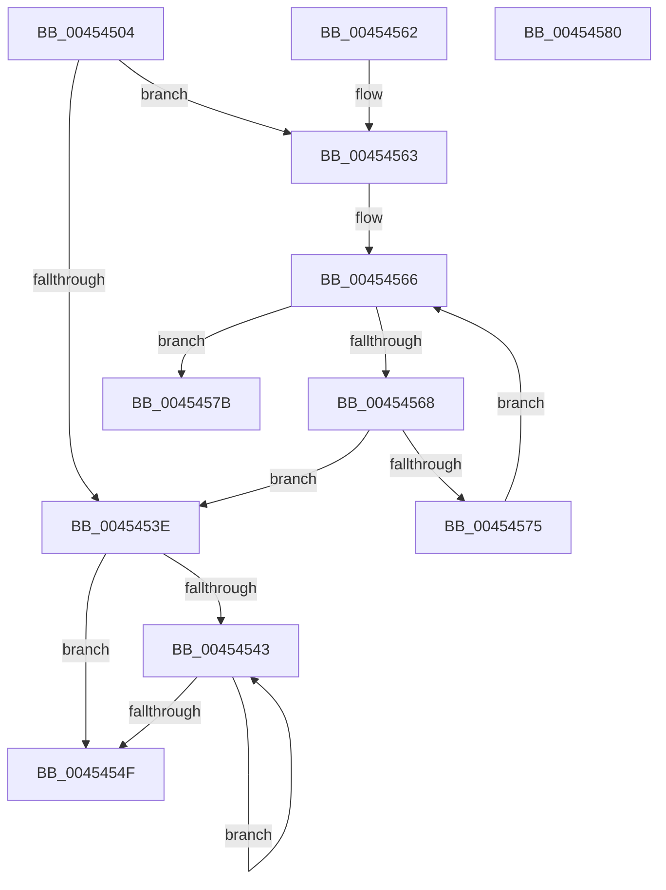

# RtlFindNextClearBitBackwardsEx

- RVA: `0x00454504`–`0x00454581` (길이 `125` bytes)
- VA: `0x0000000140454504`
- 실행 섹션: `.text`
- PDB 이름 있음: `예`; PDB Function 태그: `아니요`
- unwind 정보 RVA: `0x000DB714`
- 디코드: `41`개 명령, `125/125` bytes 표시
- 미해석 바이트: `0` (있으면 어셈블리에 `.byte`로 보존)

> 이 문서는 커널 이미지의 기계어와 PDB 기호를 분석해 생성했습니다. 4번과 5번은 함수 원형과 자료형을 바이너리 사용 방식에서 추정한 C 해석이며 원본 소스 복구 결과는 아닙니다.

## 1. Dependencies

- 직접 호출 지점: **0**; 고유 호출 대상: **0**
- 직접 호출자로 확인된 함수: **1**
- RIP 상대 이미지 참조: **0**

### Outgoing calls
- 직접 디코드된 call 명령이 없습니다.

### Direct callers
- [MiFindNextLowerLargePageCandidate](MiFindNextLowerLargePageCandidate_function_00454458.md) at `0x004544C1`

### Static image references
- 디코드된 RIP-relative 메모리 참조가 없습니다.

## 2. Other-region calls and transfers

- 다른 실행 섹션으로 향하는 call: **0**
- 별도 외부 분기/꼬리 이동을 확인하지 못했습니다.

## 3. Assembly (complete function range)

```asm
00454504  48 8B 41 08                     mov rax, qword ptr [rcx + 8]
00454508  4C 8B C2                        mov r8, rdx
0045450B  49 C1 E8 06                     shr r8, 6
0045450F  4C 8B D1                        mov r10, rcx
00454512  8A CA                           mov cl, dl
00454514  4E 8D 0C C0                     lea r9, [rax + r8*8]
00454518  41 B8 3F 00 00 00               mov r8d, 0x3f
0045451E  49 8B 01                        mov rax, qword ptr [r9]
00454521  41 22 C8                        and cl, r8b
00454524  41 8D 50 C2                     lea edx, [r8 - 0x3e]
00454528  48 D3 E2                        shl rdx, cl
0045452B  48 FF CA                        dec rdx
0045452E  48 F7 D2                        not rdx
00454531  48 0B D0                        or rdx, rax
00454534  49 8B 42 08                     mov rax, qword ptr [r10 + 8]
00454538  48 83 FA FF                     cmp rdx, -1
0045453C  74 25                           je 0x140454563
0045453E  48 85 D2                        test rdx, rdx
00454541  79 0C                           jns 0x14045454f
00454543  41 FF C8                        dec r8d
00454546  41 8B C8                        mov ecx, r8d
00454549  48 0F A3 CA                     bt rdx, rcx
0045454D  72 F4                           jb 0x140454543
0045454F  4D 2B 4A 08                     sub r9, qword ptr [r10 + 8]
00454553  49 C1 F9 03                     sar r9, 3
00454557  49 C1 E1 06                     shl r9, 6
0045455B  41 8B C0                        mov eax, r8d
0045455E  49 03 C1                        add rax, r9
00454561  C3                              ret
00454562  CC                              int3
00454563  4C 3B C8                        cmp r9, rax
00454566  74 13                           je 0x14045457b
00454568  49 83 E9 08                     sub r9, 8
0045456C  49 8B 11                        mov rdx, qword ptr [r9]
0045456F  48 83 FA FF                     cmp rdx, -1
00454573  75 C9                           jne 0x14045453e
00454575  4D 3B 4A 08                     cmp r9, qword ptr [r10 + 8]
00454579  EB EB                           jmp 0x140454566
0045457B  48 83 C8 FF                     or rax, 0xffffffffffffffff
0045457F  C3                              ret
00454580  CC                              int3
```

## 4. C-style interpretation (structured pseudocode)

```c
__int64 __fastcall RtlFindNextClearBitBackwardsEx(__int64 a1, __int64 a2)
{
    __int64 result;

    a3 = (a2) >> (6);
    a1 = (unsigned __int8)(((unsigned __int8)(a2)) & (63));
    a2 = (63 - 62) << ((unsigned __int8)(a1));
    a2 = (a2) - 1;
    a2 = ~(a2);
    a2 = (a2) | (*(unsigned __int64 *)(*(unsigned __int64 *)(a1 + 8) + a3 * 8));
    if (a2 == -1) goto loc_00454563;
loc_0045453E:
    if (!sign_flag) goto loc_0045454F;
loc_00454543:
    a3 = (unsigned int)((63) - 1);
    if (condition_is_below) goto loc_00454543;
loc_0045454F:
    a4 = (*(unsigned __int64 *)(a1 + 8) + a3 * 8) - (*(unsigned __int64 *)(a1 + 8));
    a4 = (a4) >> (3);
    a4 = (a4) << (6);
    result = ((unsigned int)((unsigned int)(a3))) + (a4);
    return result;
loc_00454563:
loc_00454566:
    if (a4 == result) goto loc_0045457B;
    a4 = (a4) - (8);
    if ((*(unsigned __int64 *)(a4)) != -1) goto loc_0045453E;
    goto loc_00454566;
loc_0045457B:
    result = (result) | (-1);
    return result;
}
```

## 5. (Beta) C Style

```c
int64_t RtlFindNextClearBitBackwardsEx(void *Arg1, int64_t Arg2)
{
    uint8_t *arg1 = (uint8_t *)Arg1;

    int64_t result;

    a3 = (Arg2) >> (6);
    Arg1 = (uint8_t)(((uint8_t)(Arg2)) & (63));
    Arg2 = (63 - 62) << ((uint8_t)(Arg1));
    Arg2 = (Arg2) - 1;
    Arg2 = ~(Arg2);
    Arg2 = (Arg2) | (*(uint64_t *)(*(uint64_t *)(arg1 + 0x8) + a3 * 8));
    if (Arg2 == -1) goto loc_00454563;
loc_0045453E:
    if (!sign_flag) goto loc_0045454F;
loc_00454543:
    a3 = (uint32_t)((63) - 1);
    if (condition_is_below) goto loc_00454543;
loc_0045454F:
    a4 = (*(uint64_t *)(arg1 + 0x8) + a3 * 8) - (*(uint64_t *)(arg1 + 0x8));
    a4 = (a4) >> (3);
    a4 = (a4) << (6);
    result = ((uint32_t)((uint32_t)(a3))) + (a4);
    return result;
loc_00454563:
loc_00454566:
    if (a4 == result) goto loc_0045457B;
    a4 = (a4) - (8);
    if ((*(uint64_t *)(a4)) != -1) goto loc_0045453E;
    goto loc_00454566;
loc_0045457B:
    result = (result) | (-1);
    return result;
}
```

### 관측된 메모리 오프셋

구조체 형식이 확인되지 않은 접근은 인자 기준의 오프셋으로만 기록했습니다.

| 기준 인자 | 오프셋 표현 | 폭 (bit) | 접근 |
|---|---:|---:|---|
| `Arg1` | `+ 0x8` | `64` | `R` |

## 6. Execution-region graph

[열기: 2D/3D 그래프와 함수 탐색 컨트롤 패널](../../../control-panel.html?section=text&rva=0x00454504&view=graph)

- 2D 그래프는 위에서 아래로 흐르고, 3D 그래프는 빈 공간을 드래그해 회전합니다. Shift+드래그는 이동, 휠은 확대·축소, 함수 노드 선택은 대상 보고서 이동입니다.

### Static fallback


