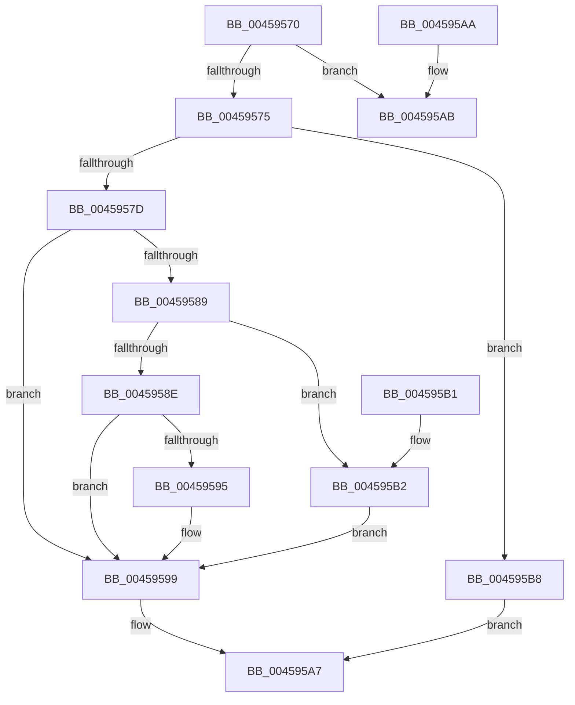

# RtlGetDaclSecurityDescriptor

- RVA: `0x00459570`–`0x004595BC` (길이 `76` bytes)
- VA: `0x0000000140459570`
- 실행 섹션: `.text`
- PDB 이름 있음: `예`; PDB Function 태그: `아니요`
- unwind 정보 RVA: `0x000DB714`
- 디코드: `30`개 명령, `76/76` bytes 표시
- 미해석 바이트: `0` (있으면 어셈블리에 `.byte`로 보존)

> 이 문서는 커널 이미지의 기계어와 PDB 기호를 분석해 생성했습니다. 4번과 5번은 함수 원형과 자료형을 바이너리 사용 방식에서 추정한 C 해석이며 원본 소스 복구 결과는 아닙니다.

## 1. Dependencies

- 직접 호출 지점: **0**; 고유 호출 대상: **0**
- 직접 호출자로 확인된 함수: **13**
- RIP 상대 이미지 참조: **0**

### Outgoing calls
- 직접 디코드된 call 명령이 없습니다.

### Direct callers
- [ObCleanupSecurityDescriptor](../../page/74/ObCleanupSecurityDescriptor_function_0074D734.md) at `0x0074D750`
- [ObpCreateDosDevicesDirectory](../../page/74/ObpCreateDosDevicesDirectory_function_0074E03C.md) at `0x0074E274`
- [RtlReplaceSidInSd](../../page/78/RtlReplaceSidInSd_function_0078E6E0.md) at `0x0078E832`
- [RtlpSysVolCheckOwnerAndSecurity](../../page/79/RtlpSysVolCheckOwnerAndSecurity_function_00791324.md) at `0x007913FC`
- [ExpInitFullProcessSecurityInfo](../../page/7C/ExpInitFullProcessSecurityInfo_function_007C43D0.md) at `0x007C44A7`
- [CmpCopySaclToVirtualKey](../../page/7E/CmpCopySaclToVirtualKey_function_007ECA6C.md) at `0x007ECC19`
- [MiInitializeMemoryEvents](../../page/81/MiInitializeMemoryEvents_function_0081123C.md) at `0x00811331`
- [ExpWnfSpecializeSecurityDescriptor](../../page/8B/ExpWnfSpecializeSecurityDescriptor_function_008BE68C.md) at `0x008BE6AF`
- [LocalConvertSDToStringSD_Rev1](../../page/92/LocalConvertSDToStringSD_Rev1_function_00924428.md) at `0x00924503`
- [PipChangeDeviceObjectFromRegistryProperties](../../page/99/PipChangeDeviceObjectFromRegistryProperties_function_00994FD0.md) at `0x00995192`
- [PiDevCfgGetKeySecurityDescriptor](../../page/99/PiDevCfgGetKeySecurityDescriptor_function_00996240.md) at `0x00996399`
- [ObpInsertOrLocateNamedObject](../../page/99/ObpInsertOrLocateNamedObject_function_0099F2C0.md) at `0x0099F735`
- [IopGetSecurityDescriptorInformation](../../page/9A/IopGetSecurityDescriptorInformation_function_009A2FA4.md) at `0x009A3061`

### Static image references
- 디코드된 RIP-relative 메모리 참조가 없습니다.

## 2. Other-region calls and transfers

- 다른 실행 섹션으로 향하는 call: **0**
- 별도 외부 분기/꼬리 이동을 확인하지 못했습니다.

## 3. Assembly (complete function range)

```asm
00459570  80 39 01                        cmp byte ptr [rcx], 1
00459573  75 36                           jne 0x1404595ab
00459575  33 C0                           xor eax, eax
00459577  F6 41 02 04                     test byte ptr [rcx + 2], 4
0045957B  74 3B                           je 0x1404595b8
0045957D  C6 02 01                        mov byte ptr [rdx], 1
00459580  0F B7 51 02                     movzx edx, word ptr [rcx + 2]
00459584  F6 C2 04                        test dl, 4
00459587  74 10                           je 0x140459599
00459589  66 85 D2                        test dx, dx
0045958C  79 24                           jns 0x1404595b2
0045958E  8B 51 10                        mov edx, dword ptr [rcx + 0x10]
00459591  85 D2                           test edx, edx
00459593  74 04                           je 0x140459599
00459595  48 8D 04 11                     lea rax, [rcx + rdx]
00459599  49 89 00                        mov qword ptr [r8], rax
0045959C  8A 41 02                        mov al, byte ptr [rcx + 2]
0045959F  C0 E8 03                        shr al, 3
004595A2  24 01                           and al, 1
004595A4  41 88 01                        mov byte ptr [r9], al
004595A7  33 C0                           xor eax, eax
004595A9  C3                              ret
004595AA  CC                              int3
004595AB  B8 58 00 00 C0                  mov eax, 0xc0000058
004595B0  C3                              ret
004595B1  CC                              int3
004595B2  48 8B 41 20                     mov rax, qword ptr [rcx + 0x20]
004595B6  EB E1                           jmp 0x140459599
004595B8  88 02                           mov byte ptr [rdx], al
004595BA  EB EB                           jmp 0x1404595a7
```

## 4. C-style interpretation (structured pseudocode)

```c
__int64 __fastcall RtlGetDaclSecurityDescriptor(__int64 a1, __int64 a2, __int64 a3, __int64 a4)
{
    __int64 result;

    if ((*(unsigned __int8 *)(a1)) != 1) goto loc_004595AB;
    result = 0;
    if (((*(unsigned __int8 *)(a1 + 2)) & (4)) == 0) goto loc_004595B8;
    *(unsigned __int8 *)(a2) = 1;
    if ((((unsigned __int8)(*(unsigned __int16 *)(a1 + 2))) & (4)) == 0) goto loc_00459599;
    if (!sign_flag) goto loc_004595B2;
    if ((unsigned int)((unsigned int)(*(unsigned int *)(a1 + 16))) != 0) {
        result = a1 + (unsigned int)(*(unsigned int *)(a1 + 16)) * 1;
    }
    *(unsigned __int64 *)(a3) = result;
    result = (unsigned __int8)((*(unsigned __int8 *)(a1 + 2)) >> (3));
    result = (unsigned __int8)((result) & (1));
    *(unsigned __int8 *)(a4) = (unsigned __int8)(result);
loc_004595A7:
    result = 0;
    return result;
loc_004595AB:
    return (unsigned int)(0xC0000058ULL);
loc_004595B2:
    goto loc_00459599;
loc_004595B8:
    *(unsigned __int8 *)((unsigned int)(*(unsigned int *)(a1 + 16))) = (unsigned __int8)(*(unsigned __int64 *)(a1 + 32));
    goto loc_004595A7;
}
```

## 5. (Beta) C Style

```c
int64_t RtlGetDaclSecurityDescriptor(void *Arg1, void *Arg2, void *Arg3, void *Arg4)
{
    uint8_t *arg1 = (uint8_t *)Arg1;
    uint8_t *arg2 = (uint8_t *)Arg2;
    uint8_t *arg3 = (uint8_t *)Arg3;
    uint8_t *arg4 = (uint8_t *)Arg4;

    int64_t result;

    if ((*(uint8_t *)(arg1)) != 1) goto loc_004595AB;
    result = 0;
    if (((*(uint8_t *)(arg1 + 0x2)) & (4)) == 0) goto loc_004595B8;
    *(uint8_t *)(arg2) = 1;
    if ((((uint8_t)(*(uint16_t *)(arg1 + 0x2))) & (4)) == 0) goto loc_00459599;
    if (!sign_flag) goto loc_004595B2;
    if ((uint32_t)((uint32_t)(*(uint32_t *)(arg1 + 0x10))) != 0) {
        result = Arg1 + (uint32_t)(*(uint32_t *)(arg1 + 0x10)) * 1;
    }
    *(uint64_t *)(arg3) = result;
    result = (uint8_t)((*(uint8_t *)(arg1 + 0x2)) >> (3));
    result = (uint8_t)((result) & (1));
    *(uint8_t *)(arg4) = (uint8_t)(result);
loc_004595A7:
    result = 0;
    return result;
loc_004595AB:
    return (uint32_t)(0xC0000058ULL);
loc_004595B2:
    goto loc_00459599;
loc_004595B8:
    *(uint8_t *)((uint32_t)(*(uint32_t *)(arg1 + 0x10))) = (uint8_t)(*(uint64_t *)(arg1 + 0x20));
    goto loc_004595A7;
}
```

### 관측된 메모리 오프셋

구조체 형식이 확인되지 않은 접근은 인자 기준의 오프셋으로만 기록했습니다.

| 기준 인자 | 오프셋 표현 | 폭 (bit) | 접근 |
|---|---:|---:|---|
| `Arg1` | `+ 0x0` | `8` | `R` |
| `Arg1` | `+ 0x0 + rdx*1` | `64` | `R` |
| `Arg1` | `+ 0x2` | `8` | `R` |
| `Arg1` | `+ 0x2` | `16` | `R` |
| `Arg1` | `+ 0x10` | `32` | `R` |
| `Arg1` | `+ 0x20` | `64` | `R` |
| `Arg2` | `+ 0x0` | `8` | `W` |
| `Arg3` | `+ 0x0` | `64` | `W` |
| `Arg4` | `+ 0x0` | `8` | `W` |

## 6. Execution-region graph

[열기: 2D/3D 그래프와 함수 탐색 컨트롤 패널](../../../control-panel.html?section=text&rva=0x00459570&view=graph)

- 2D 그래프는 위에서 아래로 흐르고, 3D 그래프는 빈 공간을 드래그해 회전합니다. Shift+드래그는 이동, 휠은 확대·축소, 함수 노드 선택은 대상 보고서 이동입니다.

### Static fallback


