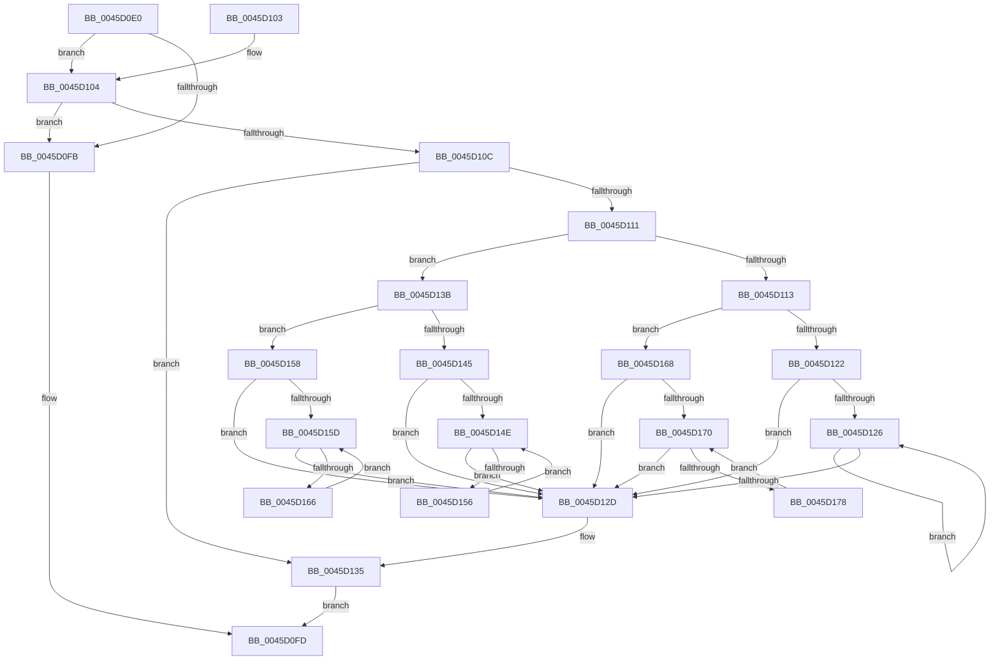

# RtlGetElementGenericTable

- RVA: `0x0045D0E0`–`0x0045D17A` (길이 `154` bytes)
- VA: `0x000000014045D0E0`
- 실행 섹션: `.text`
- PDB 이름 있음: `예`; PDB Function 태그: `아니요`
- unwind 정보 RVA: `0x000A95C0`
- 디코드: `57`개 명령, `154/154` bytes 표시
- 미해석 바이트: `0` (있으면 어셈블리에 `.byte`로 보존)

> 이 문서는 커널 이미지의 기계어와 PDB 기호를 분석해 생성했습니다. 4번과 5번은 함수 원형과 자료형을 바이너리 사용 방식에서 추정한 C 해석이며 원본 소스 복구 결과는 아닙니다.

## 1. Dependencies

- 직접 호출 지점: **0**; 고유 호출 대상: **0**
- 직접 호출자로 확인된 함수: **0**
- RIP 상대 이미지 참조: **0**

### Outgoing calls
- 직접 디코드된 call 명령이 없습니다.

### Direct callers
- 이 함수 시작 RVA로 연결되는 직접 call은 확인되지 않았습니다. 간접 호출은 완전히 역산할 수 없습니다.

### Static image references
- 디코드된 RIP-relative 메모리 참조가 없습니다.

## 2. Other-region calls and transfers

- 다른 실행 섹션으로 향하는 call: **0**
- 별도 외부 분기/꼬리 이동을 확인하지 못했습니다.

## 3. Assembly (complete function range)

```asm
0045D0E0  48 89 5C 24 08                  mov qword ptr [rsp + 8], rbx
0045D0E5  44 8B 51 20                     mov r10d, dword ptr [rcx + 0x20]
0045D0E9  44 8D 5A 01                     lea r11d, [rdx + 1]
0045D0ED  4C 8B 41 18                     mov r8, qword ptr [rcx + 0x18]
0045D0F1  83 CB FF                        or ebx, 0xffffffff
0045D0F4  45 8B CB                        mov r9d, r11d
0045D0F7  3B D3                           cmp edx, ebx
0045D0F9  75 09                           jne 0x14045d104
0045D0FB  33 C0                           xor eax, eax
0045D0FD  48 8B 5C 24 08                  mov rbx, qword ptr [rsp + 8]
0045D102  C3                              ret
0045D103  CC                              int3
0045D104  8B 41 24                        mov eax, dword ptr [rcx + 0x24]
0045D107  44 3B D8                        cmp r11d, eax
0045D10A  77 EF                           ja 0x14045d0fb
0045D10C  45 3B DA                        cmp r11d, r10d
0045D10F  74 24                           je 0x14045d135
0045D111  72 28                           jb 0x14045d13b
0045D113  41 2B C3                        sub eax, r11d
0045D116  41 8B D3                        mov edx, r11d
0045D119  41 2B D2                        sub edx, r10d
0045D11C  FF C0                           inc eax
0045D11E  3B D0                           cmp edx, eax
0045D120  77 46                           ja 0x14045d168
0045D122  85 D2                           test edx, edx
0045D124  74 07                           je 0x14045d12d
0045D126  4D 8B 00                        mov r8, qword ptr [r8]
0045D129  03 D3                           add edx, ebx
0045D12B  75 F9                           jne 0x14045d126
0045D12D  4C 89 41 18                     mov qword ptr [rcx + 0x18], r8
0045D131  44 89 59 20                     mov dword ptr [rcx + 0x20], r11d
0045D135  49 8D 40 10                     lea rax, [r8 + 0x10]
0045D139  EB C2                           jmp 0x14045d0fd
0045D13B  41 8B C2                        mov eax, r10d
0045D13E  D1 E8                           shr eax, 1
0045D140  44 3B D8                        cmp r11d, eax
0045D143  77 13                           ja 0x14045d158
0045D145  4C 8D 41 08                     lea r8, [rcx + 8]
0045D149  45 85 DB                        test r11d, r11d
0045D14C  74 DF                           je 0x14045d12d
0045D14E  4D 8B 00                        mov r8, qword ptr [r8]
0045D151  44 03 CB                        add r9d, ebx
0045D154  74 D7                           je 0x14045d12d
0045D156  EB F6                           jmp 0x14045d14e
0045D158  45 2B D3                        sub r10d, r11d
0045D15B  74 D0                           je 0x14045d12d
0045D15D  4D 8B 40 08                     mov r8, qword ptr [r8 + 8]
0045D161  44 03 D3                        add r10d, ebx
0045D164  74 C7                           je 0x14045d12d
0045D166  EB F5                           jmp 0x14045d15d
0045D168  4C 8D 41 08                     lea r8, [rcx + 8]
0045D16C  85 C0                           test eax, eax
0045D16E  74 BD                           je 0x14045d12d
0045D170  4D 8B 40 08                     mov r8, qword ptr [r8 + 8]
0045D174  03 C3                           add eax, ebx
0045D176  74 B5                           je 0x14045d12d
0045D178  EB F6                           jmp 0x14045d170
```

## 4. C-style interpretation (structured pseudocode)

```c
__int64 __fastcall RtlGetElementGenericTable(__int64 a1, __int64 a2)
{
    __int64 result;
    __int64 v_r10;
    __int64 v_rbx;
    unsigned __int64 v_stack_p8;

    v_stack_p8 = v_rbx;
    v_rbx = (unsigned int)((v_rbx) | (0xFFFFFFFFULL));
    if (((unsigned int)(a2)) != ((unsigned int)(v_rbx))) goto loc_0045D104;
loc_0045D0FB:
    result = 0;
loc_0045D0FD:
    return result;
loc_0045D104:
    if (((unsigned int)(a2 + 1)) > ((unsigned int)((unsigned int)(*(unsigned int *)(a1 + 36))))) goto loc_0045D0FB;
    if (((unsigned int)(a2 + 1)) == ((unsigned int)((unsigned int)(*(unsigned int *)(a1 + 32))))) goto loc_0045D135;
    if (((unsigned int)(a2 + 1)) < ((unsigned int)((unsigned int)(*(unsigned int *)(a1 + 32))))) goto loc_0045D13B;
    result = (unsigned int)(((unsigned int)(*(unsigned int *)(a1 + 36))) - ((unsigned int)(a2 + 1)));
    a2 = (unsigned int)(((unsigned int)((unsigned int)(a2 + 1))) - ((unsigned int)((unsigned int)(*(unsigned int *)(a1 + 32)))));
    result = (unsigned int)((result) + 1);
    if (((unsigned int)(a2)) > ((unsigned int)(result))) goto loc_0045D168;
    if ((unsigned int)(a2) == 0) goto loc_0045D12D;
loc_0045D126:
    a2 = (unsigned int)((a2) + ((unsigned int)(v_stack_p8)));
    if (condition_is_not_equal) goto loc_0045D126;
loc_0045D12D:
    *(unsigned __int64 *)(a1 + 24) = *(unsigned __int64 *)(*(unsigned __int64 *)(a1 + 24));
    *(unsigned int *)(a1 + 32) = (unsigned int)(a2 + 1);
loc_0045D135:
    goto loc_0045D0FD;
loc_0045D13B:
    result = (unsigned int)(((unsigned int)((unsigned int)((unsigned int)(*(unsigned int *)(a1 + 32))))) >> (1));
    if (((unsigned int)(a2 + 1)) > ((unsigned int)(result))) goto loc_0045D158;
    if ((unsigned int)(a2 + 1) == 0) goto loc_0045D12D;
loc_0045D14E:
    a4 = (unsigned int)(((unsigned int)((unsigned int)(a2 + 1))) + ((unsigned int)(v_stack_p8)));
    if (condition_is_equal) goto loc_0045D12D;
    goto loc_0045D14E;
loc_0045D158:
    v_r10 = (unsigned int)(((unsigned int)(*(unsigned int *)(a1 + 32))) - ((unsigned int)(a2 + 1)));
    if (condition_is_equal) goto loc_0045D12D;
loc_0045D15D:
    v_r10 = (unsigned int)((v_r10) + ((unsigned int)(v_stack_p8)));
    if (condition_is_equal) goto loc_0045D12D;
    goto loc_0045D15D;
loc_0045D168:
    if ((unsigned int)(result) == 0) goto loc_0045D12D;
loc_0045D170:
    result = (unsigned int)((result) + ((unsigned int)(v_stack_p8)));
    if (condition_is_equal) goto loc_0045D12D;
    goto loc_0045D170;
}
```

## 5. (Beta) C Style

```c
int64_t RtlGetElementGenericTable(void *Arg1, void *Arg2)
{
    uint8_t *arg1 = (uint8_t *)Arg1;
    uint8_t *arg2 = (uint8_t *)Arg2;

    int64_t result;
    int64_t local_r10;
    int64_t local_rbx;
    uint64_t v_stack_p8;

    v_stack_p8 = local_rbx;
    local_rbx = (uint32_t)((local_rbx) | (0xFFFFFFFFULL));
    if (((uint32_t)(Arg2)) != ((uint32_t)(local_rbx))) goto loc_0045D104;
loc_0045D0FB:
    result = 0;
loc_0045D0FD:
    return result;
loc_0045D104:
    if (((uint32_t)(Arg2 + 1)) > ((uint32_t)((uint32_t)(*(uint32_t *)(arg1 + 0x24))))) goto loc_0045D0FB;
    if (((uint32_t)(Arg2 + 1)) == ((uint32_t)((uint32_t)(*(uint32_t *)(arg1 + 0x20))))) goto loc_0045D135;
    if (((uint32_t)(Arg2 + 1)) < ((uint32_t)((uint32_t)(*(uint32_t *)(arg1 + 0x20))))) goto loc_0045D13B;
    result = (uint32_t)(((uint32_t)(*(uint32_t *)(arg1 + 0x24))) - ((uint32_t)(Arg2 + 1)));
    Arg2 = (uint32_t)(((uint32_t)((uint32_t)(Arg2 + 1))) - ((uint32_t)((uint32_t)(*(uint32_t *)(arg1 + 0x20)))));
    result = (uint32_t)((result) + 1);
    if (((uint32_t)(Arg2)) > ((uint32_t)(result))) goto loc_0045D168;
    if ((uint32_t)(Arg2) == 0) goto loc_0045D12D;
loc_0045D126:
    Arg2 = (uint32_t)((Arg2) + ((uint32_t)(v_stack_p8)));
    if (condition_is_not_equal) goto loc_0045D126;
loc_0045D12D:
    *(uint64_t *)(arg1 + 0x18) = *(uint64_t *)(*(uint64_t *)(arg1 + 0x18));
    *(uint32_t *)(arg1 + 0x20) = (uint32_t)(Arg2 + 1);
loc_0045D135:
    goto loc_0045D0FD;
loc_0045D13B:
    result = (uint32_t)(((uint32_t)((uint32_t)((uint32_t)(*(uint32_t *)(arg1 + 0x20))))) >> (1));
    if (((uint32_t)(Arg2 + 1)) > ((uint32_t)(result))) goto loc_0045D158;
    if ((uint32_t)(Arg2 + 1) == 0) goto loc_0045D12D;
loc_0045D14E:
    a4 = (uint32_t)(((uint32_t)((uint32_t)(Arg2 + 1))) + ((uint32_t)(v_stack_p8)));
    if (condition_is_equal) goto loc_0045D12D;
    goto loc_0045D14E;
loc_0045D158:
    local_r10 = (uint32_t)(((uint32_t)(*(uint32_t *)(arg1 + 0x20))) - ((uint32_t)(Arg2 + 1)));
    if (condition_is_equal) goto loc_0045D12D;
loc_0045D15D:
    local_r10 = (uint32_t)((local_r10) + ((uint32_t)(v_stack_p8)));
    if (condition_is_equal) goto loc_0045D12D;
    goto loc_0045D15D;
loc_0045D168:
    if ((uint32_t)(result) == 0) goto loc_0045D12D;
loc_0045D170:
    result = (uint32_t)((result) + ((uint32_t)(v_stack_p8)));
    if (condition_is_equal) goto loc_0045D12D;
    goto loc_0045D170;
}
```

### 관측된 메모리 오프셋

구조체 형식이 확인되지 않은 접근은 인자 기준의 오프셋으로만 기록했습니다.

| 기준 인자 | 오프셋 표현 | 폭 (bit) | 접근 |
|---|---:|---:|---|
| `Arg1` | `+ 0x8` | `64` | `R` |
| `Arg1` | `+ 0x18` | `64` | `R` |
| `Arg1` | `+ 0x18` | `64` | `W` |
| `Arg1` | `+ 0x20` | `32` | `R` |
| `Arg1` | `+ 0x20` | `32` | `W` |
| `Arg1` | `+ 0x24` | `32` | `R` |
| `Arg2` | `+ 0x1` | `32` | `R` |

## 6. Execution-region graph

[열기: 2D/3D 그래프와 함수 탐색 컨트롤 패널](../../../control-panel.html?section=text&rva=0x0045D0E0&view=graph)

- 2D 그래프는 위에서 아래로 흐르고, 3D 그래프는 빈 공간을 드래그해 회전합니다. Shift+드래그는 이동, 휠은 확대·축소, 함수 노드 선택은 대상 보고서 이동입니다.

### Static fallback


