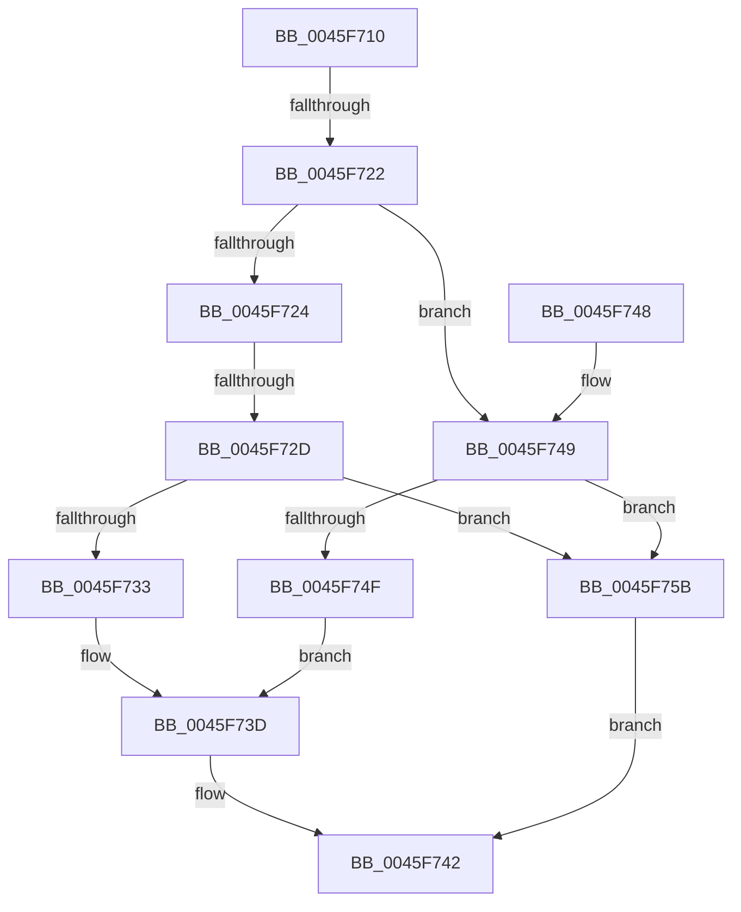

# RtlGetSystemGlobalData

- RVA: `0x0045F710`–`0x0045F762` (길이 `82` bytes)
- VA: `0x000000014045F710`
- 실행 섹션: `.text`
- PDB 이름 있음: `예`; PDB Function 태그: `예`
- unwind 정보 RVA: `0x00064C68`
- 디코드: `23`개 명령, `82/82` bytes 표시
- 미해석 바이트: `0` (있으면 어셈블리에 `.byte`로 보존)

> 이 문서는 커널 이미지의 기계어와 PDB 기호를 분석해 생성했습니다. 4번과 5번은 함수 원형과 자료형을 바이너리 사용 방식에서 추정한 C 해석이며 원본 소스 복구 결과는 아닙니다.

## 1. Dependencies

- 직접 호출 지점: **0**; 고유 호출 대상: **0**
- 직접 호출자로 확인된 함수: **0**
- RIP 상대 이미지 참조: **0**

### Outgoing calls
- 직접 디코드된 call 명령이 없습니다.

### Direct callers
- 이 함수 시작 RVA로 연결되는 직접 call은 확인되지 않았습니다. 간접 호출은 완전히 역산할 수 없습니다.

### Static image references
- 디코드된 RIP-relative 메모리 참조가 없습니다.

## 2. Other-region calls and transfers

- 다른 실행 섹션으로 향하는 call: **0**
- call이 아닌 외부 분기/꼬리 이동: **2**
  - `0x0045F71C` → [sub_006F213A + 0x182](../6F/Unknown_function_006F213A.md) (`tail-transfer`)
  - `0x0045F727` → [sub_006F213A](../6F/Unknown_function_006F213A.md) (`tail-transfer`)

## 3. Assembly (complete function range)

```asm
0045F710  40 53                           push rbx
0045F712  48 83 EC 20                     sub rsp, 0x20
0045F716  48 8B DA                        mov rbx, rdx
0045F719  83 F9 09                        cmp ecx, 9
0045F71C  0F 8F 9A 2B 29 00               jg 0x1406f22bc
0045F722  74 25                           je 0x14045f749
0045F724  83 E9 01                        sub ecx, 1
0045F727  0F 85 0D 2A 29 00               jne 0x1406f213a
0045F72D  41 83 F8 08                     cmp r8d, 8
0045F731  75 28                           jne 0x14045f75b
0045F733  48 A1 50 02 00 00 80 F7 FF FF   movabs rax, qword ptr [0xfffff78000000250]
0045F73D  48 89 02                        mov qword ptr [rdx], rax
0045F740  33 C0                           xor eax, eax
0045F742  48 83 C4 20                     add rsp, 0x20
0045F746  5B                              pop rbx
0045F747  C3                              ret
0045F748  CC                              int3
0045F749  41 83 F8 08                     cmp r8d, 8
0045F74D  75 0C                           jne 0x14045f75b
0045F74F  48 A1 C8 02 00 00 80 F7 FF FF   movabs rax, qword ptr [0xfffff780000002c8]
0045F759  EB E2                           jmp 0x14045f73d
0045F75B  B8 06 02 00 C0                  mov eax, 0xc0000206
0045F760  EB E0                           jmp 0x14045f742
```

## 4. C-style interpretation (structured pseudocode)

```c
__int64 __fastcall RtlGetSystemGlobalData(int a1, __int64 a2, int a3)
{
    __int64 result;
    __int64 v_rsp;

    v_rsp = (v_rsp) - (32);
    if (a1 == 9) goto loc_0045F749;
    a1 = (unsigned int)((a1) - (1));
    if (a3 != 8) goto loc_0045F75B;
loc_0045F73D:
    *(unsigned __int64 *)(a2) = result;
    result = 0;
loc_0045F742:
    v_rsp = (v_rsp) + (32);
    return result;
loc_0045F749:
    if (a3 != 8) goto loc_0045F75B;
    goto loc_0045F73D;
loc_0045F75B:
    goto loc_0045F742;
}
```

## 5. (Beta) C Style

```c
int64_t RtlGetSystemGlobalData(int32_t Arg1, void *Arg2, int32_t Arg3)
{
    uint8_t *arg2 = (uint8_t *)Arg2;

    int64_t result;
    int64_t local_rsp;

    local_rsp = (local_rsp) - (32);
    if (Arg1 == 9) goto loc_0045F749;
    Arg1 = (uint32_t)((Arg1) - (1));
    if (Arg3 != 8) goto loc_0045F75B;
loc_0045F73D:
    *(uint64_t *)(arg2) = result;
    result = 0;
loc_0045F742:
    local_rsp = (local_rsp) + (32);
    return result;
loc_0045F749:
    if (Arg3 != 8) goto loc_0045F75B;
    goto loc_0045F73D;
loc_0045F75B:
    goto loc_0045F742;
}
```

### 관측된 메모리 오프셋

구조체 형식이 확인되지 않은 접근은 인자 기준의 오프셋으로만 기록했습니다.

| 기준 인자 | 오프셋 표현 | 폭 (bit) | 접근 |
|---|---:|---:|---|
| `Arg2` | `+ 0x0` | `64` | `W` |

## 6. Execution-region graph

[열기: 2D/3D 그래프와 함수 탐색 컨트롤 패널](../../../control-panel.html?section=text&rva=0x0045F710&view=graph)

- 2D 그래프는 위에서 아래로 흐르고, 3D 그래프는 빈 공간을 드래그해 회전합니다. Shift+드래그는 이동, 휠은 확대·축소, 함수 노드 선택은 대상 보고서 이동입니다.

### Static fallback


