# RtlInsertDynamicUserFunctionTable

- RVA: `0x004513C4`–`0x004516D0` (길이 `780` bytes)
- VA: `0x00000001404513C4`
- 실행 섹션: `.text`
- PDB 이름 있음: `예`; PDB Function 태그: `아니요`
- unwind 정보 RVA: `0x000A7478`
- 디코드: `197`개 명령, `780/780` bytes 표시
- 미해석 바이트: `0` (있으면 어셈블리에 `.byte`로 보존)

> 이 문서는 커널 이미지의 기계어와 PDB 기호를 분석해 생성했습니다. 4번과 5번은 함수 원형과 자료형을 바이너리 사용 방식에서 추정한 C 해석이며 원본 소스 복구 결과는 아닙니다.

## 1. Dependencies

- 직접 호출 지점: **10**; 고유 호출 대상: **9**
- 직접 호출자로 확인된 함수: **1**
- RIP 상대 이미지 참조: **0**

### Outgoing calls
- `0x0045141E` → [ExRaiseDatatypeMisalignment](../../page/89/ExRaiseDatatypeMisalignment_function_00899FD0.md) (function, `0x00899FD0`)
- `0x00451478` → [KeAbPreAcquire](../21/KeAbPreAcquire_function_00210230.md) (function, `0x00210230`)
- `0x00451491` → [ExfAcquirePushLockExclusiveEx](../20/ExfAcquirePushLockExclusiveEx_function_0020FC90.md) (function, `0x0020FC90`)
- `0x00451505` → [KeAbPostRelease](../2E/KeAbPostRelease_function_002E1600.md) (function, `0x002E1600`)
- `0x0045152A` → [KiCheckForKernelApcDelivery](../2E/KiCheckForKernelApcDelivery_function_002E2C80.md) (function, `0x002E2C80`)
- `0x0045153C` → [ExFreePoolWithTag](../../poolcode/B8/ExFreePoolWithTag_function_00B82870.md) (function, `0x00B82870`)
- `0x00451583` → [ExAllocatePool2](../../poolcode/B8/ExAllocatePool2_function_00B820F0.md) (function, `0x00B820F0`)
- `0x004515B8` → [memcpy](../6C/memcpy_function_006C6840.md) (function, `0x006C6840`)
- `0x0045165D` → [memcpy](../6C/memcpy_function_006C6840.md) (function, `0x006C6840`)
- `0x004516C6` → [ExfTryToWakePushLock](../26/ExfTryToWakePushLock_function_00265DD0.md) (function, `0x00265DD0`)

### Direct callers
- [NtSetInformationProcess](../../page/AE/NtSetInformationProcess_function_00AE5370.md) at `0x00AE8A31`

### Static image references
- 디코드된 RIP-relative 메모리 참조가 없습니다.

## 2. Other-region calls and transfers

- 다른 실행 섹션으로 향하는 call: **3**
  - `0x0045141E` → [ExRaiseDatatypeMisalignment](../../page/89/ExRaiseDatatypeMisalignment_function_00899FD0.md) (`.text` → `PAGE`)
  - `0x0045153C` → [ExFreePoolWithTag](../../poolcode/B8/ExFreePoolWithTag_function_00B82870.md) (`.text` → `POOLCODE`)
  - `0x00451583` → [ExAllocatePool2](../../poolcode/B8/ExAllocatePool2_function_00B820F0.md) (`.text` → `POOLCODE`)
- 별도 외부 분기/꼬리 이동을 확인하지 못했습니다.

## 3. Assembly (complete function range)

```asm
004513C4  4C 8B DC                        mov r11, rsp
004513C7  53                              push rbx
004513C8  56                              push rsi
004513C9  57                              push rdi
004513CA  41 54                           push r12
004513CC  41 55                           push r13
004513CE  41 56                           push r14
004513D0  41 57                           push r15
004513D2  48 83 EC 40                     sub rsp, 0x40
004513D6  4C 8B E9                        mov r13, rcx
004513D9  41 F6 C5 03                     test r13b, 3
004513DD  75 3F                           jne 0x14045141e
004513DF  48 B8 00 00 FF FF FF 7F 00 00   movabs rax, 0x7fffffff0000
004513E9  48 3B C8                        cmp rcx, rax
004513EC  48 0F 42 C1                     cmovb rax, rcx
004513F0  90                              nop
004513F1  8A 00                           mov al, byte ptr [rax]
004513F3  48 8B 41 30                     mov rax, qword ptr [rcx + 0x30]
004513F7  49 89 43 B0                     mov qword ptr [r11 - 0x50], rax
004513FB  48 8B 41 28                     mov rax, qword ptr [rcx + 0x28]
004513FF  49 89 43 B8                     mov qword ptr [r11 - 0x48], rax
00451403  49 3B 43 B0                     cmp rax, qword ptr [r11 - 0x50]
00451407  72 1B                           jb 0x140451424
00451409  48 2B 44 24 28                  sub rax, qword ptr [rsp + 0x28]
0045140E  B9 FF FF FF FF                  mov ecx, 0xffffffff
00451413  48 3B C1                        cmp rax, rcx
00451416  77 0C                           ja 0x140451424
00451418  89 44 24 20                     mov dword ptr [rsp + 0x20], eax
0045141C  EB 15                           jmp 0x140451433
0045141E  E8 AD 8B 44 00                  call 0x140899fd0
00451423  CC                              int3
00451424  B8 95 00 00 C0                  mov eax, 0xc0000095
00451429  E9 15 01 00 00                  jmp 0x140451543
0045142E  E9 10 01 00 00                  jmp 0x140451543
00451433  33 D2                           xor edx, edx
00451435  48 89 94 24 88 00 00 00         mov qword ptr [rsp + 0x88], rdx
0045143D  33 F6                           xor esi, esi
0045143F  65 48 8B 04 25 88 01 00 00      mov rax, qword ptr gs:[0x188]
00451448  48 89 84 24 98 00 00 00         mov qword ptr [rsp + 0x98], rax
00451450  4C 8B B8 20 02 00 00            mov r15, qword ptr [rax + 0x220]
00451457  4C 89 BC 24 90 00 00 00         mov qword ptr [rsp + 0x90], r15
0045145F  48 83 CB FF                     or rbx, 0xffffffffffffffff
00451463  66 01 98 E6 01 00 00            add word ptr [rax + 0x1e6], bx
0045146A  90                              nop
0045146B  49 8D BF D0 05 00 00            lea rdi, [r15 + 0x5d0]
00451472  45 33 C0                        xor r8d, r8d
00451475  48 8B CF                        mov rcx, rdi
00451478  E8 B3 ED DB FF                  call 0x140210230
0045147D  4C 8B F0                        mov r14, rax
00451480  F0 48 0F BA 2F 00               lock bts qword ptr [rdi], 0
00451486  73 0E                           jae 0x140451496
00451488  4C 8B C7                        mov r8, rdi
0045148B  48 8B D0                        mov rdx, rax
0045148E  48 8B CF                        mov rcx, rdi
00451491  E8 FA E7 DB FF                  call 0x14020fc90
00451496  41 BC 01 00 00 00               mov r12d, 1
0045149C  4D 85 F6                        test r14, r14
0045149F  74 04                           je 0x1404514a5
004514A1  45 88 66 0A                     mov byte ptr [r14 + 0xa], r12b
004514A5  49 8B BF C8 05 00 00            mov rdi, qword ptr [r15 + 0x5c8]
004514AC  48 85 FF                        test rdi, rdi
004514AF  0F 84 DF 01 00 00               je 0x140451694
004514B5  44 8B 37                        mov r14d, dword ptr [rdi]
004514B8  8B 4F 04                        mov ecx, dword ptr [rdi + 4]
004514BB  41 8D 46 01                     lea eax, [r14 + 1]
004514BF  3B C1                           cmp eax, ecx
004514C1  0F 86 10 01 00 00               jbe 0x1404515d7
004514C7  44 8D 79 0A                     lea r15d, [rcx + 0xa]
004514CB  44 3B F9                        cmp r15d, ecx
004514CE  0F 83 80 00 00 00               jae 0x140451554
004514D4  BE 95 00 00 C0                  mov esi, 0xc0000095
004514D9  4C 8B B4 24 88 00 00 00         mov r14, qword ptr [rsp + 0x88]
004514E1  48 8B BC 24 90 00 00 00         mov rdi, qword ptr [rsp + 0x90]
004514E9  F0 48 0F C1 9F D0 05 00 00      lock xadd qword ptr [rdi + 0x5d0], rbx
004514F2  80 E3 06                        and bl, 6
004514F5  80 FB 02                        cmp bl, 2
004514F8  0F 84 C1 01 00 00               je 0x1404516bf
004514FE  48 8D 8F D0 05 00 00            lea rcx, [rdi + 0x5d0]
00451505  E8 F6 00 E9 FF                  call 0x1402e1600
0045150A  90                              nop
0045150B  4C 8B 84 24 98 00 00 00         mov r8, qword ptr [rsp + 0x98]
00451513  66 45 01 A0 E6 01 00 00         add word ptr [r8 + 0x1e6], r12w
0045151B  75 12                           jne 0x14045152f
0045151D  90                              nop
0045151E  49 81 C0 98 00 00 00            add r8, 0x98
00451525  4D 39 00                        cmp qword ptr [r8], r8
00451528  74 05                           je 0x14045152f
0045152A  E8 51 17 E9 FF                  call 0x1402e2c80
0045152F  4D 85 F6                        test r14, r14
00451532  74 0D                           je 0x140451541
00451534  BA 52 74 44 46                  mov edx, 0x46447452
00451539  49 8B CE                        mov rcx, r14
0045153C  E8 2F 13 73 00                  call 0x140b82870
00451541  8B C6                           mov eax, esi
00451543  48 83 C4 40                     add rsp, 0x40
00451547  41 5F                           pop r15
00451549  41 5E                           pop r14
0045154B  41 5D                           pop r13
0045154D  41 5C                           pop r12
0045154F  5F                              pop rdi
00451550  5E                              pop rsi
00451551  5B                              pop rbx
00451552  C3                              ret
00451553  CC                              int3
00451554  4B 8D 0C 7F                     lea rcx, [r15 + r15*2]
00451558  48 8D 0C CD 10 00 00 00         lea rcx, [rcx*8 + 0x10]
00451560  B8 FF FF FF FF                  mov eax, 0xffffffff
00451565  48 3B C8                        cmp rcx, rax
00451568  0F 83 66 FF FF FF               jae 0x1404514d4
0045156E  48 89 BC 24 88 00 00 00         mov qword ptr [rsp + 0x88], rdi
00451576  8B D1                           mov edx, ecx
00451578  B9 01 01 00 00                  mov ecx, 0x101
0045157D  41 B8 52 74 44 46               mov r8d, 0x46447452
00451583  E8 68 0B 73 00                  call 0x140b820f0
00451588  48 8B F8                        mov rdi, rax
0045158B  48 85 C0                        test rax, rax
0045158E  0F 84 0A 01 00 00               je 0x14045169e
00451594  48 8D 48 10                     lea rcx, [rax + 0x10]
00451598  45 85 F6                        test r14d, r14d
0045159B  0F 84 0A 01 00 00               je 0x1404516ab
004515A1  41 8B C6                        mov eax, r14d
004515A4  4C 8D 04 40                     lea r8, [rax + rax*2]
004515A8  49 C1 E0 03                     shl r8, 3
004515AC  48 8B 94 24 88 00 00 00         mov rdx, qword ptr [rsp + 0x88]
004515B4  48 83 C2 10                     add rdx, 0x10
004515B8  E8 83 52 27 00                  call 0x1406c6840
004515BD  44 89 37                        mov dword ptr [rdi], r14d
004515C0  44 89 7F 04                     mov dword ptr [rdi + 4], r15d
004515C4  40 88 77 0C                     mov byte ptr [rdi + 0xc], sil
004515C8  48 8B 84 24 90 00 00 00         mov rax, qword ptr [rsp + 0x90]
004515D0  48 89 B8 C8 05 00 00            mov qword ptr [rax + 0x5c8], rdi
004515D7  45 8B CC                        mov r9d, r12d
004515DA  45 3B F4                        cmp r14d, r12d
004515DD  76 1A                           jbe 0x1404515f9
004515DF  48 8D 4F 30                     lea rcx, [rdi + 0x30]
004515E3  48 8B 01                        mov rax, qword ptr [rcx]
004515E6  48 39 44 24 28                  cmp qword ptr [rsp + 0x28], rax
004515EB  72 0C                           jb 0x1404515f9
004515ED  45 03 CC                        add r9d, r12d
004515F0  48 83 C1 18                     add rcx, 0x18
004515F4  45 3B CE                        cmp r9d, r14d
004515F7  72 EA                           jb 0x1404515e3
004515F9  41 8D 41 FF                     lea eax, [r9 - 1]
004515FD  48 8D 14 40                     lea rdx, [rax + rax*2]
00451601  8B 44 D7 20                     mov eax, dword ptr [rdi + rdx*8 + 0x20]
00451605  48 03 44 D7 18                  add rax, qword ptr [rdi + rdx*8 + 0x18]
0045160A  48 3B 44 24 28                  cmp rax, qword ptr [rsp + 0x28]
0045160F  77 79                           ja 0x14045168a
00451611  41 8B D1                        mov edx, r9d
00451614  45 3B CE                        cmp r9d, r14d
00451617  73 10                           jae 0x140451629
00451619  48 8D 0C 52                     lea rcx, [rdx + rdx*2]
0045161D  48 8B 44 24 30                  mov rax, qword ptr [rsp + 0x30]
00451622  48 39 44 CF 18                  cmp qword ptr [rdi + rcx*8 + 0x18], rax
00451627  72 61                           jb 0x14045168a
00451629  4C 8D 3C 52                     lea r15, [rdx + rdx*2]
0045162D  49 C1 E7 03                     shl r15, 3
00451631  45 3B CE                        cmp r9d, r14d
00451634  74 2C                           je 0x140451662
00451636  41 8B C6                        mov eax, r14d
00451639  41 2B C1                        sub eax, r9d
0045163C  4C 8D 04 40                     lea r8, [rax + rax*2]
00451640  49 C1 E0 03                     shl r8, 3
00451644  48 8D 57 10                     lea rdx, [rdi + 0x10]
00451648  49 03 D7                        add rdx, r15
0045164B  41 8D 41 01                     lea eax, [r9 + 1]
0045164F  8B C8                           mov ecx, eax
00451651  48 83 C1 02                     add rcx, 2
00451655  48 8D 04 41                     lea rax, [rcx + rax*2]
00451659  48 8D 0C C7                     lea rcx, [rdi + rax*8]
0045165D  E8 DE 51 27 00                  call 0x1406c6840
00451662  4D 89 6C 3F 10                  mov qword ptr [r15 + rdi + 0x10], r13
00451667  48 8B 44 24 28                  mov rax, qword ptr [rsp + 0x28]
0045166C  49 89 44 3F 18                  mov qword ptr [r15 + rdi + 0x18], rax
00451671  8B 44 24 20                     mov eax, dword ptr [rsp + 0x20]
00451675  41 89 44 3F 20                  mov dword ptr [r15 + rdi + 0x20], eax
0045167A  41 21 74 3F 24                  and dword ptr [r15 + rdi + 0x24], esi
0045167F  41 8D 46 01                     lea eax, [r14 + 1]
00451683  89 07                           mov dword ptr [rdi], eax
00451685  E9 4F FE FF FF                  jmp 0x1404514d9
0045168A  BE 18 00 00 C0                  mov esi, 0xc0000018
0045168F  E9 45 FE FF FF                  jmp 0x1404514d9
00451694  45 33 F6                        xor r14d, r14d
00451697  33 C9                           xor ecx, ecx
00451699  E9 1D FE FF FF                  jmp 0x1404514bb
0045169E  BE 9A 00 00 C0                  mov esi, 0xc000009a
004516A3  45 33 F6                        xor r14d, r14d
004516A6  E9 36 FE FF FF                  jmp 0x1404514e1
004516AB  0F 57 C0                        xorps xmm0, xmm0
004516AE  33 C0                           xor eax, eax
004516B0  0F 11 01                        movups xmmword ptr [rcx], xmm0
004516B3  48 89 41 10                     mov qword ptr [rcx + 0x10], rax
004516B7  45 8B F4                        mov r14d, r12d
004516BA  E9 FE FE FF FF                  jmp 0x1404515bd
004516BF  48 8D 8F D0 05 00 00            lea rcx, [rdi + 0x5d0]
004516C6  E8 05 47 E1 FF                  call 0x140265dd0
004516CB  E9 2E FE FF FF                  jmp 0x1404514fe
```

## 4. C-style interpretation (structured pseudocode)

```c
__int64 __fastcall RtlInsertDynamicUserFunctionTable(__int64 a1, int a2, int a3)
{
    __int64 result;
    __int64 v_r14;
    __int64 v_r15;
    __int64 v_rbx;
    __int64 v_rsi;
    __int64 v_rsp;
    unsigned __int64 v_stack_m50;
    unsigned int v_stack_m58;
    unsigned __int64 v_stack_p10;
    unsigned __int64 v_stack_p18;
    unsigned __int64 v_stack_p20;
    unsigned __int64 v_stack_p28;
    unsigned __int64 v_stack_p30;
    unsigned __int64 v_stack_p88;
    unsigned __int64 v_stack_p90;

    v_rsp = (v_rsp) - (64);
    if ((((unsigned __int8)(a1)) & (3)) != 0) goto loc_0045141E;
    if (a1 < result) { result = a1; }
    *(unsigned __int64 *)(v_rsp - 80) = *(unsigned __int64 *)(a1 + 48);
    *(unsigned __int64 *)(v_rsp - 72) = *(unsigned __int64 *)(a1 + 40);
    if ((*(unsigned __int64 *)(a1 + 40)) < (*(unsigned __int64 *)(v_rsp - 80))) goto loc_00451424;
    result = (*(unsigned __int64 *)(a1 + 40)) - (v_stack_m50);
    if (result > ((unsigned int)(0xFFFFFFFFULL))) goto loc_00451424;
    v_stack_m58 = (unsigned int)(result);
    goto loc_00451433;
loc_0045141E:
    result = ExRaiseDatatypeMisalignment((unsigned int)(0xFFFFFFFFULL), a2, a3, a4);
loc_00451424:
    goto loc_00451543;
loc_00451433:
    a2 = 0;
    v_stack_p10 = 0;
    v_rsi = 0;
    v_stack_p20 = *(unsigned __int64 *)(gs_base + (0 + 392));
    v_stack_p18 = *(unsigned __int64 *)(*(unsigned __int64 *)(gs_base + (0 + 392)) + 544);
    v_rbx = (v_rbx) | (-1);
    a3 = 0;
    result = KeAbPreAcquire(*(unsigned __int64 *)(*(unsigned __int64 *)(gs_base + (0 + 392)) + 544) + 1488, a2, a3, a4);
    if (!(condition_is_above_or_equal)) {
        a3 = *(unsigned __int64 *)(*(unsigned __int64 *)(gs_base + (0 + 392)) + 544) + 1488;
        a2 = result;
        a1 = *(unsigned __int64 *)(*(unsigned __int64 *)(gs_base + (0 + 392)) + 544) + 1488;
        result = ExfAcquirePushLockExclusiveEx(a1, a2, a3, a4);
    }
    if (result != 0) {
        *(unsigned __int8 *)(result + 10) = 1;
    }
    if (*(unsigned __int64 *)(*(unsigned __int64 *)(*(unsigned __int64 *)(gs_base + (0 + 392)) + 544) + 1480) == 0) goto loc_00451694;
loc_004514BB:
    if (((unsigned int)((unsigned int)(*(unsigned int *)(*(unsigned __int64 *)(*(unsigned __int64 *)(*(unsigned __int64 *)(gs_base + (0 + 392)) + 544) + 1480))) + 1)) <= ((unsigned int)((unsigned int)(*(unsigned int *)(*(unsigned __int64 *)(*(unsigned __int64 *)(*(unsigned __int64 *)(gs_base + (0 + 392)) + 544) + 1480) + 4))))) goto loc_004515D7;
    if (((unsigned int)((unsigned int)(*(unsigned int *)(*(unsigned __int64 *)(*(unsigned __int64 *)(*(unsigned __int64 *)(gs_base + (0 + 392)) + 544) + 1480) + 4)) + 10)) >= ((unsigned int)((unsigned int)(*(unsigned int *)(*(unsigned __int64 *)(*(unsigned __int64 *)(*(unsigned __int64 *)(gs_base + (0 + 392)) + 544) + 1480) + 4))))) goto loc_00451554;
loc_004514D4:
loc_004514D9:
loc_004514E1:
    v_rbx = (unsigned __int8)((v_rbx) & (6));
    if (((unsigned __int8)(v_rbx)) == 2) goto loc_004516BF;
loc_004514FE:
    result = KeAbPostRelease(v_stack_p18 + 1488, a2, a3, a4);
    if (((unsigned __int8)(v_rbx)) != 2) goto loc_0045152F;
    a3 = (v_stack_p20) + (152);
    if ((*(unsigned __int64 *)(a3)) != a3) {
        result = KiCheckForKernelApcDelivery(v_stack_p18 + 1488, a2, a3, a4);
    }
    if (v_stack_p10 != 0) {
        a2 = 0x46447452ULL;
        a1 = v_stack_p10;
        result = ExFreePoolWithTag(a1, a2, a3, a4);
    }
loc_00451543:
    v_rsp = (v_rsp) + (64);
    return (unsigned int)((unsigned int)((unsigned int)(0xC0000095ULL)));
loc_00451554:
    if (((unsigned int)(*(unsigned int *)(*(unsigned __int64 *)(*(unsigned __int64 *)(*(unsigned __int64 *)(gs_base + (0 + 392)) + 544) + 1480) + 4)) + 10 + (unsigned int)(*(unsigned int *)(*(unsigned __int64 *)(*(unsigned __int64 *)(*(unsigned __int64 *)(gs_base + (0 + 392)) + 544) + 1480) + 4)) + 10 * 2 * 8 + 16) >= ((unsigned int)(0xFFFFFFFFULL))) goto loc_004514D4;
    v_stack_p88 = v_stack_p18;
    result = ExAllocatePool2(257, (unsigned int)((unsigned int)((unsigned int)(*(unsigned int *)(*(unsigned __int64 *)(*(unsigned __int64 *)(*(unsigned __int64 *)(gs_base + (0 + 392)) + 544) + 1480) + 4)) + 10 + (unsigned int)(*(unsigned int *)(*(unsigned __int64 *)(*(unsigned __int64 *)(*(unsigned __int64 *)(gs_base + (0 + 392)) + 544) + 1480) + 4)) + 10 * 2 * 8 + 16)), (unsigned int)(0x46447452ULL), a4);
    if (result == 0) goto loc_0045169E;
    if ((unsigned int)(v_stack_p10) == 0) goto loc_004516AB;
    a3 = ((unsigned int)((unsigned int)(v_stack_p10)) + (unsigned int)((unsigned int)(v_stack_p10)) * 2) << (3);
    a2 = (v_stack_p88) + (16);
    result = memcpy(result + 16, a2, a3, a4);
loc_004515BD:
    *(unsigned int *)(result) = (unsigned int)(v_stack_p10);
    *(unsigned int *)(result + 4) = (unsigned int)((unsigned int)(*(unsigned int *)(*(unsigned __int64 *)(*(unsigned __int64 *)(*(unsigned __int64 *)(gs_base + (0 + 392)) + 544) + 1480) + 4)) + 10);
    *(unsigned __int8 *)(result + 12) = (unsigned __int8)((unsigned int)(0xC0000095ULL));
    *(unsigned __int64 *)(v_stack_p90 + 1480) = result;
loc_004515D7:
    if (((unsigned int)(v_stack_p10)) <= 1) goto loc_004515F9;
loc_004515E3:
    if (v_stack_p28 < (*(unsigned __int64 *)(result + 48))) goto loc_004515F9;
    a4 = (unsigned int)((1) + (1));
    a1 = (result + 48) + (24);
    if (((unsigned int)(a4)) < ((unsigned int)(v_stack_p10))) goto loc_004515E3;
loc_004515F9:
    result = ((unsigned int)(*(unsigned int *)(result + a4 - 1 + a4 - 1 * 2 * 8 + 32))) + (*(unsigned __int64 *)(result + a4 - 1 + a4 - 1 * 2 * 8 + 24));
    if (result > v_stack_p28) goto loc_0045168A;
    if (((unsigned int)(a4)) >= ((unsigned int)(v_stack_p10))) goto loc_00451629;
    if ((*(unsigned __int64 *)(result + (unsigned int)((unsigned int)(a4)) + (unsigned int)((unsigned int)(a4)) * 2 * 8 + 24)) < v_stack_p30) goto loc_0045168A;
loc_00451629:
    v_r15 = ((unsigned int)((unsigned int)(a4)) + (unsigned int)((unsigned int)(a4)) * 2) << (3);
    result = v_stack_p30;
    if (((unsigned int)(a4)) != ((unsigned int)(v_stack_p10))) {
        result = (unsigned int)(v_stack_p10);
        result = (unsigned int)((result) - ((unsigned int)(a4)));
        a3 = result + result * 2;
        a3 = (a3) << (3);
        a2 = result + 16;
        a2 = (a2) + (v_r15);
        result = a4 + 1;
        a1 = (unsigned int)(result);
        a1 = (a1) + (2);
        result = a1 + result * 2;
        a1 = result + result * 8;
        result = memcpy(a1, a2, a3, a4);
    }
    *(unsigned __int64 *)(v_r15 + result * 1 + 16) = a1;
    *(unsigned __int64 *)(v_r15 + result * 1 + 24) = v_stack_p28;
    *(unsigned int *)(v_r15 + result * 1 + 32) = (unsigned int)((unsigned int)(v_stack_p20));
    *(unsigned int *)(result) = (unsigned int)(v_stack_p10 + 1);
    goto loc_004514D9;
loc_0045168A:
    goto loc_004514D9;
loc_00451694:
    v_r14 = 0;
    a1 = 0;
    goto loc_004514BB;
loc_0045169E:
    v_r14 = 0;
    goto loc_004514E1;
loc_004516AB:
    result = 0;
    *(unsigned __int64 *)(a1) = v_xmm0;
    *(unsigned __int64 *)(a1 + 16) = 0;
    goto loc_004515BD;
loc_004516BF:
    result = ExfTryToWakePushLock(result + 1488, a2, a3, a4);
    goto loc_004514FE;
}
```

## 5. (Beta) C Style

```c
int64_t RtlInsertDynamicUserFunctionTable(int64_t Arg1, int32_t Arg2, int32_t Arg3)
{
    int64_t result;
    int64_t local_r14;
    int64_t local_r15;
    int64_t local_rbx;
    int64_t local_rsi;
    int64_t local_rsp;
    uint64_t v_stack_m50;
    uint32_t v_stack_m58;
    uint64_t v_stack_p10;
    uint64_t v_stack_p18;
    uint64_t v_stack_p20;
    uint64_t v_stack_p28;
    uint64_t v_stack_p30;
    uint64_t v_stack_p88;
    uint64_t v_stack_p90;

    local_rsp = (local_rsp) - (64);
    if ((((uint8_t)(Arg1)) & (3)) != 0) goto loc_0045141E;
    if (Arg1 < result) { result = Arg1; }
    *(uint64_t *)(local_rsp - 0x50) = *(uint64_t *)(Arg1 + 0x30);
    *(uint64_t *)(local_rsp - 0x48) = *(uint64_t *)(Arg1 + 0x28);
    if ((*(uint64_t *)(Arg1 + 0x28)) < (*(uint64_t *)(local_rsp - 0x50))) goto loc_00451424;
    result = (*(uint64_t *)(Arg1 + 0x28)) - (v_stack_m50);
    if (result > ((uint32_t)(0xFFFFFFFFULL))) goto loc_00451424;
    v_stack_m58 = (uint32_t)(result);
    goto loc_00451433;
loc_0045141E:
    result = ExRaiseDatatypeMisalignment((uint32_t)(0xFFFFFFFFULL), Arg2, Arg3, a4);
loc_00451424:
    goto loc_00451543;
loc_00451433:
    Arg2 = 0;
    v_stack_p10 = 0;
    local_rsi = 0;
    v_stack_p20 = *(uint64_t *)(gs_base + (0 + 0x188));
    v_stack_p18 = *(uint64_t *)(*(uint64_t *)(gs_base + (0 + 0x188)) + 0x220);
    local_rbx = (local_rbx) | (-1);
    Arg3 = 0;
    result = KeAbPreAcquire(*(uint64_t *)(*(uint64_t *)(gs_base + (0 + 0x188)) + 0x220) + 1488, Arg2, Arg3, a4);
    if (!(condition_is_above_or_equal)) {
        Arg3 = *(uint64_t *)(*(uint64_t *)(gs_base + (0 + 0x188)) + 0x220) + 1488;
        Arg2 = result;
        Arg1 = *(uint64_t *)(*(uint64_t *)(gs_base + (0 + 0x188)) + 0x220) + 1488;
        result = ExfAcquirePushLockExclusiveEx(Arg1, Arg2, Arg3, a4);
    }
    if (result != 0) {
        *(uint8_t *)(result + 0xA) = 1;
    }
    if (*(uint64_t *)(*(uint64_t *)(*(uint64_t *)(gs_base + (0 + 0x188)) + 0x220) + 0x5C8) == 0) goto loc_00451694;
loc_004514BB:
    if (((uint32_t)((uint32_t)(*(uint32_t *)(*(uint64_t *)(*(uint64_t *)(*(uint64_t *)(gs_base + (0 + 0x188)) + 0x220) + 0x5C8))) + 1)) <= ((uint32_t)((uint32_t)(*(uint32_t *)(*(uint64_t *)(*(uint64_t *)(*(uint64_t *)(gs_base + (0 + 0x188)) + 0x220) + 0x5C8) + 0x4))))) goto loc_004515D7;
    if (((uint32_t)((uint32_t)(*(uint32_t *)(*(uint64_t *)(*(uint64_t *)(*(uint64_t *)(gs_base + (0 + 0x188)) + 0x220) + 0x5C8) + 0x4)) + 10)) >= ((uint32_t)((uint32_t)(*(uint32_t *)(*(uint64_t *)(*(uint64_t *)(*(uint64_t *)(gs_base + (0 + 0x188)) + 0x220) + 0x5C8) + 0x4))))) goto loc_00451554;
loc_004514D4:
loc_004514D9:
loc_004514E1:
    local_rbx = (uint8_t)((local_rbx) & (6));
    if (((uint8_t)(local_rbx)) == 2) goto loc_004516BF;
loc_004514FE:
    result = KeAbPostRelease(v_stack_p18 + 1488, Arg2, Arg3, a4);
    if (((uint8_t)(local_rbx)) != 2) goto loc_0045152F;
    Arg3 = (v_stack_p20) + (152);
    if ((*(uint64_t *)(Arg3)) != Arg3) {
        result = KiCheckForKernelApcDelivery(v_stack_p18 + 1488, Arg2, Arg3, a4);
    }
    if (v_stack_p10 != 0) {
        Arg2 = 0x46447452ULL;
        Arg1 = v_stack_p10;
        result = ExFreePoolWithTag(Arg1, Arg2, Arg3, a4);
    }
loc_00451543:
    local_rsp = (local_rsp) + (64);
    return (uint32_t)((uint32_t)((uint32_t)(0xC0000095ULL)));
loc_00451554:
    if (((uint32_t)(*(uint32_t *)(*(uint64_t *)(*(uint64_t *)(*(uint64_t *)(gs_base + (0 + 0x188)) + 0x220) + 0x5C8) + 0x4)) + 10 + (uint32_t)(*(uint32_t *)(*(uint64_t *)(*(uint64_t *)(*(uint64_t *)(gs_base + (0 + 0x188)) + 0x220) + 0x5C8) + 0x4)) + 10 * 2 * 8 + 16) >= ((uint32_t)(0xFFFFFFFFULL))) goto loc_004514D4;
    v_stack_p88 = v_stack_p18;
    result = ExAllocatePool2(257, (uint32_t)((uint32_t)((uint32_t)(*(uint32_t *)(*(uint64_t *)(*(uint64_t *)(*(uint64_t *)(gs_base + (0 + 0x188)) + 0x220) + 0x5C8) + 0x4)) + 10 + (uint32_t)(*(uint32_t *)(*(uint64_t *)(*(uint64_t *)(*(uint64_t *)(gs_base + (0 + 0x188)) + 0x220) + 0x5C8) + 0x4)) + 10 * 2 * 8 + 16)), (uint32_t)(0x46447452ULL), a4);
    if (result == 0) goto loc_0045169E;
    if ((uint32_t)(v_stack_p10) == 0) goto loc_004516AB;
    Arg3 = ((uint32_t)((uint32_t)(v_stack_p10)) + (uint32_t)((uint32_t)(v_stack_p10)) * 2) << (3);
    Arg2 = (v_stack_p88) + (16);
    result = memcpy(result + 16, Arg2, Arg3, a4);
loc_004515BD:
    *(uint32_t *)(result) = (uint32_t)(v_stack_p10);
    *(uint32_t *)(result + 0x4) = (uint32_t)((uint32_t)(*(uint32_t *)(*(uint64_t *)(*(uint64_t *)(*(uint64_t *)(gs_base + (0 + 0x188)) + 0x220) + 0x5C8) + 0x4)) + 10);
    *(uint8_t *)(result + 0xC) = (uint8_t)((uint32_t)(0xC0000095ULL));
    *(uint64_t *)(v_stack_p90 + 0x5C8) = result;
loc_004515D7:
    if (((uint32_t)(v_stack_p10)) <= 1) goto loc_004515F9;
loc_004515E3:
    if (v_stack_p28 < (*(uint64_t *)(result + 0x30))) goto loc_004515F9;
    a4 = (uint32_t)((1) + (1));
    Arg1 = (result + 48) + (24);
    if (((uint32_t)(a4)) < ((uint32_t)(v_stack_p10))) goto loc_004515E3;
loc_004515F9:
    result = ((uint32_t)(*(uint32_t *)(result + a4 - 0x1 + a4 - 0x1 * 2 * 8 + 0x20))) + (*(uint64_t *)(result + a4 - 0x1 + a4 - 0x1 * 2 * 8 + 0x18));
    if (result > v_stack_p28) goto loc_0045168A;
    if (((uint32_t)(a4)) >= ((uint32_t)(v_stack_p10))) goto loc_00451629;
    if ((*(uint64_t *)(result + (uint32_t)((uint32_t)(a4)) + (uint32_t)((uint32_t)(a4)) * 2 * 8 + 0x18)) < v_stack_p30) goto loc_0045168A;
loc_00451629:
    local_r15 = ((uint32_t)((uint32_t)(a4)) + (uint32_t)((uint32_t)(a4)) * 2) << (3);
    result = v_stack_p30;
    if (((uint32_t)(a4)) != ((uint32_t)(v_stack_p10))) {
        result = (uint32_t)(v_stack_p10);
        result = (uint32_t)((result) - ((uint32_t)(a4)));
        Arg3 = result + result * 2;
        Arg3 = (Arg3) << (3);
        Arg2 = result + 16;
        Arg2 = (Arg2) + (local_r15);
        result = a4 + 1;
        Arg1 = (uint32_t)(result);
        Arg1 = (Arg1) + (2);
        result = Arg1 + result * 2;
        Arg1 = result + result * 8;
        result = memcpy(Arg1, Arg2, Arg3, a4);
    }
    *(uint64_t *)(local_r15 + result * 1 + 0x10) = Arg1;
    *(uint64_t *)(local_r15 + result * 1 + 0x18) = v_stack_p28;
    *(uint32_t *)(local_r15 + result * 1 + 0x20) = (uint32_t)((uint32_t)(v_stack_p20));
    *(uint32_t *)(result) = (uint32_t)(v_stack_p10 + 1);
    goto loc_004514D9;
loc_0045168A:
    goto loc_004514D9;
loc_00451694:
    local_r14 = 0;
    Arg1 = 0;
    goto loc_004514BB;
loc_0045169E:
    local_r14 = 0;
    goto loc_004514E1;
loc_004516AB:
    result = 0;
    *(uint64_t *)(Arg1) = v_xmm0;
    *(uint64_t *)(Arg1 + 0x10) = 0;
    goto loc_004515BD;
loc_004516BF:
    result = ExfTryToWakePushLock(result + 1488, Arg2, Arg3, a4);
    goto loc_004514FE;
}
```

## 6. Execution-region graph

[열기: 2D/3D 그래프와 함수 탐색 컨트롤 패널](../../../control-panel.html?section=text&rva=0x004513C4&view=graph)

- 2D 그래프는 위에서 아래로 흐르고, 3D 그래프는 빈 공간을 드래그해 회전합니다. Shift+드래그는 이동, 휠은 확대·축소, 함수 노드 선택은 대상 보고서 이동입니다.

### Static fallback

```mermaid
flowchart TD
  bb_004513C4[BB_004513C4]
  bb_004513DF[BB_004513DF]
  bb_00451409[BB_00451409]
  bb_00451418[BB_00451418]
  bb_0045141E[BB_0045141E]
  bb_00451424[BB_00451424]
  bb_0045142E[BB_0045142E]
  bb_00451433[BB_00451433]
  bb_00451488[BB_00451488]
  bb_00451496[BB_00451496]
  bb_004514A1[BB_004514A1]
  bb_004514A5[BB_004514A5]
  bb_004514B5[BB_004514B5]
  bb_004514BB[BB_004514BB]
  bb_004514C7[BB_004514C7]
  bb_004514D4[BB_004514D4]
  bb_004514D9[BB_004514D9]
  bb_004514E1[BB_004514E1]
  bb_004514FE[BB_004514FE]
  bb_0045151D[BB_0045151D]
  bb_0045152A[BB_0045152A]
  bb_0045152F[BB_0045152F]
  bb_00451534[BB_00451534]
  bb_00451541[BB_00451541]
  bb_00451543[BB_00451543]
  bb_00451553[BB_00451553]
  bb_00451554[BB_00451554]
  bb_0045156E[BB_0045156E]
  bb_00451594[BB_00451594]
  bb_004515A1[BB_004515A1]
  bb_004515BD[BB_004515BD]
  bb_004515D7[BB_004515D7]
  bb_004515DF[BB_004515DF]
  bb_004515E3[BB_004515E3]
  bb_004515ED[BB_004515ED]
  bb_004515F9[BB_004515F9]
  bb_00451611[BB_00451611]
  bb_00451619[BB_00451619]
  bb_00451629[BB_00451629]
  bb_00451636[BB_00451636]
  bb_00451662[BB_00451662]
  bb_0045168A[BB_0045168A]
  bb_00451694[BB_00451694]
  bb_0045169E[BB_0045169E]
  bb_004516AB[BB_004516AB]
  bb_004516BF[BB_004516BF]
  bb_004513C4 -->|branch| bb_0045141E
  bb_004513C4 -->|fallthrough| bb_004513DF
  bb_004513DF -->|branch| bb_00451424
  bb_004513DF -->|fallthrough| bb_00451409
  bb_00451409 -->|branch| bb_00451424
  bb_00451409 -->|fallthrough| bb_00451418
  bb_00451418 -->|branch| bb_00451433
  bb_0045141E -->|flow| bb_00451424
  bb_00451424 -->|branch| bb_00451543
  bb_0045142E -->|branch| bb_00451543
  bb_00451433 -->|branch| bb_00451496
  bb_00451433 -->|fallthrough| bb_00451488
  bb_00451488 -->|flow| bb_00451496
  bb_00451496 -->|branch| bb_004514A5
  bb_00451496 -->|fallthrough| bb_004514A1
  bb_004514A1 -->|flow| bb_004514A5
  bb_004514A5 -->|branch| bb_00451694
  bb_004514A5 -->|fallthrough| bb_004514B5
  bb_004514B5 -->|flow| bb_004514BB
  bb_004514BB -->|branch| bb_004515D7
  bb_004514BB -->|fallthrough| bb_004514C7
  bb_004514C7 -->|branch| bb_00451554
  bb_004514C7 -->|fallthrough| bb_004514D4
  bb_004514D4 -->|flow| bb_004514D9
  bb_004514D9 -->|flow| bb_004514E1
  bb_004514E1 -->|branch| bb_004516BF
  bb_004514E1 -->|fallthrough| bb_004514FE
  bb_004514FE -->|branch| bb_0045152F
  bb_004514FE -->|fallthrough| bb_0045151D
  bb_0045151D -->|branch| bb_0045152F
  bb_0045151D -->|fallthrough| bb_0045152A
  bb_0045152A -->|flow| bb_0045152F
  bb_0045152F -->|branch| bb_00451541
  bb_0045152F -->|fallthrough| bb_00451534
  bb_00451534 -->|flow| bb_00451541
  bb_00451541 -->|flow| bb_00451543
  bb_00451553 -->|flow| bb_00451554
  bb_00451554 -->|branch| bb_004514D4
  bb_00451554 -->|fallthrough| bb_0045156E
  bb_0045156E -->|branch| bb_0045169E
  bb_0045156E -->|fallthrough| bb_00451594
  bb_00451594 -->|branch| bb_004516AB
  bb_00451594 -->|fallthrough| bb_004515A1
  bb_004515A1 -->|flow| bb_004515BD
  bb_004515BD -->|flow| bb_004515D7
  bb_004515D7 -->|branch| bb_004515F9
  bb_004515D7 -->|fallthrough| bb_004515DF
  bb_004515DF -->|flow| bb_004515E3
  bb_004515E3 -->|branch| bb_004515F9
  bb_004515E3 -->|fallthrough| bb_004515ED
  bb_004515ED -->|branch| bb_004515E3
  bb_004515ED -->|fallthrough| bb_004515F9
  bb_004515F9 -->|branch| bb_0045168A
  bb_004515F9 -->|fallthrough| bb_00451611
  bb_00451611 -->|branch| bb_00451629
  bb_00451611 -->|fallthrough| bb_00451619
  bb_00451619 -->|branch| bb_0045168A
  bb_00451619 -->|fallthrough| bb_00451629
  bb_00451629 -->|branch| bb_00451662
  bb_00451629 -->|fallthrough| bb_00451636
  bb_00451636 -->|flow| bb_00451662
  bb_00451662 -->|branch| bb_004514D9
  bb_0045168A -->|branch| bb_004514D9
  bb_00451694 -->|branch| bb_004514BB
  bb_0045169E -->|branch| bb_004514E1
  bb_004516AB -->|branch| bb_004515BD
  bb_004516BF -->|branch| bb_004514FE
```


